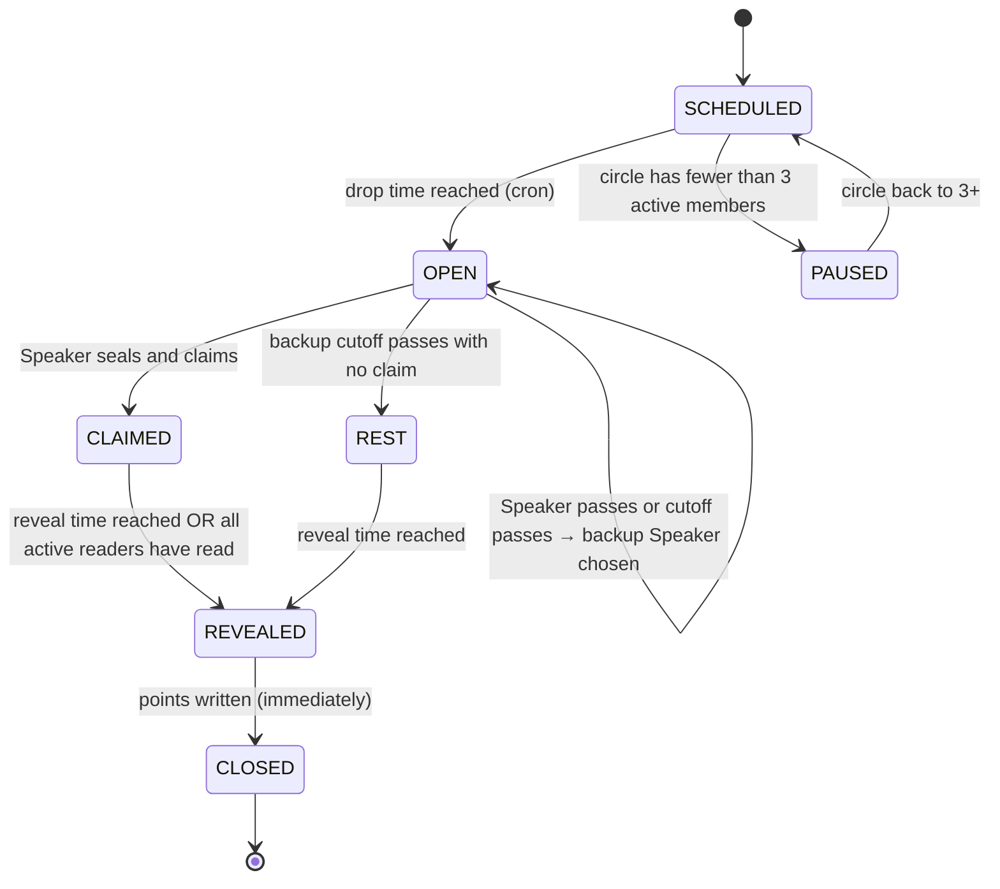
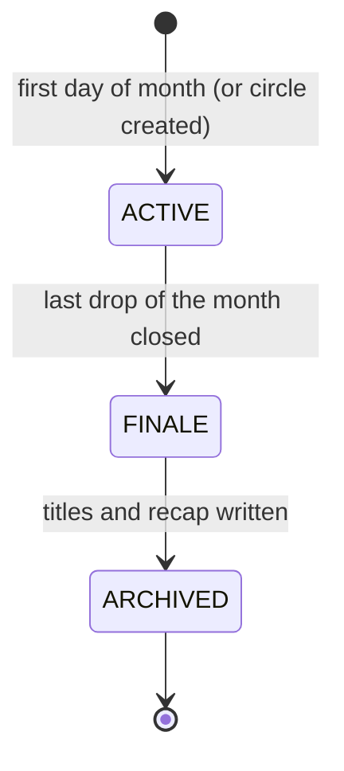

# State machine

> **In short:** a drop moves SCHEDULED → OPEN → CLAIMED → REVEALED → CLOSED, with a backup-Speaker loop and a rest-round branch; only the server changes state.

## Drop states

A rest day is scheduled directly as `REST` at the drop time.

In the database (`game.round_state`), REVEALED and CLOSED are one step, because points are already computed on every read (D-22). With two rounds a day, each round runs this machine on its own ([data model](../07-architecture/data-model.md#round-lifecycle-in-the-database)).

## Who can do what

| State | Speaker | Readers | Server |
|---|---|---|---|
| SCHEDULED | — | — | Open at drop time |
| OPEN | Seal (editable), claim, pass | See "secret Speaker" placeholder | Swap Speaker at cutoff |
| CLAIMED | Nothing (seal locked) | Read, change read, guess | Reveal at time or when all have read |
| REST | Answer prompt | Answer prompt | Reveal at time |
| REVEALED | React | React | Score, then close |
| CLOSED | React | React | — |
| PAUSED | — | — | Resume when 3+ members |

## Events and validation

The server rejects any action not allowed in the current state.

| Action | Valid when | Rejected if |
|---|---|---|
| `seal` | State OPEN, caller is current Speaker | Not Speaker; value outside the stat's allowed range; state not OPEN |
| `claim` | State OPEN, caller is current Speaker, seal exists | No seal yet; already claimed |
| `pass` | State OPEN, caller is current Speaker | Already claimed |
| `read` | State CLAIMED, caller is an active member, not the Speaker | Caller is Speaker; state not CLAIMED |
| `guess` | Same as read | Value outside allowed range |
| `react` | State REVEALED or CLOSED, caller is a member | Emoji not in preset list |

Every action carries a client-generated **idempotency key**, so retries after a
network failure don't double-submit ([API](../07-architecture/api-and-realtime.md)).

## Timers

| Timer | Default | Fires |
|---|---|---|
| Drop open | 08:00 | SCHEDULED → OPEN or REST |
| Speaker cutoff | 13:00 | Choose backup Speaker |
| Backup cutoff | 18:00 | OPEN → REST |
| Reveal | 21:00 | CLAIMED/REST → REVEALED |

A scheduler job runs every minute and advances any drop whose time has
passed ([ADR-005](../07-architecture/adr/ADR-005-scheduled-drops.md)). Early
reveal is triggered by the `read` action when it's the last missing read.

## Season states

