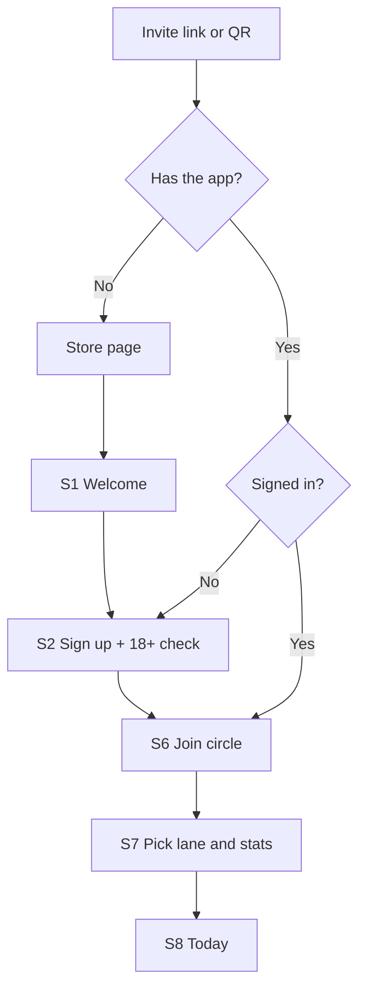
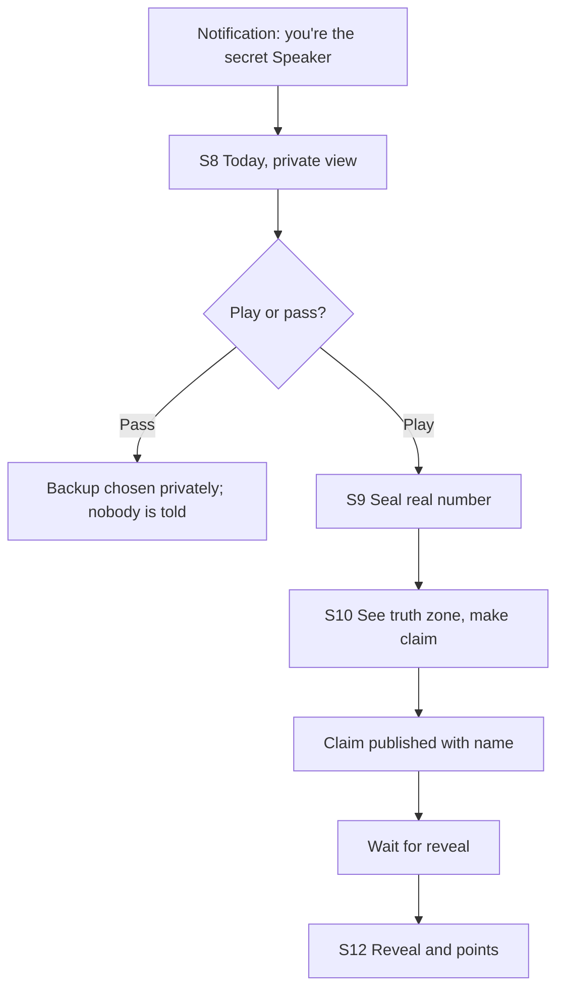
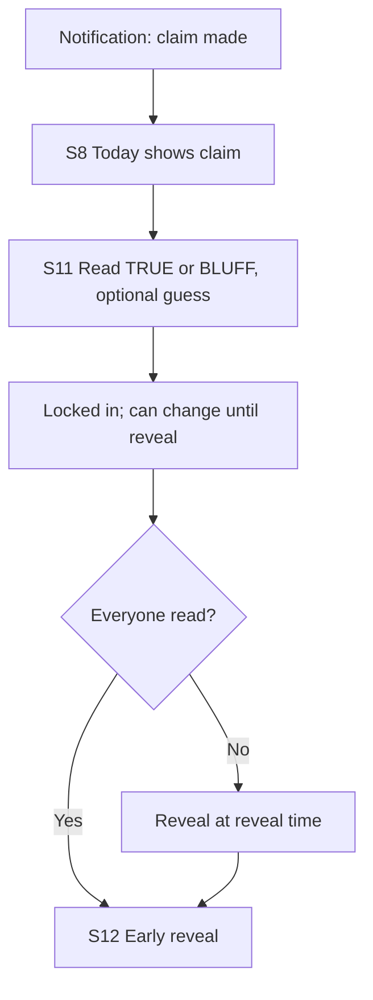
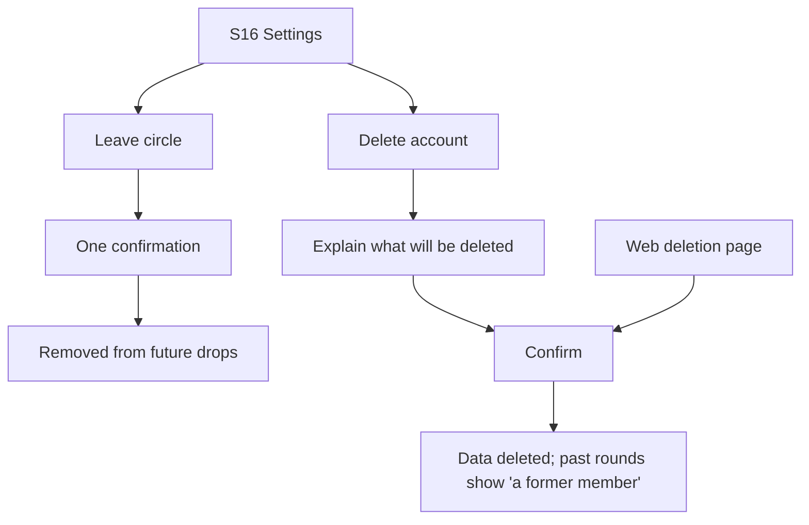

# Flows

> **In short:** four diagrams covering how people get in, speak, read and leave; screen ids match the [screen inventory](screens.md).

## Onboarding and joining

## Speaker's turn

## Reader's turn

## Leaving and deleting

