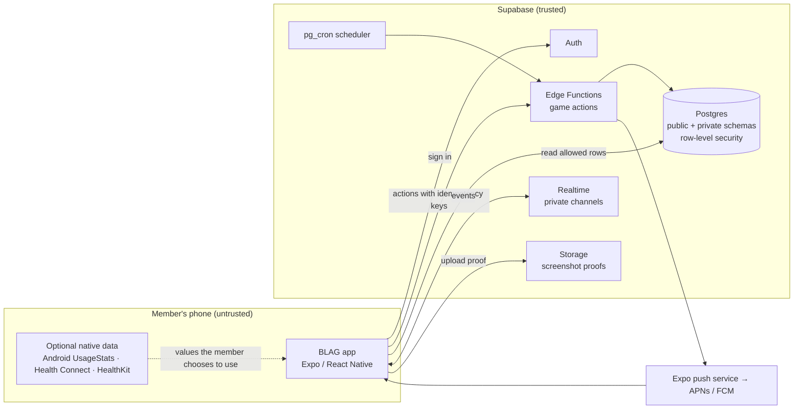

# Architecture

> **In short:** a React Native app talks to Supabase; all game decisions (timing, truth, points) happen on the server, and sealed numbers sit in a private schema clients can never read.

## System context



**Trust boundary:** everything on the phone is untrusted. The server never
accepts a score, a state change or a reveal from a client.

## Components

| Component | Responsibility | Key rule |
|---|---|---|
| App | Screens, input, animation, offline queue | Never computes points or truth |
| Game engine (shared TypeScript package) | Pure functions: truth zone, scoring, titles, Speaker choice | No I/O; fully unit-tested; used by Edge Functions |
| Edge Functions | Validate and apply every game action | Check state machine and membership on every call |
| Postgres | Source of truth | Row-level security on every public table; seals in `private` schema |
| Scheduler (pg_cron) | Open drops, cutoffs, reveals, season close | Idempotent jobs; runs every few minutes |
| Realtime | Tell clients something changed | Private channels per circle; payloads carry ids, not secrets |
| Storage | Screenshot proofs | Readable only after the reveal, only by circle members |
| Push | Notifications | Text never contains stats or Speaker identity before claim |

## Proposed code layout (when development starts)

```text
blag/
├── app/                    # Expo app (screens, navigation, UI)
├── packages/
│   └── game-engine/        # pure TS: truthZone(), score(), assignTitles(), pickSpeaker()
├── supabase/
│   ├── migrations/         # SQL schema, RLS policies
│   ├── functions/          # Edge Functions (one per action)
│   └── tests/              # RLS and SQL tests
├── modules/                # native modules (Android usage, later)
├── kb/                     # this knowledge base
└── scripts/
```

## Architecture principles

1. **Server-authoritative** (ADR-003): the client asks; the server decides.
2. **Pure game engine**: every rule in [game design](../03-game-design/README.md) is a pure function with tests.
3. **Least data**: store only what a feature needs ([data inventory](../10-privacy-security/data-inventory.md)).
4. **Idempotent everything**: every action and job can safely run twice.
5. **Provider pattern for stats**: manual, Android and health providers share one interface (ADR-004).
6. **Boring technology**: few services, managed where possible (ADR-001, ADR-002).

## Pages

| Page | What it covers |
|---|---|
| [Data model](data-model.md) | Tables, keys, who can read what |
| [API and realtime](api-and-realtime.md) | Every action, scheduled job and realtime event |
| [Sealing and fairness](sealing-and-fairness.md) | How hidden values stay hidden and scoring stays honest |
| [ADRs](adr/README.md) | Architecture decisions and their reasons |
