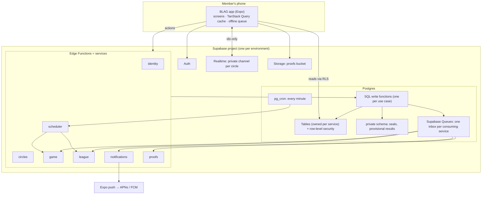
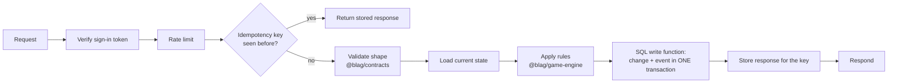
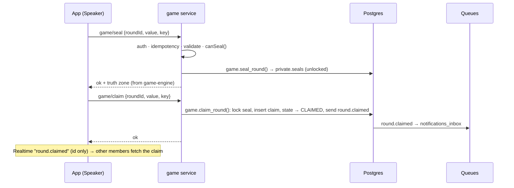
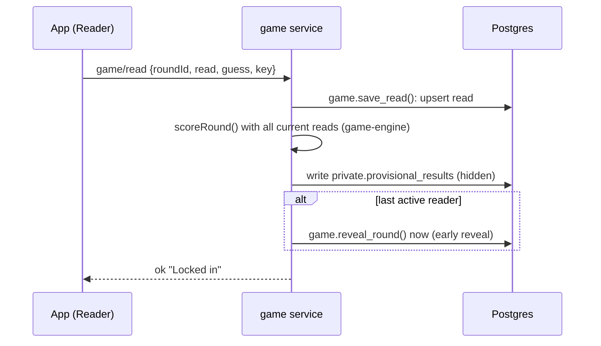
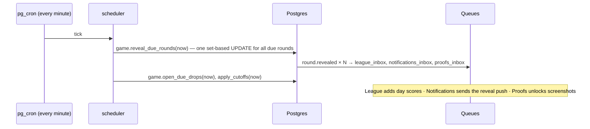

# Backend blueprint

> **In short:** every action goes through the same pipeline (check who you are, check you haven't sent it before, check the shape, apply the game rules, save the change and its event in one database transaction); points are worked out as people read, so the evening reveal is just a quick switch that scales to thousands of circles at once.

Builds on the [service map](services.md) (who owns what) and
[API and realtime](api-and-realtime.md) (the list of actions). The user-facing
words for each step are in the [UX language map](../06-design/ux-language.md).

## Containers (C4 level 2)



## Inside a service

### Layers

| Layer | Job | Example in `game/claim` | May import |
|---|---|---|---|
| **Handler** | Parse HTTP, auth token, idempotency key; return a response | `handlers/claim.ts` | use cases, `_shared` |
| **Use case** | One business action, start to finish | `usecases/make-claim.ts` | domain, data |
| **Domain** | The rules, pure | `@blag/game-engine`: `isTruth`, `canClaim` | nothing |
| **Data** | Read state; call one SQL write function | `data/rounds.ts` → `game.claim_round()` | `_shared/db` |

Folder for each service:

```text
supabase/functions/game/
├── index.ts            # tiny router: "/claim" → handlers/claim.ts …
├── handlers/           # one file per action
├── usecases/           # one file per business action
├── data/               # queries and calls to SQL write functions
└── events/             # handlers for events from this service's inbox
```

The SQL write functions live in migrations (`supabase/migrations/…_game_functions.sql`).

### The request pipeline (every action)



**Why one SQL function per write:** Supabase Queues live inside Postgres, so a
SQL function can save the change *and* put the event on the queue in a single
transaction. Either both happen or neither does, so no event is ever lost or
sent for a change that didn't save. The function also re-checks the state
(e.g. "still OPEN?") with a row lock, which closes race conditions.

## Key flows

### 1. Seal and claim ("Lock it in" → "Drop your number")



### 2. Read, and score on write ("Call it")



**Score on write:** each read is followed by a recompute of that round's
points (at most 7 reads, so it's instant) into a hidden table. At reveal time
nothing needs computing: the reveal just copies the seal value and the
provisional points into the visible results and flips the state. This makes the
9pm rush cheap.

### 3. Scheduled reveal ("The Reveal")



### 4. Season close ("Season Wrap")

1. Scheduler, first tick after local midnight on the 1st: `league.close_due_seasons(now)`.
2. League computes best-20 season scores from `day_scores` (already up to date from events).
3. `assignTitles()` from the game engine; titles written.
4. `season.finale_ready` → Notifications ("Season's over! Your title is waiting 🏆").
5. New season row created.

### 5. Delete account ("Delete everything")

1. `identity/delete-account` → SQL: mark account deleting, send `account.deleted` to every inbox.
2. Each service deletes or anonymises its own rows when it handles the event.
3. Identity deletes the auth user last; a completion record (no personal data) is kept.

## Event catalogue

All payloads carry ids and timestamps only, never stat values or names.

| Event | v | Producer | Consumers | Payload |
|---|---|---|---|---|
| `drop.opened` | 1 | game | notifications (Speaker nudge) | `dropId, circleId, speakerId` (to the Speaker's push only) |
| `round.claimed` | 1 | game | notifications | `roundId, circleId` |
| `round.revealed` | 1 | game | league, notifications, proofs | `roundId, circleId, seasonId, localDate` |
| `league.updated` | 1 | league | (realtime only) | `seasonId, circleId` |
| `season.finale_ready` | 1 | league | notifications | `seasonId, circleId` |
| `circle.member_joined` | 1 | circles | game | `circleId, userId` |
| `circle.member_left` | 1 | circles | game, league | `circleId, userId` |
| `consent.changed` | 1 | circles | game | `userId, statId, on` |
| `account.deleted` | 1 | identity | all | `userId` |

Rules: events are versioned (`v`); consumers ignore fields they don't know;
every handler is idempotent (keyed on event id).

## Queues

| Queue (inbox) | Read by | Every | Batch | Retry | Dead letter |
|---|---|---|---|---|---|
| `league_inbox` | league | 1 min | 100 | Message stays if handler fails; retried next run [S-71] | Moved to `league_dlq` after 5 attempts |
| `notifications_inbox` | notifications | 1 min | 500 | Same | `notifications_dlq` |
| `game_inbox` | game | 1 min | 100 | Same | `game_dlq` |
| `proofs_inbox` | proofs | 5 min | 100 | Same | `proofs_dlq` |

A small `event_subscriptions` table says which inboxes receive each event, so
adding a new consumer is a data change, not a code change in the producer.

## Scheduler timings

`pg_cron` calls `scheduler` **every minute** (ADR-005). Each tick runs, in order:
`open_due_drops` → `apply_cutoffs` → `reveal_due_rounds` → `close_due_seasons` →
`cleanup_retention` (hourly). All are idempotent set-based SQL updates that only
touch rows whose time has passed.

## Service-level objectives

| Objective | Target | Measured by |
|---|---|---|
| Reveal visible after reveal time | 99% within 2 minutes | `revealed_at − reveal_at` |
| Action success (excluding user errors) | 99.5% | Error logs per action |
| Action speed | p95 under 800 ms from India | Function timing logs |
| Reveal push delivered | 95% within 5 minutes | Notification log vs reveal time |
| Seal never readable before reveal | 100% (security invariant) | Access-rule tests on every change |

## Capacity estimate *(Estimate)*

Scenario: **10,000 circles, 5 members on average (50,000 people)**.

| Per day | Count |
|---|---|
| Claims | ~10,000 |
| Reads (incl. changes) | ~60,000 |
| Reactions | ~100,000 |
| Pushes | ~150,000 |

**Peak:** if most circles keep the default 9pm reveal, ~7,000 rounds reveal in
the same minute. With score-on-write, that's one SQL update plus ~7,000 queue
messages per inbox; League and Notifications drain them in a few minutes of
batches. App traffic at 9pm: roughly 35,000 people opening the reveal within 10
minutes, about 60 reads per second, well within a managed Postgres.
*Mitigation if needed:* suggest staggered default reveal times (e.g. 8:30, 9, 9:30).

## Errors

| Code | Meaning | App behaviour |
|---|---|---|
| `not_member` | Not in this circle | Return to Home |
| `wrong_state` | e.g. claim after the cutoff | Refresh the drop; friendly "That moment has passed" |
| `not_speaker` | Not today's Speaker | Refresh |
| `invalid_value` | Out of range | Inline message on the number pad |
| `circle_full` | 8 members already | "This circle is full" |
| `rate_limited` | Too many actions | Wait and retry quietly |
| `internal` | Our fault | Retry with the same idempotency key, then "That didn't go through. Try again?" |

## Observability

- **Logs:** JSON lines with `requestId`, `eventId`, `service`, `action`, `circleId`, `durationMs`, `outcome`. Never stat values, names or tokens.
- **Metrics (from logs and SQL):** actions per minute, p95 duration, error rate per action, queue depth per inbox, dead-letter count, reveal lag, push failures.
- **Alerts:** reveal lag over 5 minutes; any dead-letter message; error rate over 2% for 10 minutes; queue depth growing for 15 minutes.
- **Tracing:** the `requestId` is copied into the event, so one user action can be followed across services.

## Security per layer

| Layer | Control |
|---|---|
| App | No secrets bundled; only the public key; token in secure storage |
| Handler | Verify sign-in token; rate limit; reject unknown fields |
| Use case | Check membership and Speaker role every time |
| Data | Service-role key only inside functions; SQL functions re-check state with row locks |
| Database | Row-level security on all public tables; `private` schema not exposed to clients |
| Realtime | Private channels; ids-only payloads |
| Storage | Proofs readable only by circle members after reveal |

## Runbooks

| Symptom | First checks | Fix |
|---|---|---|
| Reveals late | `cron.job_run_details` for scheduler failures; function logs | Re-run the tick (idempotent); fix the failing step |
| Queue growing | Consumer function errors; dead-letter messages | Fix the handler; move dead letters back to the inbox |
| Pushes failing | Expired tokens; push service status | Delete invalid tokens; retry |
| Migration failed on deploy | CI logs | Fix forward with a new migration; never edit an applied one |
| Suspected seal leak | Access-rule tests; recent policy changes | Revert the policy; investigate; follow the breach plan (DPDP 72-hour notice, [compliance](../10-privacy-security/compliance.md)) |

## Open items

- Confirm Supabase Queues' visibility-timeout and read-count fields for the dead-letter rule.
- Load-test the 9pm peak with seeded circles before the beta.
