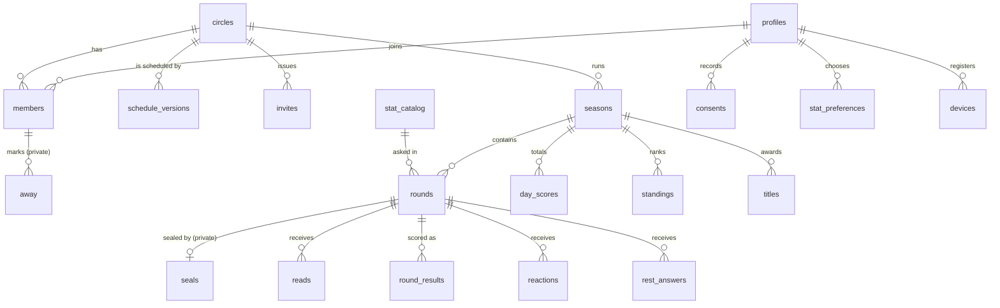
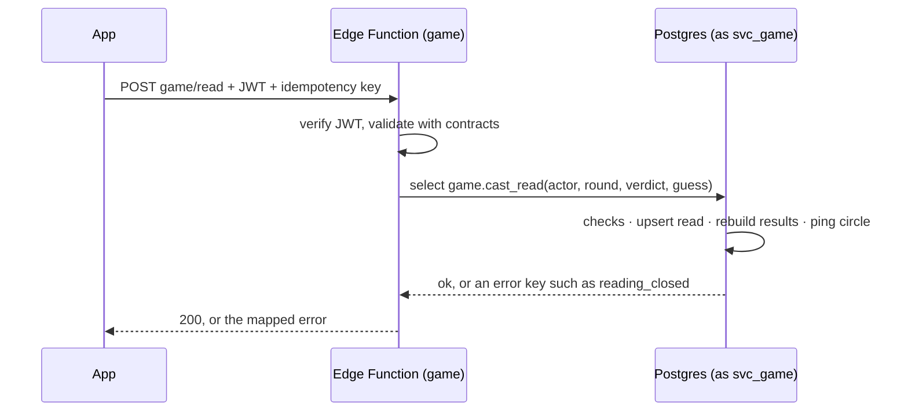

# Data model

> **In short:** one Postgres schema per service; the app can only *read*, through `api` views that show each person their own circles; every write goes through an Edge Function that may only run its own service's functions; the sealed number sits in a `private` schema nobody can read and is deleted at the reveal.

The schema is real: it lives in [`supabase/migrations`](https://github.com/VIsHnu1762/blag/tree/main/supabase/migrations)
(13 files, plain SQL, ADR-011) and is tested by [`supabase/tests`](https://github.com/VIsHnu1762/blag/tree/main/supabase/tests)
(49 pgTAP checks). When this page and the migrations disagree, **the migrations win**; fix this page.
Names follow the [glossary](../00-start-here/glossary.md) code names.

## Schemas

| Schema | Owner (service) | Holds | Exposed to the app? |
|---|---|---|---|
| `identity` | identity | profiles, consents, stat preferences | No (read through `api`) |
| `circles` | circles | circles, schedule versions, members, away, invites, blocks, reports | No |
| `game` | game | stat catalogue, rounds, reads, results, reactions, rest answers | No |
| `league` | league | seasons, day scores, standings, titles | No |
| `notify` | notifications | devices, preferences, delivery log | No |
| `ops` | scheduler + platform | idempotency keys, audit log, feature flags, blocked terms, deletion requests | No |
| `private` | game | sealed numbers | **Never**: no grants, no policies |
| `api` | (read model) | views and two read-only functions | **Yes, the only one** |

## Entity diagram

A **drop** is not a table: it is all rounds of one circle on one day, `(circle_id, play_date)`, with `slot` 1 or 2 (D-29).

## Tables

Every column, type and constraint is in the migration files; this is the map.

| Table | What it holds | Key rules |
|---|---|---|
| `game.stat_catalog` | One row per stat (`ST-01`…) with unit, range and honest-range floor | Seeded from `kb/data/stats.yaml`; `is_health` marks steps and sleep (D-39) |
| `identity.profiles` | Display name, preset avatar, locale, time zone | 1–24 character name; **no date of birth**, only `age_attested_at` (D-27) |
| `identity.consents` | Append-only ledger: purpose, stat, granted or withdrawn, notice version | Health stats need their own `health_stats` consent (D-39) |
| `identity.stat_preferences` | Which stats a person will be asked about (their focus lane) | Enabling needs a granted consent (checked in the write function) |
| `circles.circles` | Name, home time zone, member cap 3–8 | |
| `circles.schedule_versions` | Drop time, rounds per day, reveal times, from a date | Takes effect from a future date; 2 reveals ≥ 3 hours apart; first reveal ≥ 4 hours after the drop (D-29) |
| `circles.members` | Membership, organiser role, joined and left times | One active organiser per circle |
| `circles.away` | Away days (F-13) | Readable only by the member themselves |
| `circles.invites` | 8-character code, expiry (7 days), max uses (7) | Members-only; purged a day after expiry |
| `circles.blocks`, `circles.reports` | Block list and reports (Apple 1.2, D-42) | Reports answered within 24 hours |
| `league.seasons` | One per calendar month per circle | Seasons in a circle can never overlap; one active at a time |
| `game.rounds` | One round: card type, state, stat, prompt, Speaker, four times, claim, revealed value, truth zone | Unique per circle, date and slot; the times must be in order; a revealed stat round must carry its value, zone and verdict |
| `private.seals` | The real number | Written once; deleted at the reveal, or when a backup Speaker takes over |
| `game.reads` | TRUE or BLUFF plus an optional guess | Changeable until the reveal |
| `game.round_results` | Points per person per round | Rebuilt on every read (D-22); reader 0–4, Speaker 0–3 |
| `game.reactions` | Emoji from a fixed set of six | No free text (D-42) |
| `game.rest_answers` | Rest-card choice, as an option key | Hidden until the reveal; no points |
| `league.day_scores` | Points per person per day | 0–8 (two rounds × 4) |
| `league.standings` | Best-20 total, days played, rank | D-16 |
| `league.titles` | One title per member per season | |
| `notify.devices`, `notify.preferences`, `notify.deliveries` | Push tokens, quiet hours, daily cap, delivery log | Log kept 30 days; `dedupe_key` stops double sends |
| `ops.*` | Idempotency (48 h), audit log (never stat values), flags, blocked terms, deletion requests | No client access |

## Round lifecycle in the database

Follows the [state machine](../03-game-design/state-machine.md).

| State | Meaning | Who moves it on |
|---|---|---|
| `scheduled` | Created ahead of the drop | scheduler at drop time → `open`, or `paused` if under 3 members |
| `open` | The Speaker may seal, then claim, before their cutoff | `game.claim` → `claimed`; scheduler picks a backup at the first cutoff; at the backup cutoff it becomes a rest card (`rest`) |
| `claimed` | Members read | last read reveals early; otherwise the scheduler reveals at `reveal_at` |
| `rest` | Rest card (Sundays, or no claim) | scheduler at `reveal_at` |
| `revealed` | Everything visible; events sent | final |

`REVEALED` and `CLOSED` from the state machine are one step here: points already exist when the round reveals.

## Who can do what

| Role | Can | Cannot |
|---|---|---|
| `anon` (not signed in) | Nothing | Anything |
| `authenticated` (app user) | `SELECT` on chosen columns, filtered by RLS; read `api` views; call `api.me()` and `api.round_progress()` | Write any table; call any write function; read `private`, `ops`, `seed` or `speaker_attempt` |
| `svc_<service>` (one per Edge Function) | Run its own service's write functions | Read or write tables directly; run another service's functions |
| Table owner (migrations) | Owns everything; write functions run as owner | |
| `service_role` key | Not used by app code (CI and admin scripts only) | |

### What a member sees (RLS)

| Data | Visible to |
|---|---|
| Circle, schedule, members, invites, seasons, standings, titles, day scores | Active members of that circle |
| Rounds | Members; **the Speaker's identity only after the claim**, except to the Speaker (D-15, via `api.rounds`) |
| The real number | Nobody until the reveal (it is copied to the round at the reveal) |
| Reads, rest answers | Your own always; everyone's after the reveal |
| Results, reactions | After the reveal |
| "4 of 6 have read" | Members, as counts only (`api.round_progress`) |
| Away days, consents, stat preferences, devices, blocks, your reports | Only you |
| Profiles | Your own, plus name and avatar of people who share a circle with you |
| Realtime broadcasts on `circle:<id>` | Members only; nobody may send; payloads carry ids, never numbers |

## How a write happens

Error keys raised by the functions (`not_speaker`, `speaker_window_closed`, `seal_first`, `already_sealed`,
`value_out_of_range`, `not_member`, `speaker_cannot_read`, `reading_closed`, `round_not_found`) map one-to-one
to `@blag/contracts` errors.

## Events and jobs

| Event | From | To queue |
|---|---|---|
| `round.revealed` | game | `league_inbox` (stat rounds), `notify_inbox` (all) |
| `member.left` | circles | `game_inbox` |
| `user.deletion_due` | identity | `circles_inbox`, `game_inbox` |
| `season.closed` | league | `notify_inbox` |

Each inbox has a `*_dlq` dead-letter queue (after 5 attempts). `pg_cron` calls the scheduler every minute and
purges expired idempotency keys, old delivery logs and expired invites. The project URL and scheduler secret come
from Supabase Vault.

## Deletion behaviour

| When | What happens |
|---|---|
| Member leaves a circle | `left_at` set; future rounds exclude them; past rows stay for the circle's history |
| Account deleted | After the undo window the identity service deletes the auth user through the Auth admin API; profile, consents, preferences, devices, memberships, reads, results, reactions and any unrevealed seal cascade away. Rounds they spoke in keep their numbers as anonymous circle history with `speaker_id = null`, shown as "a former member" |
| Round revealed | The sealed row is deleted in the same transaction |
| Circle archived | Rounds stop; data retained per the [retention policy](../10-privacy-security/data-inventory.md) |

## Testing

| Suite | Checks |
|---|---|
| `supabase/tests/sql/game_rules.test.sql` (25) | Truth zone, guards, seal-once, scoring with ties, early reveal, timed reveal, rest cards, seal deletion, queued events, schedule rules |
| `supabase/tests/rls/access_rules.test.sql` (24) | Speaker secrecy, own-read-only before reveal, counts-only progress, `private` denied, hidden columns, no direct writes, away privacy, realtime for members only, outsiders see nothing, service roles limited to functions |

Run with `supabase test db` (needs Docker), or without Docker:
`PGTAP_SQL=/path/to/pgtap.sql scripts/db/test-local.sh` against any local Postgres.

## Changed from the first model

| Before | Now | Why |
|---|---|---|
| `drops` table with one round each | Rounds keyed by date and slot | 1 or 2 rounds a day (D-29) |
| Invite code stored hashed | Plain code, members-only, 7 days, 7 uses | Members must be able to re-share it; short life limits risk |
| `round_results.points` as JSON | One row per person per round | Simpler access rules and queries |
| `trust_level` and `proof_path` on seals | `input_method` only | Screenshot proof deferred (D-43) |
| `paused` column on members | `circles.away` table | Readable only by the member |
| Idempotency keys 48 h | Unchanged (48 h) | |
