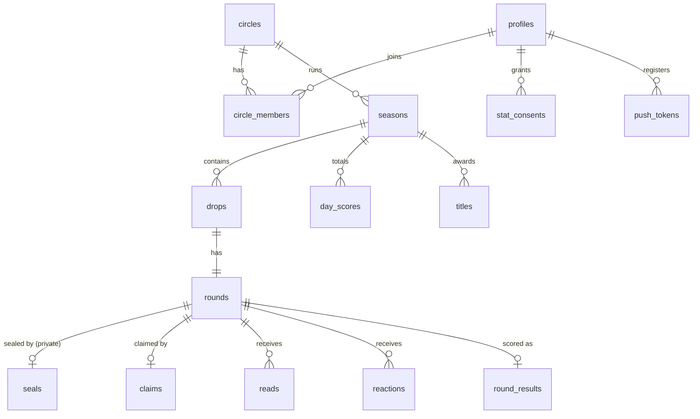

# Data model

> **In short:** circles contain seasons, seasons contain daily drops, each drop has one round; the sealed value lives in a private table that only the server can read.

Replaces the original spec's temporary "rooms" model (D-03). Names follow the
[glossary](../00-start-here/glossary.md) code names.

## Entity diagram

## Tables

| Table | Key columns | Notes |
|---|---|---|
| `profiles` | `id` (= auth user), `display_name`, `avatar_color`, `adult_confirmed_at`, `created_at` | No real name required |
| `circles` | `id`, `name`, `home_tz`, `drop_time`, `speaker_cutoff`, `backup_cutoff`, `reveal_time`, `invite_code_hash`, `created_by`, `archived_at` | Invite code stored hashed |
| `circle_members` | `circle_id`, `user_id`, `role` (owner/member), `focus_lane`, `paused`, `joined_at`, `left_at` | Max 8 active per circle (enforced in function) |
| `stat_consents` | `user_id`, `stat_id`, `granted_at`, `extra_confirmed_at`, `revoked_at` | One row per stat; catalogue ids from `stats.yaml` |
| `seasons` | `id`, `circle_id`, `starts_on`, `ends_on`, `status` | One per calendar month |
| `drops` | `id`, `circle_id`, `season_id`, `local_date`, `card_type` (stat/rest), `state`, `opens_at`, `speaker_cutoff_at`, `backup_cutoff_at`, `reveal_at` | Unique (`circle_id`, `local_date`); times stored in UTC |
| `rounds` | `id`, `drop_id`, `stat_id`, `prompt_key`, `speaker_id`, `speaker_attempt`, `claimed_at`, `revealed_at` | `speaker_id` hidden from others until `claimed_at` (see below) |
| `private.seals` | `round_id`, `value`, `trust_level`, `proof_path`, `sealed_at`, `locked` | **Private schema: no client access** |
| `claims` | `round_id`, `value`, `is_truth` (null until reveal) | `is_truth` written only at reveal |
| `reads` | `round_id`, `reader_id`, `read` (TRUE/BLUFF), `guess`, `updated_at` | Unique (`round_id`, `reader_id`) |
| `round_results` | `round_id`, `revealed_value`, `half_width`, `points` (jsonb by user), `computed_at` | Written once by the server |
| `day_scores` | `season_id`, `user_id`, `local_date`, `points` | Feeds the best-20 season score |
| `titles` | `season_id`, `user_id`, `title_key`, `reason_key` | Exactly one per qualifying member |
| `reactions` | `round_id`, `user_id`, `emoji`, `created_at` | Emoji from a fixed list; never aggregated in UI |
| `rest_answers` | `drop_id`, `user_id`, `choice` | Hidden until reveal |
| `push_tokens` | `user_id`, `token`, `platform`, `updated_at` | Deleted on sign-out and account deletion |
| `idempotency_keys` | `user_id`, `key`, `action`, `response`, `created_at` | Expire after 48 hours |

## Who can read what (row-level security)

| Table | Member of the circle can read | Notes |
|---|---|---|
| circles, circle_members, seasons, drops | Yes | Members see `paused` only for themselves |
| rounds | Yes, but `speaker_id` only after `claimed_at`, or if they *are* the Speaker | Expose via a view that nulls `speaker_id` |
| private.seals | **No one** (service role only) | Value copied to `round_results` at reveal |
| claims | After `claimed_at` | `is_truth` null until reveal |
| reads, rest_answers | Own row always; others' rows only after `revealed_at` | |
| round_results, day_scores, titles | Yes | |
| reactions | After reveal | |
| stat_consents, push_tokens | Own rows only | |
| profiles | Own row; display name and avatar of people sharing a circle | |

Every rule above becomes an automated test ([quality](../11-quality/README.md)).

## Deletion behaviour

| When | What happens |
|---|---|
| Member leaves a circle | `left_at` set; future drops exclude them; their past rows stay for the circle's history |
| Account deleted | Profile, consents, tokens, seals and reads deleted; `round_results.points` keys replaced by an anonymous id; display shows "a former member" |
| Circle archived | All drops stop; data retained per the [retention policy](../10-privacy-security/data-inventory.md) |
