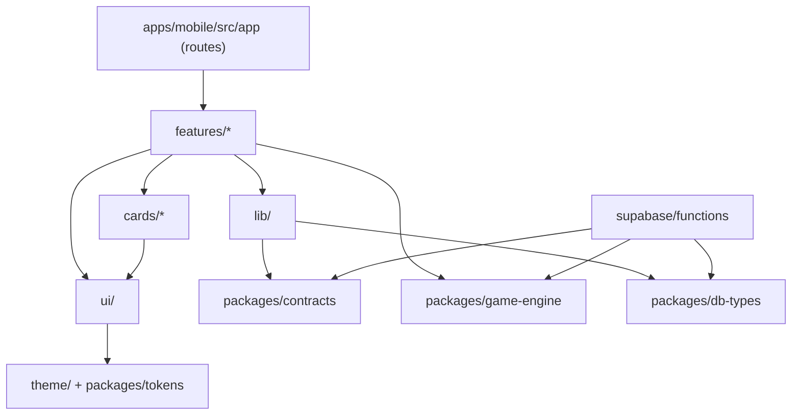

# Repository structure

> **In short:** one monorepo with an `apps/` folder (the Expo app now, a small web app later), a `packages/` folder for code shared across apps and the server (game engine, contracts, config), and `supabase/` for the database and server functions; features are self-contained folders with strict import rules, so the codebase can grow from one developer to a team without a rewrite.

Status: **Proposal** (ADR-008, ADR-009, ADR-010). What exists today: `supabase/migrations` (13 files), `supabase/tests` (pgTAP) and `scripts/db`. Everything else is the plan.
Create folders **only when the first file needs them** (see [growth plan](#growth-plan-create-folders-only-when-needed)).

How this measures up against enterprise practice is in the [enterprise standards scorecard](enterprise-standards.md); a plain-language tour of every part is in the [learning guide](learning-guide.md).

## Goals

| Goal | How the structure supports it |
|---|---|
| One person can start fast | Small number of top-level folders; Expo defaults kept |
| A team can join later | Feature folders with owners; clear rules on what may import what |
| Game rules are identical everywhere | One pure `game-engine` package used by the app and the server |
| The server stays the authority | All scoring and state live under `supabase/`; the app only sends intents (ADR-003) |
| New card types (movies, memes, music) plug in | Card types are modules behind one interface (P-38 to P-41) |
| AI agents can work safely | Predictable paths, a where-does-it-go table, `AGENTS.md` at the root |
| Optimisation later without restructuring | Caching, lazy routes, build caching and grouped server functions are planned in |

## Top level

```text
blag/
├── apps/
│   ├── mobile/                  # Expo + React Native app (iOS, Android)            ← MVP
│   └── web/                     # Plain static pages: landing, invite, privacy, account deletion (D-31)   ← MVP
├── packages/
│   ├── game-engine/             # Pure TypeScript game rules: truth zone, scoring, titles, Speaker choice  ← MVP
│   ├── contracts/               # Shared API types, validation schemas, error codes, realtime events     ← MVP
│   ├── db-types/                # Types generated from the database schema (never hand-edited)          ← MVP
│   ├── tokens/                  # Design tokens: colours, type, spacing (from kb/05-brand)               ← Next
│   ├── ui/                      # Shared design-system components, if a second app needs them            ← Later
│   └── config/                  # Shared tsconfig, ESLint and Prettier presets                            ← MVP
├── supabase/
│   ├── config.toml              # Local Supabase settings
│   ├── migrations/              # SQL schema and row-level-security changes, in order
│   ├── functions/               # Edge Functions (Deno), grouped by domain
│   ├── tests/                   # SQL tests for access rules (pgTAP)
│   └── seed.sql                 # Local test data (fake circles, never real people)
├── kb/                          # This knowledge base
├── scripts/
│   ├── kb.py                    # Knowledge-base build and check
│   ├── db/                      # test-local.sh + supabase-stubs.sql: run migrations and pgTAP without Docker
│   ├── gen-stats-catalog.ts     # kb/data/stats.yaml → game-engine catalogue + SQL seed     ← Prototype
│   ├── gen-db-types.sh          # supabase gen types → packages/db-types                     ← Prototype
│   └── seed-demo.ts             # Fake circles for local play, never real people              ← Prototype
├── .github/
│   ├── workflows/               # ci.yml, kb.yml, deploy-backend.yml, codeql.yml, e2e.yml
│   ├── PULL_REQUEST_TEMPLATE.md # Only if a branch workflow is ever added (D-35)
│   ├── ISSUE_TEMPLATE/          # bug.yml, feature.yml
│   ├── renovate.json            # Dependency updates
│   └── CODEOWNERS               # ← Later, when a second person joins
├── .changeset/                  # Release notes and versions (Changesets, D-32)
├── .claude/skills/              # Design skills for agents: impeccable, intent (8), taste (D-25)
├── skills-lock.json             # Pinned sources and hashes of those skills
├── .vscode/                     # Recommended extensions and settings
├── PRODUCT.md                   # Product context read by the Impeccable design skill
├── AGENTS.md  CLAUDE.md  README.md  CONTRIBUTING.md  SECURITY.md  CHANGELOG.md  LICENSE
├── commitlint.config.js         # Conventional Commits check
├── package.json                 # Root: workspace scripts only, no app code
├── pnpm-workspace.yaml          # Declares apps/* and packages/*
├── turbo.json                   # Task graph and build cache (ADR-008)
├── tsconfig.base.json           # Strict TypeScript settings shared by all
├── .npmrc  .nvmrc  .editorconfig  .gitignore  .env.example
└── mkdocs.yml  requirements-docs.txt  llms.txt
```

Expo supports monorepos built with Bun, npm, pnpm or Yarn workspaces, and
configures its bundler for them automatically from SDK 52 onwards [S-67].

## `apps/mobile`

```text
apps/mobile/
├── app.config.ts                # App config per environment (dev, preview, production)
├── eas.json                     # EAS build and submit profiles
├── package.json
├── tsconfig.json                # Extends packages/config; "@/*" → src/*
├── assets/                      # Icons, splash, fonts, sounds, Rive/Lottie files
├── src/
│   ├── app/                     # ROUTES ONLY (Expo Router). Thin files that render feature screens
│   │   ├── _layout.tsx          # Root: AppProviders, fonts, error boundary
│   │   ├── +not-found.tsx
│   │   ├── join/[code].tsx      # Invite deep link (universal link / app link)
│   │   ├── (auth)/
│   │   │   ├── sign-in.tsx      # Email code, Google, Sign in with Apple (D-26)
│   │   │   ├── verify.tsx       # Enter the one-time code
│   │   │   └── age-check.tsx    # 18+ attestation (D-27)
│   │   ├── (onboarding)/
│   │   │   ├── welcome.tsx  lane.tsx  first-stat.tsx
│   │   ├── (main)/
│   │   │   ├── index.tsx        # Home: my circles
│   │   │   ├── circle/new.tsx
│   │   │   ├── circle/[circleId]/
│   │   │   │   ├── index.tsx    # Today's Drop (1 or 2 rounds, D-29)
│   │   │   │   ├── seal.tsx  claim.tsx  read.tsx
│   │   │   │   ├── reveal/[roundId].tsx
│   │   │   │   ├── league.tsx  invite.tsx  members.tsx
│   │   │   │   └── finale/[seasonId].tsx
│   │   │   ├── my-month.tsx
│   │   │   └── settings/
│   │   │       ├── index.tsx  notifications.tsx  stats.tsx  privacy.tsx
│   │   │       └── delete-account.tsx
│   ├── features/                # One folder per product feature (see anatomy below)
│   │   ├── auth/
│   │   ├── onboarding/
│   │   ├── circles/             # create, join, invite, leave
│   │   ├── consent/             # stats on/off, spicy and health confirmations, focus lane
│   │   ├── drop/                # today's state, catch-up card, rest day
│   │   ├── round/               # seal, claim, read, reveal, reactions
│   │   ├── league/
│   │   ├── finale/              # titles, moments, share card
│   │   ├── my-month/
│   │   ├── notifications/
│   │   └── account/             # settings, deletion
│   ├── cards/                   # Card-type UI plugins: stat (MVP), rest (MVP), movie/meme/music (later)
│   ├── ui/                      # App design system: Button, Card, Stamp, NumberPad, Avatar, Sheet
│   ├── providers/
│   │   └── AppProviders.tsx     # Query client, auth session, theme, i18n
│   ├── lib/                     # Infrastructure, no product logic
│   │   ├── supabase/            # Client, auth session, typed queries
│   │   ├── api/                 # Calls to Edge Functions with idempotency keys
│   │   ├── query/               # TanStack Query client, cache keys
│   │   ├── realtime/            # Circle channel subscription
│   │   ├── haptics/             # Seal, stamp and reveal haptics
│   │   ├── sound/               # Reveal and stamp sounds (respect silent mode)
│   │   ├── offline/             # Action queue for poor connections
│   │   ├── analytics/           # Wrapper that blocks stat values by design
│   │   ├── logging/             # Crash reporting with scrubbing
│   │   └── storage/             # SecureStore and local storage helpers
│   ├── i18n/                    # en.ts (the text catalogue), format.ts (numbers, durations)
│   ├── theme/                   # Reads tokens; light and dark themes
│   ├── config/                  # env.ts (typed environment), flags.ts (feature flags)
│   └── test/                    # Test helpers, fake API, fixtures
├── modules/                     # Local native modules (Expo Modules), added only when needed
│   ├── today-widget/            # iOS WidgetKit (Swift) + Android widget (Kotlin)    ← Later
│   └── android-usage/           # UsageStatsManager reader (Kotlin)                   ← Later
└── e2e/                         # Maestro end-to-end flows
```

In Expo Router, the `src/app` folder is only for routes: any other file placed
there is treated as a screen. Components, hooks and the rest live elsewhere in
`src/` [S-68].

### Feature folder anatomy

Every feature follows the same shape, so people and agents always know where to look:

```text
features/round/
├── index.ts                 # PUBLIC API: the only file other code may import
├── screens/                 # Full screens used by routes in src/app
│   ├── SealScreen.tsx
│   └── RevealScreen.tsx
├── components/              # Pieces used only inside this feature
│   └── TruthZoneHint.tsx
├── hooks/                   # useRound(), useSubmitRead() …
├── api.ts                   # Queries and mutations for this feature (uses lib/api, lib/query)
├── state.ts                 # Local UI state if needed
├── copy.ts                  # Keys into the i18n catalogue for this feature
└── __tests__/               # Component and hook tests
```

Rules: a feature never imports another feature's internals, only its `index.ts`.
Shared logic moves down into `ui/`, `lib/` or a package.

## `apps/web`

Plain static HTML on free hosting; under 30 KB per page, no framework (D-31).

```text
apps/web/
├── index.html                   # Landing page (built with the Taste skill, D-25)
├── privacy.html                 # Privacy policy
├── delete-account.html          # The only page with sign-in (email code), for deletion from the web
├── join/index.html              # Invite page: reads the code from the URL, opens the app or shows store buttons; loads no data
├── .well-known/
│   ├── apple-app-site-association   # iOS universal links for /join
│   └── assetlinks.json              # Android app links for /join
└── assets/                      # One small CSS file, icons
```

## `packages/`

```text
packages/game-engine/
├── src/
│   ├── truth-zone.ts            # truthZone(), isTruth()
│   ├── scoring.ts               # scoreRound()
│   ├── season.ts                # seasonScore() (best 20)
│   ├── titles.ts                # assignTitles()
│   ├── speaker.ts               # pickSpeaker(), pickStat()
│   ├── state-machine.ts         # allowed transitions per drop state
│   ├── cards/                   # Card-type rules: stat.ts, rest.ts (one interface for all)
│   ├── catalog/stats.ts         # Generated from kb/data/stats.yaml
│   └── index.ts
├── test/                        # Unit + property tests (Vitest, fast-check); edge-cases.test.ts covers E-1..E-25
└── package.json                 # No runtime dependencies. No React, no Supabase, no I/O

packages/contracts/
├── src/
│   ├── actions/                 # Request and response shapes, one file per service (identity.ts, circles.ts, game.ts …)
│   ├── events.ts                # Queue events between services (round.revealed …)
│   ├── realtime.ts              # Realtime event names and payloads (ids only)
│   ├── errors.ts                # Error codes shared by app and server
│   └── index.ts
└── package.json                 # Depends only on a schema library (e.g. zod)

packages/db-types/               # Output of `supabase gen types`; regenerated in CI
packages/config/                 # tsconfig presets, ESLint config, Prettier config
packages/tokens/                 # Design tokens as TypeScript (and later JSON for Figma)
```

The game engine is the most important package: it's where the rules in
[game design](../03-game-design/README.md) become code, tested once and used by
both the app (for instant previews such as the truth zone) and the server (for
the real result).

## `supabase/`

```text
supabase/
├── config.toml                  # Created by `supabase init` at kick-off; exposes only the `api` schema
├── migrations/                  # EXISTS. One change per file, never edited after it is applied
│   ├── 20261104000100_extensions.sql      # extensions, one schema per service, service roles
│   ├── 20261104000200_enums.sql
│   ├── 20261104000300_identity.sql        # stat catalogue, profiles, consents, stat preferences
│   ├── 20261104000400_circles.sql         # circles, schedule versions, members, away, invites, blocks, reports
│   ├── 20261104000500_league.sql          # seasons, day scores, standings, titles
│   ├── 20261104000600_game.sql            # rounds, reads, results, reactions, rest answers
│   ├── 20261104000700_private.sql         # sealed numbers
│   ├── 20261104000800_notifications.sql
│   ├── 20261104000900_ops.sql             # idempotency, audit, flags, blocked terms, deletion requests
│   ├── 20261104001000_rls.sql             # access helpers + row-level security
│   ├── 20261104001100_game_functions.sql  # truth zone, scoring, seal, claim, read, reveal
│   ├── 20261104001200_grants_api.sql      # least-privilege grants + api read views
│   └── 20261104001300_events_cron.sql     # queues and scheduled jobs
├── functions/                   # One folder per service (see the service map)
│   ├── deno.json                # Imports, including the shared packages
│   ├── _shared/                 # JWT check, errors, idempotency, db client per service role, rate limits
│   ├── identity/                # profile, consent, device registration, account deletion
│   ├── circles/                 # create, join, leave, invite, schedule, away, block, report
│   ├── game/                    # seal, claim, read, react, rest answer (uses packages/game-engine)
│   ├── league/                  # day scores, season close, titles (uses packages/game-engine)
│   ├── scheduler/               # tick: open drops, pick backups, rest cards, reveals (called by pg_cron)
│   ├── notifications/           # reads its queue, sends pushes
│   └── proofs/                  # screenshot proofs   ← Later (D-43)
├── tests/                       # EXISTS. pgTAP, run by `supabase test db`
│   ├── sql/game_rules.test.sql      # truth zone, scoring, guards, early and timed reveal
│   ├── rls/access_rules.test.sql    # who can see and run what
│   └── functions/               # Deno tests for Edge Functions   ← Prototype
└── seed.sql                     # Local test data (fake circles, never real people)
```

The database design, access rules and test commands are in the [data model](data-model.md).

Supabase recommends keeping shared function code in a folder whose name starts
with an underscore, and building a few larger functions that combine related
actions to reduce cold starts [S-69]. Inside each service the code is layered (handler → use case → domain → data); see the [backend blueprint](backend-blueprint.md#inside-a-service). BLAG follows that: each **service** from the [service map](services.md) is
one function folder, and each action from [API and realtime](api-and-realtime.md)
is a route inside it (ADR-010). Services talk to each other through events on a
queue, never by writing each other's tables. Importing code from outside `supabase/` (our
`packages/`) is supported for monorepos [S-70] *(verify the current deploy
command when setting up)*.

## Dependency rules



| Rule | Why |
|---|---|
| Arrows only point down. Nothing imports "upwards" | Prevents tangles as the app grows |
| `game-engine` imports nothing except the standard library | Rules stay pure and identical on app and server |
| Features import other features only through their `index.ts` | Each feature can change internally without breaking others |
| `src/app` files contain no logic; they render a feature screen | Routes can be reorganised freely |
| Only `lib/supabase` talks to Supabase directly | One place to change auth, retries and caching |
| Nothing in the app imports from `supabase/functions` | The server is a separate deployment |

Enforced in CI with an import-boundary lint rule (for example
`eslint-plugin-boundaries` or `dependency-cruiser`) *(Proposal, ADR-009)*.

## Naming conventions

| Thing | Convention | Example |
|---|---|---|
| Folders | kebab-case | `my-month/`, `truth-zone.ts` |
| React components and screens | PascalCase file and export | `RevealScreen.tsx` |
| Hooks | `use` + camelCase | `useSubmitRead.ts` |
| Pure functions | camelCase verbs | `scoreRound()` |
| Tests | Same name + `.test.ts(x)` | `scoring.test.ts` |
| Routes | Lowercase, glossary words | `circle/[circleId]/reveal.tsx` |
| Database | snake_case, glossary code names | `circle_members`, `reveal_at` |
| Edge Function routes | kebab-case verbs | `game/claim` |
| Environment variables | `EXPO_PUBLIC_` prefix only for values safe to ship in the app | `EXPO_PUBLIC_SUPABASE_URL` |
| Packages | `@blag/` scope | `@blag/game-engine` |

Use the [glossary](../00-start-here/glossary.md) words in code: `circle`,
`drop`, `round`, `seal`, `claim`, `read`, `reveal`, `season`, `speaker`.

## Environments

| Environment | Supabase | App build | Used for |
|---|---|---|---|
| `local` | `supabase start` on your machine | Expo dev client | Daily development |
| `preview` | Separate Supabase project | EAS "preview" profile, internal distribution | Testers and the beta |
| `production` | Separate Supabase project | EAS "production" profile, stores | Real users |

Secrets (service-role key, push credentials) live only in Supabase and EAS
secret stores, never in the repo. `.env.example` lists every variable with a
fake value.

## Where does it go?

| I want to add… | Put it in |
|---|---|
| A new screen | Route file in `apps/mobile/src/app/…` + screen in `features/<feature>/screens/` |
| A rule about points, truth or titles | `packages/game-engine` + a test, then update `kb/03-game-design` |
| A new server action | Route in the owning service's `supabase/functions/<service>/` + shapes in `packages/contracts` |
| Something one service must tell another | An event in `packages/contracts/src/events.ts`, written to the outbox, handled idempotently |
| A database table or policy | New file in `supabase/migrations/` + test in `supabase/tests/` + update [data model](data-model.md) |
| A new card type (e.g. movie) | Rules in `packages/game-engine/src/cards/`, UI in `apps/mobile/src/cards/` |
| A reusable button or stamp | `apps/mobile/src/ui/` (move to `packages/ui` only if a second app needs it) |
| A colour or font size | `packages/tokens` |
| User-facing text | `apps/mobile/src/i18n/` catalogue, checked against [voice and tone](../05-brand/voice-and-tone.md) |
| A native iOS or Android feature | `apps/mobile/modules/<name>/` as an Expo Module |
| A scheduled job | `supabase/functions/scheduler/` + a `pg_cron` entry in a migration |
| An end-to-end test | `apps/mobile/e2e/` |
| A decision | `kb/data/decisions.yaml`, or an ADR for technical ones |

## Built-in room to optimise later

| Area | Planned now | Turn on when |
|---|---|---|
| Build speed | Turborepo task cache | From day one; add remote cache when CI gets slow |
| App start time | Thin routes; heavy screens (finale, my month) loaded lazily | If cold start on a mid-range Android exceeds about 2 s |
| Lists | One list component wrapper in `ui/` | Swap the implementation without touching features |
| Network | TanStack Query cache, ids-only realtime events | Always on |
| Offline | `lib/offline` action queue with idempotency keys | MVP |
| Server cold starts | One function per service, not per action (ADR-010) | Always on |
| Hot service | Service boundaries with events | Extract that service into its own microservice ([service map](services.md#when-to-extract-a-service-into-its-own-microservice)) |
| Database | Indexes on `circle_id`, `season_id`, `local_date`, `round_id` | In the first migration |
| Updates | EAS Update channels per environment | For copy and bug fixes without store review (within store rules) |
| Native speed-ups | `modules/` for hot paths in Swift or Kotlin | Only if profiling shows a need |

## Growth plan: create folders only when needed

| Phase ([roadmap](../12-roadmap/README.md)) | What exists |
|---|---|
| 2. Prototype | `apps/mobile` (auth, circles, round, a basic league), `packages/game-engine`, `packages/contracts`, `packages/config`, `supabase/` with `game` and `scheduler` services |
| 3. MVP | All MVP features, `apps/web` static pages, `packages/db-types`, the remaining services (identity, circles, league, notifications), e2e flows, CI |
| 4. Beta | `packages/tokens`, analytics and crash reporting in `lib/`, preview environment |
| Later | `modules/today-widget`, `modules/android-usage`, the proofs service (D-43), new card types, `packages/ui` if a second app shares components |

## Open questions

- Exact deploy command for Edge Functions importing `packages/` [S-70].
