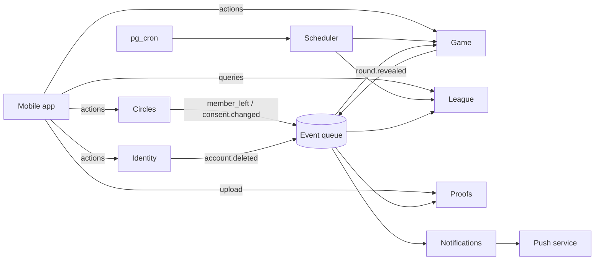

# Service map

> **In short:** BLAG is divided into seven services with clear jobs and their own data, talking to each other through events on a queue; they start as grouped Supabase Edge Functions in one project, and any of them can be moved out into its own microservice later without changing the others.

Status: **Proposal** (ADR-010, D-21).

## Why services now, separate deployments later

| Approach | For | Against for BLAG today |
|---|---|---|
| One big backend | Simplest | Hard to classify, optimise or hand over parts |
| **Service boundaries inside one Supabase project (chosen)** | Clear ownership and contracts; each service optimised on its own; cheap to run; one person can manage it | Shares one database (mitigated by ownership rules) |
| Full microservices (separate servers and databases) | Independent scaling and teams | Many deployments, network failures between services, data spread out, more cost; heavy for one developer before product-market fit |

The aim is a **modular** system: each service has its own code folder, its own
tables, its own actions and its own events. Because services never reach into
each other's internals, extracting one later is a move, not a rewrite.

## The services

| # | Service | Job | Owns data | Actions (from the app) | Emits events | Consumes events | Load profile |
|---|---|---|---|---|---|---|---|
| 1 | **Identity** | Accounts, age gate, profiles, deletion, push tokens | `profiles`, `push_tokens`, `idempotency_keys` | sign-up completion, profile update, register device, delete account | `account.deleted` | — | Low, spiky at sign-up |
| 2 | **Circles** | Circles, invites, membership, focus lanes, stat consent | `circles`, `circle_members`, `stat_consents` | create, join, leave, invite-reset, lane-set, consent-set | `circle.member_joined`, `circle.member_left`, `consent.changed` | `account.deleted` | Low |
| 3 | **Game** | Drops and rounds: Speaker choice, seal, claim, read, reveal, round scoring | `drops`, `rounds`, `private.seals`, `claims`, `reads`, `rest_answers`, `reactions`, `round_results` | seal, claim, pass, read, react | `drop.opened`, `round.claimed`, `round.revealed` | `circle.member_left`, `consent.changed`, `account.deleted` | Medium; peaks around reveal times |
| 4 | **League** | Day scores, best-20 season scores, finale, titles, recap | `seasons`, `day_scores`, `titles` | (read-only queries) | `league.updated`, `season.finale_ready` | `round.revealed`, `account.deleted` | Low, batch at month end |
| 5 | **Scheduler** | The clock: opens drops, applies cutoffs, triggers reveals, closes seasons | none (reads due times) | none (called by `pg_cron`) | — (calls Game and League) | — | Small, steady every few minutes |
| 6 | **Notifications** | Turns events into pushes; quiet hours; daily budget; no stats or Speaker leaks | `notification_log`, `notification_prefs` | update preferences | — | `drop.opened` (Speaker only), `round.claimed`, `round.revealed`, `season.finale_ready` | Bursty: many pushes at once |
| 7 | **Proofs** *(MVP-light)* | Screenshot upload, access only after reveal, deletion after 30 days | Storage bucket `proofs` | get upload URL, get view URL | — | `round.revealed`, `account.deleted` | Low; storage-bound |

Later candidates: **Cards** (movie, meme, music content), **Analytics**
(privacy-safe metrics), **Moderation** (for any future user content).

## How services talk

1. **App → service:** direct calls to that service's Edge Function, with an idempotency key.
2. **Service → service:** through **events**, not direct writes. A service writes the event to an *outbox* in the same database transaction as its change; a dispatcher puts it on a queue.
3. **Queue:** Supabase Queues, a pull-based message queue in Postgres [S-71]. An Edge Function reads a batch, processes it, and deletes each message; if processing fails, the message stays and is retried next run [S-71].
4. **Realtime to the app:** ids only, on private circle channels ([API and realtime](api-and-realtime.md)).

Every event handler must be **idempotent**: processing the same event twice gives
the same result.

## Data ownership rules

- Every table has **exactly one owning service**, listed above. Only the owner writes to it.
- Other services may **read** through a view or receive the data in an event; they never write.
- Row-level security still protects all client reads ([data model](data-model.md#who-can-read-what-row-level-security)).
- *(Later)* Move each service's tables into its own Postgres schema (`identity`, `circles`, `game`, …) once there's a second developer.

## Optimisation per service

| Service | What to optimise | How |
|---|---|---|
| Game | Reveal-time latency | Indexes on `(circle_id, local_date)`; precompute scores at reveal; keep the function warm by grouping actions |
| League | Month-end batch | Incremental day scores on each `round.revealed`, so the finale is a small final step |
| Notifications | Bursts at reveal times | Batch sends from the queue; respect quiet hours; drop stale pushes |
| Scheduler | Missed or double runs | Idempotent ticks that only move drops whose time has passed |
| Proofs | Storage cost | Compress on device; delete after 30 days |
| Identity | Abuse | Rate limits on sign-up and join |

## When to extract a service into its own microservice

Extract only with evidence. Triggers:

| Trigger | Likely first candidate |
|---|---|
| Push volume makes the queue lag at reveal times | Notifications → a dedicated worker (any language, e.g. Go) |
| Game actions need lower latency than Edge Functions give in a region | Game → a container service near users |
| Month-end finale takes minutes | League → a batch job runner |
| A second team owns part of the product | That team's service |
| A new card type needs heavy media processing | Cards/Proofs → a media service |

**How:** the extracted service keeps the same action contracts
(`packages/contracts`) and the same events, so the app and the other services
don't change. Move its tables last, once nothing else reads them directly.

## Code location

Each service is one folder in `supabase/functions/` with routes per action, plus
shared code in `_shared/` and the shared packages
([repository structure](repository-structure.md#supabase)).
