# BLAG knowledge base (single-file export)

Generated by `scripts/kb.py` from https://github.com/VIsHnu1762/blag. Do not edit. Links point to the files on GitHub.

Read order follows the folders: 00 start here → 01 idea → … → 13 pitch → registers.


---

<!-- page: kb/README.md · id: kb.home · status: living · updated: 2026-11-04 -->

## BLAG knowledge base

> **In short:** everything about BLAG, researched and decided before development, in one place that both people and AI agents can read.

**BLAG: Are You Bluffing?** is a ten-minute daily game for close friend groups.
One friend makes a claim about their own habits, the others read it as TRUE
or BLUFF, and the real number is revealed. Points reward reading your friends,
never having "good" habits.

### Start in 60 seconds

1. Read the [vision](https://github.com/VIsHnu1762/blag/blob/main/kb/01-idea/01-vision.md) (3 minutes).
2. Read [how a day works](https://github.com/VIsHnu1762/blag/blob/main/kb/03-game-design/rules.md) (5 minutes).
3. Skim the [red lines](https://github.com/VIsHnu1762/blag/blob/main/kb/01-idea/05-principles-and-red-lines.md): the rules nothing may break.
4. Check the [open questions](https://github.com/VIsHnu1762/blag/blob/main/kb/registers/questions.md) to see what still needs deciding.

### Map

| # | Section | What you'll find | Status |
|---|---|---|---|
| 00 | [Start here](https://github.com/VIsHnu1762/blag/blob/main/kb/00-start-here/README.md) | Reading paths, [glossary](https://github.com/VIsHnu1762/blag/blob/main/kb/00-start-here/glossary.md), [FAQ](https://github.com/VIsHnu1762/blag/blob/main/kb/00-start-here/faq.md), [conventions](https://github.com/VIsHnu1762/blag/blob/main/kb/00-start-here/conventions.md) | Living |
| 01 | [Idea](https://github.com/VIsHnu1762/blag/blob/main/kb/01-idea/README.md) | Vision, problem, concept, 15 products studied, red lines, competitors, validation plan | Proposal |
| 02 | [Users](https://github.com/VIsHnu1762/blag/blob/main/kb/02-users/README.md) | Audience, personas, journeys, research plan | Draft |
| 03 | [Game design](https://github.com/VIsHnu1762/blag/blob/main/kb/03-game-design/README.md) | Rules, scoring, seasons and titles, stats, prompts, state machine, edge cases | Proposal |
| 04 | [Features](https://github.com/VIsHnu1762/blag/blob/main/kb/04-features/README.md) | MVP scope, user stories, notifications | Draft |
| 05 | [Brand](https://github.com/VIsHnu1762/blag/blob/main/kb/05-brand/README.md) | Personality, voice and tone, visual identity | Draft |
| 06 | [Design](https://github.com/VIsHnu1762/blag/blob/main/kb/06-design/README.md) | Emotional design, screens, flows, accessibility | Draft |
| 07 | [Architecture](https://github.com/VIsHnu1762/blag/blob/main/kb/07-architecture/README.md) | System overview, data model, API and realtime, fairness, ADRs | Draft |
| 08 | [Tech stack](https://github.com/VIsHnu1762/blag/blob/main/kb/08-tech-stack/README.md) | Chosen tools and alternatives | Proposal |
| 09 | [Mobile dependencies](https://github.com/VIsHnu1762/blag/blob/main/kb/09-mobile-dependencies/README.md) | What iOS and Android really allow; permissions | Research |
| 10 | [Privacy and security](https://github.com/VIsHnu1762/blag/blob/main/kb/10-privacy-security/README.md) | Data inventory, threat model, compliance map | Draft |
| 11 | [Quality](https://github.com/VIsHnu1762/blag/blob/main/kb/11-quality/README.md) | Test strategy, definition of done | Draft |
| 12 | [Roadmap](https://github.com/VIsHnu1762/blag/blob/main/kb/12-roadmap/README.md) | Phases from hand-run test to launch | Proposal |
| 13 | [Pitch](https://github.com/VIsHnu1762/blag/blob/main/kb/13-pitch/README.md) | Pitch lines, demo script, judge Q&A | Draft |
| — | [Registers](https://github.com/VIsHnu1762/blag/blob/main/kb/registers/README.md) | Ideas, features, stats, decisions, questions, risks, sources | Generated |

### For AI agents

Read [`AGENTS.md`](https://github.com/VIsHnu1762/blag/blob/main/AGENTS.md) first.
Machine-readable entry points: [`kb/export/kb-index.json`](https://github.com/VIsHnu1762/blag/blob/main/kb/export/kb-index.json),
the [single-file export](https://github.com/VIsHnu1762/blag/blob/main/kb/export/blag-kb.md), and the YAML registers in [`kb/data/`](https://github.com/VIsHnu1762/blag/blob/main/kb/data).

### Readiness gate

Development starts only when all of these are true:

- [ ] Idea section reviewed; red lines agreed by the team
- [ ] Two-week hand-run test done and results recorded ([validation plan](https://github.com/VIsHnu1762/blag/blob/main/kb/01-idea/07-validation-plan.md))
- [ ] Game rules and scoring signed off ([game design](https://github.com/VIsHnu1762/blag/blob/main/kb/03-game-design/README.md))
- [ ] MVP scope frozen ([features](https://github.com/VIsHnu1762/blag/blob/main/kb/04-features/mvp-scope.md))
- [ ] Architecture ADRs accepted ([ADRs](https://github.com/VIsHnu1762/blag/blob/main/kb/07-architecture/adr/README.md))
- [ ] Questions Q-03 (age), Q-04 (health data), Q-13 (sign-in) and Q-14 (truth zone) decided
- [ ] Privacy review done ([privacy and security](https://github.com/VIsHnu1762/blag/blob/main/kb/10-privacy-security/README.md))


---

<!-- page: kb/00-start-here/README.md · id: start.home · status: living · updated: 2026-11-04 -->

## Start here

> **In short:** pick your reading path below; every page opens with a one-line summary so you can skim.

### Reading paths

#### "I've never heard of BLAG" (15 minutes)
1. [Vision](https://github.com/VIsHnu1762/blag/blob/main/kb/01-idea/01-vision.md)
2. [Concept](https://github.com/VIsHnu1762/blag/blob/main/kb/01-idea/03-concept.md)
3. [Game rules](https://github.com/VIsHnu1762/blag/blob/main/kb/03-game-design/rules.md)
4. [FAQ](https://github.com/VIsHnu1762/blag/blob/main/kb/00-start-here/faq.md)

#### Product and game design (1 hour)
1. [Problem and opportunity](https://github.com/VIsHnu1762/blag/blob/main/kb/01-idea/02-problem-and-opportunity.md)
2. [Inspiration library](https://github.com/VIsHnu1762/blag/blob/main/kb/01-idea/04-inspiration-library.md)
3. [Principles and red lines](https://github.com/VIsHnu1762/blag/blob/main/kb/01-idea/05-principles-and-red-lines.md)
4. [Scoring](https://github.com/VIsHnu1762/blag/blob/main/kb/03-game-design/scoring.md) and [seasons and titles](https://github.com/VIsHnu1762/blag/blob/main/kb/03-game-design/seasons-and-titles.md)
5. [Users](https://github.com/VIsHnu1762/blag/blob/main/kb/02-users/README.md)
6. [Open questions](https://github.com/VIsHnu1762/blag/blob/main/kb/registers/questions.md)

#### UI and brand
1. [Emotional design](https://github.com/VIsHnu1762/blag/blob/main/kb/06-design/emotional-design.md)
2. [Voice and tone](https://github.com/VIsHnu1762/blag/blob/main/kb/05-brand/voice-and-tone.md)
3. [Visual identity](https://github.com/VIsHnu1762/blag/blob/main/kb/05-brand/visual-identity.md)
4. [Screens](https://github.com/VIsHnu1762/blag/blob/main/kb/06-design/screens.md) and [flows](https://github.com/VIsHnu1762/blag/blob/main/kb/06-design/flows.md)
5. [Accessibility](https://github.com/VIsHnu1762/blag/blob/main/kb/06-design/accessibility.md)

#### Engineering
1. [Game rules](https://github.com/VIsHnu1762/blag/blob/main/kb/03-game-design/rules.md) and [state machine](https://github.com/VIsHnu1762/blag/blob/main/kb/03-game-design/state-machine.md)
2. [Architecture overview](https://github.com/VIsHnu1762/blag/blob/main/kb/07-architecture/README.md)
3. [Data model](https://github.com/VIsHnu1762/blag/blob/main/kb/07-architecture/data-model.md) and [API and realtime](https://github.com/VIsHnu1762/blag/blob/main/kb/07-architecture/api-and-realtime.md)
4. [Sealing and fairness](https://github.com/VIsHnu1762/blag/blob/main/kb/07-architecture/sealing-and-fairness.md)
5. [Mobile dependencies](https://github.com/VIsHnu1762/blag/blob/main/kb/09-mobile-dependencies/README.md)
6. [Quality](https://github.com/VIsHnu1762/blag/blob/main/kb/11-quality/README.md)

#### Hackathon judges and mentors (10 minutes)
1. [Pitch kit](https://github.com/VIsHnu1762/blag/blob/main/kb/13-pitch/README.md)
2. [Vision](https://github.com/VIsHnu1762/blag/blob/main/kb/01-idea/01-vision.md)
3. [Privacy and security](https://github.com/VIsHnu1762/blag/blob/main/kb/10-privacy-security/README.md)

#### AI agents
1. `AGENTS.md` at the repository root (rules and routing)
2. `llms.txt` (map) or `kb/export/blag-kb.md` (everything in one file)
3. `kb/data/*.yaml` for structured registers
4. [Conventions](https://github.com/VIsHnu1762/blag/blob/main/kb/00-start-here/conventions.md) for frontmatter and id formats

### How the KB is organised

- **Numbered sections** (00–13) go roughly in the order decisions depend on each other: idea → users → game → features → brand → design → architecture → stack → platforms → privacy → quality → roadmap → pitch.
- **Registers** are living lists with ids (P-, F-, D-, Q-, R-, A-, S-, ST-). They're kept as YAML in `kb/data/` and rendered into [registers](https://github.com/VIsHnu1762/blag/blob/main/kb/registers/README.md).
- **Every page** has frontmatter (for tools and agents) and an *In short* line (for people).

### Glossary in one breath

A **circle** of friends plays one **drop** a day. The secret **Speaker**
**seals** their real number, then makes a **claim**. Everyone else **reads** it
as TRUE or BLUFF and may **guess** the number. At the **reveal**, points go to
good reads, close guesses and Speakers who fooled people. Daily points build a
**season** (one month) that ends in the **finale**. Full list: [glossary](https://github.com/VIsHnu1762/blag/blob/main/kb/00-start-here/glossary.md).


---

<!-- page: kb/00-start-here/glossary.md · id: start.glossary · status: generated · updated: 2026-11-04 -->

<!-- kb/data/glossary.yaml. Do not edit by hand. -->

## Glossary

> **In short:** the shared words for BLAG. Use them exactly in docs, UI copy and code. The *code name* is what to call it in code and the database.

The *in the app* column is the proposed wording users see ([UX language map](https://github.com/VIsHnu1762/blag/blob/main/kb/06-design/ux-language.md)); it's being tested and may change. Code names don't change.

| Term | Meaning | In the app | Code name | Don't call it |
|---|---|---|---|---|
| **Circle** | A private, invite-only group of 3-8 friends that plays together across seasons. | Circle | `circle` | room, group, team |
| **Member** | A person in a circle. | (name only) | `circle_member` | user (in game context), follower |
| **Organiser** | The member who created the circle. Can change circle settings; has no extra power in the game. | Organiser | `owner` | admin, host |
| **Season** | One calendar month of play. Scores reset at the start of each season. | Season | `season` | league (the league is the competition inside a season) |
| **League** | The standings within a circle for the current season. | The League | `league` | leaderboard (we avoid this word in UI) |
| **Finale** | The end-of-season moment where every member gets a title and the recap is shown. | Season Wrap | `finale` | results |
| **Drop** | The circle's daily game: it opens in the morning and reveals at the circle's reveal time. | Today's Drop | `drop` | session, match |
| **Round** | One claim-vote-reveal cycle inside a drop. MVP has one round per drop. | (not shown) | `round` | turn |
| **Card type** | The kind of round: stat (MVP), rest, movie, meme, music.  | (not shown) | `card_type` | mode |
| **Speaker** | The member who makes today's claim. Kept secret until they claim. | On the mic 🎤 | `speaker` | player of the day |
| **Backup Speaker** | A member chosen privately if the Speaker doesn't claim before the cutoff. | (not shown) | `backup_speaker` |  |
| **Seal** | The Speaker's real number, locked on the server before they claim. Hidden from everyone until the reveal. | Lock it in 🔒 | `seal` | answer, truth value |
| **Claim** | The number the Speaker tells the circle. It may be true or a bluff. | Drop your number | `claim` | statement |
| **Truth zone** | The range of claims that count as true: within 10% of the sealed number, with a minimum per unit. | Honest range | `truth_zone` | tolerance (fine in code comments) |
| **Bluff** | A claim outside the truth zone. | BLUFF | `bluff` | lie (we never say 'lie' in UI) |
| **Read** | A voter's call on the claim: TRUE or BLUFF. | Call it: TRUTH or BLUFF | `read` | vote (vote is fine in code; 'read' in UI) |
| **Guess** | A voter's estimate of the sealed number. Optional. | Bonus guess | `guess` | bet |
| **Reveal** | The moment the sealed number and the TRUTH or BLUFF! stamp are shown. | The Reveal | `reveal` |  |
| **Reveal time** | The circle's chosen daily time for the reveal. Early reveal if everyone has voted. | Reveal time | `reveal_at` |  |
| **Stat** | A measurable habit used as game material, from the stat catalogue. | (the stat's own name) | `stat` | metric (fine in code) |
| **Spicy stat** | A stat that can feel personal (late-night use, pickups). Needs an extra opt-in. | 🌶️ Spicy | `sensitivity=spicy` |  |
| **Health stat** | A stat that may count as health data (steps, sleep). Needs an extra opt-in and is never ranked. | Health | `sensitivity=health` |  |
| **Focus lane** | A member's chosen theme (fitness, less social media, sleep, productivity, just for fun) that decides their stats as Speaker. | Your lane | `focus_lane` | goal |
| **Pass** | Choosing not to take part today. Invisible to the circle. | Skip today | `pass` | skip (internal only) |
| **Away** | A neutral status for a member who hasn't opened today's drop. No counts. | (nothing shown) | `away` | absent, inactive |
| **Rest day** | A weekly drop with a non-stat prompt. | Chill Day | `card_type=rest` |  |
| **Catch-up card** | A short summary shown to a member returning after days away. | While you were away | `catch_up` |  |
| **Title** | A play-style award given to every member at the finale. | Your title | `title` | badge (badges are for trust levels) |
| **Trust badge** | Shows how a seal was entered: typed, screenshot or auto-read. Never changes points. | Receipts 🧾 | `trust_level` | verified |
| **My month** | A member's private view of their own stats against their own baseline. | Just you | `my_month` | dashboard |
| **Our month** | The circle's shared story of the season: moments, not numbers. | Our story | `our_month` |  |
| **Live mode** | Playing a drop together in the same room with short timers. | Live | `live` | party mode |
| **Day score** | A member's points for one drop. | Today's points | `day_score` |  |
| **Season score** | The sum of a member's best 20 day scores in the season. | Season points | `season_score` | total |


---

<!-- page: kb/00-start-here/faq.md · id: start.faq · status: living · updated: 2026-11-04 -->

## FAQ

> **In short:** the questions friends, teammates and judges ask most, each with a two-line answer and a link.

### The idea

**What is BLAG in one line?**
A ten-minute daily game where close friends bluff about their real phone and
life stats, catch each other out, and get closer doing it. → [Vision](https://github.com/VIsHnu1762/blag/blob/main/kb/01-idea/01-vision.md)

**Is it social media?**
No. There is no public feed, no followers, and it's designed to end after
about ten minutes. It's a private social game. → Decision D-04

**Isn't it encouraging people to use their phones more?**
No. Points never depend on whether a number is high or low, only on how well
you read your friends. Awareness comes as a side effect of the reveal. → [Red lines](https://github.com/VIsHnu1762/blag/blob/main/kb/01-idea/05-principles-and-red-lines.md)

**Why would anyone lie about their screen time?**
Because it's the game. Like poker or Among Us, bluffing is the fun, inside a
clearly marked game. We call it a bluff, never a lie. → [Inspiration library](https://github.com/VIsHnu1762/blag/blob/main/kb/01-idea/04-inspiration-library.md)

### Playing

**How long does it take each day?**
About ten minutes in total, spread across the day: a minute to read the claim,
a minute or two at the reveal. → [Game rules](https://github.com/VIsHnu1762/blag/blob/main/kb/03-game-design/rules.md)

**What if I miss a day?**
Nothing happens. Nobody sees it, and your season score counts only your best
20 days. → Decisions D-08 and D-16

**What if I don't want to share a stat?**
Every stat is off until you turn it on, and you can pass any day without
anyone knowing. → [Rules: passing](https://github.com/VIsHnu1762/blag/blob/main/kb/03-game-design/rules.md#passing-and-absence)

**Who wins?**
The player with the highest season score at the end of the month, but every
member gets a title at the finale. → [Seasons and titles](https://github.com/VIsHnu1762/blag/blob/main/kb/03-game-design/seasons-and-titles.md)

**Can I cheat by typing a fake number?**
You can bluff in your claim, but your real number is sealed first and can't be
changed. Typing a false seal only fools yourself and is easy to spot with
screenshot proof. → [Sealing and fairness](https://github.com/VIsHnu1762/blag/blob/main/kb/07-architecture/sealing-and-fairness.md)

### Technology and privacy

**Does BLAG read my screen time automatically?**
Not at first. On iPhone, Apple doesn't let apps export Screen Time numbers,
so everyone types them in. Android auto-reading may come later. → [Mobile dependencies](https://github.com/VIsHnu1762/blag/blob/main/kb/09-mobile-dependencies/README.md)

**Who can see my numbers?**
Only your circle, and only the one number revealed in a round. Your history is
private to you. → [Privacy and security](https://github.com/VIsHnu1762/blag/blob/main/kb/10-privacy-security/README.md)

**Can I delete everything?**
Yes, inside the app or from a web page. → Feature F-18

**What is it built with?**
Proposed: React Native with Expo, and Supabase for the backend. → [Tech stack](https://github.com/VIsHnu1762/blag/blob/main/kb/08-tech-stack/README.md)

### The project

**What stage is BLAG at?**
Pre-development. The next step is a two-week test run by hand in WhatsApp. → [Validation plan](https://github.com/VIsHnu1762/blag/blob/main/kb/01-idea/07-validation-plan.md)

**Who is it for?**
Close friend groups of 3–8, roughly 18–30, starting with university friends. → [Users](https://github.com/VIsHnu1762/blag/blob/main/kb/02-users/README.md)


---

<!-- page: kb/00-start-here/conventions.md · id: start.conventions · status: agreed · updated: 2026-11-04 -->

## Conventions

> **In short:** every page has the same metadata block, every list item has a stable id, and every claim says how sure we are.

### Page frontmatter

Every Markdown page in `kb/` starts with this block (Decision D-14):

```yaml
---
id: game.scoring              # unique, dot-separated: <section>.<topic>
title: Scoring                # human title
section: 03-game-design       # folder name
status: proposal              # see below
summary: One sentence that says what the page answers.
last_updated: 2026-11-04
audience: [product, developers]   # optional: everyone, product, design, developers, judges, agents
related: [game.rules, game.seasons]   # optional: ids of neighbouring pages
---
```

| Status | Meaning |
|---|---|
| `seeded` | Scope and questions only |
| `draft` | Written, not yet reviewed |
| `proposal` | Reviewed enough to discuss; not agreed |
| `agreed` | The team signed it off |
| `research` | Findings that need re-checking over time |
| `living` | Expected to change constantly (indexes, how-tos) |
| `generated` | Built by `scripts/kb.py`; don't edit |

### Id series

| Series | What | Example | Lives in |
|---|---|---|---|
| `P-nn` | Idea | P-14 Seal before you claim | `kb/data/ideas.yaml` |
| `F-nn` | Feature | F-06 Seal and claim | `kb/data/features.yaml` |
| `D-nn` | Decision | D-05 Points from skill | `kb/data/decisions.yaml` |
| `Q-nn` | Open question | Q-03 Minimum age | `kb/data/questions.yaml` |
| `A-nn` | Assumption | A-01 Daily is wanted | `kb/data/risks.yaml` |
| `R-nn` | Risk | R-01 iOS data export | `kb/data/risks.yaml` |
| `S-nn` | Source | S-29 Apple forums | `kb/data/sources.yaml` |
| `ST-nn` `LF-nn` `PR-nn` `FN-nn` | Stat: screen, life, productivity, fun | ST-01 Screen time | `kb/data/stats.yaml` |
| `ADR-nnn` | Architecture decision record | ADR-003 | `kb/07-architecture/adr/` |

Ids are never reused. If something is dropped, keep it and change its status
(for ideas: `release: Cut`; for decisions: `status: Superseded`).

### Claim labels

| Label | Use when | Must include |
|---|---|---|
| **Fact** | Verified | A source id, e.g. [S-29] |
| **Estimate** | Third-party numbers | A source id, and treat as rough |
| **Assumption** | Believed, not tested | An `A-` id if it matters |
| **Decision** | Agreed by the team | A `D-` id |
| **Proposal** | Suggested | Nothing extra; that's the default |

### Writing

- One-sentence `> **In short:**` line under the title.
- Plain words, short sentences, international English.
- Tables for comparisons, numbered lists for steps, prose for reasoning.
- Dates as `YYYY-MM-DD`.
- Use [glossary](https://github.com/VIsHnu1762/blag/blob/main/kb/00-start-here/glossary.md) terms exactly.


---

<!-- page: kb/00-start-here/doc-template.md · id: start.template · status: living · updated: 2026-11-04 -->

## Page title

> **In short:** one sentence that answers the page's question.

### Context

Why this page exists and which decision or question it supports.

### Content

The substance: tables for comparisons, numbered lists for steps, prose for
reasoning. Label claims as **Fact** (with a source id from the
[sources register](https://github.com/VIsHnu1762/blag/blob/main/kb/registers/sources.md)), **Estimate**, **Assumption**,
**Decision** (with a decision id) or **Proposal**.

### Open questions

Link to entries in the [open questions register](https://github.com/VIsHnu1762/blag/blob/main/kb/registers/questions.md),
or add new ones to `kb/data/questions.yaml`.

### To do

- [ ] Next research or writing step


---

<!-- page: kb/01-idea/README.md · id: idea.home · status: proposal · updated: 2026-11-04 -->

## Idea

> **In short:** everything about what BLAG is and why, collected before any design or code.

| # | Page | What it covers |
|---|---|---|
| 01 | [Vision](https://github.com/VIsHnu1762/blag/blob/main/kb/01-idea/01-vision.md) | Title, one-liner, vision, mission, category, pillars, the 290-word description |
| 02 | [Problem and opportunity](https://github.com/VIsHnu1762/blag/blob/main/kb/01-idea/02-problem-and-opportunity.md) | The problems BLAG solves, with evidence |
| 03 | [Concept](https://github.com/VIsHnu1762/blag/blob/main/kb/01-idea/03-concept.md) | How BLAG works: circles, daily drops, seasons, personal and shared layers |
| 04 | [Inspiration library](https://github.com/VIsHnu1762/blag/blob/main/kb/01-idea/04-inspiration-library.md) | 15 products: what worked, what failed, what BLAG borrows or rejects |
| 05 | [Principles and red lines](https://github.com/VIsHnu1762/blag/blob/main/kb/01-idea/05-principles-and-red-lines.md) | Rules every decision must follow |
| 06 | [Competitive landscape](https://github.com/VIsHnu1762/blag/blob/main/kb/01-idea/06-competitive-landscape.md) | Apps in the same space and how BLAG differs |
| 07 | [Validation plan](https://github.com/VIsHnu1762/blag/blob/main/kb/01-idea/07-validation-plan.md) | How to test the riskiest assumptions without code |

Related registers: [idea bank](https://github.com/VIsHnu1762/blag/blob/main/kb/registers/ideas.md) ·
[decisions](https://github.com/VIsHnu1762/blag/blob/main/kb/registers/decisions.md) · [open questions](https://github.com/VIsHnu1762/blag/blob/main/kb/registers/questions.md) ·
[risks and assumptions](https://github.com/VIsHnu1762/blag/blob/main/kb/registers/risks.md) · [sources](https://github.com/VIsHnu1762/blag/blob/main/kb/registers/sources.md).

### The idea in one paragraph

BLAG is a private social game for close friend groups of 3 to 8. Each day, one
friend makes a claim about their own habits and may be bluffing. The others
read it as TRUE or BLUFF, and the real number is revealed. Points reward
reading your friends well, not having "good" habits. Daily points build into a
monthly season that ends in a finale where everyone is recognised. It takes
about ten minutes a day, has no public feed, and never ranks anyone's health.

### The three findings most likely to change this idea

1. **Apple doesn't let apps export Screen Time numbers** (R-01). On iPhone,
   stats will be typed in, so the game must be fun and fair with typed numbers.
   That's why the real number is **sealed before the claim** (P-14).
2. **People don't know their own numbers.** Most people misjudge their screen
   time, usually underestimating it [S-17]. That's an accuracy problem and a
   game in its own right ("Guess yourself", P-06).
3. **Daily social apps often spike and fade** (R-03). BeReal and Gas grew very
   fast, then lost most of their users. BLAG needs reasons to stay, not only
   reasons to try.


---

<!-- page: kb/01-idea/01-vision.md · id: idea.vision · status: proposal · updated: 2026-11-04 -->

## Vision

> **In short:** BLAG: Are You Bluffing? is a daily ritual that makes a friend group feel closer, with stats as the game material.

### Name and title

| | |
|---|---|
| Name | **BLAG** |
| Title | **BLAG: Are You Bluffing?** |
| Tagline | *Your people. Their stats. Your call.* |
| Why "BLAG" | Chosen to be unique and short while still being a recognisable word for bluffing. It is **not** meant as a British-slang brand, so product copy stays neutral and international. (Decision D-02) |

The title works as both a name and a line friends actually say to each other
when they doubt a claim.

### One-liner

A ten-minute daily game where close friends guess, bluff and reveal their real
phone and life stats, and get closer doing it.

### Vision

**A daily ritual that makes a friend group feel closer.** The stats are only
the material for the ritual. If BLAG works, the thing people remember is their
friends, not their numbers.

### Mission

Turn self-tracking into something playful that people share only with the
people they trust, so that awareness of our habits comes from friends rather
than from a dashboard, and never through shame.

### Category

BLAG is a **private social game built around a daily friend ritual.**

| It is not | Because |
|---|---|
| Social media | No public feed, no followers, no broadcasting. It is designed to end after ten minutes, not to maximise time in the app |
| A productivity app | It rewards reading your friends, not hitting targets |
| A gamified wellness tracker | Health awareness is a side effect of the game, not its promise. It never ranks anyone's health |

Closest relatives: daily games (Wordle), social-deduction party games (Among
Us, Werewolf), and periodic recaps (Spotify Wrapped). See the
[inspiration library](https://github.com/VIsHnu1762/blag/blob/main/kb/01-idea/04-inspiration-library.md).

### Three pillars

| Pillar | Meaning | In the product |
|---|---|---|
| **Ritual** | A small shared moment every day | The circle's daily drop, about ten minutes |
| **Reveal** | The bluff-and-reveal moment is the emotional peak | Seal → claim → read → reveal, with a satisfying animation |
| **Remember** | The circle builds a shared history | Monthly finale, season recap, the circle yearbook |

### What success looks like

- Circles are still playing after four weeks.
- On most days, at least three members of a circle play.
- A daily session finishes in about ten minutes.
- Monthly recap cards are shared outside the app.
- Players say they learned something about their friends, not only about themselves.

### The description (290 words)

Used for the Open Innovation hackathon submission.

> **BLAG: Are You Bluffing?**
>
> BLAG is a privacy-first social game that turns digital wellbeing into ten
> minutes of daily fun with your closest friends.
>
> **The problem:** Most of us have no idea how much time we spend on our
> phones, and the tools that tell us feel like judgement. Meanwhile, friends
> who drift apart across cities and time zones lose the small daily moments
> that kept them close.
>
> **How it works:** Each day, a private circle of 3–8 friends plays a short
> round. One player makes a claim about their own habits, such as screen time,
> steps or late-night use, and may be telling the truth or bluffing. Friends
> vote True or Bluff, the real number is revealed, and points reward reading
> your friends well, not having "good" habits. Every player chooses a personal
> focus, such as fitness, less social media, sleep or productivity, so the game
> fits everyone. Daily points build into a monthly league, ending in a finale
> where every member is recognised for something.
>
> **Why it works:** Awareness lands more gently from friends than from a
> dashboard. BLAG turns self-tracking into a shared, playful ritual with no
> public feed, no shaming and no ranking of health. Missing a day carries no
> penalty, and nobody is ever marked absent.
>
> **Built on trust:** Every statistic is opt-in, players can pass discreetly,
> personal progress stays private and is measured only against your own
> baseline, and data can be deleted at any time.
>
> **Who it's for:** Close friend groups, from college hostels to long-distance
> friends, who want a small daily reason to connect.
>
> **The vision:** A daily ritual for friendships that can grow to include
> shared movie ratings, memes and music.
>
> **Impact:** Stronger friendships, healthier digital awareness, and
> gamification that never guilt-trips its users.

Note: the description says friends "vote True or Bluff, the real number is
revealed". On iPhone the real number will usually be typed in by the player
(see [risks](https://github.com/VIsHnu1762/blag/blob/main/kb/registers/risks.md), R-01). Keep the wording, but don't
claim automatic tracking in a demo unless it works.


---

<!-- page: kb/01-idea/02-problem-and-opportunity.md · id: idea.problem · status: proposal · updated: 2026-11-04 -->

## Problem and opportunity

> **In short:** We misjudge our own habits, habit tools feel like judgement, and friends lose small daily moments; no product combines real data, bluffing and small private circles.

### Problem 1: We don't really know our own habits

- **Fact.** Self-reported screen time is unreliable. In one study of 202
  college students who shared their phone's screen-time screenshot, about 72%
  underestimated their daily use and about 28% overestimated it [S-17]. A
  study of Czech adolescents also found people usually underestimate both
  screen time and how often they check their phone [S-18].
- **Fact.** A University of Cape Town study of 267 people aged 18–25 found
  self-reports differed from tracked data in both directions depending on how
  it was measured, and suggested phone use distorts our sense of time [S-16].
- **Estimate.** Indians spent about five hours a day on their phones in 2024,
  with roughly 70% on social media, gaming and video, according to an EY
  report [S-19].

**What this means for BLAG:** the gap between what you *think* your number is
and what it actually is makes a natural game. It is also a real awareness
moment that doesn't need a lecture.

### Problem 2: Tools that tell us about our habits feel like judgement

- **Fact.** Screen-time apps such as Opal offer leaderboards against friends
  and a global community [S-21]. Some users have asked Opal for a way to turn
  off all social comparison because it doesn't feel good to rank above or
  below others [S-22].
- **Fact.** Research on leaderboards finds that ranking lifts top performers
  but can demotivate people near the bottom [S-26, S-27]. Smaller, tiered
  comparison groups are seen as fairer [S-28].
- **Fact.** Streak mechanics can create pressure. In a March 2026 survey of
  300 teenagers, most kept Snapchat streaks, a quarter had paid to restore
  one, and 42% would turn streaks off if they could [S-13].

**What this means for BLAG:** awareness has to arrive without ranking, guilt or
streak pressure. That is a design constraint, not a nice-to-have (see
[principles](https://github.com/VIsHnu1762/blag/blob/main/kb/01-idea/05-principles-and-red-lines.md)).

### Problem 3: Friends drift apart without small daily moments

- **Assumption.** Friend groups who move to different cities, colleges or jobs
  keep a group chat but lose the small shared moments. We haven't measured
  this yet. It's assumption A-03 in the [assumptions list](https://github.com/VIsHnu1762/blag/blob/main/kb/registers/risks.md).
- **Fact.** Products built around small, shared daily moments have reached
  very large audiences: Wordle's one puzzle a day [S-03], BeReal's daily
  prompt [S-01], and Locket's photos from close friends on the home screen
  [S-14].
- **Fact.** Social connection motivates people. Strava's research found
  social connection was the top reason people exercise with others [S-11],
  and a study of Strava clubs found that receiving kudos was linked to running
  more [S-10].

### The opportunity

No product we found combines all three of these:

1. **Real self-tracking data** as game material
2. A **social-deduction** mechanic (bluffing and catching bluffs)
3. A **small private circle** with a daily ritual and a periodic recap

Screen-time apps compare numbers. Party games use made-up prompts. Daily games
are solitary with a share button. BLAG sits in the gap. See the
[competitive landscape](https://github.com/VIsHnu1762/blag/blob/main/kb/01-idea/06-competitive-landscape.md).

### Why now

- **Estimate.** Phone use in our first market is high and is a common topic of
  conversation [S-19].
- **Fact.** Year-in-review recaps are a mainstream habit. Spotify reported more
  than 200 million engaged users and about 500 million shares in the first day
  of Wrapped 2025 [S-07], and added a "Wrapped Party" feature for comparing
  with friends [S-08].
- **Fact.** Both phone platforms already show users their own screen time, so
  the numbers exist. iOS doesn't let other apps export them, which shapes how
  BLAG collects data (see [mobile dependencies](https://github.com/VIsHnu1762/blag/blob/main/kb/09-mobile-dependencies/README.md)).


---

<!-- page: kb/01-idea/03-concept.md · id: idea.concept · status: proposal · updated: 2026-11-04 -->

## Concept

> **In short:** a circle of friends plays one short drop a day; a secret Speaker bluffs or tells the truth about a real stat; points for good reads build into a monthly season with a finale.

This page describes the experience. The exact rules are in
[game design](https://github.com/VIsHnu1762/blag/blob/main/kb/03-game-design/README.md).

### The shape of BLAG

```text
Circle (3–8 friends, invite-only, lasts across seasons)
  └── Season = one calendar month
        ├── Drop (every day, ~10 minutes in total)
        │     └── Round: seal → claim → read → reveal → points
        ├── My month (private to each member)
        └── Finale (shared): titles, recap, share card
```

### 1. The circle

- A **persistent** group of 3–8 friends, not a one-off room (D-03).
- **Invite-only** by link or QR code. No address-book upload in the MVP (D-07).
- Has a **home time zone**, a **drop time** and a **reveal time** (D-11, P-52).

### 2. A day in BLAG

| Time (circle's zone) | What happens | Feeling we want |
|---|---|---|
| 08:00 | The drop opens: "Today's Speaker is a secret. Watch this space." | Curiosity |
| Morning | The Speaker privately gets a topic, e.g. *Steps yesterday*. They **seal** the real number, see the **truth zone**, and make a **claim** | Mischief |
| After the claim | Everyone else sees "Priya says she walked 9,400 steps yesterday" and **reads** it: TRUE or BLUFF, plus an optional **guess** | Suspense |
| 21:00, or when everyone has read | **Reveal**: the sealed number counts up, a TRUTH or BLUFF! stamp lands, points appear | The peak moment |
| After | Preset emoji reactions only. No free text | Laughter, never pile-ons |

Why the Speaker is secret: if they don't play today, a backup is chosen
privately, so nobody can tell who skipped (D-15).

Why sealing: you can bluff in your **claim**, but you can't change your
**truth** after seeing the reads (P-14).

### 3. The monthly season

- Each month is a **season** with a fresh start.
- Points come from **skill** (good reads, close guesses, fooling people as
  Speaker), never from the stat values (D-05).
- Your season score is your **best 20 days**, so missing days costs nothing (D-16).
- The **finale** gives every member a play-style title, such as *Poker Face* or
  *Mind Reader* (D-06). Never habit labels like "Night Owl".

### 4. Personal and shared, connected but neutral

| | My month (private) | Our month (shared) |
|---|---|---|
| Who sees it | Only me | The circle |
| Compared with | My own past values | Nothing; it's a story |
| Shows | "Different from usual" notes | Best bluff, closest guess, funniest reveal |
| Never shows | Red/green, up/down arrows, "good/bad" | Anyone's raw history |

They're connected by **focus lanes** (P-27): each member picks fitness, less
social media, sleep, productivity or just for fun. As Speaker, their topics
come from their lane, so the circle learns what each friend is working on
without anyone ranking it (D-10).

### 5. Absence and passing

| Situation | What happens |
|---|---|
| Didn't open the app today | Nothing. No counts, no notices |
| Away for days | Optional sealed claims left in advance (P-21); a catch-up card on return (P-22) |
| Don't want to share today | **Pass**, invisibly (P-19) |
| Uncomfortable with a stat | Turn it off; you'll never be asked about it |
| Several passes in a row | Privately offered rest-day prompts; never announced |

### 6. Days without stats

Once a week the drop is a **rest day** with a non-stat prompt (P-23), e.g.
"Who in the circle would last longest without their phone?" Later, other card
types (movies, memes, music) can join, but only after the core round is proven (D-09).

### 7. The ten-minute budget

| Part | Target |
|---|---|
| Seeing today's claim and reading it | under 1 minute |
| Speaker: seal and claim (about once a week) | under 2 minutes |
| Reveal and reactions | 1–2 minutes |
| Day recap | under 1 minute |

Remote circles play through the day at their own pace. Circles in the same
room can later use **live mode** with phones as controllers (P-11).


---

<!-- page: kb/01-idea/04-inspiration-library.md · id: idea.inspiration · status: research · updated: 2026-11-04 -->

## Inspiration library

> **In short:** BLAG borrows daily rituals, spoiler-free sharing, small groups, resets and social deduction, and rejects streak guilt, ranking and penalties.

### Summary table

| Product | Type | Key lesson for BLAG | Borrow / Reject |
|---|---|---|---|
| Wordle | Daily game | One shared daily moment plus a share result that reveals nothing private | Borrow |
| BeReal | Social media | A daily prompt creates a shared moment, but novelty fades fast | Borrow, with caution |
| Locket | Close-friends social | A hard friend cap and uncounted reactions keep things intimate | Borrow |
| Spotify Wrapped | Periodic recap | "Who you were this period" is extremely shareable; now has a friends mode | Borrow |
| Strava | Social fitness | Kudos and clubs motivate, but comparison can push people too hard | Borrow kudos, reject segment-style ranking |
| Duolingo streaks | Habit mechanic | Streaks drive retention; freezes make them forgiving | Borrow the forgiveness, reject the guilt |
| Duolingo leagues | Weekly leaderboard | Small, tiered, resetting leaderboards feel winnable | Borrow the reset and small groups, reject demotion |
| Snapchat streaks | Habit mechanic | Streaks can become anxiety and paid restores | Reject |
| Among Us / Werewolf | Social deduction | Lying is fun inside a game, and best with friends | Borrow |
| Jackbox | Party games | Phones as controllers, join with a code, private info on each phone | Borrow |
| Letterboxd | Taste community | Taste as identity; a tiny "four favourites" profile | Borrow for later card types |
| Forest | Focus app | Group sessions where everyone's tree dies if one person leaves | Borrow the shared stake, reject the punishment |
| Opal / Limito | Screen-time apps | Friend leaderboards on screen time; some users want them off | Reject ranking |
| Habitica | Gamified habits | Party quests give accountability; missed tasks cost health | Borrow parties, reject penalties |
| Gas / tbh | Viral friend apps | Fast viral growth through schools, then shut down | Learn from the fade |

---

### Wordle: a daily ritual with a spoiler-free share

**What worked**
- **Fact.** One puzzle a day for everyone, so it's a shared experience and play
  time is limited [S-03].
- **Fact.** The share result is a coloured grid without letters, so you can
  show off without spoiling it for others [S-03]. Commentators credit this
  share format as the main reason it spread.

**What BLAG borrows**
- One **daily drop** per circle.
- A **share card that reveals no numbers**: who caught whom, titles, a pattern
  of TRUTH/BLUFF stamps, but never anyone's stat.

---

### BeReal: the daily prompt, and the fade

**What worked**
- A daily notification at a random time gives everyone two minutes to post,
  so friends see each other at the same moment [S-01].

**What went wrong**
- *Estimate.* Daily users fell from around 20 million in October 2022 to about
  10.4 million a few months later, according to Apptopia data [S-01]. Figures
  from different firms conflict.
- **Fact.** It was sold to Voodoo in 2024 for about €500 million after the
  decline [S-35].

**Lesson for BLAG**
- A daily prompt creates habit and a shared moment, but it isn't enough on its
  own. BLAG needs **something that builds over time** (the league, the
  yearbook, the knowing scores) so the circle has a reason to stay.

---

### Locket: close friends only

**What worked**
- **Fact.** Friends' photos appear on your home screen through a widget. The
  app caps you at 20 friends, and says it doesn't count or track reactions
  [S-14].

**What BLAG borrows**
- A **hard cap** on circle size (3–8) to keep it intimate.
- **Reactions that aren't counted or ranked.**
- A future **home-screen widget** showing today's drop.

---

### Spotify Wrapped: the recap people want to share

**What worked**
- **Fact.** Spotify reported Wrapped 2025 reached more than 200 million engaged
  users in its first 24 hours, with about 500 million shares, 41% more than
  the year before [S-07].
- **Fact.** Wrapped 2025 added a "Wrapped Party" where you invite up to nine
  friends and compare listening [S-08]. That's close to BLAG's circle size.

**What BLAG borrows**
- The **monthly finale and Group Wrapped**: a story-style recap of the
  circle's month (best bluff, closest guess, most alike pair).
- The recap is about **identity and moments**, not raw numbers.

---

### Strava: social motivation, with a warning

**What worked**
- **Fact.** A Radboud University study of five Strava clubs found that people
  who received more kudos ran more, and that what close club-mates did
  mattered even more [S-10].
- **Fact.** Strava's 2024 report found group activities lasted longer and got
  more kudos than solo ones [S-09], and social connection was the top reason
  people gave for exercising with others [S-11].

**Warning**
- The same study noted that runners changed their behaviour to earn more
  kudos [S-10]. Social rewards change behaviour, which is exactly why BLAG
  must not reward any particular habit level.

**What BLAG borrows**
- **Reactions as encouragement**, tied to play (a great bluff), not to habits.

---

### Duolingo: streaks and leagues

**Streaks**
- **Fact.** Duolingo says a redesigned milestone animation raised the chance new
  learners were still active after seven days by 1.7% [S-05].
- **Fact.** Streak Freezes let you miss a day without losing the streak, and
  Duolingo raised the limit to two at a time to give more flexibility [S-04].

**Leagues** (closest to BLAG's league idea)
- **Fact.** A league is a weekly leaderboard of about 30 users across ten tiers,
  with promotion for the top and demotion for the bottom [S-06].
- The small group size makes winning feel possible, and the weekly reset gives
  everyone a fresh start.

**What BLAG borrows**
- A **reset** every season, so last month never weighs on this month.
- **Small groups**, which already happens because circles are 3–8 friends.
- **Forgiveness by design**: BLAG goes further than freezes, with no streak
  counter at all.

**What BLAG rejects**
- **Demotion and guilt-based nudges.** A teardown of Duolingo's streak
  mechanic shows notifications warning that a streak is about to end [S-36].
  BLAG's notifications never threaten a loss.

---

### Snapchat streaks: the counter-example

- **Fact.** A March 2026 Bits of Freedom survey of 300 people aged 13–21 found
  86% kept streaks, 25% had paid to restore one, and 42% would remove streaks
  if they were optional [S-13].

**What BLAG rejects**
- Any visible count of consecutive days, any paid restore, and any number
  attached to a friendship.

---

### Among Us and Werewolf: lying is fun inside the game

**What worked**
- **Fact.** Among Us is a social-deduction game in the tradition of Mafia and
  Werewolf: players read behaviour to work out who is lying [S-25].
- It's widely described as best played with people you know, because the fun
  is reading friends.

**What BLAG borrows**
- **The bluff mechanic itself**, and the idea that lying is acceptable inside a
  clearly marked game ("the magic circle").
- Copy that frames bluffing as **skill**, never as dishonesty.

---

### Jackbox: phones as controllers

**What worked**
- **Fact.** Players join from their own phones with a room code, without
  downloading an app, which removes setup friction at parties [S-24].
- **Fact.** Jackbox's engineers note that some games only work because each
  phone can show different private information to its player [S-24].

**What BLAG borrows**
- **Live mode** for circles in the same room: one shared screen, private votes
  on each phone.
- A **join code** and possibly a **web join** for friends who haven't
  installed the app yet (to be checked against privacy needs).

---

### Letterboxd: taste as identity

**What worked**
- **Fact.** Letterboxd lets members log and rate films and pin four favourites
  to their profile, a feature known well beyond the site. It passed 30 million
  members by July 2026 [S-20].

**What BLAG borrows (later)**
- A **movie card** day type: circle members rate a film and guess each
  other's rating. It fits the bluff mechanic and needs no sensitive data.
- A tiny **"my four" profile**: four favourite things, as identity rather than
  stats.

---

### Forest: a shared stake

**What worked**
- **Fact.** Forest's "Plant Together" lets a group focus at the same time. If
  anyone leaves the app, the whole group's tree dies [S-15].
- **Fact.** Forest has funded more than two million real trees through Trees
  for the Future [S-15].

**What BLAG borrows**
- A **shared circle goal** (e.g. a phone-free dinner challenge) as a later
  opt-in feature.
- A **real-world good** at the finale is worth exploring for the Open
  Innovation impact story.

**What BLAG rejects**
- Punishing the whole group for one person's choice.

---

### Opal and Limito: screen time as competition

- **Fact.** Opal lets you compare your screen time with friends and on a global
  leaderboard [S-21]. Some users have asked to turn off all social comparison
  [S-22].
- **Fact.** Limito runs screen-time battles with friends where the person with
  the lowest screen time wins the stakes [S-23].

**Lesson for BLAG**
- Ranking screen time works for some people and hurts others. BLAG's
  difference is to **score the reading, not the number**.
- These are the closest competitors. See the
  [competitive landscape](https://github.com/VIsHnu1762/blag/blob/main/kb/01-idea/06-competitive-landscape.md).

---

### Habitica: party accountability

- **Fact.** Habitica turns habits into an RPG. Parties fight monsters together
  by completing real tasks [S-32]. Missing daily tasks costs your character
  health.

**What BLAG borrows**
- **Circle-wide quests** where everyone contributes (later, opt-in).

**What BLAG rejects**
- Penalties for missed days.

---

### Gas and tbh: viral, then gone

- **Fact.** tbh, an anonymous compliments app for high schoolers, was bought by
  Facebook in 2017 and shut down the next year because of low usage [S-33].
- **Fact.** Its successor, Gas, reached about a million daily users within two
  months of launching in 2022 [S-34]. Discord bought it and shut it down nine
  months later [S-12].

**Lesson for BLAG**
- Growth through tight social networks (schools, hostels) can be explosive.
- Viral growth isn't retention. Plan the reasons to stay (league, history,
  yearbook) before chasing growth.
- Both targeted teenagers. BLAG launches **18+** (Q-03).


---

<!-- page: kb/01-idea/05-principles-and-red-lines.md · id: idea.principles · status: proposal · updated: 2026-11-04 -->

## Principles and red lines

> **In short:** Score the reading, never the number; forgive by default; private unless chosen; never rank health.

Every later decision in design, features and architecture is checked against
this page. If a feature breaks a red line, it doesn't ship.

### Product principles

1. **Friends first, stats second.** The numbers are material for the game, not
   the point of it.
2. **Score the reading, not the number.** Points come from guessing, bluffing
   and reading people well. No stat value is better than another.
3. **End on time.** About ten minutes a day, then the app is done. No infinite
   feed, no reasons to keep scrolling.
4. **Forgive by default.** Missing a day costs nothing and isn't shown to
   anyone.
5. **Private unless chosen.** Every stat is opt-in, every pass is invisible,
   personal progress is private.
6. **Neutral words.** Changes are "different from usual", never "better" or
   "worse".
7. **Everyone leaves with something.** The finale recognises every member.
8. **Honest technology.** We don't promise automatic tracking where a platform
   doesn't allow it.
9. **One great loop first.** Extra card types and features come after the core
   round is fun.
10. **International by default.** Neutral copy, time-zone-aware drops, and
    alignment with the privacy and accessibility standards in the decisions
    workbook.

### Red lines

| Never | Why |
|---|---|
| Rank anyone by a health or body number (steps, sleep, weight) | Competition over health metrics can push people toward unhealthy behaviour |
| Reward high or low phone use with points | Stat values must be neutral, or someone is structurally last |
| Show a streak counter or a missed-day count | Streaks create pressure and guilt (see [Snapchat in the inspiration library](https://github.com/VIsHnu1762/blag/blob/main/kb/01-idea/04-inspiration-library.md)) |
| Sell streak restores, extra lives or pay-to-win | Turns forgiveness into a purchase |
| Send guilt or loss-based notifications ("Your friends are waiting", "You'll lose…") | Against the forgive-by-default principle |
| Make a pass, opt-out or absence visible to the circle | Creates social pressure on the person who is least comfortable |
| Show anyone's raw history to others | Only the round's value, a range or a ranking within the round |
| Allow free-text chat during rounds | Prevents pile-ons about someone's habits |
| Use habit-based titles ("Night Owl", "The Lurker", "Couch Potato") | Labels people by their habits |
| Upload a user's address book without explicit choice | Contacts are other people's data |
| Launch to under-18s without legal review | Child-data rules, e.g. India's DPDP Act |
| Show public profiles, followers or a public feed | BLAG is private circles only |

### Copy examples

| Moment | Say | Don't say |
|---|---|---|
| Caught bluffing | "Caught! Nice try, Poker Face." | "Liar!" |
| Fooled everyone | "Nobody saw that coming." | "You fooled them all, they're so gullible" |
| Big number revealed | "Whoa, that's a big one!" | "That's a lot of screen time…" |
| Small number revealed | "Short and sweet." | "Well done for using your phone less!" |
| Coming back after days away | "Welcome back! Here's what you missed." | "You missed 4 days." |
| Passing | (nothing is shown to the group) | "Sam passed again." |
| End of season, last place | "Wildcard of the month." | "Better luck next time." |


---

<!-- page: kb/01-idea/06-competitive-landscape.md · id: idea.competitors · status: research · updated: 2026-11-04 -->

## Competitive landscape

> **In short:** Screen-time apps rank numbers and party games use made-up prompts; BLAG is the social-deduction game built on friends' real data.

### Where BLAG sits

```
                     Uses real self-tracking data
                                 ▲
         Opal · Limito           │           BLAG
         (rank screen time)      │   (bluff about real data,
                                 │    score the reading)
  Compare / rank ◄───────────────┼───────────────► Play / deduce
                                 │
         Strava leaderboards     │     Among Us · Jackbox
         Duolingo leagues        │     (made-up prompts)
                                 ▼
                     Uses made-up or game data
```

### Direct and adjacent products

| Product | What it does | Overlap with BLAG | How BLAG differs |
|---|---|---|---|
| Opal | Screen-time blocker with friend and global leaderboards [S-21] | Friends see each other's screen time | BLAG never ranks screen time; it's a guessing game |
| Limito | Screen-time battles where the lowest time wins the stakes [S-23] | Friend competition on screen time | BLAG doesn't reward low (or high) use |
| Forest | Focus timer with group sessions and real trees [S-15] | Group, phone-related, social | BLAG is a game about knowing friends, not a focus tool |
| BeReal / Locket | Daily or ambient photo sharing with close friends [S-01, S-14] | Daily ritual with close friends | BLAG is a game with a reveal and a season |
| Jackbox / Among Us | Party and social-deduction games [S-24, S-25] | Bluffing, group play | BLAG uses real data and a daily cadence |
| Spotify Wrapped | Yearly personal recap, now with a friends mode [S-07, S-08] | Recaps from real data | BLAG's recap is monthly and about the circle |
| Duolingo / Habitica | Gamified habits with streaks, leagues, parties [S-06, S-32] | Leagues, group accountability | No streaks, no demotion, no penalties |

### BLAG's position in one line

The only product we found that turns friends' real habit data into a
**social-deduction game**, played in a **small private circle**, with a
**daily ritual** and a **monthly recap**, and that **scores the reading, not
the number**.

### Gaps to research

- Apps that already combine screen time with friend games, especially in India.
- Hackathon and student projects with similar ideas (to sharpen the pitch).
- Whether any store category or policy treats "competing on screen time" in a
  special way.


---

<!-- page: kb/01-idea/07-validation-plan.md · id: idea.validation · status: proposal · updated: 2026-11-04 -->

## Validation plan

> **In short:** run BLAG by hand in WhatsApp for two weeks with three friend groups before building anything, and measure whether people come back.

The assumptions and risks themselves are listed in the
[risks and assumptions register](https://github.com/VIsHnu1762/blag/blob/main/kb/registers/risks.md). This page is the plan
for testing them.

### Test 1: the two-week hand-run test (no code)

**Tests:** A-01 (daily is wanted), A-02 (bluffing is fun), A-04 (sealing feels
fair), A-05 (ten minutes), A-07 (focus lanes).

#### Setup

Timing: runs alongside the first two weeks of the build (D-45). To mimic the seal, the Speaker sends the real number to the game master by private message **before** posting the claim in the group.


1. Recruit **three friend groups** of 4–6 people: a hostel group, a class
   group and a long-distance group.
2. Each group gets a **WhatsApp group** and a **shared sheet**. One team member
   plays "the app" (the game master).
3. Everyone privately tells the game master which stats they're happy to use
   and picks a focus lane.

#### Daily script for the game master

| Time | Action |
|---|---|
| 08:00 | Post: "Today's Speaker is a secret 👀" |
| 08:05 | DM the Speaker their topic and the truth-zone rule |
| Speaker replies | They DM their real number (the seal) and a screenshot if they like, then post their claim in the group |
| Until 21:00 | Members DM their read (TRUE/BLUFF) and a guess to the game master |
| 21:00 | Post the reveal: the real number, the stamp, who read it right, points |
| 21:05 | Update the sheet; post the league once a week |

Use the [scoring rules](https://github.com/VIsHnu1762/blag/blob/main/kb/03-game-design/scoring.md) exactly. Make every Sunday
a rest day.

#### What to record

| Measure | How |
|---|---|
| Daily participation | Count reads per day per group |
| Time spent | Ask 3 people per group to time themselves on days 3, 7 and 12 |
| Disputes | Note any argument about whether a claim was true |
| Passes and discomfort | Count passes; note anything awkward |
| Enjoyment | Day-14 interview, 10 minutes each |

#### Day-14 interview questions

1. What was the best moment of the two weeks?
2. Was there a moment you felt uncomfortable? What happened?
3. Did you learn anything about a friend? About yourself?
4. Would you keep playing next month? Why or why not?
5. How did it feel to bluff? To be caught?
6. What would you change?

#### Decide afterwards

| Result | Then |
|---|---|
| Most groups still playing on day 14 and say they'd continue | Proceed to the prototype |
| Engagement drops in week 2 | Revisit daily vs a few times a week; test twist cards |
| Frequent disputes about truth | Tighten sealing and proof before building |
| People feel exposed | Strengthen comfort features; review stat list |

Record results in `kb/data/risks.yaml` (assumption `status`) and any new
decisions in `kb/data/decisions.yaml`.

### Test 2: "find your number" task (30 minutes)

**Tests:** A-09. Ask 10 people with different phones to find yesterday's
screen time, pickups and steps. Time them and note where they get stuck. This
shapes the help text in [stat entry](https://github.com/VIsHnu1762/blag/blob/main/kb/06-design/screens.md).

### Test 3: problem interviews

**Tests:** A-03. Talk to 10–15 people whose friend groups live apart. Plan in
[user research](https://github.com/VIsHnu1762/blag/blob/main/kb/02-users/research-plan.md).


---

<!-- page: kb/02-users/README.md · id: users.home · status: draft · updated: 2026-11-04 -->

## Users

> **In short:** close friend groups of 3–8 people aged roughly 18–30, starting with university friends; designed so the quietest member feels safe.

### Primary audience (D-13, proposed)

Close friend groups of **3–8**, roughly **18–30**: university friends, hostel
mates and young professionals who already share a group chat, living together
or far apart. They probably already play party games, share daily-game results
or post year-end recaps.

**First market (Q-07):** university friend groups, starting with the team's
own college in India.

**Context worth knowing** *(Estimate)*: Indians spent about five hours a day on
their phones in 2024, much of it on social media, video and games [S-19].

### Roles inside a circle

| Role | Need | Design answer |
|---|---|---|
| **Organiser** | Quick setup; one invite for everyone | Circle creation under 2 minutes; one link or QR (F-02) |
| **Regular** | A fun two-minute moment and a reason to return | Daily drop, league, titles |
| **Quiet member** | Control and invisibility | Invisible pass, secret Speaker, per-stat opt-in |
| **Long-distance friend** | Feel included without being online at the same time | All-day reading window, catch-up card |

If the design works for the quiet member, it works for everyone.

### Not for (at launch)

| Who | Why |
|---|---|
| Under-18s | Children's data rules (India treats under-18s as children needing verifiable parental consent [S-41]); Q-03 |
| People with a difficult relationship to tracking or body data | A game built on numbers isn't a good fit; health stats are opt-in only |
| Large public communities | The closeness depends on small, known circles |

### Pages

| Page | What it covers |
|---|---|
| [Personas](https://github.com/VIsHnu1762/blag/blob/main/kb/02-users/personas.md) | Five people we design for, plus one anti-persona |
| [Journeys](https://github.com/VIsHnu1762/blag/blob/main/kb/02-users/journeys.md) | First invite, first read, first time as Speaker, a week away, the finale, leaving |
| [Research plan](https://github.com/VIsHnu1762/blag/blob/main/kb/02-users/research-plan.md) | Interviews and tests to run before and during the prototype |

### Practical facts to confirm (research plan)

- Android vs iPhone share in the first market (affects auto-read plans).
- Typical phone range and storage (affects app size and animation budget).
- Languages: English first; which Indian languages next?
- Mobile data costs and patchy connectivity (affects offline behaviour).


---

<!-- page: kb/02-users/personas.md · id: users.personas · status: draft · updated: 2026-11-04 -->

## Personas

> **In short:** five people BLAG must work for and one it must not try to serve; these are proto-personas until interviews confirm them.

**Assumption:** these are built from the team's knowledge, not research yet.
Validate with the [research plan](https://github.com/VIsHnu1762/blag/blob/main/kb/02-users/research-plan.md).

### 1. Arjun, the organiser
*21 · engineering student · hostel in Chennai · mid-range Android*

- **Goals:** keep the hostel gang doing things together; start the next fun thing.
- **Frustrations:** group plans die in the chat; games need too much setup.
- **Phone life:** heavy WhatsApp and Instagram; creates the polls.
- **What BLAG gives him:** one link to bring everyone in; a daily excuse to message the group.
- **Design implications:** circle setup under 2 minutes; invite card that looks good in WhatsApp; he is the onboarding target.
- **Quote we expect:** "Let's try this, it takes literally one minute."

### 2. Meera, the quiet member
*20 · design student · iPhone · careful about what she shares*

- **Goals:** be part of the group's jokes without being the joke.
- **Worries:** her late-night scrolling being teased; people seeing she skipped.
- **What BLAG gives her:** she chooses every stat; passing is invisible; nobody can be "last" because of habits.
- **Design implications:** spicy stats off by default; secret Speaker; affectionate copy when caught.
- **Quote we expect:** "I'll play if nobody can see my actual history."

### 3. Kabir, the long-distance friend
*23 · first job in Bengaluru · friends spread over three cities*

- **Goals:** stay close to college friends without long calls.
- **Frustrations:** the group chat moves on while he's in meetings.
- **What BLAG gives him:** a small daily moment he can do at lunch; the reveal at night is a shared event.
- **Design implications:** all-day reading window; reveal-time notification; catch-up card after busy weeks.
- **Quote we expect:** "It's the one thing we all do every day now."

### 4. Sana, the fitness lane
*22 · runs every morning · uses a step tracker*

- **Goals:** stay active; have friends notice without bragging.
- **Worries:** fitness apps that turn into competitions she didn't sign up for.
- **What BLAG gives her:** her topics come from her lane; nobody is ranked on steps; her friends learn what she cares about.
- **Design implications:** focus lanes; health stats never ranked; "My month" against her own baseline only.
- **Quote we expect:** "They finally asked me about my runs, and I bluffed, ha."

### 5. Rohan, the sceptic
*24 · tried BeReal for a month · deletes apps fast*

- **Goals:** fun that's worth the space on his phone.
- **Frustrations:** apps that nag; streaks; daily obligations.
- **What BLAG gives him:** no streaks, no guilt notifications, missing a week costs nothing.
- **Design implications:** a fast, funny first round; respectful notifications; real reasons to return (titles, finale).
- **Quote we expect:** "If it guilt-trips me once, it's gone."

### Anti-persona: the optimiser
*Wants to rank friends on screen time and win by using the phone less.*

BLAG deliberately doesn't serve this person: points never depend on stat
values. Apps like Opal and Limito already do this (see the
[competitive landscape](https://github.com/VIsHnu1762/blag/blob/main/kb/01-idea/06-competitive-landscape.md)). Copy should
gently explain "it's a game about reading friends, not about scores".


---

<!-- page: kb/02-users/journeys.md · id: users.journeys · status: draft · updated: 2026-11-04 -->

## Journeys

> **In short:** the six moments that make or break BLAG, each with the steps, the feeling we want and the risk to design against.

### J-1. Arjun starts a circle

| Step | Arjun does | App does | Feeling |
|---|---|---|---|
| 1 | Installs from a friend's recommendation | 3-screen intro: what BLAG is, "it's a game, not a judgement", privacy promise | Curious |
| 2 | Signs up, confirms 18+ | No permissions requested | Easy |
| 3 | Creates "Hostel 4B" | Suggests drop and reveal times | In control |
| 4 | Shares the invite link in WhatsApp | Link preview shows the BLAG card | Proud |
| 5 | Waits for 2 friends | Lobby shows who joined; tip: "Drops start tomorrow at 8" | Anticipation |

**Risk:** fewer than 3 join, so nothing happens. **Design:** a "practice round" against the house while waiting (Later, P-08).

### J-2. Meera's first read

| Step | Meera does | App does | Feeling |
|---|---|---|---|
| 1 | Joins by link | Asks her to pick a focus lane and turn on stats; spicy stats explained, off by default | Safe |
| 2 | Next morning, opens the drop | "Today's Speaker is a secret 👀" | Curious |
| 3 | Later: "Arjun says he spent 40 minutes on social apps yesterday" | TRUE / BLUFF buttons, optional guess | Playful suspicion |
| 4 | Picks BLUFF, guesses 95 | "Locked in. Reveal at 9pm" | Anticipation |
| 5 | 9pm notification, opens | Number counts up to 102, **BLUFF!** stamp, +2 for her, +1 bullseye | Delight |

### J-3. Kabir's first time as Speaker

| Step | Kabir does | App does | Feeling |
|---|---|---|---|
| 1 | Gets a private notification: "You're today's secret Speaker" | Shows the topic: *Steps yesterday*, and where to find it | Mischief |
| 2 | Checks his health app: 3,120 | Enters it; optional screenshot | Fair |
| 3 | Sees "Anything from 2,808 to 3,432 counts as the truth" | Claim keypad | Clever |
| 4 | Claims 6,500 | Claim published; his name revealed as Speaker | Excited |
| 5 | Reveal: 3 of 4 fooled | "Nobody saw that coming." +3 | Proud, laughing |

**Risk:** can't find the number fast. **Design:** stat-specific help with screenshots per platform (A-09).

### J-4. Rohan's week away

| Step | What happens | Design |
|---|---|---|
| 1 | Rohan doesn't open BLAG for 6 days | No nag notifications beyond the normal daily ones; he can mute them |
| 2 | Nobody in the circle sees he was away | Secret Speaker; no counts |
| 3 | He opens the app | Catch-up card: "Here's what you missed: Sana fooled everyone on Tuesday…" |
| 4 | He checks the league | His best 20 days aren't hurt yet |

**Feeling:** welcome back, not guilty.

### J-5. Sana's finale

| Step | What happens | Feeling |
|---|---|---|
| 1 | 1st of the month, the finale appears | Ceremony |
| 2 | League positions, then titles one by one: Sana is **Bluff Hunter** | Recognised |
| 3 | Moments: "Kabir's 6,500-step bluff fooled three of you" | Laughter |
| 4 | Share card with titles, no stats | Proud to share |
| 5 | "Season 2 starts today" | Fresh start |

### J-6. Leaving and deleting

| Step | What happens |
|---|---|
| 1 | Settings → Leave circle: one confirmation, no guilt copy |
| 2 | The circle sees only that membership changed, not why |
| 3 | Settings → Delete account: explains what is deleted; confirm |
| 4 | Data deleted (see [privacy](https://github.com/VIsHnu1762/blag/blob/main/kb/10-privacy-security/data-inventory.md)); past rounds show "a former member" |
| 5 | A web page also accepts deletion requests (F-18) |


---

<!-- page: kb/02-users/research-plan.md · id: users.research · status: draft · updated: 2026-11-04 -->

## Research plan

> **In short:** four small studies, cheapest first, each tied to an assumption in the risks register.

| # | Study | Tests | People | Effort | When |
|---|---|---|---|---|---|
| 1 | Problem interviews | A-03, personas | 10–15 | 2 days | Week 1 |
| 2 | Find-your-number task | A-09 | 10, mixed phones | half a day | Week 1 |
| 3 | Hand-run test | A-01, A-02, A-04, A-05, A-07 | 3 groups of 4–6 | 2 weeks | Weeks 2–3 |
| 4 | Prototype usability | Flows and copy | 6–8 | 2 days | After prototype |

Details of study 3 are in the [validation plan](https://github.com/VIsHnu1762/blag/blob/main/kb/01-idea/07-validation-plan.md).

### Study 1: problem interviews (30 minutes each)

**Recruit:** people aged 18–30 in at least one friend group of 3–8, half of
them with friends living in other cities.

**Questions:**
1. Tell me about your closest friend group. How do you stay in touch day to day?
2. When did you last feel out of the loop with them? What happened?
3. What do you do together online? Any games, polls, shared results?
4. Have you ever checked your screen time? How did it feel?
5. Would you share your screen time with these friends? Which numbers wouldn't you share?
6. *(Show the one-paragraph idea.)* What's your first reaction? What would worry you?

**Record:** quotes, worries, which stats feel OK or not, phone type.

### Study 2: find-your-number task

Ask each person to find, on their own phone: yesterday's screen time, social
app time, pickups and steps. Time each one and note where they get lost. Output:
help text and screenshots per platform for the stat entry screen.

### Study 4: prototype usability (45 minutes each)

Tasks: join a circle by link; turn on two stats; read a claim; act as Speaker;
pass; find and delete your data. Measure task success, time, and confusion.
Ask afterwards: "Did anything make you feel judged?"

### Ethics

- Explain what is recorded and get consent before each session.
- Participants must be 18+.
- Store notes without full names; delete raw recordings after analysis.
- Never ask participants to share actual screenshots with the team unless they choose to.


---

<!-- page: kb/03-game-design/README.md · id: game.home · status: proposal · updated: 2026-11-04 -->

## Game design

> **In short:** the precise rules of BLAG, written so a developer can build them and a game master can run them by hand.

| Page | Answers |
|---|---|
| [Rules](https://github.com/VIsHnu1762/blag/blob/main/kb/03-game-design/rules.md) | How a drop works, step by step, with timings |
| [Scoring](https://github.com/VIsHnu1762/blag/blob/main/kb/03-game-design/scoring.md) | Exactly who gets how many points, with worked examples |
| [Seasons and titles](https://github.com/VIsHnu1762/blag/blob/main/kb/03-game-design/seasons-and-titles.md) | Season score, the league view, the finale and how titles are assigned |
| [Stats and the truth zone](https://github.com/VIsHnu1762/blag/blob/main/kb/03-game-design/stats-and-truth-zone.md) | What can be claimed, sensitivity levels, and when a claim counts as true |
| [Prompt engine](https://github.com/VIsHnu1762/blag/blob/main/kb/03-game-design/prompt-engine.md) | How the Speaker, topic and wording are chosen each day |
| [State machine](https://github.com/VIsHnu1762/blag/blob/main/kb/03-game-design/state-machine.md) | Every state a drop can be in, and the transitions |
| [Edge cases](https://github.com/VIsHnu1762/blag/blob/main/kb/03-game-design/edge-cases.md) | What happens when things don't go to plan |

Registers used here: [stat catalogue](https://github.com/VIsHnu1762/blag/blob/main/kb/registers/stats.md) ·
[feature catalogue](https://github.com/VIsHnu1762/blag/blob/main/kb/registers/features.md).

### Design rules for the game itself

1. **Score the reading, not the number** (D-05).
2. **Nobody loses points** for a wrong read (D-18).
3. **Absence is invisible and free** (D-08, D-15, D-16).
4. **Every number is sealed before the claim** (P-14).
5. **The server decides everything**: timing, truth, points (P-17).
6. **One round per drop** in the MVP (Q-11).

Values marked *(tunable)* are starting points to adjust after the
[hand-run test](https://github.com/VIsHnu1762/blag/blob/main/kb/01-idea/07-validation-plan.md).


---

<!-- page: kb/03-game-design/rules.md · id: game.rules · status: proposal · updated: 2026-11-04 -->

## Rules

> **In short:** each day a secret Speaker seals their real number and makes a claim; everyone else reads it as TRUE or BLUFF and may guess the number; the reveal shows who was right.

### Roles

| Role | Who | Each day |
|---|---|---|
| **Speaker** | One member, chosen privately by the server | Seals the real number, then claims |
| **Reader** | Every other active member | Reads the claim (TRUE/BLUFF), optionally guesses |
| **Backup Speaker** | Chosen privately if the Speaker hasn't claimed by the cutoff | Same as Speaker |

The Speaker's identity is shown to the circle **only when they claim** (D-15).

### Requirements to play

- A circle needs **at least 3 members** to run drops. With fewer, drops pause.
- A member can be Speaker only for stats they have turned on (F-04).
- A member who joins during the day can read today's claim but isn't chosen as Speaker until tomorrow.

### Timeline of a drop

Times are in the circle's home time zone; each member sees them in their own
local time. All values *(tunable)* by the organiser within limits.

| Default time | Event |
|---|---|
| 08:00 | **Drop opens.** Server picks the Speaker and topic privately ([prompt engine](https://github.com/VIsHnu1762/blag/blob/main/kb/03-game-design/prompt-engine.md)) |
| 08:00–13:00 | Speaker can seal and claim |
| 13:00 | **Speaker cutoff.** If no claim, a backup Speaker is chosen privately |
| 13:00–18:00 | Backup Speaker can seal and claim |
| 18:00 | **Backup cutoff.** If still no claim, the drop becomes a rest round |
| After a claim | Readers can read and guess until the reveal |
| 21:00 | **Reveal**, or earlier as soon as every active reader has read |

Every Sunday is a **rest day** with a non-stat prompt *(tunable)*.

#### One or two rounds a day

Each circle plays **1 or 2 rounds a day** (D-29). The organiser changes it, and the change applies from the next day.
The app suggests a second round after 7 days in which everyone read every round, and suggests going back to one
after 3 days with under half the circle reading.

- Both rounds open at the drop time and each has its own reveal time, at least 3 hours apart (for example 14:00 and 21:00).
- The Speaker and backup cutoffs split each round's window 5:5:3, which gives 13:00 and 18:00 with the defaults above.
- The two rounds have **different Speakers**.
- A day can score up to 8 (two rounds × 4); the season still counts the best 20 days (D-16). Everyone in a circle plays the same number of rounds, so changing it mid-month stays fair.

### Step by step

#### 1. Seal (Speaker)
1. The Speaker sees the topic, e.g. *"Steps yesterday"*, with help text on where to find the number ([stat catalogue](https://github.com/VIsHnu1762/blag/blob/main/kb/registers/stats.md)).
2. Optionally, they guess their own number first (Next release, P-06).
3. They enter the **real number**. Optionally they attach a screenshot as proof.
4. The server stores it as the **seal**. Before the claim, the Speaker can still correct a typo; after the claim it's locked.

#### 2. Claim (Speaker)
1. The app shows the **truth zone**: "Anything from 7,200 to 8,800 counts as the truth" ([truth zone](https://github.com/VIsHnu1762/blag/blob/main/kb/03-game-design/stats-and-truth-zone.md)).
2. The Speaker enters a **claim**. Inside the zone = truth; outside = bluff.
3. The claim is published to the circle with the Speaker's name.

#### 3. Read (everyone else)
1. Each reader picks **TRUE** or **BLUFF**.
2. Optionally, they **guess** the real number.
3. They can change their read and guess until the reveal.
4. Nobody can see anyone else's read or guess before the reveal.

#### 4. Reveal
1. At the reveal time (or once everyone has read), the server marks the round revealed.
2. Everyone sees: the sealed number, the **TRUTH** or **BLUFF!** stamp, each member's read and guess, and the points.
3. If the seal had a screenshot, it can now be viewed.
4. Members can add preset emoji reactions. No free text.

#### 5. Points
Computed by the server using the [scoring rules](https://github.com/VIsHnu1762/blag/blob/main/kb/03-game-design/scoring.md), added to each
member's day score.

### Passing and absence

| Situation | Rule |
|---|---|
| Speaker taps **Pass** | A backup is chosen privately. Nobody learns who passed |
| Reader doesn't read | Gets 0 for the day. Nothing is shown to others |
| Member doesn't open the app | Nothing is shown. Their season counts their best 20 days anyway |
| Member wants a break | They can pause themselves; they won't be chosen as Speaker. Not shown to others |
| Member leaves the circle | Removed from future drops. Their past rounds remain, credited to "a former member" if they delete their account |

### Rest days

The drop shows a non-stat prompt from the [prompt bank](https://github.com/VIsHnu1762/blag/blob/main/kb/03-game-design/prompt-engine.md#rest-day-prompts).
Members answer by picking a circle member or an option. Results are revealed at
the reveal time. **Rest days give no points**: they're for fun.

### What the rules deliberately don't have

- No negative points for readers (D-18).
- No streaks or missed-day counts (D-08).
- No in-app disputes in the MVP. Sealing and optional proof make disputes rare (A-04).
- No chat on round screens (red lines).


---

<!-- page: kb/03-game-design/scoring.md · id: game.scoring · status: proposal · updated: 2026-11-04 -->

## Scoring

> **In short:** readers get 2 points for a correct read and up to 2 more for a good guess; the Speaker gets 1 point for every reader they fooled, up to 3; nobody ever loses points.

### The rules

#### Readers

| Event | Points | Why |
|---|---|---|
| Correct read (TRUE on a truth, BLUFF on a bluff) | **+2** | The core skill: reading your friend |
| Wrong read | **0** | Forgive by default; keeps quiet players playing (D-18) |
| Closest guess among readers who guessed | **+1** | Rewards knowing your friends' habits, not having habits |
| Guess inside the truth zone ("bullseye") | **+1** | Extra reward for a very good guess; stacks with closest |
| No read | **0** | Nothing shown to others |

A reader can earn at most **4 points** in a round.

#### Speaker

| Event | Points | Why |
|---|---|---|
| Each reader who read wrong | **+1**, up to **+3** | The Speaker's aim is to be misread, whether they told the truth or bluffed |

The cap of 3 stops large circles giving Speakers far more points than small
ones. Because the Speaker wants to be misread either way, **telling the truth
convincingly-badly is as valid a strategy as bluffing**, which keeps rounds
unpredictable.

#### Rest days and passes

Rest days score nothing. A Speaker who passes scores 0 that day; the backup
Speaker scores as Speaker.

### Worked examples

#### Example 1: a bluff, five-member circle
Stat LF-01 *Steps yesterday*. Priya seals **8,000**. Truth zone is ±800
(10% of 8,000; the floor is 200), so **7,200–8,800** is true. She claims **9,400**: a bluff.

| Reader | Read | Guess | Correct read | Closest | Bullseye | Total |
|---|---|---|---|---|---|---|
| Arjun | BLUFF | 8,100 | +2 | +1 | +1 | **4** |
| Meera | TRUE | 9,300 | 0 | 0 | 0 | **0** |
| Kabir | BLUFF | — | +2 | — | — | **2** |
| Sana | TRUE | 9,000 | 0 | 0 | 0 | **0** |

Priya: 2 readers misread → **+2**.

#### Example 2: a truth that looks like a bluff
Stat ST-07 *Late-night use*. Kabir seals **45** minutes. Zone ±5 (10% is 4.5,
rounded up to 5; floor is 5): **40–50**. He claims **45**: true.
All three readers read BLUFF. Readers: **0** each. Kabir: 3 misreads → **+3**.

#### Example 3: tied guesses
Seal 120 minutes, zone 108–132. Two readers guess 110 and 130: both 10 away,
so both get **+1** closest, and both are inside the zone so both get **+1** bullseye.

#### Example 4: a claim of zero
ST-07 seal **0**. Zone = floor = ±5 → **0–5** is true. A claim of 3 is the truth.

### Formal definition

```text
h          = max(ceil(0.10 × seal), floor(stat))          # truth-zone half-width
is_truth   = |claim − seal| ≤ h
correct(r) = (r.read = TRUE and is_truth) or (r.read = BLUFF and not is_truth)

reader_points(r) = 2·[correct(r)]
                 + 1·[r.guess ≠ null and |r.guess − seal| = min over readers with guesses of |g − seal|]
                 + 1·[r.guess ≠ null and |r.guess − seal| ≤ h]

speaker_points   = min(3, count of readers r with not correct(r))
```

Floors per stat are in the [stat catalogue](https://github.com/VIsHnu1762/blag/blob/main/kb/registers/stats.md). For
time-of-day stats, values are minutes after midnight. The 10% figure is
*(tunable)* (Q-14).

### Properties the scoring must keep

These are test cases for the scoring engine ([quality](https://github.com/VIsHnu1762/blag/blob/main/kb/11-quality/README.md)):

- No outcome produces negative points.
- A stat value never affects points except through the truth zone and guesses.
- Points are identical whether the round is played live or asynchronously.
- Re-running scoring on the same inputs gives the same result (idempotent).
- A reader who doesn't read scores exactly 0.
- Changing a stat's unit (minutes vs hours) doesn't change anyone's points.

### Changes from the original spec

The first brief had bets of 1–3 points and penalties for wrong reads. These
were dropped: bets added little skill and penalties punish the most hesitant
players (D-18). Bets could return as a *twist card* (P-07).


---

<!-- page: kb/03-game-design/seasons-and-titles.md · id: game.seasons · status: proposal · updated: 2026-11-04 -->

## Seasons and titles

> **In short:** a season is a calendar month; your score is your best 20 days; at the finale every member gets exactly one play-style title.

### Seasons

- A season runs from the first to the last day of a **calendar month** in the circle's home time zone.
- A drop belongs to the season of its local date.
- Scores reset when a new season starts. Past seasons stay in the circle's history.
- A circle created mid-month starts a short first season. The "best 20 days" rule still applies, so a short season simply has fewer days to count.

### Season score

**Season score = the sum of a member's best 20 day scores** (D-16).

| Why 20 | |
|---|---|
| A month has 28–31 days, minus about 4 rest days | ~24–27 scoring days |
| Best 20 | Missing up to about a week costs nothing |
| Playing more | Never hurts: an extra day can only replace a lower one |

### League view

| Shows | Doesn't show |
|---|---|
| Members ordered by season score | Missed days, passes, streaks |
| Shared positions for ties ("joint 2nd") | Anyone's stat values |
| Each member's best moment so far (optional) | Gaps between scores as "behind by" |

The language is "the league", never "leaderboard" in the UI (see the [glossary](https://github.com/VIsHnu1762/blag/blob/main/kb/00-start-here/glossary.md)).

### The finale

On the first day of a new season, the previous season's **finale** appears:

1. Final league positions.
2. **Titles**: every member who played at least one round gets exactly one.
3. **Moments**: best bluff, closest guess, most surprising reveal, described without numbers where possible.
4. A **share card** with titles and stamps, never stats (F-12).

### Titles

| Title | Given to | Minimum to qualify |
|---|---|---|
| **Poker Face** | Most readers fooled by bluffs | 2 bluffs as Speaker |
| **Open Book** | Highest share of truthful claims | 2 claims as Speaker |
| **Mind Reader** | Highest correct-read rate | 8 reads |
| **Bullseye** | Most bullseye guesses | 3 guesses |
| **Bluff Hunter** | Most correct BLUFF reads | 3 BLUFF reads |
| **True Believer** | Most correct TRUE reads | 3 TRUE reads |
| **Wildcard** | The boldest bluff that fooled at least half the readers | 1 such bluff |
| **Comeback** | Biggest rise in average day score from the first half to the second half of the season | Played in both halves |
| **Rookie** | First season in this circle | New this season |
| **Heart of the Circle** | Fallback, so everyone gets a title | Played at least one round |

#### Assignment algorithm

1. Compute every member's eligibility and score for each title.
2. Go through titles **in the table order**. For each, give it to the best eligible member who has no title yet.
3. Ties: the member who reached the score first in the season wins; if still tied, a random choice seeded by the season id (so it's repeatable).
4. Members still without a title get **Heart of the Circle**. Several members can share it.

#### Title rules

- Titles describe **how someone played**, never their habits. No titles from stat values ("Night Owl", "Couch Potato", "Step Master") (red lines).
- Every title's description is affectionate. Copy is in [voice and tone](https://github.com/VIsHnu1762/blag/blob/main/kb/05-brand/voice-and-tone.md).


---

<!-- page: kb/03-game-design/stats-and-truth-zone.md · id: game.stats · status: proposal · updated: 2026-11-04 -->

## Stats and the truth zone

> **In short:** stats come from a fixed catalogue with three sensitivity levels; a claim is true if it's within 10% of the sealed number (with a minimum per stat).

The full list is the [stat catalogue](https://github.com/VIsHnu1762/blag/blob/main/kb/registers/stats.md) (edit
`kb/data/stats.yaml`).

### Families

| Prefix | Family | Examples |
|---|---|---|
| `ST` | Screen | Screen time, social apps, pickups, late-night use |
| `LF` | Life and health | Steps, sleep, workouts |
| `PR` | Productivity | Focus time, tasks finished, pages read |
| `FN` | Fun | Cups of tea or coffee, photos taken |

### Sensitivity levels

| Level | Examples | Consent | Extra rules |
|---|---|---|---|
| `standard` | Screen time, focus time | Turn on per stat | — |
| `spicy` | Pickups, late-night use | Turn on, then confirm a second time | Only offered if the member opted in to spicy stats |
| `health` | Steps, sleep, workouts | Turn on, then confirm a second time | Never ranked; may be health data under law (Q-04) |

### Focus lanes

| Lane | Typical stats |
|---|---|
| Fitness | Steps, workouts |
| Less social media | Social apps, video apps, pickups, notifications |
| Sleep | Late-night use, first pickup, sleep |
| Productivity | Focus time, tasks, pages read |
| Just for fun | Screen time, tea or coffee, photos |

When a member is Speaker, the [prompt engine](https://github.com/VIsHnu1762/blag/blob/main/kb/03-game-design/prompt-engine.md) prefers stats
from their lane that they've turned on.

### The truth zone

A claim is **true** if it's within the truth zone around the sealed value.

```text
half-width h = max( ceil(10% of seal), floor for this stat )
true if  seal − h ≤ claim ≤ seal + h
```

| Stat | Seal | 10% | Floor | Zone |
|---|---|---|---|---|
| Screen time (min) | 300 | 30 | 10 | 270–330 |
| Steps | 8,000 | 800 | 200 | 7,200–8,800 |
| Steps | 1,000 | 100 | 200 | 800–1,200 |
| Pickups | 12 | 2 | 3 | 9–15 |
| Late-night use (min) | 0 | 0 | 5 | 0–5 |
| Cups of tea | 2 | 1 | 0 | 1–3 |

Why a zone at all: people round numbers ("about 5 hours"). Without a zone, an
honest Speaker who says 300 for a sealed 297 would count as bluffing. The
Speaker sees the zone before claiming, so bluffing is always deliberate (P-51).

Open: 10% or 5% (Q-14). Test both in the hand-run.

### Where the numbers come from

| Source | Status | Trust badge |
|---|---|---|
| Typed in by the member | MVP, all platforms | Typed |
| Typed in with a screenshot | MVP | Screenshot |
| Read automatically on Android | Research (P-46) | Auto-read |
| Read from HealthKit / Health Connect | Research (P-48) | Auto-read |
| Read automatically on iPhone | Likely impossible (R-01) | — |

Badges never change points (D-17). See [mobile dependencies](https://github.com/VIsHnu1762/blag/blob/main/kb/09-mobile-dependencies/README.md).


---

<!-- page: kb/03-game-design/prompt-engine.md · id: game.prompts · status: proposal · updated: 2026-11-04 -->

## Prompt engine

> **In short:** each morning the server privately picks a Speaker who has spoken least, a stat they've opted into (preferably from their lane), and a friendly sentence to frame the claim.

### 1. Choosing the Speaker

Eligible members:
- are in the circle and haven't paused themselves,
- have at least one stat turned on,
- joined before today's drop opened.

Pick the eligible member who has been Speaker **the fewest times this
season**. Break ties with a random choice seeded by the drop id (repeatable).
The backup Speaker is chosen the same way, excluding today's Speaker.

### 2. Choosing the stat

From the Speaker's turned-on stats:

1. Prefer stats in their **focus lane**.
2. Avoid a stat they were asked about in the **last 7 days**.
3. Include `spicy` or `health` stats only if they confirmed the extra opt-in.
4. Prefer stats marked `MVP` in the catalogue while the Next ones are tested.
5. If nothing qualifies, fall back to any turned-on stat.

### 3. Wording

Templates use placeholders. The Speaker sees the **private** version; the
circle sees the **public** one after the claim.

| Stat | Private (to Speaker) | Public (after claim) |
|---|---|---|
| ST-01 | "How long was your screen time yesterday?" | "{name} says their screen time yesterday was {claim}." |
| ST-02 | "How much time did you spend on social apps yesterday?" | "{name} says they spent {claim} on social apps yesterday." |
| ST-05 | "How many times did you pick up your phone yesterday?" | "{name} says they picked up their phone {claim} times yesterday." |
| ST-07 | "How many minutes did you use your phone after 1am last night?" | "{name} says {claim} after 1am last night." |
| LF-01 | "How many steps did you take yesterday?" | "{name} says they walked {claim} steps yesterday." |
| PR-01 | "How many minutes of focused work did you do yesterday?" | "{name} says {claim} of focus time yesterday." |
| FN-01 | "How many cups of tea or coffee did you have yesterday?" | "{name} says {claim} cups yesterday." |

Every template needs a "where to find it" line (from the catalogue) and must
pass the [voice and tone](https://github.com/VIsHnu1762/blag/blob/main/kb/05-brand/voice-and-tone.md) check: no judgement words.

### Rest-day prompts

Rest days use prompts with no right answer. Members pick a circle member or an
option; the reveal shows the spread.

| Type | Example |
|---|---|
| Who in the circle | "Who would last longest without their phone?" |
| Who in the circle | "Who's most likely to reply to a message within 10 seconds?" |
| Would you rather | "Would you rather lose your camera roll or your chat history?" |
| Memory | "Which circle moment this month made you laugh most?" (pick a revealed round) |
| Prediction | "Next week, who will fool the most people?" |

#### Safety rules for prompts

- No prompts about bodies, weight, appearance, money, relationships, religion,
  politics or health conditions.
- "Who in the circle" prompts must be affectionate or neutral; never "Who is the
  most addicted/laziest/worst…".
- New prompts are reviewed by two team members before they go live.

### Later: twist cards (P-07)

| Twist | Change |
|---|---|
| Double or nothing | Correct reads score +4 today |
| Everyone bluffs | The Speaker must bluff; readers guess by how much |
| Silent round | No reactions until the reveal |
| Guess yourself | The Speaker guesses their own number before sealing (P-06) |


---

<!-- page: kb/03-game-design/state-machine.md · id: game.state · status: proposal · updated: 2026-11-04 -->

## State machine

> **In short:** a drop moves SCHEDULED → OPEN → CLAIMED → REVEALED → CLOSED, with a backup-Speaker loop and a rest-round branch; only the server changes state.

### Drop states

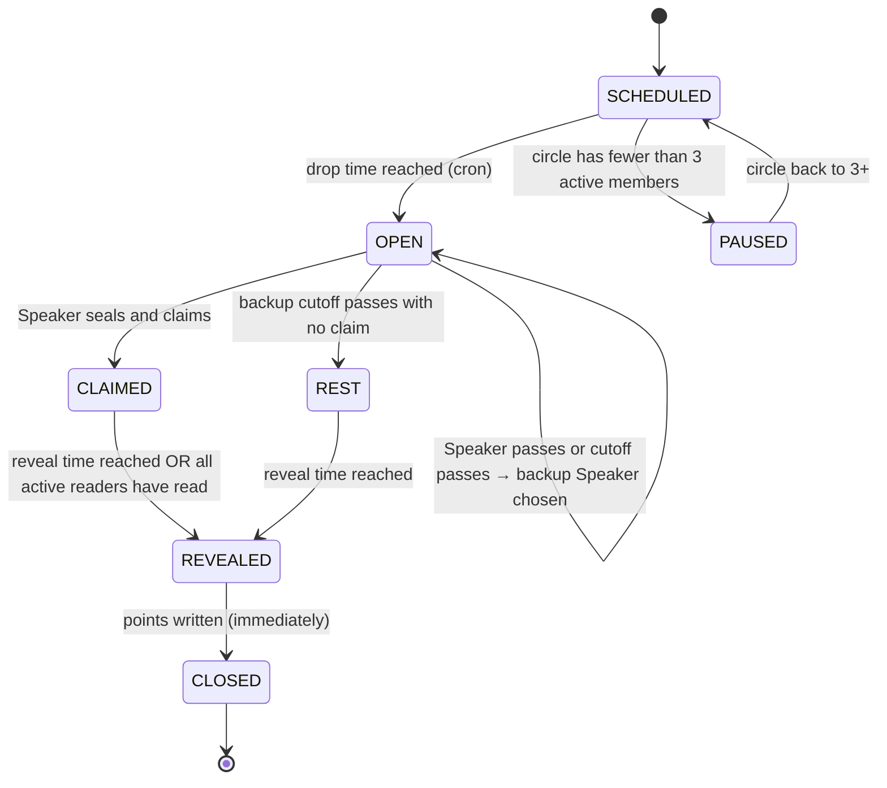

A rest day is scheduled directly as `REST` at the drop time.

In the database (`game.round_state`), REVEALED and CLOSED are one step, because points are already computed on every read (D-22). With two rounds a day, each round runs this machine on its own ([data model](https://github.com/VIsHnu1762/blag/blob/main/kb/07-architecture/data-model.md#round-lifecycle-in-the-database)).

### Who can do what

| State | Speaker | Readers | Server |
|---|---|---|---|
| SCHEDULED | — | — | Open at drop time |
| OPEN | Seal (editable), claim, pass | See "secret Speaker" placeholder | Swap Speaker at cutoff |
| CLAIMED | Nothing (seal locked) | Read, change read, guess | Reveal at time or when all have read |
| REST | Answer prompt | Answer prompt | Reveal at time |
| REVEALED | React | React | Score, then close |
| CLOSED | React | React | — |
| PAUSED | — | — | Resume when 3+ members |

### Events and validation

The server rejects any action not allowed in the current state.

| Action | Valid when | Rejected if |
|---|---|---|
| `seal` | State OPEN, caller is current Speaker | Not Speaker; value outside the stat's allowed range; state not OPEN |
| `claim` | State OPEN, caller is current Speaker, seal exists | No seal yet; already claimed |
| `pass` | State OPEN, caller is current Speaker | Already claimed |
| `read` | State CLAIMED, caller is an active member, not the Speaker | Caller is Speaker; state not CLAIMED |
| `guess` | Same as read | Value outside allowed range |
| `react` | State REVEALED or CLOSED, caller is a member | Emoji not in preset list |

Every action carries a client-generated **idempotency key**, so retries after a
network failure don't double-submit ([API](https://github.com/VIsHnu1762/blag/blob/main/kb/07-architecture/api-and-realtime.md)).

### Timers

| Timer | Default | Fires |
|---|---|---|
| Drop open | 08:00 | SCHEDULED → OPEN or REST |
| Speaker cutoff | 13:00 | Choose backup Speaker |
| Backup cutoff | 18:00 | OPEN → REST |
| Reveal | 21:00 | CLAIMED/REST → REVEALED |

A scheduler job runs every minute and advances any drop whose time has
passed ([ADR-005](https://github.com/VIsHnu1762/blag/blob/main/kb/07-architecture/adr/ADR-005-scheduled-drops.md)). Early
reveal is triggered by the `read` action when it's the last missing read.

### Season states

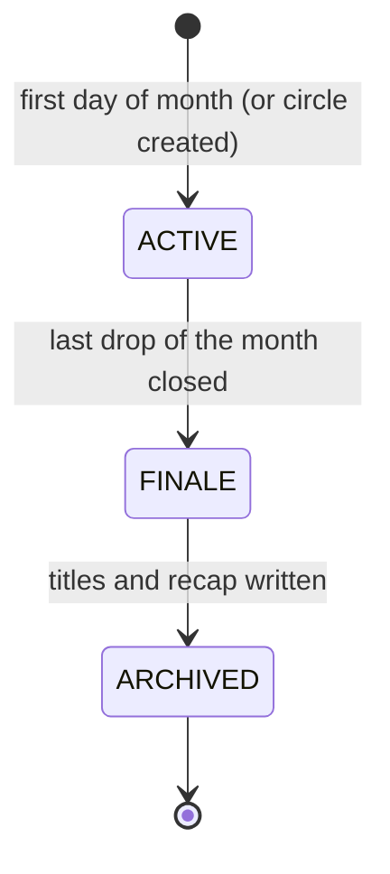


---

<!-- page: kb/03-game-design/edge-cases.md · id: game.edge · status: proposal · updated: 2026-11-04 -->

## Edge cases

> **In short:** a checklist of awkward situations and the rule for each; every row should become a test.

| # | Situation | Rule |
|---|---|---|
| E-1 | Seal is 0 | Truth zone is the stat's floor (e.g. 0–5 minutes) |
| E-2 | Seal is far outside normal range (e.g. 2,000 minutes screen time) | Reject values above the stat's maximum (24h for daily time, 100,000 steps); ask to re-check |
| E-3 | Speaker realises the seal had a typo | Can edit until they claim; locked after |
| E-4 | Speaker typed a false seal on purpose | Can't be detected for typed values; it only spoils their own game. Screenshot proof discourages it |
| E-5 | Nobody reads | Speaker scores 0; round still reveals at reveal time |
| E-6 | Only one reader | Normal scoring; that reader is automatically "closest" if they guessed |
| E-7 | Everyone passes as Speaker | Rest round |
| E-8 | Member joins after the drop opened | Can read today's claim; not chosen as Speaker until tomorrow |
| E-9 | Member leaves while a round is CLAIMED | Their read is removed; if they were Speaker, the round still reveals and scores readers |
| E-10 | Circle drops to 2 members | Drops pause; a friendly note invites a third friend |
| E-11 | Organiser changes the reveal time mid-day | Applies from tomorrow |
| E-12 | Organiser changes the home time zone | Applies from the next drop; no drop is skipped or doubled |
| E-13 | Daylight-saving change | Times stay at the same local clock time; computed in the zone database, never fixed offsets |
| E-14 | Member travels to another time zone | Circle times don't change; the app shows them in the member's new local time |
| E-15 | Network fails while submitting a read | Client retries with the same idempotency key; server accepts once |
| E-16 | Two devices on one account read differently | Last write before the reveal wins |
| E-17 | Reveal happens while a member is offline | They see it next time they open the app; no notification spam |
| E-18 | Member turns off the stat that is today's topic after being chosen | Treated as a pass; backup chosen |
| E-19 | Member deletes their account mid-season | Their rows are deleted; past revealed rounds show "a former member"; league recalculates without them |
| E-20 | Last day of month at 23:59 | The drop belongs to the season of its local date |
| E-21 | Circle created mid-month | Short first season; best-20 rule unchanged |
| E-22 | Two readers tie for closest guess | Both get +1 |
| E-23 | Guess is identical to the claim | Allowed; scored normally |
| E-24 | Claim equals the zone edge | Inside the zone counts as true (inclusive) |
| E-25 | Clock on the phone is wrong | The server's time is always used |


---

<!-- page: kb/04-features/README.md · id: features.home · status: draft · updated: 2026-11-04 -->

## Features

> **In short:** ideas live in the idea bank; the ones we commit to building become features (F-ids) with acceptance criteria.

| Page | What it covers |
|---|---|
| [Feature catalogue](https://github.com/VIsHnu1762/blag/blob/main/kb/registers/features.md) | Every feature by release, with acceptance criteria (generated from `kb/data/features.yaml`) |
| [MVP scope](https://github.com/VIsHnu1762/blag/blob/main/kb/04-features/mvp-scope.md) | What's in and out of the first playable version, and why |
| [User stories](https://github.com/VIsHnu1762/blag/blob/main/kb/04-features/user-stories.md) | The MVP as user stories grouped into epics |
| [Notifications](https://github.com/VIsHnu1762/blag/blob/main/kb/04-features/notifications.md) | Every notification, its wording and its rules |

### How an idea becomes a feature

1. The idea is in the [idea bank](https://github.com/VIsHnu1762/blag/blob/main/kb/registers/ideas.md) with a `P-` id.
2. The team agrees to build it: a decision is logged.
3. It gets an `F-` id in `kb/data/features.yaml`, with `ideas: [P-..]`, a release and acceptance criteria.
4. Each acceptance criterion becomes at least one test ([quality](https://github.com/VIsHnu1762/blag/blob/main/kb/11-quality/README.md)).
5. Every feature is checked against the [red lines](https://github.com/VIsHnu1762/blag/blob/main/kb/01-idea/05-principles-and-red-lines.md) before it's agreed.

### Prioritisation

Features use **MoSCoW** within a release: Must, Should, Could, Won't (this
release). Releases are `MVP`, `Next`, `Later` ([roadmap](https://github.com/VIsHnu1762/blag/blob/main/kb/12-roadmap/README.md)).


---

<!-- page: kb/04-features/mvp-scope.md · id: features.mvp · status: proposal · updated: 2026-11-04 -->

## MVP scope

> **In short:** one complete daily loop for real circles, with manual stats, comfort features, a monthly finale and full data deletion; nothing else.

### The MVP promise

> A circle of 3–8 friends can play one drop a day for a whole month, with
> numbers they type in, feel safe doing it, and enjoy a finale at the end.

### In

| Area | Features |
|---|---|
| Account | F-01 sign-up and 18+ gate · F-18 delete my data |
| Circles | F-02 create · F-03 join and leave |
| Comfort | F-04 consent and focus lane · F-09 reactions · F-13 invisible pass · F-14 catch-up card · F-15 rest day |
| Game | F-05 daily drop · F-06 seal and claim · F-07 read and guess · F-08 reveal · F-10 scoring and league · F-11 finale and titles |
| Memory | F-12 share card |
| Personal | F-16 my month (Could) |
| Platform | F-17 notifications |

### Out (and why)

| Not in MVP | Why |
|---|---|
| Automatic stats (F-23, P-46 to P-48) | iOS can't export them (R-01); Android needs policy checks (Q-16). Manual entry works everywhere |
| Contact sync (P-36) | Third-party data; invite links are enough (D-07) |
| Live mode (F-21) | Async daily play is the core; live is a later boost |
| Guess yourself, knowing scores, Group Wrapped (F-19, F-20, F-22) | Good retention features, but only after the core loop is proven |
| Other card types (P-38 to P-41) | One loop first (D-09) |
| Chat | Red line on round screens; the group chat already exists |
| Monetisation | Q-10 open; nothing that breaks the red lines |

### Size check

Rough screen count: about 16 screens ([screens](https://github.com/VIsHnu1762/blag/blob/main/kb/06-design/screens.md)). Rough
backend surface: about 12 actions plus 2 scheduled jobs ([API](https://github.com/VIsHnu1762/blag/blob/main/kb/07-architecture/api-and-realtime.md)).
That's realistic for a small student team over 8–10 weeks *(Assumption)*.

### Freezing the scope

Freeze the MVP when:
- [ ] The hand-run test is done and its results are in `kb/data/risks.yaml`
- [ ] Q-03, Q-13 and Q-14 are decided
- [ ] Every MVP feature has acceptance criteria the team agrees with

After freezing, any addition needs a decision entry and must replace something
of similar size.


---

<!-- page: kb/04-features/user-stories.md · id: features.stories · status: draft · updated: 2026-11-04 -->

## User stories

> **In short:** the MVP as "As a…, I want…, so that…" stories; acceptance criteria live with each feature in the catalogue.

Format: **US-epic.n** · story · feature. Acceptance criteria are in the
[feature catalogue](https://github.com/VIsHnu1762/blag/blob/main/kb/registers/features.md).

### Epic 1: Getting in

- **US-1.1** As a new person, I want to sign up quickly without granting permissions, so that I can try BLAG with no risk. · F-01
- **US-1.2** As an organiser, I want to create a circle and pick when drops and reveals happen, so that it fits our routine. · F-02
- **US-1.3** As an organiser, I want one invite link and QR code, so that I can bring the whole group in from our chat. · F-02
- **US-1.4** As a friend, I want to join from a link in under 30 seconds, so that joining isn't a chore. · F-03

### Epic 2: Feeling safe

- **US-2.1** As a member, I want every stat off until I turn it on, so that I decide what's shared. · F-04
- **US-2.2** As a member, I want spicy and health stats to need an extra confirmation, so that I don't share them by accident. · F-04
- **US-2.3** As a member, I want to pass today without anyone knowing, so that I never feel pressured. · F-13
- **US-2.4** As a member, I want no screen to show I was away, so that taking a break is guilt-free. · F-13
- **US-2.5** As a member, I want only emoji reactions on rounds, so that nobody gets piled on. · F-09

### Epic 3: Being the Speaker

- **US-3.1** As the Speaker, I want a private notice with my topic and where to find the number, so that I can answer quickly. · F-05, F-06
- **US-3.2** As the Speaker, I want to seal my real number before claiming, so that the game is fair. · F-06
- **US-3.3** As the Speaker, I want to see the truth zone, so that I know whether my claim is a truth or a bluff. · F-06
- **US-3.4** As the Speaker, I want to attach a screenshot, so that my friends trust the reveal. · F-06

### Epic 4: Reading

- **US-4.1** As a reader, I want to see today's claim and pick TRUE or BLUFF in one tap, so that it takes seconds. · F-07
- **US-4.2** As a reader, I want to guess the number, so that I can earn extra points for knowing my friend. · F-07
- **US-4.3** As a reader, I want to change my mind until the reveal, so that I can rethink. · F-07

### Epic 5: The reveal

- **US-5.1** As a member, I want a reveal at a set time each evening, so that it's a shared moment. · F-08
- **US-5.2** As a member, I want an early reveal when everyone has read, so that we don't wait for nothing. · F-08
- **US-5.3** As a member, I want a satisfying animation and stamp, so that the reveal feels like an event. · F-08
- **US-5.4** As a member who prefers less motion, I want a calm version of the reveal. · F-08

### Epic 6: The season

- **US-6.1** As a member, I want to see the league for this month, so that I know where I stand. · F-10
- **US-6.2** As a member, I want missed days not to hurt me, so that I can have a life. · F-10
- **US-6.3** As a member, I want a title at the finale, so that I'm recognised for how I played. · F-11
- **US-6.4** As a member, I want a share card without my numbers, so that I can post it safely. · F-12
- **US-6.5** As a returning member, I want a catch-up card, so that I can rejoin the fun. · F-14

### Epic 7: Control

- **US-7.1** As a member, I want to leave a circle easily, so that I'm never stuck. · F-03
- **US-7.2** As a member, I want to delete my account and data from the app or the web, so that I'm in control. · F-18
- **US-7.3** As a member, I want quiet hours for notifications, so that BLAG never wakes me. · F-17
- **US-7.4** As a member, I want my own month's view, private to me, so that I notice my habits without judgement. · F-16


---

<!-- page: kb/04-features/notifications.md · id: features.notifications · status: proposal · updated: 2026-11-04 -->

## Notifications

> **In short:** at most three notifications a day, all playful, never about losing, missing or anyone else's absence.

### Budget

A member gets **at most 3 notifications per day** from BLAG, plus at most one
Speaker notice. Quiet hours default to **23:00–08:00** local; anything due then
waits until the quiet hours end, or is dropped if it's no longer relevant.

### The list

| ID | When | To | Wording (example) | Can turn off |
|---|---|---|---|---|
| N-1 | Speaker chosen | Speaker only | "You've got the mic today 🎤🤫" | No (it's the game), but can pass |
| N-2 | Claim published | Readers | "Priya dropped her number. Call it 👀" | Yes |
| N-3 | Reveal | Everyone who read, and the Speaker | "The truth is out 👀" | Yes |
| N-4 | Finale | Everyone | "Season's over! Your title is waiting 🏆" | Yes |
| N-5 | Backup Speaker chosen | Backup only | "Plot twist: the mic is yours today 🎤" | No, but can pass |
| N-6 | Circle reached 3 members | Organiser | "Hostel 4B is ready! First drop tomorrow at 8" | Yes |

### Rules

1. **Never mention absence**: no "you missed", "your friends are waiting", "don't lose".
2. **Never reveal the Speaker** before the claim, including in N-1's lock-screen preview: use "Psst, open BLAG 🤫" when previews are visible on the lock screen *(Proposal)*.
3. **Never include stat values** in notification text.
4. **No streak or countdown language.**
5. **No marketing notifications** in the MVP.
6. Respect the OS notification settings and in-app toggles.

### Banned examples

| Don't send | Why |
|---|---|
| "You haven't played in 3 days 😢" | Guilt; counts absence |
| "Meera is ahead of you!" | Ranking pressure |
| "Last chance to save your score!" | Loss framing |
| "Arjun spent 6h on Instagram yesterday" | Exposes a stat |


---

<!-- page: kb/05-brand/README.md · id: brand.home · status: draft · updated: 2026-11-04 -->

## Brand

> **In short:** BLAG is the mischievous friend who teases you and always has your back: playful, warm, never shaming.

### Basics

| | |
|---|---|
| Name | **BLAG** (D-02: unique and recognisable, not British slang) |
| Title | **BLAG: Are You Bluffing?** (D-01) |
| Tagline | *Your people. Their stats. Your call.* |
| Category | Private social game built around a daily friend ritual (D-04) |
| Signature moment | The **TRUTH** / **BLUFF!** stamp at the reveal |

### Brand promise

**Ten minutes a day that make your friends feel closer, and never make you feel judged.**

### Personality

| BLAG is | BLAG is not |
|---|---|
| Mischievous | Mean |
| Warm | Clingy |
| Quick | Rushed |
| Curious about people | Nosy about data |
| Proud of its players | A coach or a doctor |

**Feel:** poker night meets group chat.

### Pages

| Page | What it covers |
|---|---|
| [Voice and tone](https://github.com/VIsHnu1762/blag/blob/main/kb/05-brand/voice-and-tone.md) | How BLAG writes: principles, words to use and avoid, copy for every key moment |
| [Visual identity](https://github.com/VIsHnu1762/blag/blob/main/kb/05-brand/visual-identity.md) | Colour tokens with measured contrast, type, shape, motion, sound and haptics |

### To do

- [ ] Logo and app icon exploration (3 directions)
- [ ] Name search in stores and trademark databases (Q-06)
- [ ] Decide whether to keep the purple, yellow and coral palette (Q-05)
- [ ] Mascot: yes or no


---

<!-- page: kb/05-brand/voice-and-tone.md · id: brand.voice · status: proposal · updated: 2026-11-04 -->

## Voice and tone

> **In short:** BLAG talks like a friend teasing you at a party: short, cheeky, warm, and never about whether your habits are good or bad.

### Four principles

1. **Tease the play, never the person.** "Nice try, Poker Face" is fine; anything about someone's habits is not.
2. **Neutral about numbers.** A big number is "a big one", never "too much".
3. **Short.** Most UI lines are under 8 words.
4. **International.** Plain English, no regional slang, emoji used sparingly and only where meaning survives without them.

### Words

In-app labels for each game concept (Today's Drop, Lock it in, Call it, Season Wrap…) are in the [UX language map](https://github.com/VIsHnu1762/blag/blob/main/kb/06-design/ux-language.md).


| Use | Avoid |
|---|---|
| bluff, fooled, caught | lie, liar, cheat |
| read, call | accuse, judge |
| different from usual | better, worse, improved, too much |
| took a break, welcome back | missed, absent, inactive |
| big number, small number | addicted, lazy, unhealthy, wasted |
| the league | leaderboard, ranking |
| circle | group, room, team |

### Tone by moment

| Moment | Tone | Example |
|---|---|---|
| Onboarding | Reassuring, brief | "This is a game, not a judgement. Everyone's numbers are fine." |
| Speaker chosen | Conspiratorial | "You've got the mic today 🎤🤫" |
| Truth zone | Helpful | "Anything from 7,200 to 8,800 counts as the truth." |
| Claim published | Playful | "Priya says 9,400 steps. TRUE or BLUFF?" |
| Waiting for reveal | Light | "Locked in. Reveal at 9pm." |
| Reveal: caught | Affectionate | "BLUFF! Nice try, Poker Face." |
| Reveal: fooled everyone | Celebratory | "Nobody saw that coming." |
| Reveal: truth doubted | Amused | "TRUTH! Turns out Kabir is just that honest." |
| Big number | Neutral | "Whoa, that's a big one!" |
| Small number | Neutral | "Short and sweet." |
| Wrong read | Encouraging | "Not this time. Tomorrow's another drop." |
| Returning after days away | Warm | "Welcome back! Here's what you missed." |
| Finale | Ceremonial | "Season 3 is in the books. Here's who you were." |
| Error | Calm, practical | "That didn't go through. Try again?" |
| Deleting account | Respectful | "Sorry to see you go. Here's exactly what we'll delete." |

### Title descriptions

| Title | Line |
|---|---|
| Poker Face | "Fooled the circle more than anyone." |
| Open Book | "Told the truth, and still kept us guessing." |
| Mind Reader | "Saw straight through us." |
| Bullseye | "Guessed numbers like they'd peeked." |
| Bluff Hunter | "No bluff went unnoticed." |
| True Believer | "Trusted the truth when it mattered." |
| Wildcard | "Pulled off the boldest bluff of the season." |
| Comeback | "Finished stronger than they started." |
| Rookie | "First season, and already one of us." |
| Heart of the Circle | "The circle wouldn't be the same without you." |

### Checklist for any new copy

- [ ] Could it make someone feel judged about their habits? Rewrite.
- [ ] Does it mention absence, streaks or losing? Remove.
- [ ] Does it reveal a stat or who passed? Remove.
- [ ] Is it under about 8 words (UI) or 15 (notifications)?
- [ ] Does it use [glossary](https://github.com/VIsHnu1762/blag/blob/main/kb/00-start-here/glossary.md) words?


---

<!-- page: kb/05-brand/visual-identity.md · id: brand.visual · status: proposal · updated: 2026-11-04 -->

## Visual identity

> **In short:** a dark "poker night" base with electric yellow and hot coral accents, big tabular numbers, and one signature animation: the stamp.

Status: **Proposal** (Q-05). Based on the original brief's purple, yellow and
coral, refined for contrast.

### Colour tokens (dark theme, default)

| Token | Hex | Use |
|---|---|---|
| `bg/night` | `#140F24` | App background |
| `bg/surface` | `#211936` | Cards |
| `bg/raised` | `#2E2448` | Sheets, inputs |
| `text/primary` | `#F6F3FF` | Body text |
| `text/muted` | `#B9B0D3` | Secondary text |
| `brand/purple` | `#8B5CF6` | Large accents, focus rings (not body text) |
| `brand/purple-deep` | `#4C1D95` | Buttons with light text |
| `accent/yellow` | `#FFD43B` | Primary action, **TRUTH** stamp |
| `accent/coral` | `#FF6B57` | **BLUFF!** stamp, highlights |
| `accent/mint` | `#4ADE80` | Success confirmations |

#### Measured contrast

Computed with the WCAG 2 formula. AA needs **4.5:1** for normal text and **3:1**
for large text and UI parts.

| Foreground on background | Ratio | Result |
|---|---|---|
| text/primary on bg/night | 17.1 | Pass AAA |
| text/primary on bg/surface | 15.3 | Pass AAA |
| text/muted on bg/surface | 8.1 | Pass AAA |
| accent/yellow on bg/night | 13.1 | Pass AAA |
| accent/coral on bg/night | 6.7 | Pass AA |
| accent/coral on bg/surface | 6.0 | Pass AA |
| bg/night on accent/yellow (button text) | 13.1 | Pass AAA |
| text/primary on brand/purple-deep | 10.0 | Pass AAA |
| brand/purple on bg/night | 4.4 | **Large text and UI parts only** |
| text/primary on brand/purple | 3.9 | **Large text only**; use purple-deep for buttons |

A light theme (ink `#1A1530` on paper `#FBF8FF`, 16.7:1) is available for
people who prefer it.

#### Colour rules

- TRUTH and BLUFF! must differ in **word and shape** as well as colour (see [accessibility](https://github.com/VIsHnu1762/blag/blob/main/kb/06-design/accessibility.md)).
- Never use red/green or up/down arrows for personal data (D-10).
- Coral is for the game's BLUFF moment, never for "bad" numbers.

### Typography

| Role | Proposal | Why |
|---|---|---|
| Display (stamps, big numbers) | **Bricolage Grotesque**, extra bold | Characterful, playful; open licence (OFL) |
| UI and body | **Inter** | Highly legible; **tabular figures** so counting-up numbers don't jitter |
| Numbers | Inter with `tnum` | Fixed-width digits during the reveal |

Both are free Google Fonts under the SIL Open Font License *(verify before shipping)*.
Support system font scaling up to 200% ([accessibility](https://github.com/VIsHnu1762/blag/blob/main/kb/06-design/accessibility.md)).

### Shape

- Rounded corners: 16 px cards, 999 px pills for buttons.
- The **stamp** is a rotated (−8°) rounded rectangle with a rough ink edge, like a rubber stamp.
- Avatars are circles with a 2 px ring in the member's chosen colour.

### Motion

| Moment | Motion | Reduced-motion version |
|---|---|---|
| Reveal number | Counts up over ~1.2 s | Number appears with a fade |
| Stamp | Drops in with a small bounce and a slight shake | Fades in |
| Read locked | Card flips | Check mark appears |
| Finale titles | Cards deal in one by one | Shown as a list |

### Sound and haptics

| Moment | Sound | Haptic |
|---|---|---|
| Read locked | Soft chip click | Light tap |
| Stamp lands | Rubber-stamp thud | Medium impact |
| Fooled everyone | Short card-shuffle flourish | Success pattern |

Sounds off by default *(Proposal)* with a clear toggle; haptics follow the system setting.


---

<!-- page: kb/06-design/README.md · id: design.home · status: draft · updated: 2026-11-04 -->

## Design

> **In short:** design every screen around one question: "how should this moment feel?", then make it accessible to everyone.

| Page | What it covers |
|---|---|
| [Emotional design](https://github.com/VIsHnu1762/blag/blob/main/kb/06-design/emotional-design.md) | The feelings BLAG creates, the emotional arc of a day and a season, and the review that shaped it |
| [UX language and moments map](https://github.com/VIsHnu1762/blag/blob/main/kb/06-design/ux-language.md) | In-app words, and each moment's feeling, proven pattern, twist and backend guarantee |
| [Design toolkit](https://github.com/VIsHnu1762/blag/blob/main/kb/06-design/design-toolkit.md) | The five design references, one job each, screen modes and the five-step process (D-24, D-25) |
| [Screens](https://github.com/VIsHnu1762/blag/blob/main/kb/06-design/screens.md) | Every MVP screen with purpose, contents and states |
| [Flows](https://github.com/VIsHnu1762/blag/blob/main/kb/06-design/flows.md) | Diagrams of the main flows |
| [Accessibility](https://github.com/VIsHnu1762/blag/blob/main/kb/06-design/accessibility.md) | WCAG 2.2 AA checklist applied to BLAG |

### Design principles

1. **One thing per screen.** Each game screen asks for one decision.
2. **The reveal is the show.** Spend animation and polish there; keep everything else calm.
3. **Big numbers, few words.**
4. **Thumb-first.** Primary actions sit in the bottom third of the screen.
5. **Nothing that shames.** Every screen passes the [voice checklist](https://github.com/VIsHnu1762/blag/blob/main/kb/05-brand/voice-and-tone.md#checklist-for-any-new-copy).
6. **Works on a mid-range Android on patchy data** ([users](https://github.com/VIsHnu1762/blag/blob/main/kb/02-users/README.md)).
7. **Native plumbing, expressive game moments** (D-24): settings feel like the phone; the game feels like BLAG.
8. **Low-fidelity first** (D-36): layout and flow before colour and type.

### To do

- [ ] Low-fidelity wireframes for every MVP screen, through the [five steps](https://github.com/VIsHnu1762/blag/blob/main/kb/06-design/design-toolkit.md#the-five-steps-every-screen-goes-through)
- [ ] Clickable prototype for usability testing ([research plan](https://github.com/VIsHnu1762/blag/blob/main/kb/02-users/research-plan.md))
- [ ] Reveal animation prototype
- [ ] Design tokens file once the core works and the palette is chosen (Q-05 parked, D-36)


---

<!-- page: kb/06-design/emotional-design.md · id: design.emotional · status: proposal · updated: 2026-11-04 -->

## Emotional design

> **In short:** BLAG should feel like mischief among friends (curiosity, suspense, delight, belonging) and never like being measured, exposed or left behind.

### Feelings to create and to avoid

| Create | Avoid |
|---|---|
| Curiosity ("who's the Speaker today?") | Obligation ("I have to keep my streak") |
| Mischief (planning a bluff) | Shame (about a number) |
| Suspense (waiting for the reveal) | Exposure (others seeing what you didn't share) |
| Delight (the stamp, being right) | Inferiority (being last because of habits) |
| Belonging (titles, shared jokes) | Guilt (missing days) |
| Being known (friends guess you well) | Being judged (labels like "Night Owl") |

### The emotional arc of a day

```text
 delight ┤                                   ★ reveal
         │                                  ╱ ╲
suspense ┤                     read ╭──────╯   ╲ reactions
         │                         ╱             ╲
curiosity┤  drop opens ───── claim╯               ╲__ calm
         └──────────────────────────────────────────────
           08:00          midday              21:00
```

Peaks are kept short: the app is mostly calm and the reveal is the one big moment.

### The emotional arc of a season

| Week | Feeling | Design support |
|---|---|---|
| 1 | Fresh start | Everyone at zero; new season card |
| 2 | Getting to know the rhythm | First titles hinted ("You're reading people well") |
| 3 | Rivalry, playful | League view; best moments so far |
| 4 | Anticipation | "Finale in 3 days" (no countdown pressure, just a heads-up) |
| Finale | Belonging, pride | Titles dealt one by one; moments; share card |

### Review of the early concept

The first specs ("Bluff the Stats", then the BLAG master prompt) were reviewed
for emotional design on 2026-11-01. The intent was strong, but the follow-through was weak:

| Issue found | Fix adopted |
|---|---|
| Emotional rules weren't carried into later documents (no voice guide, no emotional journey) | This page, [voice and tone](https://github.com/VIsHnu1762/blag/blob/main/kb/05-brand/voice-and-tone.md), and the [red lines](https://github.com/VIsHnu1762/blag/blob/main/kb/01-idea/05-principles-and-red-lines.md) |
| **Hot Seat** gave 20 seconds to "defend" a stat, which felt like a courtroom | Cut (P-13) |
| Titles like "Night Owl" and "The Lurker" labelled habits | Play-style titles only ([seasons and titles](https://github.com/VIsHnu1762/blag/blob/main/kb/03-game-design/seasons-and-titles.md)) |
| "Rank the group by pickups" created a loser by design | Points from skill only (D-05) |
| Passing 3 stats triggered a visible Light-mode suggestion | Private comfort prompts; invisible pass (P-19) |
| Passing and skipping were visible to the group | Secret Speaker (D-15); away status hidden (D-08) |
| Manual entry undermined the reveal's tension | Seal before you claim (P-14), truth zone (P-51) |
| No design for losing | No negative points (D-18); every member gets a title (D-06); best 20 days (D-16) |
| No design for group dynamics (one person always targeted) | Speaker rotation by fewest turns; no "who in the circle" prompts that single anyone out negatively |
| British slang identity was accidental | Neutral, international copy (D-02) |

### Emotional design checklist for any new feature

- [ ] What should the person feel at each step? Write it down.
- [ ] Could the quietest member (see [personas](https://github.com/VIsHnu1762/blag/blob/main/kb/02-users/personas.md)) feel exposed? How is that prevented?
- [ ] Could someone feel worse about their habits? Remove that path.
- [ ] Does losing still feel OK?
- [ ] Is absence invisible?
- [ ] Is there a moment of delight, and is it short?


---

<!-- page: kb/06-design/ux-language.md · id: design.language · status: proposal · updated: 2026-11-04 -->

## UX language and moments map

> **In short:** BLAG speaks the language people already use on social and productivity apps (drops, lock it in, receipts, season wrap), so nothing needs explaining; every moment borrows a pattern that has worked elsewhere, adds one BLAG twist, and is backed by a specific backend guarantee.

Status: **Proposal**. All words are to be tested in the hand-run test (A-10)
before they're final. Code and database names don't change (see the
[glossary](https://github.com/VIsHnu1762/blag/blob/main/kb/00-start-here/glossary.md), which now lists both).

### Adoption principles

| Principle | Meaning for BLAG |
|---|---|
| **Familiar first** | People prefer apps that work like the ones they already use (Jakob's Law) [S-76]. BLAG reuses known gestures and words: stories-style finale, Wordle-style share, chat-style invites |
| **One decision per screen** | More choices slow decisions (Hick's Law) [S-76]. Each game screen asks one thing: lock it, drop it, call it |
| **Fun in 60 seconds** | A new member sees a real claim within a minute of joining, before any setup beyond one stat |
| **Ask later, not upfront** | Join with one lane and one stat; offer more stats after the first reveal |
| **Thumb zone** | Main buttons in the bottom third; TRUTH and BLUFF full width |
| **One delight a day** | The reveal is the only big animation; everything else is calm |
| **No dark patterns** | No fake urgency, no guilt, no streak traps ([red lines](https://github.com/VIsHnu1762/blag/blob/main/kb/01-idea/05-principles-and-red-lines.md)) |

### Vocabulary: system words → in-app words

| Concept (code name) | In the app | Why it lands | Avoid |
|---|---|---|---|
| circle | **Circle** | Same idea as close-friends lists on social apps | group, room |
| drop | **Today's Drop** | "Drops" are how music, sneakers and games release: new, timed, exciting | session, match |
| speaker | **On the mic 🎤** | Familiar from podcasts and live audio; playful, not formal | player of the day |
| seal | **Lock it in 🔒** | Everyday phrase for committing to something, also used for getting focused | submit, seal |
| truth_zone | **Honest range** | Self-explanatory | tolerance |
| claim | **Drop your number** | Echoes "drop"; short and active | statement |
| read | **Call it: TRUTH or BLUFF** | "Call it" is natural party-game language | vote, accuse |
| guess | **Bonus guess** | Makes the optional part clearly optional | bet |
| reveal | **The Reveal** at **reveal time** | Reality-TV and game-show familiarity | results |
| reactions | **Reacts** | Same word as messaging apps | likes |
| day_score | **Today's points** | Plain | score |
| season | **Season** | Games and streaming series both use seasons | month |
| league | **The League** | Fantasy-sports familiarity, but friendly | leaderboard, ranking |
| finale | **Season Wrap** | Recalls year-end music recaps people love to share | results |
| title | **Your title** | Like a superlative in a yearbook | badge |
| focus_lane | **Your lane** | "Stay in your lane" is everyday; doubles as the productivity idea of focus | goal |
| sensitivity=spicy | **🌶️ Spicy** | Instantly signals "a bit personal" | sensitive |
| pass | **Skip today** | Neutral; nothing to explain | pass, opt out |
| away | (nothing shown) | Absence is invisible | absent, inactive |
| catch_up | **While you were away** | Familiar from news and social apps | missed |
| card_type=rest | **Chill Day** | Signals a lighter day | rest day |
| my_month | **Just you** (only you can see this) | Privacy promise in the label itself | dashboard, stats |
| our_month | **Our story** | Stories format is familiar | timeline |
| trust_level / proof | **Receipts 🧾** | "Show the receipts" means "show proof" | verified |
| live | **Live** | Familiar from streaming | party mode |
| knowing score (Next) | **In sync** | Friendship language, not numbers | compatibility |

### Moments map

Each row: what the person sees, what they should feel, the proven pattern it
borrows, BLAG's twist, and the backend step that makes it reliable.

| # | Moment | In-app words | Feeling | Proven pattern (source) | BLAG twist | Backend guarantee |
|---|---|---|---|---|---|---|
| 1 | Invite | "Invite your circle" → link or QR | Belonging | Room codes and phone-first joining from party games [S-24] | One link brings the whole group; circle capped at 8 | `circles/join`; invite code stored hashed; rate-limited |
| 2 | Join | "Pick your lane" → one stat | In control | Small, close-friend networks [S-14] | Lane decides what *you* get asked about | `circles/lane-set`, `consent-set`; nothing shared until opted in |
| 3 | Drop opens | "Today's Drop is live 👀" | Curiosity | One shared daily moment [S-03, S-01] | The Speaker is a secret | `scheduler` opens drop; `drop.opened` event; Speaker hidden by row-level security |
| 4 | You're the Speaker | "You've got the mic 🎤🤫" | Mischief | Hidden roles in social-deduction games [S-25] | Your real life is the material | Private push to the Speaker only; generic lock-screen text |
| 5 | Lock it in | "Lock it in 🔒" + where to find your number | Fair play | — (BLAG's own) | Truth locked *before* the bluff | `game/seal` → `private.seals`; locked at claim |
| 6 | Honest range | "Anything from 7,200 to 8,800 counts as the truth" | Clever | — (BLAG's own) | Bluffing is always deliberate | Computed by `game-engine` `truthZone()` |
| 7 | Drop your number | "Drop your number" | Excitement | — | Name revealed only now | `game/claim`: claim + `round.claimed` in one transaction |
| 8 | Call it | "Priya says 9,400 steps. TRUTH or BLUFF?" | Playful suspicion | Voting on who's lying [S-25] | Real numbers, not made-up roles | `game/read`; others' calls hidden until reveal |
| 9 | Waiting | "Locked in. Reveal at 9pm" | Anticipation | Timed shared reveal [S-01] | Early reveal when everyone's in | Score-on-write; last read triggers early reveal |
| 10 | The Reveal | Number counts up → **BLUFF!** stamp | Delight | Reveal moments and celebration animations [S-05] | One big moment a day, then calm | `reveal_due_rounds()` every minute; within 2 minutes (SLO) |
| 11 | Reacts | Preset emoji | Laughter | Uncounted reactions [S-14] | No text, no pile-ons | Emoji from a fixed list; never aggregated |
| 12 | Skip today | "Skip today" | Relief | — | Nobody can tell | Backup Speaker chosen privately |
| 13 | Coming back | "While you were away…" | Welcome | — | No missed-day counts, ever | Best-20 scoring; no absence data exposed |
| 14 | Chill Day | "Who'd last longest without their phone?" | Lightness | — | A day off from numbers | Rest card type; no points |
| 15 | The League | Positions, joint places | Playful rivalry | Small groups that reset [S-06] | Points only for reading people | `league` from `round.revealed`; best-20 |
| 16 | Season Wrap | Titles dealt like cards, moments, share card | Pride, belonging | Year-end recaps people share [S-07]; friends mode [S-08] | Everyone gets a title; no stats on the card | `league` close + `assignTitles()`; `season.finale_ready` |
| 17 | Share | Card with stamps and titles | Showing off safely | Spoiler-free share grid [S-03] | Shows the play, never the numbers | Share image built on device from non-sensitive fields |
| 18 | Just you | "Only you can see this" | Calm insight | — | Compared only with your past self | Owner-only access rules |
| 19 | Receipts | "Add receipts 🧾" | Trust | — | Proof is optional and appears only after the reveal | `proofs` unlocks after `round.revealed`; deleted after 30 days |
| 20 | Leaving | "Leave circle" / "Delete everything" | Control | Store-required deletion [S-37, S-38] | No guilt copy | `account.deleted` → every service cleans its own data |

### What's borrowed and what's new

| Borrowed (proven) | New in BLAG |
|---|---|
| Daily drop and timed reveal | **Lock-it-in before you bluff**: fair bluffing with typed numbers |
| Hidden-role bluffing | **Real habits as the game material**, with consent per stat |
| Close-friend circles | **Points for reading people, never for the numbers** |
| Season recaps that people share | **Everyone gets a title**; share cards without stats |
| Party-game joining | **Invisible skipping** and a **secret Speaker** |
| Celebration animations | **Honest range** that makes every bluff deliberate |

### The 60-second first run

1. Tap the invite link → "Join Hostel 4B" (sign-in, 18+ check).
2. "Pick your lane" (one tap).
3. "Turn on one thing to bluff about" (one stat, plain explanation).
4. Land on **Today's Drop**: if a claim is already up, call it immediately.
5. After the first reveal: "Want more to bluff about?" offers more stats.

### Rules for trendy language

- Use words most 18–30-year-olds already use; avoid slang that dates fast or excludes people.
- Every label must make sense without the emoji.
- Never use words that judge habits ([voice and tone](https://github.com/VIsHnu1762/blag/blob/main/kb/05-brand/voice-and-tone.md)).
- English first; keep every string in the catalogue so it can be translated and changed without code.
- Test with real users in the hand-run test and usability tests; replace anything that needs explaining.


---

<!-- page: kb/06-design/design-toolkit.md · id: design.toolkit · status: agreed · updated: 2026-11-04 -->

## Design toolkit

> **In short:** five references the founder has used for a long time, each with one job so they never argue: Intent decides *why*, Perception-First Design checks *what people will perceive*, Impeccable builds and polishes the app, Taste Skill builds the web pages, React Bits only inspires motion (D-25).

### One job per tool

| Tool | Job in BLAG | When | Licence |
|---|---|---|---|
| **Design with Intent** [S-87] | UX strategy, journeys, structure, wireframes, accessibility, and the dark-pattern check | Before any screen, and as a check after | CC0 |
| **Perception-First Design** [S-89] | Diagnoses a screen through five layers: cognitive load, first impression, processing fluency, perception bias, decision architecture | The five key screens: first run, Today's Drop, seal and claim, read, reveal | CC BY-SA 4.0 (applying it is exempt) |
| **Impeccable** [S-86] | Main design system for the app: `PRODUCT.md`, `DESIGN.md`, iOS and Android rules, native audit, critique, later typeset, colour, motion and polish | Low-fidelity now; visuals after the core works | Apache 2.0 |
| **Taste Skill** [S-88] | Public web pages only (landing, invite): art direction, real browser checks at three widths | Near release | MIT |
| **React Bits** [S-90] | Motion ideas only; effects are rebuilt from scratch in Reanimated | After the core works | MIT + Commons Clause: no redistribution or ports |

Anthropic's frontend-design skill is not used separately: Impeccable builds on it.

### Design modes for BLAG's screens (D-24)

Impeccable names what success looks like on each surface. BLAG's rule: **native plumbing, expressive game moments.**

| Mode | BLAG surfaces | Rule |
|---|---|---|
| **Operate** (get a task done) | Sign-in, settings, invite, members, notifications | Feel native: platform controls, system font, back gesture, 44 pt (iOS) / 48 dp (Android) targets |
| **Experience** (you are inside the game) | Seal, claim, read, reveal, finale | BLAG's own look, motion and sound live here |
| **Read** | Privacy, help, my month | Calm and easy to read |
| **Persuade** | Landing page, store listing, invite web page | Taste Skill + Impeccable, aimed at the install |

### The five steps every screen goes through

1. **Why and where.** Intent `/journey` places the screen in the day or season loop. Perception-First Design runs its five-layer analysis (5 passes for a key screen, 1 for a small one). Output: requirements, not pixels.
2. **Layout.** Intent `/wireframe` writes the low-fidelity layout; Impeccable `shape` turns it into a UX plan.
3. **Build low-fidelity.** Greyscale React Native screen, system font, real words from the text catalogue (`src/i18n/en.ts`), proper layout (D-36).
4. **Check.** Impeccable `audit` (native) and `critique`, Intent `/evaluate` for dark patterns, Perception-First Design `evaluate`. Fix what they find; the [quality page](https://github.com/VIsHnu1762/blag/blob/main/kb/11-quality/README.md) lists the bar.
5. **Later, once the core works.** Impeccable `typeset`, `colorize`, `animate`, `delight` and `polish`; motion inspired by React Bits and built with Reanimated; then `/impeccable document` writes `DESIGN.md` from what shipped.

### The ethics check agrees with our red lines

Intent's ethical-design guide independently says what BLAG's [principles](https://github.com/VIsHnu1762/blag/blob/main/kb/01-idea/05-principles-and-red-lines.md) say:
breaking a streak must carry no penalty, and notifications should arrive because something real happened, never
at an algorithm-chosen "best moment". Every notification and every missed-day screen goes through Intent `/evaluate`.

### Installed in the repo

| Skill | Source | Where |
|---|---|---|
| `impeccable` (4.8) | `pbakaus/impeccable` | `.claude/skills/impeccable` |
| `intent`, `journey`, `organize`, `wireframe`, `evaluate`, `include`, `localize`, `specify` (1.7) | `ghaida/intent` | `.claude/skills/<name>` |
| `design-taste-frontend` | `Leonxlnx/taste-skill` | `.claude/skills/design-taste-frontend` |

Sources and content hashes are pinned in `skills-lock.json`; update with `npx skills update -p`.
`PRODUCT.md` at the repo root is the product record Impeccable reads (platform: `adaptive`).

**Perception-First Design is not committed**: copying its CC BY-SA text into this public repo would put that copy
under share-alike. Install it per person:

```text
/plugin marketplace add skovalik/perception-first-design
/plugin install perception-first-design@perception-first-design
```

**Impeccable's design-check hook** (`/impeccable hooks on`) is for the web pages only; its detector reads web code,
and native screens are audited from source by `audit` instead.

### Using the toolkit with an agent

| You want | Ask for |
|---|---|
| Plan a new screen | "Run Intent journey and wireframe for the reveal screen, then Impeccable shape" |
| Check a built screen | "Impeccable audit and critique the read screen; Intent evaluate it for dark patterns" |
| Check first impressions | "Perception-First Design evaluate the first-run flow" |
| Polish after the core works | "Impeccable typeset, then colorize, then animate the reveal" |
| Build the landing page | "Taste skill: build apps/web/index.html under 30 KB" |


---

<!-- page: kb/06-design/screens.md · id: design.screens · status: draft · updated: 2026-11-04 -->

## Screens

> **In short:** sixteen MVP screens, each with one job; wireframes still to be drawn.

### Inventory

| # | Screen | Job | Key contents | Primary action | Feature |
|---|---|---|---|---|---|
| S1 | Welcome | Explain BLAG in 3 cards | What it is; "a game, not a judgement"; privacy promise | Get started | F-01 |
| S2 | Sign up | Create account | Sign-in options (Q-13); 18+ confirmation | Continue | F-01 |
| S3 | Home | See circles and today's state | Circle cards with today's status ("Reveal at 9pm") | Open circle | — |
| S4 | Create circle | Set up a circle | Name, home time zone, drop and reveal times | Create | F-02 |
| S5 | Invite | Bring friends | Link, QR, share sheet, members so far | Share | F-02 |
| S6 | Join | Accept an invite | Circle name, organiser, member count | Join | F-03 |
| S7 | Stats and lane | Choose what to share | Focus lane picker; stats grouped by family; extra confirm for spicy and health | Save | F-04 |
| S8 | Today (drop) | The day's game hub | Secret Speaker placeholder, or the claim; read status; reveal time | Read / Seal | F-05 |
| S9 | Seal | Enter the real number | Topic; where-to-find help per platform; number pad; screenshot | Seal | F-06 |
| S10 | Claim | Make the claim | Truth zone; number pad; "This is a TRUTH / BLUFF" indicator | Claim | F-06 |
| S11 | Read | Call it | Claim card; TRUE / BLUFF buttons; optional guess | Lock in | F-07 |
| S12 | Reveal | The show | Count-up number, stamp, everyone's reads and guesses, points, reactions | React | F-08, F-09 |
| S13 | League | Season standings | Members by season score; joint positions; days left | — | F-10 |
| S14 | Finale | End of season | Positions, titles dealt in, moments, share card | Share | F-11, F-12 |
| S15 | My month | Private reflection | Own values over time, neutral notes | — | F-16 |
| S16 | Settings and privacy | Control | Notifications, quiet hours, stats, leave circle, delete account, privacy policy | — | F-17, F-18 |

Rest days reuse S8 and S11 with a "who in the circle" picker. The catch-up card
(F-14) is a sheet over S8.

### States every screen needs

| State | Rule |
|---|---|
| Loading | Skeletons, not spinners, for lists; never block the whole screen |
| Empty | Friendly and actionable, e.g. League before the first reveal: "The league starts after tonight's reveal." |
| Offline | Show the last known state with a small "offline" pill; queue actions with idempotency keys |
| Error | Calm, practical copy ([voice](https://github.com/VIsHnu1762/blag/blob/main/kb/05-brand/voice-and-tone.md)); always a retry |
| Paused circle | "Drops start again when there are 3 of you." with an invite button |

### Details worth getting right

- **S8 Today:** before the claim it must not reveal who the Speaker is, even to the Speaker on a shared screen. Show the Speaker's private view only after they tap.
- **S9 Seal:** platform-specific help: a short line and a small screenshot of where the number lives on iPhone and Android ([find-your-number study](https://github.com/VIsHnu1762/blag/blob/main/kb/02-users/research-plan.md)).
- **S10 Claim:** the TRUTH/BLUFF indicator updates live as the Speaker types, so a bluff is always deliberate.
- **S12 Reveal:** works in reduced-motion mode; the stamp is readable without colour ([accessibility](https://github.com/VIsHnu1762/blag/blob/main/kb/06-design/accessibility.md)).
- **S13 League:** no "behind by" numbers; no arrows.


---

<!-- page: kb/06-design/flows.md · id: design.flows · status: draft · updated: 2026-11-04 -->

## Flows

> **In short:** four diagrams covering how people get in, speak, read and leave; screen ids match the [screen inventory](https://github.com/VIsHnu1762/blag/blob/main/kb/06-design/screens.md).

### Onboarding and joining

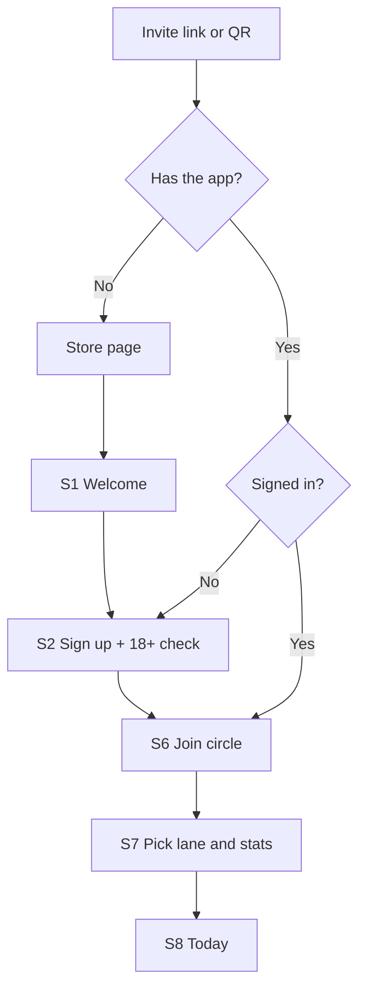

### Speaker's turn

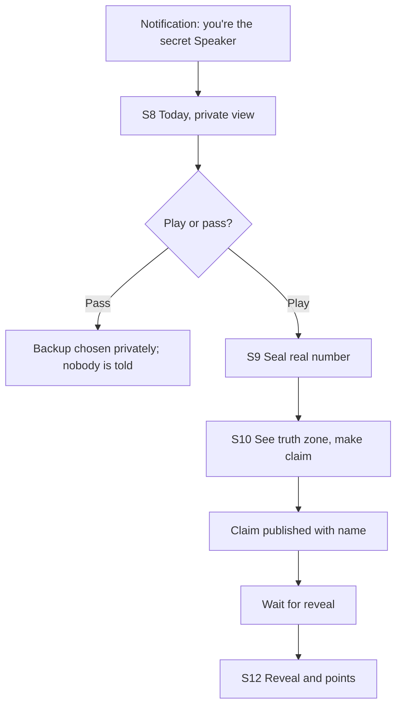

### Reader's turn

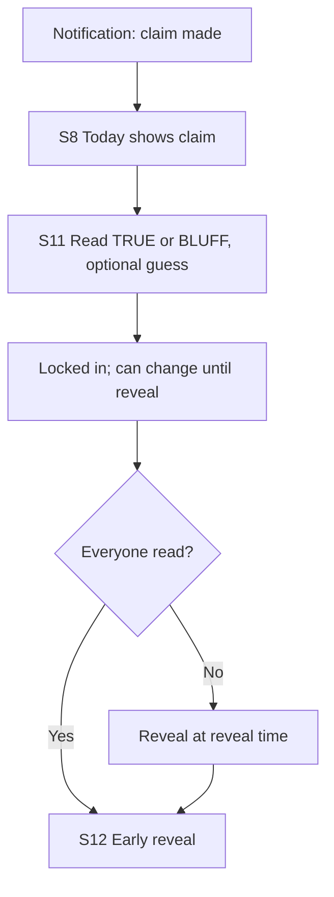

### Leaving and deleting

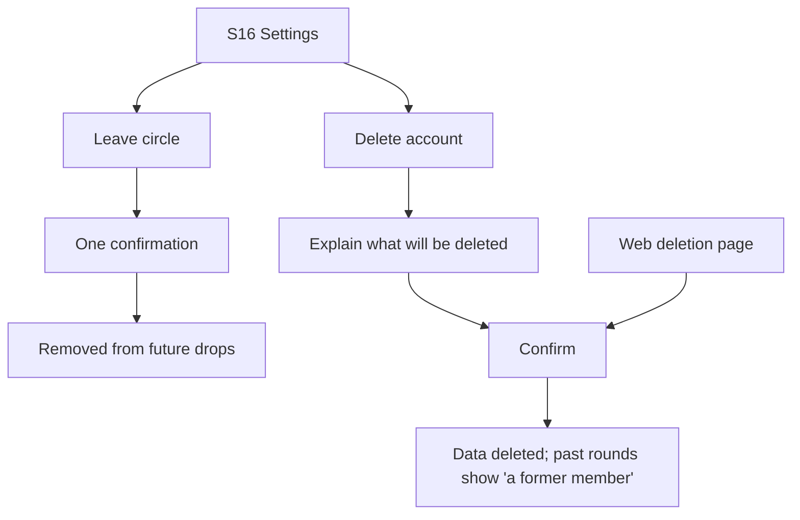


---

<!-- page: kb/06-design/accessibility.md · id: design.accessibility · status: proposal · updated: 2026-11-04 -->

## Accessibility

> **In short:** BLAG targets WCAG 2.2 AA (D-12); the reveal, stamps and number entry get special attention because they're the heart of the game.

### Requirements

| Area | Requirement | BLAG specifics |
|---|---|---|
| Contrast | Text 4.5:1, large text and UI parts 3:1 | Measured for every token in [visual identity](https://github.com/VIsHnu1762/blag/blob/main/kb/05-brand/visual-identity.md); purple only for large text |
| Not colour alone | Meaning never relies only on colour | TRUTH and BLUFF! differ in word, shape and icon (✓ vs ✗) |
| Text size | Support system font scaling to 200% | Number pads and stamps reflow; no truncated claims |
| Touch targets | At least 24×24 px (WCAG 2.2), aim for 44×44 | TRUE / BLUFF buttons are full-width |
| Screen readers | Every control labelled; reading order logical | Reveal announces: "Revealed: 8,000 steps. Bluff. You read Bluff: correct, plus 2." |
| Motion | Respect reduce-motion | Calm reveal variant ([visual identity](https://github.com/VIsHnu1762/blag/blob/main/kb/05-brand/visual-identity.md#motion)) |
| Timing | No action needs fast reactions in async play | Live mode (later) must allow extending its timer |
| Focus | Visible focus ring on every interactive element | Purple ring, 3:1 against background |
| Errors | Explained in text, with how to fix | "That number looks too high for steps. Check it?" |
| Haptics and sound | Never the only feedback | Every haptic has a visual equivalent |

### Inclusion beyond WCAG

| Need | Plan |
|---|---|
| Mid-range and older Android phones | Keep the reveal animation light; test on a 3–4 GB RAM device |
| Patchy data | Small payloads; offline queue; images compressed |
| Languages | English first; copy kept in string files from day one for translation |
| Number formats | Respect locale grouping (e.g. Indian 1,00,000 vs 100,000) *(Proposal)* |
| Colour blindness | Check stamps under protanopia, deuteranopia and tritanopia simulation |

### Testing

- Automated: lint for missing labels; contrast checks on tokens.
- Manual: VoiceOver (iOS) and TalkBack (Android) run-through of S8–S12 before each release.
- Include at least one participant who uses a screen reader in usability tests if possible.


---

<!-- page: kb/07-architecture/README.md · id: arch.home · status: draft · updated: 2026-11-04 -->

## Architecture

> **In short:** a React Native app talks to Supabase; all game decisions (timing, truth, points) happen on the server, and sealed numbers sit in a private schema clients can never read.

### System context

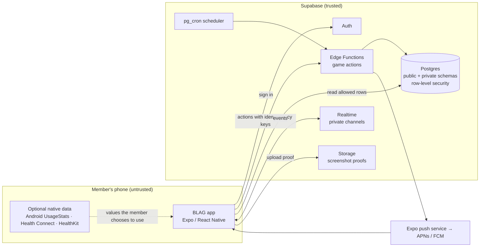

**Trust boundary:** everything on the phone is untrusted. The server never
accepts a score, a state change or a reveal from a client.

### Components

| Component | Responsibility | Key rule |
|---|---|---|
| App | Screens, input, animation, offline queue | Never computes points or truth |
| Game engine (shared TypeScript package) | Pure functions: truth zone, scoring, titles, Speaker choice | No I/O; fully unit-tested; used by Edge Functions |
| Edge Functions | Validate and apply every game action | Check state machine and membership on every call |
| Postgres | Source of truth | Row-level security on every public table; seals in `private` schema |
| Scheduler (pg_cron) | Open drops, cutoffs, reveals, season close | Idempotent jobs; runs every few minutes |
| Realtime | Tell clients something changed | Private channels per circle; payloads carry ids, not secrets |
| Storage | Screenshot proofs | Readable only after the reveal, only by circle members |
| Push | Notifications | Text never contains stats or Speaker identity before claim |

### Code layout and services

The full planned file structure is in [repository structure](https://github.com/VIsHnu1762/blag/blob/main/kb/07-architecture/repository-structure.md):
a pnpm monorepo with `apps/mobile`, shared `packages/` (game engine, contracts,
config) and `supabase/`. The backend is split into seven services (identity,
circles, game, league, scheduler, notifications, proofs) described in the
[service map](https://github.com/VIsHnu1762/blag/blob/main/kb/07-architecture/services.md).

### Architecture principles

1. **Server-authoritative** (ADR-003): the client asks; the server decides.
2. **Pure game engine**: every rule in [game design](https://github.com/VIsHnu1762/blag/blob/main/kb/03-game-design/README.md) is a pure function with tests.
3. **Least data**: store only what a feature needs ([data inventory](https://github.com/VIsHnu1762/blag/blob/main/kb/10-privacy-security/data-inventory.md)).
4. **Idempotent everything**: every action and job can safely run twice.
5. **Provider pattern for stats**: manual, Android and health providers share one interface (ADR-004).
6. **Boring technology**: few services, managed where possible (ADR-001, ADR-002).

### Pages

| Page | What it covers |
|---|---|
| [Backend blueprint](https://github.com/VIsHnu1762/blag/blob/main/kb/07-architecture/backend-blueprint.md) | Service internals, request pipeline, key flows, events, queues, SLOs, capacity, runbooks |
| [Data model](https://github.com/VIsHnu1762/blag/blob/main/kb/07-architecture/data-model.md) | Tables, keys, who can read what |
| [API and realtime](https://github.com/VIsHnu1762/blag/blob/main/kb/07-architecture/api-and-realtime.md) | Every action, scheduled job and realtime event |
| [Sealing and fairness](https://github.com/VIsHnu1762/blag/blob/main/kb/07-architecture/sealing-and-fairness.md) | How hidden values stay hidden and scoring stays honest |
| [Repository structure](https://github.com/VIsHnu1762/blag/blob/main/kb/07-architecture/repository-structure.md) | Every folder, dependency rules, naming, where things go |
| [Service map](https://github.com/VIsHnu1762/blag/blob/main/kb/07-architecture/services.md) | The seven backend services, their data, events and extraction rules |
| [Enterprise standards scorecard](https://github.com/VIsHnu1762/blag/blob/main/kb/07-architecture/enterprise-standards.md) | How the plan meets enterprise practice, and the gaps closed |
| [Learning guide](https://github.com/VIsHnu1762/blag/blob/main/kb/07-architecture/learning-guide.md) | Every folder and concept explained in plain words |
| [ADRs](https://github.com/VIsHnu1762/blag/blob/main/kb/07-architecture/adr/README.md) | Architecture decisions and their reasons |


---

<!-- page: kb/07-architecture/backend-blueprint.md · id: arch.blueprint · status: proposal · updated: 2026-11-04 -->

## Backend blueprint

> **In short:** every action goes through the same pipeline (check who you are, check you haven't sent it before, check the shape, apply the game rules, save the change and its event in one database transaction); points are worked out as people read, so the evening reveal is just a quick switch that scales to thousands of circles at once.

Builds on the [service map](https://github.com/VIsHnu1762/blag/blob/main/kb/07-architecture/services.md) (who owns what) and
[API and realtime](https://github.com/VIsHnu1762/blag/blob/main/kb/07-architecture/api-and-realtime.md) (the list of actions). The user-facing
words for each step are in the [UX language map](https://github.com/VIsHnu1762/blag/blob/main/kb/06-design/ux-language.md).

### Containers (C4 level 2)

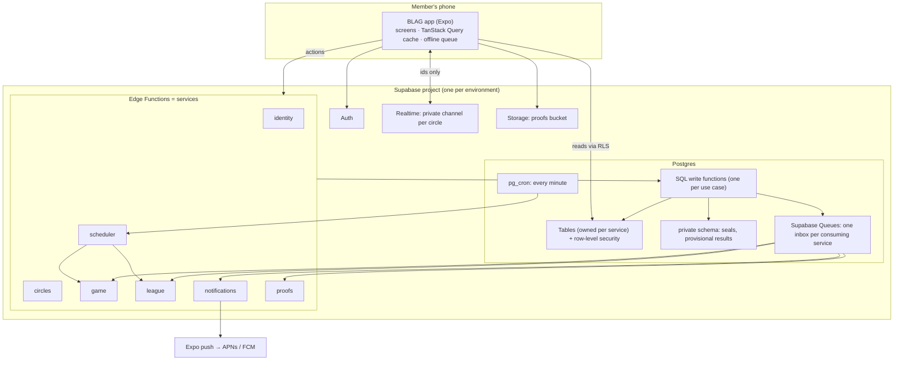

### Inside a service

#### Layers

| Layer | Job | Example in `game/claim` | May import |
|---|---|---|---|
| **Handler** | Parse HTTP, auth token, idempotency key; return a response | `handlers/claim.ts` | use cases, `_shared` |
| **Use case** | One business action, start to finish | `usecases/make-claim.ts` | domain, data |
| **Domain** | The rules, pure | `@blag/game-engine`: `isTruth`, `canClaim` | nothing |
| **Data** | Read state; call one SQL write function | `data/rounds.ts` → `game.claim_round()` | `_shared/db` |

Folder for each service:

```text
supabase/functions/game/
├── index.ts            # tiny router: "/claim" → handlers/claim.ts …
├── handlers/           # one file per action
├── usecases/           # one file per business action
├── data/               # queries and calls to SQL write functions
└── events/             # handlers for events from this service's inbox
```

The SQL write functions live in migrations (`supabase/migrations/…_game_functions.sql`).

#### The request pipeline (every action)

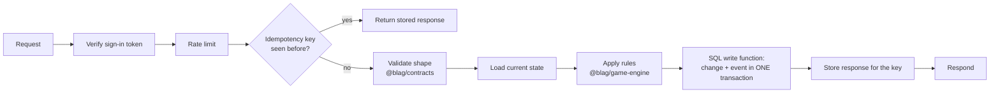

**Why one SQL function per write:** Supabase Queues live inside Postgres, so a
SQL function can save the change *and* put the event on the queue in a single
transaction. Either both happen or neither does, so no event is ever lost or
sent for a change that didn't save. The function also re-checks the state
(e.g. "still OPEN?") with a row lock, which closes race conditions.

### Key flows

#### 1. Seal and claim ("Lock it in" → "Drop your number")

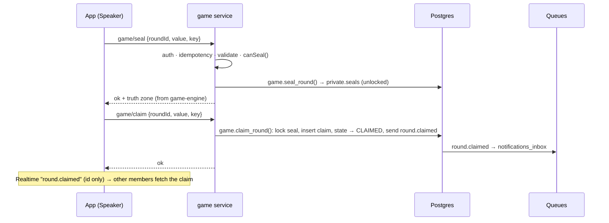

#### 2. Read, and score on write ("Call it")

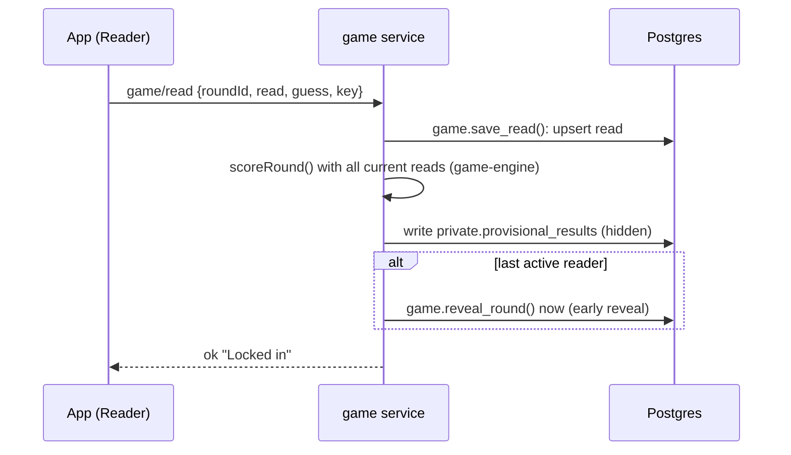

**Score on write:** each read is followed by a recompute of that round's
points (at most 7 reads, so it's instant) into a hidden table. At reveal time
nothing needs computing: the reveal just copies the seal value and the
provisional points into the visible results and flips the state. This makes the
9pm rush cheap.

#### 3. Scheduled reveal ("The Reveal")

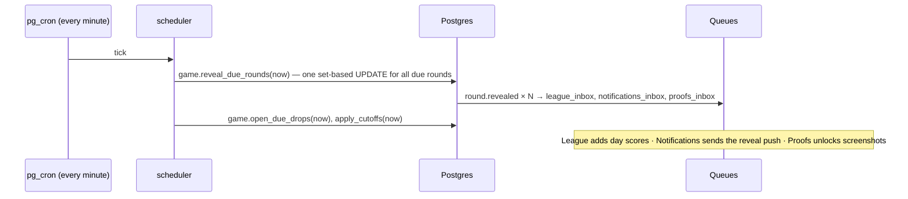

#### 4. Season close ("Season Wrap")

1. Scheduler, first tick after local midnight on the 1st: `league.close_due_seasons(now)`.
2. League computes best-20 season scores from `day_scores` (already up to date from events).
3. `assignTitles()` from the game engine; titles written.
4. `season.finale_ready` → Notifications ("Season's over! Your title is waiting 🏆").
5. New season row created.

#### 5. Delete account ("Delete everything")

1. `identity/delete-account` → SQL: mark account deleting, send `account.deleted` to every inbox.
2. Each service deletes or anonymises its own rows when it handles the event.
3. Identity deletes the auth user last; a completion record (no personal data) is kept.

### Event catalogue

All payloads carry ids and timestamps only, never stat values or names.

| Event | v | Producer | Consumers | Payload |
|---|---|---|---|---|
| `drop.opened` | 1 | game | notifications (Speaker nudge) | `dropId, circleId, speakerId` (to the Speaker's push only) |
| `round.claimed` | 1 | game | notifications | `roundId, circleId` |
| `round.revealed` | 1 | game | league, notifications, proofs | `roundId, circleId, seasonId, localDate` |
| `league.updated` | 1 | league | (realtime only) | `seasonId, circleId` |
| `season.finale_ready` | 1 | league | notifications | `seasonId, circleId` |
| `circle.member_joined` | 1 | circles | game | `circleId, userId` |
| `circle.member_left` | 1 | circles | game, league | `circleId, userId` |
| `consent.changed` | 1 | circles | game | `userId, statId, on` |
| `account.deleted` | 1 | identity | all | `userId` |

Rules: events are versioned (`v`); consumers ignore fields they don't know;
every handler is idempotent (keyed on event id).

### Queues

| Queue (inbox) | Read by | Every | Batch | Retry | Dead letter |
|---|---|---|---|---|---|
| `league_inbox` | league | 1 min | 100 | Message stays if handler fails; retried next run [S-71] | Moved to `league_dlq` after 5 attempts |
| `notifications_inbox` | notifications | 1 min | 500 | Same | `notifications_dlq` |
| `game_inbox` | game | 1 min | 100 | Same | `game_dlq` |
| `proofs_inbox` | proofs | 5 min | 100 | Same | `proofs_dlq` |

A small `event_subscriptions` table says which inboxes receive each event, so
adding a new consumer is a data change, not a code change in the producer.

### Scheduler timings

`pg_cron` calls `scheduler` **every minute** (ADR-005). Each tick runs, in order:
`open_due_drops` → `apply_cutoffs` → `reveal_due_rounds` → `close_due_seasons` →
`cleanup_retention` (hourly). All are idempotent set-based SQL updates that only
touch rows whose time has passed.

### Service-level objectives

| Objective | Target | Measured by |
|---|---|---|
| Reveal visible after reveal time | 99% within 2 minutes | `revealed_at − reveal_at` |
| Action success (excluding user errors) | 99.5% | Error logs per action |
| Action speed | p95 under 800 ms from India | Function timing logs |
| Reveal push delivered | 95% within 5 minutes | Notification log vs reveal time |
| Seal never readable before reveal | 100% (security invariant) | Access-rule tests on every change |

### Capacity estimate *(Estimate)*

Scenario: **10,000 circles, 5 members on average (50,000 people)**.

| Per day | Count |
|---|---|
| Claims | ~10,000 |
| Reads (incl. changes) | ~60,000 |
| Reactions | ~100,000 |
| Pushes | ~150,000 |

**Peak:** if most circles keep the default 9pm reveal, ~7,000 rounds reveal in
the same minute. With score-on-write, that's one SQL update plus ~7,000 queue
messages per inbox; League and Notifications drain them in a few minutes of
batches. App traffic at 9pm: roughly 35,000 people opening the reveal within 10
minutes, about 60 reads per second, well within a managed Postgres.
*Mitigation if needed:* suggest staggered default reveal times (e.g. 8:30, 9, 9:30).

### Errors

| Code | Meaning | App behaviour |
|---|---|---|
| `not_member` | Not in this circle | Return to Home |
| `wrong_state` | e.g. claim after the cutoff | Refresh the drop; friendly "That moment has passed" |
| `not_speaker` | Not today's Speaker | Refresh |
| `invalid_value` | Out of range | Inline message on the number pad |
| `circle_full` | 8 members already | "This circle is full" |
| `rate_limited` | Too many actions | Wait and retry quietly |
| `internal` | Our fault | Retry with the same idempotency key, then "That didn't go through. Try again?" |

### Observability

- **Logs:** JSON lines with `requestId`, `eventId`, `service`, `action`, `circleId`, `durationMs`, `outcome`. Never stat values, names or tokens.
- **Metrics (from logs and SQL):** actions per minute, p95 duration, error rate per action, queue depth per inbox, dead-letter count, reveal lag, push failures.
- **Alerts:** reveal lag over 5 minutes; any dead-letter message; error rate over 2% for 10 minutes; queue depth growing for 15 minutes.
- **Tracing:** the `requestId` is copied into the event, so one user action can be followed across services.

### Security per layer

| Layer | Control |
|---|---|
| App | No secrets bundled; only the public key; token in secure storage |
| Handler | Verify sign-in token; rate limit; reject unknown fields |
| Use case | Check membership and Speaker role every time |
| Data | Service-role key only inside functions; SQL functions re-check state with row locks |
| Database | Row-level security on all public tables; `private` schema not exposed to clients |
| Realtime | Private channels; ids-only payloads |
| Storage | Proofs readable only by circle members after reveal |

### Runbooks

| Symptom | First checks | Fix |
|---|---|---|
| Reveals late | `cron.job_run_details` for scheduler failures; function logs | Re-run the tick (idempotent); fix the failing step |
| Queue growing | Consumer function errors; dead-letter messages | Fix the handler; move dead letters back to the inbox |
| Pushes failing | Expired tokens; push service status | Delete invalid tokens; retry |
| Migration failed on deploy | CI logs | Fix forward with a new migration; never edit an applied one |
| Suspected seal leak | Access-rule tests; recent policy changes | Revert the policy; investigate; follow the breach plan (DPDP 72-hour notice, [compliance](https://github.com/VIsHnu1762/blag/blob/main/kb/10-privacy-security/compliance.md)) |

### Open items

- Confirm Supabase Queues' visibility-timeout and read-count fields for the dead-letter rule.
- Load-test the 9pm peak with seeded circles before the beta.


---

<!-- page: kb/07-architecture/data-model.md · id: arch.data · status: draft · updated: 2026-11-04 -->

## Data model

> **In short:** one Postgres schema per service; the app can only *read*, through `api` views that show each person their own circles; every write goes through an Edge Function that may only run its own service's functions; the sealed number sits in a `private` schema nobody can read and is deleted at the reveal.

The schema is real: it lives in [`supabase/migrations`](https://github.com/VIsHnu1762/blag/tree/main/supabase/migrations)
(13 files, plain SQL, ADR-011) and is tested by [`supabase/tests`](https://github.com/VIsHnu1762/blag/tree/main/supabase/tests)
(49 pgTAP checks). When this page and the migrations disagree, **the migrations win**; fix this page.
Names follow the [glossary](https://github.com/VIsHnu1762/blag/blob/main/kb/00-start-here/glossary.md) code names.

### Schemas

| Schema | Owner (service) | Holds | Exposed to the app? |
|---|---|---|---|
| `identity` | identity | profiles, consents, stat preferences | No (read through `api`) |
| `circles` | circles | circles, schedule versions, members, away, invites, blocks, reports | No |
| `game` | game | stat catalogue, rounds, reads, results, reactions, rest answers | No |
| `league` | league | seasons, day scores, standings, titles | No |
| `notify` | notifications | devices, preferences, delivery log | No |
| `ops` | scheduler + platform | idempotency keys, audit log, feature flags, blocked terms, deletion requests | No |
| `private` | game | sealed numbers | **Never**: no grants, no policies |
| `api` | (read model) | views and two read-only functions | **Yes, the only one** |

### Entity diagram

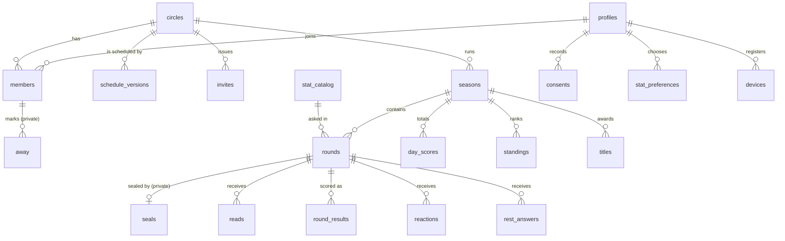

A **drop** is not a table: it is all rounds of one circle on one day, `(circle_id, play_date)`, with `slot` 1 or 2 (D-29).

### Tables

Every column, type and constraint is in the migration files; this is the map.

| Table | What it holds | Key rules |
|---|---|---|
| `game.stat_catalog` | One row per stat (`ST-01`…) with unit, range and honest-range floor | Seeded from `kb/data/stats.yaml`; `is_health` marks steps and sleep (D-39) |
| `identity.profiles` | Display name, preset avatar, locale, time zone | 1–24 character name; **no date of birth**, only `age_attested_at` (D-27) |
| `identity.consents` | Append-only ledger: purpose, stat, granted or withdrawn, notice version | Health stats need their own `health_stats` consent (D-39) |
| `identity.stat_preferences` | Which stats a person will be asked about (their focus lane) | Enabling needs a granted consent (checked in the write function) |
| `circles.circles` | Name, home time zone, member cap 3–8 | |
| `circles.schedule_versions` | Drop time, rounds per day, reveal times, from a date | Takes effect from a future date; 2 reveals ≥ 3 hours apart; first reveal ≥ 4 hours after the drop (D-29) |
| `circles.members` | Membership, organiser role, joined and left times | One active organiser per circle |
| `circles.away` | Away days (F-13) | Readable only by the member themselves |
| `circles.invites` | 8-character code, expiry (7 days), max uses (7) | Members-only; purged a day after expiry |
| `circles.blocks`, `circles.reports` | Block list and reports (Apple 1.2, D-42) | Reports answered within 24 hours |
| `league.seasons` | One per calendar month per circle | Seasons in a circle can never overlap; one active at a time |
| `game.rounds` | One round: card type, state, stat, prompt, Speaker, four times, claim, revealed value, truth zone | Unique per circle, date and slot; the times must be in order; a revealed stat round must carry its value, zone and verdict |
| `private.seals` | The real number | Written once; deleted at the reveal, or when a backup Speaker takes over |
| `game.reads` | TRUE or BLUFF plus an optional guess | Changeable until the reveal |
| `game.round_results` | Points per person per round | Rebuilt on every read (D-22); reader 0–4, Speaker 0–3 |
| `game.reactions` | Emoji from a fixed set of six | No free text (D-42) |
| `game.rest_answers` | Rest-card choice, as an option key | Hidden until the reveal; no points |
| `league.day_scores` | Points per person per day | 0–8 (two rounds × 4) |
| `league.standings` | Best-20 total, days played, rank | D-16 |
| `league.titles` | One title per member per season | |
| `notify.devices`, `notify.preferences`, `notify.deliveries` | Push tokens, quiet hours, daily cap, delivery log | Log kept 30 days; `dedupe_key` stops double sends |
| `ops.*` | Idempotency (48 h), audit log (never stat values), flags, blocked terms, deletion requests | No client access |

### Round lifecycle in the database

Follows the [state machine](https://github.com/VIsHnu1762/blag/blob/main/kb/03-game-design/state-machine.md).

| State | Meaning | Who moves it on |
|---|---|---|
| `scheduled` | Created ahead of the drop | scheduler at drop time → `open`, or `paused` if under 3 members |
| `open` | The Speaker may seal, then claim, before their cutoff | `game.claim` → `claimed`; scheduler picks a backup at the first cutoff; at the backup cutoff it becomes a rest card (`rest`) |
| `claimed` | Members read | last read reveals early; otherwise the scheduler reveals at `reveal_at` |
| `rest` | Rest card (Sundays, or no claim) | scheduler at `reveal_at` |
| `revealed` | Everything visible; events sent | final |

`REVEALED` and `CLOSED` from the state machine are one step here: points already exist when the round reveals.

### Who can do what

| Role | Can | Cannot |
|---|---|---|
| `anon` (not signed in) | Nothing | Anything |
| `authenticated` (app user) | `SELECT` on chosen columns, filtered by RLS; read `api` views; call `api.me()` and `api.round_progress()` | Write any table; call any write function; read `private`, `ops`, `seed` or `speaker_attempt` |
| `svc_<service>` (one per Edge Function) | Run its own service's write functions | Read or write tables directly; run another service's functions |
| Table owner (migrations) | Owns everything; write functions run as owner | |
| `service_role` key | Not used by app code (CI and admin scripts only) | |

#### What a member sees (RLS)

| Data | Visible to |
|---|---|
| Circle, schedule, members, invites, seasons, standings, titles, day scores | Active members of that circle |
| Rounds | Members; **the Speaker's identity only after the claim**, except to the Speaker (D-15, via `api.rounds`) |
| The real number | Nobody until the reveal (it is copied to the round at the reveal) |
| Reads, rest answers | Your own always; everyone's after the reveal |
| Results, reactions | After the reveal |
| "4 of 6 have read" | Members, as counts only (`api.round_progress`) |
| Away days, consents, stat preferences, devices, blocks, your reports | Only you |
| Profiles | Your own, plus name and avatar of people who share a circle with you |
| Realtime broadcasts on `circle:<id>` | Members only; nobody may send; payloads carry ids, never numbers |

### How a write happens

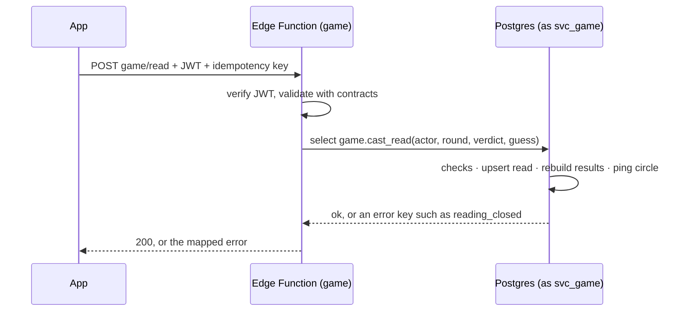

Error keys raised by the functions (`not_speaker`, `speaker_window_closed`, `seal_first`, `already_sealed`,
`value_out_of_range`, `not_member`, `speaker_cannot_read`, `reading_closed`, `round_not_found`) map one-to-one
to `@blag/contracts` errors.

### Events and jobs

| Event | From | To queue |
|---|---|---|
| `round.revealed` | game | `league_inbox` (stat rounds), `notify_inbox` (all) |
| `member.left` | circles | `game_inbox` |
| `user.deletion_due` | identity | `circles_inbox`, `game_inbox` |
| `season.closed` | league | `notify_inbox` |

Each inbox has a `*_dlq` dead-letter queue (after 5 attempts). `pg_cron` calls the scheduler every minute and
purges expired idempotency keys, old delivery logs and expired invites. The project URL and scheduler secret come
from Supabase Vault.

### Deletion behaviour

| When | What happens |
|---|---|
| Member leaves a circle | `left_at` set; future rounds exclude them; past rows stay for the circle's history |
| Account deleted | After the undo window the identity service deletes the auth user through the Auth admin API; profile, consents, preferences, devices, memberships, reads, results, reactions and any unrevealed seal cascade away. Rounds they spoke in keep their numbers as anonymous circle history with `speaker_id = null`, shown as "a former member" |
| Round revealed | The sealed row is deleted in the same transaction |
| Circle archived | Rounds stop; data retained per the [retention policy](https://github.com/VIsHnu1762/blag/blob/main/kb/10-privacy-security/data-inventory.md) |

### Testing

| Suite | Checks |
|---|---|
| `supabase/tests/sql/game_rules.test.sql` (25) | Truth zone, guards, seal-once, scoring with ties, early reveal, timed reveal, rest cards, seal deletion, queued events, schedule rules |
| `supabase/tests/rls/access_rules.test.sql` (24) | Speaker secrecy, own-read-only before reveal, counts-only progress, `private` denied, hidden columns, no direct writes, away privacy, realtime for members only, outsiders see nothing, service roles limited to functions |

Run with `supabase test db` (needs Docker), or without Docker:
`PGTAP_SQL=/path/to/pgtap.sql scripts/db/test-local.sh` against any local Postgres.

### Changed from the first model

| Before | Now | Why |
|---|---|---|
| `drops` table with one round each | Rounds keyed by date and slot | 1 or 2 rounds a day (D-29) |
| Invite code stored hashed | Plain code, members-only, 7 days, 7 uses | Members must be able to re-share it; short life limits risk |
| `round_results.points` as JSON | One row per person per round | Simpler access rules and queries |
| `trust_level` and `proof_path` on seals | `input_method` only | Screenshot proof deferred (D-43) |
| `paused` column on members | `circles.away` table | Readable only by the member |
| Idempotency keys 48 h | Unchanged (48 h) | |


---

<!-- page: kb/07-architecture/api-and-realtime.md · id: arch.api · status: draft · updated: 2026-11-04 -->

## API and realtime

> **In short:** about twelve actions and two scheduled jobs; every action is authenticated, checked against the state machine, and idempotent.

### Conventions

- Actions are grouped by **service** (identity, circles, game, league, scheduler, notifications, proofs): each service is one Edge Function and each action a route inside it, e.g. `game/claim` ([service map](https://github.com/VIsHnu1762/blag/blob/main/kb/07-architecture/services.md), ADR-010).

- Each action is a Supabase **Edge Function** called with the member's auth token.
- Body includes `idempotency_key` (a UUID made on the device). Repeat calls with the same key return the first response.
- Errors return `{ error: { code, message } }`. Codes: `not_member`, `wrong_state`, `not_speaker`, `invalid_value`, `circle_full`, `rate_limited`.
- All times in requests and responses are ISO 8601 UTC; the app converts to local time.

### Actions

| Action | Input | Checks | Effect |
|---|---|---|---|
| `circle-create` | name, home_tz, times | 18+ confirmed | Creates circle, owner membership, invite code |
| `circle-invite-reset` | circle_id | Caller is owner | New invite code; old one stops working |
| `circle-join` | invite_code | Code valid; circle < 8 active members | Membership row |
| `circle-leave` | circle_id | Member | Sets `left_at`; removes from today's Speaker pool |
| `consent-set` | stat_id, on/off, extra_confirm | Stat exists; spicy/health need `extra_confirm` | Upserts consent |
| `lane-set` | circle_id, lane | Member | Updates lane from tomorrow |
| `round-seal` | round_id, value, proof_path? | Caller is current Speaker; state OPEN; value in range | Upserts `private.seals` (unlocked) |
| `round-claim` | round_id, value | Seal exists; state OPEN | Locks seal; writes claim; state → CLAIMED; realtime `round.claimed`; push N-2 |
| `round-pass` | round_id | Caller is current Speaker; state OPEN | Picks backup privately; push N-5 to backup |
| `round-read` | round_id, read, guess? | Member, not Speaker; state CLAIMED | Upserts read; if last missing read → triggers reveal |
| `round-react` | round_id, emoji | Member; state REVEALED/CLOSED; emoji in list | Inserts reaction |
| `account-delete` | confirm | Authenticated | Runs the deletion procedure ([data model](https://github.com/VIsHnu1762/blag/blob/main/kb/07-architecture/data-model.md#deletion-behaviour)) |

Rate limit *(Proposal)*: 60 actions per minute per user; 10 joins per hour per user.

### Scheduled jobs (pg_cron → Edge Function)

| Job | Every | Does |
|---|---|---|
| `drops-tick` | 1 minute | Creates tomorrow's drops; opens due drops; applies Speaker and backup cutoffs; reveals due rounds; scores revealed rounds |
| `season-tick` | 1 hour | Closes ended seasons; computes best-20 scores and titles; creates the next season |

Supabase supports calling Edge Functions on a schedule with `pg_cron` and
`pg_net` [S-43]. Schedules run in UTC, so jobs compare against stored UTC times.
Each job is idempotent: it only moves drops whose time has passed and whose
state hasn't changed.

### Realtime events

One **private channel per circle**: `circle:{circle_id}`. Access is limited to
members through row-level security policies on Realtime's messages table, with
the channel created as private [S-44] *(verify the feature's current status
before relying on it)*.

| Event | Payload | Sent when |
|---|---|---|
| `drop.opened` | drop_id, card_type | Drop opens (no Speaker id) |
| `round.claimed` | round_id | Claim made; clients then fetch the claim |
| `round.revealed` | round_id | Reveal done; clients fetch results |
| `league.updated` | season_id | Day scores written |
| `season.finale` | season_id | Titles written |
| `circle.changed` | circle_id | Membership or settings changed |

Payloads carry **ids only**. Clients fetch the data through row-level security,
so a leaked event can't reveal a seal, a read or who passed.

### Shared game engine

Edge Functions import the pure functions from `packages/game-engine`:

```ts
truthZone(seal: number, statId: StatId): { min: number; max: number }
isTruth(claim: number, seal: number, statId: StatId): boolean
scoreRound(input: { seal; claim; statId; reads: Read[] }): Record<UserId, number>
seasonScore(dayScores: number[]): number          // sum of best 20
assignTitles(stats: SeasonStats, seed: string): Record<UserId, TitleKey>
pickSpeaker(members: Member[], history: SpeakerHistory, seed: string): UserId | null
```

These signatures are a proposal; the rules they implement are in
[game design](https://github.com/VIsHnu1762/blag/blob/main/kb/03-game-design/README.md).


---

<!-- page: kb/07-architecture/sealing-and-fairness.md · id: arch.fairness · status: draft · updated: 2026-11-04 -->

## Sealing and fairness

> **In short:** the real number is locked on the server before the claim, reads stay hidden until the reveal, and only the server scores; what can't be stopped is someone lying in their own seal, which only spoils their own game.

### The fairness problem

On iPhone, the app can't read Screen Time numbers to share them (R-01), so
players type them in. Without care, a Speaker could change their "real"
number after seeing the reads, or a reader could peek at others' reads.

### The design

| Threat to fairness | Prevention |
|---|---|
| Speaker changes the truth after seeing reads | Seal is **locked** when the claim is made; stored in `private.seals`, which clients can't read or write directly |
| Reader sees the truth early | Seal is copied to `round_results` only at reveal; no API returns it before |
| Reader copies others' reads | Reads of others are readable only after `revealed_at` (row-level security) |
| Client sends fake points or forces a reveal | Points and state changes exist only in Edge Functions and scheduled jobs (ADR-003) |
| Network retries double-count | Idempotency keys on every action |
| Someone works out who passed | Secret Speaker; backups chosen privately; no counts in events or UI (D-15) |
| Speaker types a false seal | **Can't be prevented** for typed numbers. Mitigated by optional screenshot proof shown after reveal, trust badges, and the fact that it only spoils the Speaker's own round |
| Edited screenshot | Can't be fully prevented; no points depend on it (D-17) |

### Optional commitment receipt *(Proposal, Next)*

For extra transparency, at seal time the server can show the Speaker a short
receipt code made from a hash of (round id, value, random salt). At the reveal,
anyone can check the receipt matches the revealed value. This proves the
server didn't change the seal either. It's not needed for the MVP.

### Fairness across platforms

Android may later allow auto-read; iPhone won't. To keep things fair:
- Trust levels show as **badges only**, never points (D-17).
- Auto-read values can still be edited before sealing; an edited value shows the "typed" badge.

### Testing fairness

Automated tests must show that, as a normal member, it's impossible to:
1. read `private.seals`,
2. read another member's read before the reveal,
3. see `speaker_id` before the claim (unless you are the Speaker),
4. change a seal after the claim,
5. write to `round_results`, `day_scores` or `titles`.

See [quality](https://github.com/VIsHnu1762/blag/blob/main/kb/11-quality/README.md).


---

<!-- page: kb/07-architecture/repository-structure.md · id: arch.repo · status: proposal · updated: 2026-11-04 -->

## Repository structure

> **In short:** one monorepo with an `apps/` folder (the Expo app now, a small web app later), a `packages/` folder for code shared across apps and the server (game engine, contracts, config), and `supabase/` for the database and server functions; features are self-contained folders with strict import rules, so the codebase can grow from one developer to a team without a rewrite.

Status: **Proposal** (ADR-008, ADR-009, ADR-010). What exists today: `supabase/migrations` (13 files), `supabase/tests` (pgTAP) and `scripts/db`. Everything else is the plan.
Create folders **only when the first file needs them** (see [growth plan](#growth-plan-create-folders-only-when-needed)).

How this measures up against enterprise practice is in the [enterprise standards scorecard](https://github.com/VIsHnu1762/blag/blob/main/kb/07-architecture/enterprise-standards.md); a plain-language tour of every part is in the [learning guide](https://github.com/VIsHnu1762/blag/blob/main/kb/07-architecture/learning-guide.md).

### Goals

| Goal | How the structure supports it |
|---|---|
| One person can start fast | Small number of top-level folders; Expo defaults kept |
| A team can join later | Feature folders with owners; clear rules on what may import what |
| Game rules are identical everywhere | One pure `game-engine` package used by the app and the server |
| The server stays the authority | All scoring and state live under `supabase/`; the app only sends intents (ADR-003) |
| New card types (movies, memes, music) plug in | Card types are modules behind one interface (P-38 to P-41) |
| AI agents can work safely | Predictable paths, a where-does-it-go table, `AGENTS.md` at the root |
| Optimisation later without restructuring | Caching, lazy routes, build caching and grouped server functions are planned in |

### Top level

```text
blag/
├── apps/
│   ├── mobile/                  # Expo + React Native app (iOS, Android)            ← MVP
│   └── web/                     # Plain static pages: landing, invite, privacy, account deletion (D-31)   ← MVP
├── packages/
│   ├── game-engine/             # Pure TypeScript game rules: truth zone, scoring, titles, Speaker choice  ← MVP
│   ├── contracts/               # Shared API types, validation schemas, error codes, realtime events     ← MVP
│   ├── db-types/                # Types generated from the database schema (never hand-edited)          ← MVP
│   ├── tokens/                  # Design tokens: colours, type, spacing (from kb/05-brand)               ← Next
│   ├── ui/                      # Shared design-system components, if a second app needs them            ← Later
│   └── config/                  # Shared tsconfig, ESLint and Prettier presets                            ← MVP
├── supabase/
│   ├── config.toml              # Local Supabase settings
│   ├── migrations/              # SQL schema and row-level-security changes, in order
│   ├── functions/               # Edge Functions (Deno), grouped by domain
│   ├── tests/                   # SQL tests for access rules (pgTAP)
│   └── seed.sql                 # Local test data (fake circles, never real people)
├── kb/                          # This knowledge base
├── scripts/
│   ├── kb.py                    # Knowledge-base build and check
│   ├── db/                      # test-local.sh + supabase-stubs.sql: run migrations and pgTAP without Docker
│   ├── gen-stats-catalog.ts     # kb/data/stats.yaml → game-engine catalogue + SQL seed     ← Prototype
│   ├── gen-db-types.sh          # supabase gen types → packages/db-types                     ← Prototype
│   └── seed-demo.ts             # Fake circles for local play, never real people              ← Prototype
├── .github/
│   ├── workflows/               # ci.yml, kb.yml, deploy-backend.yml, codeql.yml, e2e.yml
│   ├── PULL_REQUEST_TEMPLATE.md # Only if a branch workflow is ever added (D-35)
│   ├── ISSUE_TEMPLATE/          # bug.yml, feature.yml
│   ├── renovate.json            # Dependency updates
│   └── CODEOWNERS               # ← Later, when a second person joins
├── .changeset/                  # Release notes and versions (Changesets, D-32)
├── .claude/skills/              # Design skills for agents: impeccable, intent (8), taste (D-25)
├── skills-lock.json             # Pinned sources and hashes of those skills
├── .vscode/                     # Recommended extensions and settings
├── PRODUCT.md                   # Product context read by the Impeccable design skill
├── AGENTS.md  CLAUDE.md  README.md  CONTRIBUTING.md  SECURITY.md  CHANGELOG.md  LICENSE
├── commitlint.config.js         # Conventional Commits check
├── package.json                 # Root: workspace scripts only, no app code
├── pnpm-workspace.yaml          # Declares apps/* and packages/*
├── turbo.json                   # Task graph and build cache (ADR-008)
├── tsconfig.base.json           # Strict TypeScript settings shared by all
├── .npmrc  .nvmrc  .editorconfig  .gitignore  .env.example
└── mkdocs.yml  requirements-docs.txt  llms.txt
```

Expo supports monorepos built with Bun, npm, pnpm or Yarn workspaces, and
configures its bundler for them automatically from SDK 52 onwards [S-67].

### `apps/mobile`

```text
apps/mobile/
├── app.config.ts                # App config per environment (dev, preview, production)
├── eas.json                     # EAS build and submit profiles
├── package.json
├── tsconfig.json                # Extends packages/config; "@/*" → src/*
├── assets/                      # Icons, splash, fonts, sounds, Rive/Lottie files
├── src/
│   ├── app/                     # ROUTES ONLY (Expo Router). Thin files that render feature screens
│   │   ├── _layout.tsx          # Root: AppProviders, fonts, error boundary
│   │   ├── +not-found.tsx
│   │   ├── join/[code].tsx      # Invite deep link (universal link / app link)
│   │   ├── (auth)/
│   │   │   ├── sign-in.tsx      # Email code, Google, Sign in with Apple (D-26)
│   │   │   ├── verify.tsx       # Enter the one-time code
│   │   │   └── age-check.tsx    # 18+ attestation (D-27)
│   │   ├── (onboarding)/
│   │   │   ├── welcome.tsx  lane.tsx  first-stat.tsx
│   │   ├── (main)/
│   │   │   ├── index.tsx        # Home: my circles
│   │   │   ├── circle/new.tsx
│   │   │   ├── circle/[circleId]/
│   │   │   │   ├── index.tsx    # Today's Drop (1 or 2 rounds, D-29)
│   │   │   │   ├── seal.tsx  claim.tsx  read.tsx
│   │   │   │   ├── reveal/[roundId].tsx
│   │   │   │   ├── league.tsx  invite.tsx  members.tsx
│   │   │   │   └── finale/[seasonId].tsx
│   │   │   ├── my-month.tsx
│   │   │   └── settings/
│   │   │       ├── index.tsx  notifications.tsx  stats.tsx  privacy.tsx
│   │   │       └── delete-account.tsx
│   ├── features/                # One folder per product feature (see anatomy below)
│   │   ├── auth/
│   │   ├── onboarding/
│   │   ├── circles/             # create, join, invite, leave
│   │   ├── consent/             # stats on/off, spicy and health confirmations, focus lane
│   │   ├── drop/                # today's state, catch-up card, rest day
│   │   ├── round/               # seal, claim, read, reveal, reactions
│   │   ├── league/
│   │   ├── finale/              # titles, moments, share card
│   │   ├── my-month/
│   │   ├── notifications/
│   │   └── account/             # settings, deletion
│   ├── cards/                   # Card-type UI plugins: stat (MVP), rest (MVP), movie/meme/music (later)
│   ├── ui/                      # App design system: Button, Card, Stamp, NumberPad, Avatar, Sheet
│   ├── providers/
│   │   └── AppProviders.tsx     # Query client, auth session, theme, i18n
│   ├── lib/                     # Infrastructure, no product logic
│   │   ├── supabase/            # Client, auth session, typed queries
│   │   ├── api/                 # Calls to Edge Functions with idempotency keys
│   │   ├── query/               # TanStack Query client, cache keys
│   │   ├── realtime/            # Circle channel subscription
│   │   ├── haptics/             # Seal, stamp and reveal haptics
│   │   ├── sound/               # Reveal and stamp sounds (respect silent mode)
│   │   ├── offline/             # Action queue for poor connections
│   │   ├── analytics/           # Wrapper that blocks stat values by design
│   │   ├── logging/             # Crash reporting with scrubbing
│   │   └── storage/             # SecureStore and local storage helpers
│   ├── i18n/                    # en.ts (the text catalogue), format.ts (numbers, durations)
│   ├── theme/                   # Reads tokens; light and dark themes
│   ├── config/                  # env.ts (typed environment), flags.ts (feature flags)
│   └── test/                    # Test helpers, fake API, fixtures
├── modules/                     # Local native modules (Expo Modules), added only when needed
│   ├── today-widget/            # iOS WidgetKit (Swift) + Android widget (Kotlin)    ← Later
│   └── android-usage/           # UsageStatsManager reader (Kotlin)                   ← Later
└── e2e/                         # Maestro end-to-end flows
```

In Expo Router, the `src/app` folder is only for routes: any other file placed
there is treated as a screen. Components, hooks and the rest live elsewhere in
`src/` [S-68].

#### Feature folder anatomy

Every feature follows the same shape, so people and agents always know where to look:

```text
features/round/
├── index.ts                 # PUBLIC API: the only file other code may import
├── screens/                 # Full screens used by routes in src/app
│   ├── SealScreen.tsx
│   └── RevealScreen.tsx
├── components/              # Pieces used only inside this feature
│   └── TruthZoneHint.tsx
├── hooks/                   # useRound(), useSubmitRead() …
├── api.ts                   # Queries and mutations for this feature (uses lib/api, lib/query)
├── state.ts                 # Local UI state if needed
├── copy.ts                  # Keys into the i18n catalogue for this feature
└── __tests__/               # Component and hook tests
```

Rules: a feature never imports another feature's internals, only its `index.ts`.
Shared logic moves down into `ui/`, `lib/` or a package.

### `apps/web`

Plain static HTML on free hosting; under 30 KB per page, no framework (D-31).

```text
apps/web/
├── index.html                   # Landing page (built with the Taste skill, D-25)
├── privacy.html                 # Privacy policy
├── delete-account.html          # The only page with sign-in (email code), for deletion from the web
├── join/index.html              # Invite page: reads the code from the URL, opens the app or shows store buttons; loads no data
├── .well-known/
│   ├── apple-app-site-association   # iOS universal links for /join
│   └── assetlinks.json              # Android app links for /join
└── assets/                      # One small CSS file, icons
```

### `packages/`

```text
packages/game-engine/
├── src/
│   ├── truth-zone.ts            # truthZone(), isTruth()
│   ├── scoring.ts               # scoreRound()
│   ├── season.ts                # seasonScore() (best 20)
│   ├── titles.ts                # assignTitles()
│   ├── speaker.ts               # pickSpeaker(), pickStat()
│   ├── state-machine.ts         # allowed transitions per drop state
│   ├── cards/                   # Card-type rules: stat.ts, rest.ts (one interface for all)
│   ├── catalog/stats.ts         # Generated from kb/data/stats.yaml
│   └── index.ts
├── test/                        # Unit + property tests (Vitest, fast-check); edge-cases.test.ts covers E-1..E-25
└── package.json                 # No runtime dependencies. No React, no Supabase, no I/O

packages/contracts/
├── src/
│   ├── actions/                 # Request and response shapes, one file per service (identity.ts, circles.ts, game.ts …)
│   ├── events.ts                # Queue events between services (round.revealed …)
│   ├── realtime.ts              # Realtime event names and payloads (ids only)
│   ├── errors.ts                # Error codes shared by app and server
│   └── index.ts
└── package.json                 # Depends only on a schema library (e.g. zod)

packages/db-types/               # Output of `supabase gen types`; regenerated in CI
packages/config/                 # tsconfig presets, ESLint config, Prettier config
packages/tokens/                 # Design tokens as TypeScript (and later JSON for Figma)
```

The game engine is the most important package: it's where the rules in
[game design](https://github.com/VIsHnu1762/blag/blob/main/kb/03-game-design/README.md) become code, tested once and used by
both the app (for instant previews such as the truth zone) and the server (for
the real result).

### `supabase/`

```text
supabase/
├── config.toml                  # Created by `supabase init` at kick-off; exposes only the `api` schema
├── migrations/                  # EXISTS. One change per file, never edited after it is applied
│   ├── 20261104000100_extensions.sql      # extensions, one schema per service, service roles
│   ├── 20261104000200_enums.sql
│   ├── 20261104000300_identity.sql        # stat catalogue, profiles, consents, stat preferences
│   ├── 20261104000400_circles.sql         # circles, schedule versions, members, away, invites, blocks, reports
│   ├── 20261104000500_league.sql          # seasons, day scores, standings, titles
│   ├── 20261104000600_game.sql            # rounds, reads, results, reactions, rest answers
│   ├── 20261104000700_private.sql         # sealed numbers
│   ├── 20261104000800_notifications.sql
│   ├── 20261104000900_ops.sql             # idempotency, audit, flags, blocked terms, deletion requests
│   ├── 20261104001000_rls.sql             # access helpers + row-level security
│   ├── 20261104001100_game_functions.sql  # truth zone, scoring, seal, claim, read, reveal
│   ├── 20261104001200_grants_api.sql      # least-privilege grants + api read views
│   └── 20261104001300_events_cron.sql     # queues and scheduled jobs
├── functions/                   # One folder per service (see the service map)
│   ├── deno.json                # Imports, including the shared packages
│   ├── _shared/                 # JWT check, errors, idempotency, db client per service role, rate limits
│   ├── identity/                # profile, consent, device registration, account deletion
│   ├── circles/                 # create, join, leave, invite, schedule, away, block, report
│   ├── game/                    # seal, claim, read, react, rest answer (uses packages/game-engine)
│   ├── league/                  # day scores, season close, titles (uses packages/game-engine)
│   ├── scheduler/               # tick: open drops, pick backups, rest cards, reveals (called by pg_cron)
│   ├── notifications/           # reads its queue, sends pushes
│   └── proofs/                  # screenshot proofs   ← Later (D-43)
├── tests/                       # EXISTS. pgTAP, run by `supabase test db`
│   ├── sql/game_rules.test.sql      # truth zone, scoring, guards, early and timed reveal
│   ├── rls/access_rules.test.sql    # who can see and run what
│   └── functions/               # Deno tests for Edge Functions   ← Prototype
└── seed.sql                     # Local test data (fake circles, never real people)
```

The database design, access rules and test commands are in the [data model](https://github.com/VIsHnu1762/blag/blob/main/kb/07-architecture/data-model.md).

Supabase recommends keeping shared function code in a folder whose name starts
with an underscore, and building a few larger functions that combine related
actions to reduce cold starts [S-69]. Inside each service the code is layered (handler → use case → domain → data); see the [backend blueprint](https://github.com/VIsHnu1762/blag/blob/main/kb/07-architecture/backend-blueprint.md#inside-a-service). BLAG follows that: each **service** from the [service map](https://github.com/VIsHnu1762/blag/blob/main/kb/07-architecture/services.md) is
one function folder, and each action from [API and realtime](https://github.com/VIsHnu1762/blag/blob/main/kb/07-architecture/api-and-realtime.md)
is a route inside it (ADR-010). Services talk to each other through events on a
queue, never by writing each other's tables. Importing code from outside `supabase/` (our
`packages/`) is supported for monorepos [S-70] *(verify the current deploy
command when setting up)*.

### Dependency rules

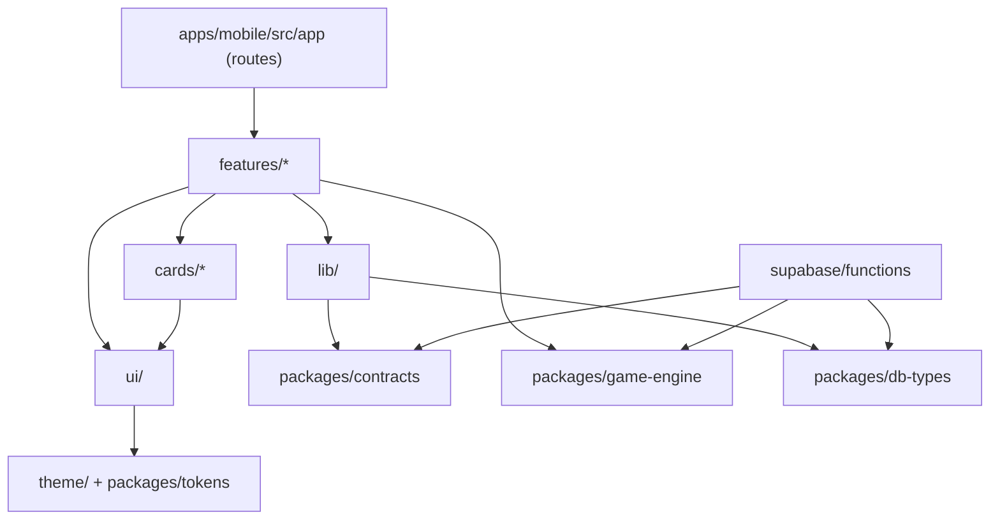

| Rule | Why |
|---|---|
| Arrows only point down. Nothing imports "upwards" | Prevents tangles as the app grows |
| `game-engine` imports nothing except the standard library | Rules stay pure and identical on app and server |
| Features import other features only through their `index.ts` | Each feature can change internally without breaking others |
| `src/app` files contain no logic; they render a feature screen | Routes can be reorganised freely |
| Only `lib/supabase` talks to Supabase directly | One place to change auth, retries and caching |
| Nothing in the app imports from `supabase/functions` | The server is a separate deployment |

Enforced in CI with an import-boundary lint rule (for example
`eslint-plugin-boundaries` or `dependency-cruiser`) *(Proposal, ADR-009)*.

### Naming conventions

| Thing | Convention | Example |
|---|---|---|
| Folders | kebab-case | `my-month/`, `truth-zone.ts` |
| React components and screens | PascalCase file and export | `RevealScreen.tsx` |
| Hooks | `use` + camelCase | `useSubmitRead.ts` |
| Pure functions | camelCase verbs | `scoreRound()` |
| Tests | Same name + `.test.ts(x)` | `scoring.test.ts` |
| Routes | Lowercase, glossary words | `circle/[circleId]/reveal.tsx` |
| Database | snake_case, glossary code names | `circle_members`, `reveal_at` |
| Edge Function routes | kebab-case verbs | `game/claim` |
| Environment variables | `EXPO_PUBLIC_` prefix only for values safe to ship in the app | `EXPO_PUBLIC_SUPABASE_URL` |
| Packages | `@blag/` scope | `@blag/game-engine` |

Use the [glossary](https://github.com/VIsHnu1762/blag/blob/main/kb/00-start-here/glossary.md) words in code: `circle`,
`drop`, `round`, `seal`, `claim`, `read`, `reveal`, `season`, `speaker`.

### Environments

| Environment | Supabase | App build | Used for |
|---|---|---|---|
| `local` | `supabase start` on your machine | Expo dev client | Daily development |
| `preview` | Separate Supabase project | EAS "preview" profile, internal distribution | Testers and the beta |
| `production` | Separate Supabase project | EAS "production" profile, stores | Real users |

Secrets (service-role key, push credentials) live only in Supabase and EAS
secret stores, never in the repo. `.env.example` lists every variable with a
fake value.

### Where does it go?

| I want to add… | Put it in |
|---|---|
| A new screen | Route file in `apps/mobile/src/app/…` + screen in `features/<feature>/screens/` |
| A rule about points, truth or titles | `packages/game-engine` + a test, then update `kb/03-game-design` |
| A new server action | Route in the owning service's `supabase/functions/<service>/` + shapes in `packages/contracts` |
| Something one service must tell another | An event in `packages/contracts/src/events.ts`, written to the outbox, handled idempotently |
| A database table or policy | New file in `supabase/migrations/` + test in `supabase/tests/` + update [data model](https://github.com/VIsHnu1762/blag/blob/main/kb/07-architecture/data-model.md) |
| A new card type (e.g. movie) | Rules in `packages/game-engine/src/cards/`, UI in `apps/mobile/src/cards/` |
| A reusable button or stamp | `apps/mobile/src/ui/` (move to `packages/ui` only if a second app needs it) |
| A colour or font size | `packages/tokens` |
| User-facing text | `apps/mobile/src/i18n/` catalogue, checked against [voice and tone](https://github.com/VIsHnu1762/blag/blob/main/kb/05-brand/voice-and-tone.md) |
| A native iOS or Android feature | `apps/mobile/modules/<name>/` as an Expo Module |
| A scheduled job | `supabase/functions/scheduler/` + a `pg_cron` entry in a migration |
| An end-to-end test | `apps/mobile/e2e/` |
| A decision | `kb/data/decisions.yaml`, or an ADR for technical ones |

### Built-in room to optimise later

| Area | Planned now | Turn on when |
|---|---|---|
| Build speed | Turborepo task cache | From day one; add remote cache when CI gets slow |
| App start time | Thin routes; heavy screens (finale, my month) loaded lazily | If cold start on a mid-range Android exceeds about 2 s |
| Lists | One list component wrapper in `ui/` | Swap the implementation without touching features |
| Network | TanStack Query cache, ids-only realtime events | Always on |
| Offline | `lib/offline` action queue with idempotency keys | MVP |
| Server cold starts | One function per service, not per action (ADR-010) | Always on |
| Hot service | Service boundaries with events | Extract that service into its own microservice ([service map](https://github.com/VIsHnu1762/blag/blob/main/kb/07-architecture/services.md#when-to-extract-a-service-into-its-own-microservice)) |
| Database | Indexes on `circle_id`, `season_id`, `local_date`, `round_id` | In the first migration |
| Updates | EAS Update channels per environment | For copy and bug fixes without store review (within store rules) |
| Native speed-ups | `modules/` for hot paths in Swift or Kotlin | Only if profiling shows a need |

### Growth plan: create folders only when needed

| Phase ([roadmap](https://github.com/VIsHnu1762/blag/blob/main/kb/12-roadmap/README.md)) | What exists |
|---|---|
| 2. Prototype | `apps/mobile` (auth, circles, round, a basic league), `packages/game-engine`, `packages/contracts`, `packages/config`, `supabase/` with `game` and `scheduler` services |
| 3. MVP | All MVP features, `apps/web` static pages, `packages/db-types`, the remaining services (identity, circles, league, notifications), e2e flows, CI |
| 4. Beta | `packages/tokens`, analytics and crash reporting in `lib/`, preview environment |
| Later | `modules/today-widget`, `modules/android-usage`, the proofs service (D-43), new card types, `packages/ui` if a second app shares components |

### Open questions

- Exact deploy command for Edge Functions importing `packages/` [S-70].


---

<!-- page: kb/07-architecture/services.md · id: arch.services · status: proposal · updated: 2026-11-04 -->

## Service map

> **In short:** BLAG is divided into seven services with clear jobs and their own data, talking to each other through events on a queue; they start as grouped Supabase Edge Functions in one project, and any of them can be moved out into its own microservice later without changing the others.

Status: **Proposal** (ADR-010, D-21).

### Why services now, separate deployments later

| Approach | For | Against for BLAG today |
|---|---|---|
| One big backend | Simplest | Hard to classify, optimise or hand over parts |
| **Service boundaries inside one Supabase project (chosen)** | Clear ownership and contracts; each service optimised on its own; cheap to run; one person can manage it | Shares one database (mitigated by ownership rules) |
| Full microservices (separate servers and databases) | Independent scaling and teams | Many deployments, network failures between services, data spread out, more cost; heavy for one developer before product-market fit |

The aim is a **modular** system: each service has its own code folder, its own
tables, its own actions and its own events. Because services never reach into
each other's internals, extracting one later is a move, not a rewrite.

### The services

| # | Service | Job | Owns data | Actions (from the app) | Emits events | Consumes events | Load profile |
|---|---|---|---|---|---|---|---|
| 1 | **Identity** | Accounts, age gate, profiles, deletion, push tokens | `profiles`, `push_tokens`, `idempotency_keys` | sign-up completion, profile update, register device, delete account | `account.deleted` | — | Low, spiky at sign-up |
| 2 | **Circles** | Circles, invites, membership, focus lanes, stat consent | `circles`, `circle_members`, `stat_consents` | create, join, leave, invite-reset, lane-set, consent-set | `circle.member_joined`, `circle.member_left`, `consent.changed` | `account.deleted` | Low |
| 3 | **Game** | Drops and rounds: Speaker choice, seal, claim, read, reveal, round scoring | `drops`, `rounds`, `private.seals`, `claims`, `reads`, `rest_answers`, `reactions`, `round_results` | seal, claim, pass, read, react | `drop.opened`, `round.claimed`, `round.revealed` | `circle.member_left`, `consent.changed`, `account.deleted` | Medium; peaks around reveal times |
| 4 | **League** | Day scores, best-20 season scores, finale, titles, recap | `seasons`, `day_scores`, `titles` | (read-only queries) | `league.updated`, `season.finale_ready` | `round.revealed`, `account.deleted` | Low, batch at month end |
| 5 | **Scheduler** | The clock: opens drops, applies cutoffs, triggers reveals, closes seasons | none (reads due times) | none (called by `pg_cron`) | — (calls Game and League) | — | Small, steady every few minutes |
| 6 | **Notifications** | Turns events into pushes; quiet hours; daily budget; no stats or Speaker leaks | `notification_log`, `notification_prefs` | update preferences | — | `drop.opened` (Speaker only), `round.claimed`, `round.revealed`, `season.finale_ready` | Bursty: many pushes at once |
| 7 | **Proofs** *(MVP-light)* | Screenshot upload, access only after reveal, deletion after 30 days | Storage bucket `proofs` | get upload URL, get view URL | — | `round.revealed`, `account.deleted` | Low; storage-bound |

Later candidates: **Cards** (movie, meme, music content), **Analytics**
(privacy-safe metrics), **Moderation** (for any future user content).

### How services talk

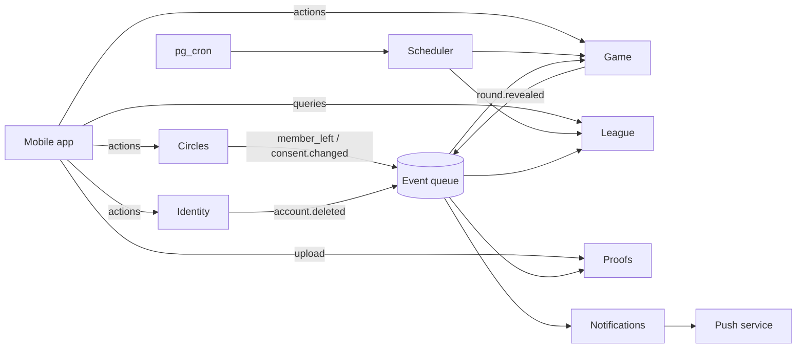

1. **App → service:** direct calls to that service's Edge Function, with an idempotency key.
2. **Service → service:** through **events**, not direct writes. A service writes the event to an *outbox* in the same database transaction as its change; a dispatcher puts it on a queue.
3. **Queue:** Supabase Queues, a pull-based message queue in Postgres [S-71]. An Edge Function reads a batch, processes it, and deletes each message; if processing fails, the message stays and is retried next run [S-71].
4. **Realtime to the app:** ids only, on private circle channels ([API and realtime](https://github.com/VIsHnu1762/blag/blob/main/kb/07-architecture/api-and-realtime.md)).

Every event handler must be **idempotent**: processing the same event twice gives
the same result.

### Data ownership rules

- Every table has **exactly one owning service**, listed above. Only the owner writes to it.
- Other services may **read** through a view or receive the data in an event; they never write.
- Row-level security still protects all client reads ([data model](https://github.com/VIsHnu1762/blag/blob/main/kb/07-architecture/data-model.md#who-can-read-what-row-level-security)).
- *(Later)* Move each service's tables into its own Postgres schema (`identity`, `circles`, `game`, …) once there's a second developer.

### Optimisation per service

| Service | What to optimise | How |
|---|---|---|
| Game | Reveal-time latency | Indexes on `(circle_id, local_date)`; precompute scores at reveal; keep the function warm by grouping actions |
| League | Month-end batch | Incremental day scores on each `round.revealed`, so the finale is a small final step |
| Notifications | Bursts at reveal times | Batch sends from the queue; respect quiet hours; drop stale pushes |
| Scheduler | Missed or double runs | Idempotent ticks that only move drops whose time has passed |
| Proofs | Storage cost | Compress on device; delete after 30 days |
| Identity | Abuse | Rate limits on sign-up and join |

### When to extract a service into its own microservice

Extract only with evidence. Triggers:

| Trigger | Likely first candidate |
|---|---|
| Push volume makes the queue lag at reveal times | Notifications → a dedicated worker (any language, e.g. Go) |
| Game actions need lower latency than Edge Functions give in a region | Game → a container service near users |
| Month-end finale takes minutes | League → a batch job runner |
| A second team owns part of the product | That team's service |
| A new card type needs heavy media processing | Cards/Proofs → a media service |

**How:** the extracted service keeps the same action contracts
(`packages/contracts`) and the same events, so the app and the other services
don't change. Move its tables last, once nothing else reads them directly.

### Code location

Each service is one folder in `supabase/functions/` with routes per action, plus
shared code in `_shared/` and the shared packages
([repository structure](https://github.com/VIsHnu1762/blag/blob/main/kb/07-architecture/repository-structure.md#supabase)).


---

<!-- page: kb/07-architecture/enterprise-standards.md · id: arch.standards · status: proposal · updated: 2026-11-04 -->

## Enterprise standards scorecard

> **In short:** the planned structure already meets most enterprise practices (layered architecture, service boundaries, ADRs, strict types, tests, access rules); this page closes the remaining gaps (commit conventions, versioning, code owners, dependency updates, security scanning, runbooks, service-level targets) and says which to switch on now and which to leave until there's a team.

"Enterprise grade" here means: a stranger (or an AI agent) can understand
the code, change it safely, ship it repeatably, and find out quickly when
something breaks. It doesn't mean "as many tools as possible".

### Scorecard

Legend: ✅ in the plan · 🆕 added on this page · ⏳ planned for later.

#### Architecture

| Practice | What it means | BLAG | Status |
|---|---|---|---|
| Layered / clean architecture | Business rules don't depend on UI, database or framework | `packages/game-engine` is pure; services use handler → use case → domain → data layers ([backend blueprint](https://github.com/VIsHnu1762/blag/blob/main/kb/07-architecture/backend-blueprint.md)) | ✅ |
| Bounded contexts (domain services) | Each part of the business owns its data and language | Seven services in the [service map](https://github.com/VIsHnu1762/blag/blob/main/kb/07-architecture/services.md) | ✅ |
| Architecture decision records | Every big decision written down with options and reasons | `kb/07-architecture/adr/` | ✅ |
| C4 diagrams | Architecture drawn at four levels: context, containers, components, code [S-73] | Context and containers in the [architecture overview](https://github.com/VIsHnu1762/blag/blob/main/kb/07-architecture/README.md); components in the [backend blueprint](https://github.com/VIsHnu1762/blag/blob/main/kb/07-architecture/backend-blueprint.md) | ✅ |
| Contract-first APIs | Request, response and event shapes defined once and shared | `packages/contracts` | ✅ |
| Config separate from code | Anything that changes between deploys lives in the environment, not in code [S-74] | Env vars per environment; secrets in Supabase and EAS stores | ✅ |

#### Code quality

| Practice | BLAG | Status |
|---|---|---|
| Strict TypeScript everywhere | `tsconfig.base.json` with `strict: true` | ✅ |
| Lint and format | Shared ESLint and Prettier in `packages/config` | ✅ |
| Enforced import boundaries | Lint rule in CI (ADR-009) | ✅ |
| Conventional Commits | Commit messages like `feat(game): add early reveal`, which tools turn into changelogs and version numbers [S-75] | 🆕 `commitlint` in CI |
| Semantic versioning and changelog | App version and `CHANGELOG.md` generated from commits | 🆕 Changesets or release-please |
| Code owners and pull-request template | Who reviews what; a checklist on every PR (red lines, tests, KB updated) | 🆕 `.github/CODEOWNERS`, `.github/pull_request_template.md` |
| Automated dependency updates | Weekly update PRs, grouped | 🆕 Renovate or Dependabot |

#### Testing

| Practice | BLAG | Status |
|---|---|---|
| Test pyramid | Many unit tests (game engine), fewer integration (functions, access rules), few end-to-end (Maestro) | ✅ [quality](https://github.com/VIsHnu1762/blag/blob/main/kb/11-quality/README.md) |
| Coverage gate on core rules | 95%+ line coverage on `game-engine`; no gate elsewhere at first | 🆕 |
| Access-rule tests | Every row of the who-can-read table is a test | ✅ |
| Contract tests | Schemas in `packages/contracts` validated on both sides | 🆕 |

#### Security

| Practice | BLAG | Status |
|---|---|---|
| Threat model | [Threat model](https://github.com/VIsHnu1762/blag/blob/main/kb/10-privacy-security/threat-model.md) | ✅ |
| Mobile security checklist | OWASP MASVS self-assessment before beta | ✅ |
| Secret scanning | GitHub secret scanning + push protection | 🆕 |
| Static analysis | CodeQL on TypeScript | 🆕 |
| Least privilege | Service-role key only inside functions; row-level security for every client read | ✅ |
| Security policy | `SECURITY.md` with how to report a problem | 🆕 |

#### Operations

| Practice | BLAG | Status |
|---|---|---|
| Separate environments | local, preview, production | ✅ |
| CI/CD | Checks on every PR; deploy functions and migrations from `main` | ✅ (workflow drafted in `scripts/ci/`) |
| Service-level objectives | e.g. reveals visible within 2 minutes of reveal time ([backend blueprint](https://github.com/VIsHnu1762/blag/blob/main/kb/07-architecture/backend-blueprint.md#service-level-objectives)) | 🆕 |
| Observability | Structured logs with request and event ids; key metrics; alerts | 🆕 [backend blueprint](https://github.com/VIsHnu1762/blag/blob/main/kb/07-architecture/backend-blueprint.md#observability) |
| Runbooks | Step-by-step fixes for known failures | 🆕 [backend blueprint](https://github.com/VIsHnu1762/blag/blob/main/kb/07-architecture/backend-blueprint.md#runbooks) |
| Backups and restore drill | Supabase backups; one restore rehearsal before beta | ⏳ |
| Feature flags | Turn features on per circle or per release | 🆕 `src/config/flags.ts`, values from the server |

#### Data, accessibility and docs

| Practice | BLAG | Status |
|---|---|---|
| Versioned migrations | `supabase/migrations/`, never edited after merge | ✅ |
| Data ownership and retention | [Service map](https://github.com/VIsHnu1762/blag/blob/main/kb/07-architecture/services.md), [data inventory](https://github.com/VIsHnu1762/blag/blob/main/kb/10-privacy-security/data-inventory.md) | ✅ |
| Accessibility standard | WCAG 2.2 AA | ✅ |
| Internationalisation-ready | Strings in catalogues from day one | ✅ |
| Living documentation | This KB, generated indexes, `AGENTS.md` | ✅ |

### Files added to the repository plan

```text
.github/
├── workflows/
│   ├── ci.yml                   # lint, types, boundaries, unit + access-rule tests, kb check
│   ├── e2e.yml                  # Maestro flows on preview builds (nightly)
│   ├── deploy-backend.yml       # migrations + Edge Functions on merge to main
│   ├── codeql.yml               # static security analysis
│   └── kb.yml                   # knowledge-base site (currently scripts/ci/kb-workflow.yml)
├── CODEOWNERS
├── pull_request_template.md
├── ISSUE_TEMPLATE/              # bug, feature, research question
└── renovate.json (or dependabot.yml)
.changeset/                      # release notes and versions (if Changesets is chosen)
commitlint.config.js
SECURITY.md
```

These are reflected in the [repository structure](https://github.com/VIsHnu1762/blag/blob/main/kb/07-architecture/repository-structure.md).

### Right-sizing for one person

| Switch on at the start | Leave until there's a team or users |
|---|---|
| Strict types, lint, import boundaries | Coverage gates outside the game engine |
| Game-engine and access-rule tests | Nightly end-to-end runs |
| Conventional Commits | CODEOWNERS (you own everything for now) |
| Secret scanning, CodeQL | Remote build cache |
| Environments and secrets handling | Formal on-call and incident process |
| ADRs and the KB | Separate database schemas per service |


---

<!-- page: kb/07-architecture/learning-guide.md · id: arch.learning · status: living · updated: 2026-11-04 -->

## Learning guide to the code structure

> **In short:** each idea below gets one plain sentence, an everyday analogy, how BLAG uses it, what breaks without it, and where to learn more; learn them in the order of the build phases at the bottom.

Think of BLAG's codebase as **a restaurant**: the app is the dining room, the
server is the kitchen, the database is the store room, and the rules of the
game are the recipe book everyone must follow. Most ideas below fit into that
picture.

### Part 1: The repository

#### Monorepo
- **What:** one Git repository that holds the app, the server code, shared code and the docs.
- **Analogy:** one building with several rooms, instead of separate buildings across town.
- **In BLAG:** `apps/`, `packages/`, `supabase/`, `kb/` in one repo (ADR-008).
- **Without it:** the app and server drift apart; a rule fixed in one place stays broken in another.
- **Learn next:** [Expo: monorepos](https://docs.expo.dev/guides/monorepos/), [pnpm workspaces](https://pnpm.io/workspaces).

#### `apps/` vs `packages/`
- **What:** `apps/` are things you ship to users; `packages/` are building blocks the apps share.
- **Analogy:** apps are the dishes served; packages are the shared sauces made once and used in many dishes.
- **In BLAG:** `apps/mobile`, `apps/web`; `packages/game-engine`, `contracts`, `config`.
- **Without it:** copy-pasted code that slowly becomes different in each copy.

#### Package manager and workspaces (pnpm)
- **What:** the tool that downloads libraries and links your own packages together.
- **Analogy:** the supplier who stocks the kitchen and labels which shelf belongs to which cook.
- **Learn next:** [pnpm workspaces](https://pnpm.io/workspaces).

#### Task runner with a cache (Turborepo)
- **What:** runs lint, tests and builds across all packages, and skips work whose inputs didn't change.
- **Analogy:** a chef who doesn't re-chop vegetables that are already chopped.
- **Without it:** CI gets slower every month.

#### Strict TypeScript
- **What:** JavaScript with types; "strict" makes the compiler refuse risky code.
- **Analogy:** a recipe that says "200 g sugar", not "some sugar".
- **In BLAG:** shared `tsconfig.base.json`. The same types travel from database to app.
- **Learn next:** [TypeScript handbook](https://www.typescriptlang.org/docs/handbook/intro.html).

### Part 2: The app (`apps/mobile`)

#### Routes folder (`src/app`)
- **What:** in Expo Router every file here is a screen with a URL; nothing else may live here.
- **Analogy:** the restaurant's floor plan: it says where tables are, not how food is cooked.
- **In BLAG:** thin route files that just show a feature's screen.
- **Learn next:** [Expo Router core concepts](https://docs.expo.dev/router/basics/core-concepts/).

#### Feature folders with a front door (`src/features/<feature>/index.ts`)
- **What:** all code for one product feature in one folder; other code may only use what `index.ts` exports.
- **Analogy:** apartments with a front door: neighbours ring the bell, they don't climb in through the window.
- **In BLAG:** `circles/`, `round/`, `league/`, `finale/` … (ADR-009).
- **Without it:** changing one feature breaks three others you didn't know were connected.

#### Design system (`src/ui/`, later `packages/tokens`)
- **What:** one set of buttons, cards, stamps and colours used everywhere.
- **Analogy:** the restaurant's plates and cutlery: every dish looks like it belongs.
- **In BLAG:** `Button`, `Stamp`, `NumberPad`; tokens from [visual identity](https://github.com/VIsHnu1762/blag/blob/main/kb/05-brand/visual-identity.md).

#### Infrastructure layer (`src/lib/`)
- **What:** code that talks to the outside world: Supabase, push, storage, analytics.
- **Analogy:** the waiter who carries orders between dining room and kitchen.
- **Without it:** network code scattered in screens; impossible to add retries or caching in one place.

#### Server state vs screen state (TanStack Query)
- **What:** data from the server is cached and refreshed by a library; small UI state (which button is pressed) stays in the screen.
- **Analogy:** the menu board (server state, updated centrally) vs your own notepad (screen state).
- **Learn next:** [TanStack Query](https://tanstack.com/query/latest).

### Part 3: Shared packages

#### Pure game engine (`packages/game-engine`)
- **What:** the rules as plain functions with no network, database or UI. Same input, same output, always.
- **Analogy:** the recipe book. The kitchen and the menu both follow it; nobody improvises.
- **In BLAG:** `truthZone()`, `scoreRound()`, `assignTitles()`; tested with every worked example in [scoring](https://github.com/VIsHnu1762/blag/blob/main/kb/03-game-design/scoring.md).
- **Without it:** the app shows one score, the server stores another.

#### Contracts (`packages/contracts`)
- **What:** the agreed shape of every request, response, error and event, checked at runtime with a schema library.
- **Analogy:** the order slip: the waiter and the kitchen both read the same form.
- **Learn next:** [Zod](https://zod.dev).

### Part 4: The backend (`supabase/`)

#### Postgres and row-level security (RLS)
- **What:** the database, plus rules on every row that decide who may read or write it.
- **Analogy:** a store room where each shelf has its own guest list at the door.
- **In BLAG:** a member can read their circle's revealed rounds, never a seal ([data model](https://github.com/VIsHnu1762/blag/blob/main/kb/07-architecture/data-model.md)).
- **Learn next:** [Supabase row-level security](https://supabase.com/docs/guides/database/postgres/row-level-security).

#### Migrations
- **What:** numbered SQL files that change the database step by step, applied in order everywhere.
- **Analogy:** numbered renovation permits: you can rebuild the same building anywhere by following them.
- **Without it:** your laptop's database and production's database quietly differ.

#### Services as Edge Functions
- **What:** small server programs, one per business area, that receive the app's requests.
- **Analogy:** kitchen stations: grill, pastry, drinks. Each has its own job and its own fridge.
- **In BLAG:** identity, circles, game, league, scheduler, notifications, proofs ([service map](https://github.com/VIsHnu1762/blag/blob/main/kb/07-architecture/services.md)).

#### Layers inside a service
- **What:** handler (reads the request) → use case (decides what to do) → domain (game engine rules) → data (database calls).
- **Analogy:** take the order → decide the steps → follow the recipe → fetch ingredients.
- **In BLAG:** [backend blueprint](https://github.com/VIsHnu1762/blag/blob/main/kb/07-architecture/backend-blueprint.md#inside-a-service).

#### Idempotency keys
- **What:** a unique id sent with each action so repeating it has no extra effect.
- **Analogy:** a receipt number: the cashier won't charge you twice for the same receipt.
- **In BLAG:** every action; essential on patchy mobile networks.

#### Events and queues
- **What:** a service announces "this happened"; others react in their own time, via a queue.
- **Analogy:** the office mail tray: you drop a note and carry on; the other department picks it up.
- **In BLAG:** `round.revealed` → League updates scores, Notifications sends pushes (Supabase Queues).
- **Without it:** services call each other directly and one slow service slows everyone.

#### Scheduler (cron)
- **What:** a clock that triggers jobs at set times.
- **Analogy:** the restaurant's opening and closing bell.
- **In BLAG:** opens drops, applies cutoffs, triggers reveals every minute.

#### Realtime channels
- **What:** a live connection so the app hears "something changed" instantly.
- **Analogy:** the kitchen bell that rings when a dish is ready; the waiter then fetches it.
- **In BLAG:** events carry only ids; the app then fetches data through access rules.

### Part 5: Shipping and running

#### Environments and config
- **What:** separate copies for development, testing and real users; settings in environment variables, not code.
- **Analogy:** rehearsal stage vs opening night.
- **Learn next:** [The Twelve-Factor App: config](https://12factor.net/config).

#### CI/CD
- **What:** robots that check every change (CI) and ship approved changes (CD).
- **Analogy:** a quality inspector at the kitchen door.

#### Test pyramid
- **What:** many fast small tests, fewer bigger ones, a handful of full-journey tests.
- **Analogy:** taste each ingredient often, each dish sometimes, the whole menu before opening night.

#### Conventional Commits and semantic versioning
- **What:** commit messages with a type (`feat`, `fix`) so tools can write release notes and pick the next version number.
- **Learn next:** [conventionalcommits.org](https://www.conventionalcommits.org), [semver.org](https://semver.org).

#### ADRs
- **What:** short records of why a technical decision was made.
- **Analogy:** meeting minutes you'll thank yourself for in six months.

#### Observability
- **What:** logs, metrics and alerts that tell you what the system is doing.
- **Analogy:** the dashboard in a car: speed, fuel, warning lights.

#### Feature flags
- **What:** switches that turn a feature on or off without a new app release.
- **Analogy:** a dimmer switch instead of rewiring the room.

### Learning order (matches the roadmap)

| Phase | Learn | Why then |
|---|---|---|
| Before coding | TypeScript basics, Git, Conventional Commits | Everything builds on these |
| Prototype | Expo Router, feature folders, pure functions and unit tests, Supabase basics (tables, auth, RLS) | First playable round |
| MVP | Edge Functions and layers, migrations, contracts, idempotency, TanStack Query, scheduler, realtime | Real circles playing daily |
| Beta | Events and queues, environments, CI/CD, observability, feature flags | Running it for others |
| Later | Native modules in Swift and Kotlin, extracting a service | Widgets, auto-read, scale |


---

<!-- page: kb/07-architecture/adr/README.md · id: arch.adr · status: living · updated: 2026-11-04 -->

## Architecture decision records

> **In short:** one short file per important technical decision, so anyone can see what was chosen, what else was considered, and why.

| ADR | Decision | Status |
|---|---|---|
| [ADR-001](https://github.com/VIsHnu1762/blag/blob/main/kb/07-architecture/adr/ADR-001-expo-react-native.md) | Use React Native with Expo | Accepted (D-19) |
| [ADR-002](https://github.com/VIsHnu1762/blag/blob/main/kb/07-architecture/adr/ADR-002-supabase-backend.md) | Use Supabase as the backend | Proposed (confirm at kick-off) |
| [ADR-003](https://github.com/VIsHnu1762/blag/blob/main/kb/07-architecture/adr/ADR-003-server-authoritative.md) | Server-authoritative game with sealed values | Accepted |
| [ADR-004](https://github.com/VIsHnu1762/blag/blob/main/kb/07-architecture/adr/ADR-004-stat-providers.md) | Manual entry first, behind a provider interface | Accepted |
| [ADR-005](https://github.com/VIsHnu1762/blag/blob/main/kb/07-architecture/adr/ADR-005-scheduled-drops.md) | Drive drops with a scheduler job | Proposed |
| [ADR-006](https://github.com/VIsHnu1762/blag/blob/main/kb/07-architecture/adr/ADR-006-persistent-circles.md) | Persistent circles instead of temporary rooms | Accepted |
| [ADR-007](https://github.com/VIsHnu1762/blag/blob/main/kb/07-architecture/adr/ADR-007-authentication.md) | Sign-in: email code, Google, Apple | Accepted (D-26) |
| [ADR-008](https://github.com/VIsHnu1762/blag/blob/main/kb/07-architecture/adr/ADR-008-monorepo.md) | Monorepo with pnpm workspaces and Turborepo | Proposed |
| [ADR-009](https://github.com/VIsHnu1762/blag/blob/main/kb/07-architecture/adr/ADR-009-feature-modules.md) | Feature modules with enforced import boundaries | Proposed |
| [ADR-010](https://github.com/VIsHnu1762/blag/blob/main/kb/07-architecture/adr/ADR-010-domain-services.md) | Domain services as grouped Edge Functions, connected by events | Proposed |
| [ADR-011](https://github.com/VIsHnu1762/blag/blob/main/kb/07-architecture/adr/ADR-011-sql-first-database.md) | Plain SQL migrations instead of Prisma | Proposed (D-40) |
| [ADR-012](https://github.com/VIsHnu1762/blag/blob/main/kb/07-architecture/adr/ADR-012-service-database-roles.md) | One database role per service; the app only reads | Proposed (D-41) |

### Writing a new ADR

1. Copy an existing ADR and use the next number (for example `ADR-0nn-short-name.md`).
2. Fill in context, decision, options considered and consequences.
3. Start as **Proposed**. The team marks it **Accepted**, or **Superseded by ADR-nnn** later.
4. Run `python scripts/kb.py build && python scripts/kb.py check`.


---

<!-- page: kb/07-architecture/adr/ADR-001-expo-react-native.md · id: adr.001 · status: agreed · updated: 2026-11-04 -->

## ADR-001: Use React Native with Expo

> **In short:** Build with React Native + Expo + TypeScript, using development builds (not Expo Go) once native modules are added, and EAS Build for store builds.

**Status:** Accepted on 2026-11-04 by the founder (D-19). Review after the prototype (Q-18).

### Context

We need one app for Android and iOS, built by a small student team, with room for native modules later (Android usage stats, health data).

### Decision

Build with **React Native + Expo + TypeScript**, using **development builds** (not Expo Go) once native modules are added, and **EAS Build** for store builds. Target the current Expo SDK at kick-off (SDK 56 shipped React Native 0.85 in May 2026, and Expo recommends moving to SDK 57 for a known regression) [S-42].

### Options considered

| Option | For | Against |
|---|---|---|
| **Expo + React Native** | One TypeScript codebase; fast iteration; Expo Modules for native code; managed builds | Custom native code needs dev builds; some native APIs need our own modules |
| Flutter | Strong UI performance; one codebase | Team's existing skills are JavaScript; Supabase and Expo tooling fit better with TS |
| Fully native (Swift + Kotlin) | Best platform access | Two codebases; too slow for a small team |
| Bare React Native | Full control | More setup and upkeep than Expo for little gain |
| Two native apps built with AI coding agents | Shopify moved this way in Sep 2026 because agents cut the cost of building twice [S-61] | Needs Swift and Kotlin skill to review agent output; two release tracks; game engine still shared only on the server |
| Valdi (Snap) | TypeScript UI compiled to native views; proven inside Snapchat [S-47] | Still in beta as open source; small community |

### Consequences

India is the first market and about 93% of phones there run Android [S-66], so one codebase for both platforms matters more than native depth. The founder learns Swift alongside for the parts that must be native: the home-screen widget, any private Screen Time view, and HealthKit.


Fast start and shared code with the backend's game engine (TypeScript). Review this decision at the end of the prototype phase (D-19, Q-18); see [industry benchmarks](https://github.com/VIsHnu1762/blag/blob/main/kb/08-tech-stack/industry-benchmarks.md). Native work (Android Usage Access, Health Connect, HealthKit) will need Expo Modules and development builds. Keep game logic out of UI components.


---

<!-- page: kb/07-architecture/adr/ADR-002-supabase-backend.md · id: adr.002 · status: proposal · updated: 2026-11-04 -->

## ADR-002: Use Supabase as the backend

> **In short:** Use Supabase: Auth, Postgres with row-level security, Edge Functions for every game action, `pg_cron` + `pg_net` for scheduled jobs [S-43], Realtime private channels [S-44], and Storage for screenshot proofs..

**Status:** Proposed (confirm at kick-off)

### Context

The game needs auth, a relational database with strict access rules, server-side functions, scheduled jobs, realtime updates and file storage, with as few services as possible.

### Decision

Use **Supabase**: Auth, Postgres with row-level security, Edge Functions for every game action, `pg_cron` + `pg_net` for scheduled jobs [S-43], Realtime private channels [S-44], and Storage for screenshot proofs.

### Options considered

| Option | For | Against |
|---|---|---|
| **Supabase** | All needed parts in one managed service; SQL and row-level security suit hidden values; generous free tier | Vendor coupling; Edge Functions run on Deno |
| Firebase | Mature realtime and auth | Document model and security rules are harder for relational game data and hidden values |
| Custom Node server + Postgres | Full control | More to build, host and secure |

### Consequences

One platform to learn and operate. Access rules live next to the data. Region choice and data residency must be decided (see [tech stack](https://github.com/VIsHnu1762/blag/blob/main/kb/08-tech-stack/README.md)).


---

<!-- page: kb/07-architecture/adr/ADR-003-server-authoritative.md · id: adr.003 · status: agreed · updated: 2026-11-04 -->

## ADR-003: Server-authoritative game with sealed values

> **In short:** Every state change, truth check, score and reveal happens in Edge Functions or scheduled jobs.

**Status:** Accepted

### Context

Clients are untrusted. If phones computed truth, points or reveals, a modified client could cheat or read hidden values.

### Decision

Every state change, truth check, score and reveal happens in **Edge Functions or scheduled jobs**. Seals live in a **private schema** with no client access. Clients only send intents (seal, claim, read, react) with idempotency keys.

### Options considered

| Option | For | Against |
|---|---|---|
| **Server decides** | Fair; hidden values stay hidden; one place to test rules | Every action needs a round-trip |
| Client computes, server stores | Snappier | Trivially cheatable |

### Consequences

Slight latency on actions, acceptable for a turn-based daily game. The game engine must be a pure, well-tested package (P-17).


---

<!-- page: kb/07-architecture/adr/ADR-004-stat-providers.md · id: adr.004 · status: agreed · updated: 2026-11-04 -->

## ADR-004: Manual entry first, behind a provider interface

> **In short:** All stat values come through a StatProvider interface: `ManualProvider` (MVP), later `AndroidUsageProvider` and `HealthProvider`.

**Status:** Accepted

### Context

iOS doesn't allow exporting Screen Time numbers (R-01). Android allows reading usage with special access but needs policy checks (Q-16). The MVP must work everywhere.

### Decision

All stat values come through a **StatProvider** interface: `ManualProvider` (MVP), later `AndroidUsageProvider` and `HealthProvider`. The game never depends on a provider being available. Each value carries a `trust_level` badge that never affects points (D-17).

### Options considered

| Option | For | Against |
|---|---|---|
| **Manual first, providers later** | Works on every phone; no permissions at launch | Relies on honesty (mitigated by sealing) |
| Auto-read first | Less typing | Impossible on iOS; delays launch |

### Consequences

The seal screen must make finding numbers easy (A-09). Native modules come only after the MVP.


---

<!-- page: kb/07-architecture/adr/ADR-005-scheduled-drops.md · id: adr.005 · status: proposal · updated: 2026-11-04 -->

## ADR-005: Drive drops with a scheduler job

> **In short:** A scheduler job runs **every minute** via `pg_cron` (changed from 5 minutes on 2026-11-04 to meet the 2-minute reveal objective, D-22) and advances any drop whose stored UTC time has passed.

**Status:** Proposed

### Context

Drops open, change Speaker, and reveal at circle-specific local times across many time zones.

### Decision

A scheduler job runs **every minute** via `pg_cron` (changed from 5 minutes on 2026-11-04 to meet the 2-minute reveal objective, D-22) and advances any drop whose stored UTC time has passed. A `season-tick` job runs hourly. Both are idempotent. Early reveal is triggered by the last read.

### Options considered

| Option | For | Against |
|---|---|---|
| **Periodic tick** | Simple; self-healing if a run is missed | Up to 5 minutes' delay |
| One scheduled job per drop | Exact timing | Thousands of jobs to manage |
| External cron service | Independent of the database | Another service |

### Consequences

Reveal is at most about a minute late, plus processing; see the [backend blueprint](https://github.com/VIsHnu1762/blag/blob/main/kb/07-architecture/backend-blueprint.md#scheduler-timings). Times are stored in UTC and computed with the time-zone database, so daylight-saving changes are handled.


---

<!-- page: kb/07-architecture/adr/ADR-006-persistent-circles.md · id: adr.006 · status: agreed · updated: 2026-11-04 -->

## ADR-006: Persistent circles instead of temporary rooms

> **In short:** Model a long-lived circle with seasons, drops and rounds.

**Status:** Accepted

### Context

The original spec used rooms with join codes for one game session. The product is now a daily ritual with monthly seasons (D-03).

### Decision

Model a long-lived **circle** with seasons, drops and rounds. Invite codes are stored hashed and can be reset.

### Options considered

| Option | For | Against |
|---|---|---|
| **Persistent circle** | History, seasons, titles, yearbook | More data to manage and delete correctly |
| Temporary rooms | Simple | No reason to return; no season |

### Consequences

Retention and deletion rules matter more ([data inventory](https://github.com/VIsHnu1762/blag/blob/main/kb/10-privacy-security/data-inventory.md)).


---

<!-- page: kb/07-architecture/adr/ADR-007-authentication.md · id: adr.007 · status: agreed · updated: 2026-11-04 -->

## ADR-007: Sign-in method

> **In short:** Email one-time code, Google, and Sign in with Apple on iPhone; phone numbers after the MVP.

**Status:** Accepted (D-26, 2026-11-04)

### Context

Members must be able to sign in easily and recover their account; stores have rules for sign-in and account deletion [S-38, S-37].

### Decision

- **Email one-time code** (Supabase Auth), **Google**, and **Sign in with Apple** on iPhone, shown with equal prominence.
- Apple guideline 4.8 requires an equivalent privacy-focused login whenever Google or another social login sets up the main account; Sign in with Apple is the option known to satisfy it [S-77, S-78].
- **Phone-number sign-in comes after the MVP**: every text message costs money, and business SMS in India needs sender registration.
- Age: 18+ self-attestation at sign-up; the date of birth is not stored (D-27).

### Options considered

| Option | For | Against |
|---|---|---|
| Phone OTP | Familiar in India | SMS costs; phone numbers are sensitive; SIM changes |
| Email link/code | Cheap; no password | Slower first sign-in |
| Apple / Google sign-in | One tap | Google requires Apple as well on iOS [S-77] |

### Consequences

Whatever is chosen, account deletion must be available in the app and on the web (F-18).


---

<!-- page: kb/07-architecture/adr/ADR-008-monorepo.md · id: adr.008 · status: proposal · updated: 2026-11-04 -->

## ADR-008: Monorepo with pnpm workspaces and Turborepo

> **In short:** Use one repository with pnpm workspaces (`apps/*`, `packages/*`) and Turborepo for the task graph and build cache.

**Status:** Proposed

### Context

BLAG has an app, shared rules used by app and server, a Supabase backend, a small web page for account deletion, and a knowledge base. They change together and must stay in sync.

### Decision

Use **one repository** with **pnpm workspaces** (`apps/*`, `packages/*`) and **Turborepo** for the task graph and build cache. Start pnpm with hoisted installs for React Native compatibility and revisit isolated installs later. Expo supports monorepos with Bun, npm, pnpm or Yarn workspaces and configures its bundler automatically from SDK 52 [S-67].

### Options considered

| Option | For | Against |
|---|---|---|
| **pnpm workspaces + Turborepo** | Fast installs; strict dependencies; cached builds; widely used with Expo | Some React Native libraries dislike isolated installs [S-67] |
| npm or Yarn workspaces | Simplest | Slower; weaker dependency strictness |
| Bun workspaces | Very fast | Younger ecosystem for React Native tooling |
| Separate repositories | Clear separation | Shared rules drift; harder for one person |

### Consequences

One place for everything, including the KB. Root `package.json` holds only workspace scripts. See [repository structure](https://github.com/VIsHnu1762/blag/blob/main/kb/07-architecture/repository-structure.md).


---

<!-- page: kb/07-architecture/adr/ADR-009-feature-modules.md · id: adr.009 · status: proposal · updated: 2026-11-04 -->

## ADR-009: Feature modules with enforced import boundaries

> **In short:** Organise app code by feature (`src/features/<feature>/` with a public `index.ts`), keep routes thin in `src/app/`, put shared UI in `src/ui/` and infrastructure in `src/lib/`.

**Status:** Proposed

### Context

The app will grow from about 16 screens to many more, possibly with more developers and AI agents editing code. Without rules, features import each other's internals and become hard to change.

### Decision

Organise app code by **feature** (`src/features/<feature>/` with a public `index.ts`), keep **routes thin** in `src/app/`, put shared UI in `src/ui/` and infrastructure in `src/lib/`. Enforce the dependency rules with an import-boundary lint rule in CI. Expo Router treats every file in `src/app` as a route, so non-route code must live elsewhere [S-68].

### Options considered

| Option | For | Against |
|---|---|---|
| **Feature folders + boundaries** | Changes stay local; clear ownership; easy for agents | Some upfront discipline |
| Type folders (components/, hooks/, screens/) | Familiar | Features scatter across folders as the app grows |
| Atomic design only | Good for UI | Says nothing about product logic |

### Consequences

A where-does-it-go table in the [repository structure](https://github.com/VIsHnu1762/blag/blob/main/kb/07-architecture/repository-structure.md#where-does-it-go) guides every addition.


---

<!-- page: kb/07-architecture/adr/ADR-010-domain-services.md · id: adr.010 · status: proposal · updated: 2026-11-04 -->

## ADR-010: Domain services as grouped Edge Functions, connected by events

> **In short:** Split the backend into seven services (identity, circles, game, league, scheduler, notifications, proofs).

**Status:** Proposed

### Context

The founder wants services that can be classified and optimised separately. Full microservices would add deployments, network failure points and data spread before the product is proven. Supabase recommends a few larger functions to reduce cold starts and a `_shared` folder for common code [S-69].

### Decision

Split the backend into **seven services** (identity, circles, game, league, scheduler, notifications, proofs). Each is **one Edge Function** with a route per action, **owns its tables** (only it writes them), and talks to other services through **events** written to an outbox and delivered via **Supabase Queues** [S-71]. Any service can later be extracted into its own microservice using the same contracts.

### Options considered

| Option | For | Against |
|---|---|---|
| **Domain services in one Supabase project** | Clear boundaries; cheap; one person can run it; extractable | Shared database needs ownership discipline |
| One function per action | Very granular | More cold starts; more to deploy [S-69] |
| Full microservices now | Independent scaling | Heavy operations for a solo builder; premature |
| One monolithic function | Simple | No classification or separate optimisation |

### Consequences

The proofs service is deferred past the MVP (D-43). Inside the database, each service's ownership is enforced with its own role (ADR-012). Event handlers must be idempotent. Extraction triggers and steps are in the [service map](https://github.com/VIsHnu1762/blag/blob/main/kb/07-architecture/services.md#when-to-extract-a-service-into-its-own-microservice).


---

<!-- page: kb/07-architecture/adr/ADR-011-sql-first-database.md · id: adr.011 · status: proposal · updated: 2026-11-04 -->

## ADR-011: Plain SQL migrations instead of Prisma

> **In short:** Write the database as plain SQL migration files and generate TypeScript types from it; no ORM for the MVP.

**Status:** Proposed (D-40)

### Context

The founder asked whether Prisma would make the PostgreSQL work easier. Most of BLAG's safety lives inside the database: row-level security, sealed values in a private schema, SECURITY DEFINER write functions, per-service roles, queues and cron jobs. An ORM maps tables to code; it does not help write those.

- Prisma connects with the service role or database URL in most setups, which bypasses Supabase RLS [S-83].
- Prisma Next added Supabase support and RLS policy authoring only in July 2026 [S-82]; too new to build a learner's production base on.
- Our server code runs in Deno Edge Functions and mostly calls one SQL function per use case (D-22), so a query builder adds little.
- Drizzle can define RLS policies and Supabase roles in TypeScript [S-84] and is the fallback if a TypeScript schema is ever wanted.

### Decision

The schema is written as **plain SQL** in `supabase/migrations` (one change per file, never edited after it is applied). TypeScript types are generated with `supabase gen types` into `packages/db-types`. Access rules and game functions are tested with **pgTAP** (`supabase test db`).

### Options considered

| Option | For | Against |
|---|---|---|
| **Plain SQL migrations** | Full Postgres: RLS, functions, roles, queues, cron; teaches Postgres directly; Supabase's default | More SQL to write by hand |
| Prisma (classic) | Familiar schema file, typed client | Bypasses RLS with privileged connections [S-83]; doesn't model functions, roles or queues |
| Prisma Next | RLS authoring, Supabase extension [S-82] | Brand new; still an ORM layer we barely use |
| Drizzle | TypeScript schema with RLS policies [S-84] | Second source of truth next to the SQL functions |

### Consequences

The SQL game rules must match `@blag/game-engine`; one shared set of test cases runs against both (D-44). Revisit if the app ever needs complex ad-hoc queries from a Node server.


---

<!-- page: kb/07-architecture/adr/ADR-012-service-database-roles.md · id: adr.012 · status: proposal · updated: 2026-11-04 -->

## ADR-012: One database role per service; the app only reads

> **In short:** The app reads through `api` views under RLS and never writes tables; each Edge Function connects as its own Postgres role that can only run its own service's functions.

**Status:** Proposed (D-41)

### Context

ADR-010 splits the backend into services that each own their tables. Without enforcement, any function holding the service-role key could write any table, and a bug in one service could corrupt another's data. Supabase Edge Functions may connect to Postgres directly with any Postgres client [S-85].

### Decision

- **App users** (`authenticated`) get `SELECT` on chosen columns only, filtered by RLS, and read through views in the `api` schema, the only schema exposed by the Data API.
- **Each service** has a `NOLOGIN` role in the migrations (`svc_identity`, `svc_circles`, `svc_game`, `svc_league`, `svc_notify`, `svc_scheduler`). Per environment, a one-off script reading the secret store gives each role `LOGIN` and a password; the function's database URL lives in its own secret.
- Service roles get **no table grants**, only `EXECUTE` on their own SECURITY DEFINER functions. The Edge Function verifies the caller's JWT and passes the user id as `p_actor`.
- The **service-role key** is not used by app code (CI and admin scripts only).

### Options considered

| Option | For | Against |
|---|---|---|
| **Role per service, functions only** | Ownership enforced by the database; least privilege; matches ADR-010 | Six roles and secrets to manage |
| App writes tables under RLS | Fewer moving parts | Game rules in policies; hard to keep the seal fair (ADR-003) |
| One shared service-role key | Simplest | Any bug can touch any table; bypasses RLS |

### Consequences

Edge Functions connect through the pooler with prepared statements disabled [S-85]. Every new write function needs an explicit `GRANT EXECUTE` to its service role, and a pgTAP test proves the other roles can't run it.


---

<!-- page: kb/08-tech-stack/README.md · id: stack.home · status: proposal · updated: 2026-11-04 -->

## Tech stack

> **In short:** TypeScript everywhere: Expo and React Native for the app, Supabase for the backend, a shared pure game engine, and managed services wherever possible.

Status: **Proposal**, except the app framework: **Expo + React Native is decided** (D-19, ADR-001). Each choice links to its ADR when there is one.

**Benchmark:** see [industry benchmarks](https://github.com/VIsHnu1762/blag/blob/main/kb/08-tech-stack/industry-benchmarks.md) for what Snapchat,
Duolingo, Wordle, BeReal, Discord, Bluesky and others use, and why BLAG keeps
Expo for the MVP but reviews it after the prototype (D-19, Q-18).

### The stack

| Layer | Choice | Why | ADR |
|---|---|---|---|
| Language | **TypeScript** | One language across app, game engine and Edge Functions | — |
| App framework | **React Native + Expo** (current SDK at kick-off; SDK 56 shipped React Native 0.85 in May 2026 [S-42]) | One codebase for Android and iOS; Expo Modules for native code | ADR-001 |
| Navigation | Expo Router | File-based routes; standard in Expo | — |
| Builds and releases | EAS Build and EAS Submit | Managed signing and store uploads | ADR-001 |
| Backend | **Supabase**: Postgres, Auth, Edge Functions, Realtime, Storage | All-in-one; SQL with row-level security fits hidden values | ADR-002 |
| Scheduling | `pg_cron` + `pg_net` calling Edge Functions [S-43] | Drops and seasons on a clock | ADR-005 |
| Realtime | Supabase Realtime private channels [S-44] | Per-circle events, members only | ADR-002 |
| Game engine | Pure TS package shared by app and Edge Functions | Rules tested once, used everywhere | ADR-003 |
| Push | Expo push notifications → APNs / FCM | One API for both platforms | — |
| Animation | React Native Reanimated for the MVP; try Rive after the core works (D-33) | Smooth reveal on mid-range phones; Duolingo uses Rive for characters [S-50] | — |
| Haptics | expo-haptics | Built in | — |
| Local storage | Expo SecureStore (tokens), AsyncStorage or SQLite (offline queue) | Secure tokens; queued actions | — |
| Analytics | Privacy-first, self-hostable option (e.g. PostHog) with no stat values sent *(Proposal)* | Measure retention without collecting habits | — |
| Crash reporting | Sentry (Expo integration) with personal data scrubbing *(Proposal)* | Find crashes fast | — |
| Database | Plain SQL migrations, one schema per service, generated types; no ORM (D-40) | RLS, sealed values, functions and queues live in Postgres | ADR-011, ADR-012 |
| Sign-in | Supabase Auth: email one-time code, Google, Sign in with Apple; phone later (D-26) | Apple 4.8 requires Apple sign-in alongside Google [S-77] | ADR-007 |
| Monorepo tooling | pnpm workspaces (D-30) + Turborepo; Changesets for release notes (D-32) | Best-supported for Expo monorepos | ADR-008 |
| Public web pages | Plain static HTML on free hosting, under 30 KB per page (D-31) | Instant load; the invite page loads no data | — |
| Testing | Vitest + fast-check (game engine), pgTAP (database and access rules), Deno test (Edge Functions), Jest + React Native Testing Library (screens), Maestro (end-to-end) (D-44) | See [quality](https://github.com/VIsHnu1762/blag/blob/main/kb/11-quality/README.md) | — |
| Design skills | Intent, Perception-First Design, Impeccable, Taste Skill; React Bits for motion ideas (D-25) | See [design toolkit](https://github.com/VIsHnu1762/blag/blob/main/kb/06-design/design-toolkit.md) | — |
| Docs | This KB: Markdown + YAML, `scripts/kb.py`, MkDocs Material site | People and agents read the same files (D-14) | — |

### Native work (later, not MVP)

| Need | Approach |
|---|---|
| Android app usage | Kotlin Expo Module wrapping `UsageStatsManager` [S-30] |
| Android steps | Health Connect via an Expo Module or a maintained community package [S-31] |
| iOS steps | HealthKit via an Expo Module or community package *(verify)* |
| iOS Screen Time | Not planned: data can't leave Apple's report extension [S-29] |

### Choices still open

| Question | Options | Notes |
|---|---|---|
| Data region | India (Mumbai) vs EU vs US | Choose for latency and law; record in an ADR |
| Analytics vendor | PostHog, Plausible-style, or none at MVP | Must not receive stat values |
| Live mode web join (Q-08) | Expo web vs a small separate web app | Later |
| Stay on Expo after the prototype? (Q-18) | Expo / two native apps with AI agents | See [benchmarks](https://github.com/VIsHnu1762/blag/blob/main/kb/08-tech-stack/industry-benchmarks.md#when-to-switch-to-native-review-at-the-end-of-the-prototype-q-18) |

### Cost notes *(Estimate, verify before committing)*

For the hand-run test: free. For the prototype and a small beta, the Supabase
and Expo free tiers are likely enough; check current limits for database size,
Edge Function invocations, Realtime connections and EAS builds before the beta.
Store accounts: Apple Developer Program (yearly fee) and Google Play (one-time fee).


---

<!-- page: kb/08-tech-stack/industry-benchmarks.md · id: stack.benchmarks · status: research · updated: 2026-11-04 -->

## Industry benchmarks

> **In short:** most big social apps build two native apps, but small and fast-moving teams (Discord, Bluesky, Shopify until 2026) did very well with React Native; Shopify's 2026 switch back to native shows AI coding tools are changing that trade-off, so BLAG keeps Expo for the MVP and reviews the choice after the prototype.

Status: **Research**. Stacks of private companies are known only from their
engineering blogs, job posts and open-source code. Treat every row as "publicly
visible signals", not a complete picture. Sources are in the
[sources register](https://github.com/VIsHnu1762/blag/blob/main/kb/registers/sources.md).

### The table

| App | Why it's relevant to BLAG | iOS | Android | Shared / cross-platform layer | Backend and infrastructure | Sources |
|---|---|---|---|---|---|---|
| **Snapchat** | Close-friends social, streaks | Native (Swift, Objective-C) | Native (Kotlin, Java) | **Valdi**, Snap's own framework: UI written in TypeScript, compiled to native views; in production for 8 years, open-sourced in 2025 | Microservices on Google Cloud **and** AWS (moved off a Google App Engine monolith) | S-47, S-48 |
| **Duolingo** | Streaks, leagues, daily habit | Native (Swift) | Native (Kotlin) | TypeScript for web; **Rive** for character animation | Python and Kotlin services; Postgres and DynamoDB; AWS, Kubernetes, Terraform | S-49, S-50 |
| **Wordle (original)** | Daily ritual, viral share | Web only | Web only | Plain JavaScript and web components; no backend | Static files | S-51 |
| **Wordle / NYT Games** | Daily games at scale | NYT Games app hosts Wordle and Connections as **web apps** inside it; the new two-player Crossplay is a **native Swift** app | Same pattern | NYT rebuilt Wordle in React | NYT infrastructure (not public) | S-52 |
| **BeReal** | Daily prompt, close friends | Native (Swift, SwiftUI) | Native (Kotlin, Compose) | — | Go and Node.js (NestJS); Spanner, Postgres, Redis; Google Cloud, GKE, Firebase | S-56 |
| **Discord** | Friend groups, realtime | **React Native** since 2015 | **React Native** since 2022 | One React Native codebase, shared ideas with the React web app | Elixir for realtime messaging | S-53, S-54, S-65 |
| **Bluesky** | Young social network, small team | **React Native + Expo** | **React Native + Expo** | One codebase for iOS, Android **and web** | Go service for web; AT Protocol | S-55 |
| **Instagram** | Large social app | Native with **React Native** in parts | Native with **React Native** in parts | Mixed | Python and Django | S-57 |
| **Strava** | Social fitness, kudos | Native (Swift, Objective-C, C++) | Native *(not verified)* | — | Ruby on Rails and Scala microservices on AWS | S-58, S-64 |
| **Among Us** | Social deduction | **Unity** game engine | **Unity** | Same Unity project on mobile, PC and consoles | Unity Gaming Services for multiplayer | S-59 |
| **Shopify** (not social, but the key data point) | The best-documented React Native story | React Native 2020–2026, now **back to Swift** | React Native 2020–2026, now **back to Kotlin** | Said React Native "remains an excellent framework" | — | S-60, S-61, S-62 |

### Patterns

#### 1. The biggest consumer apps mostly build two native apps
Snapchat, Duolingo and BeReal have separate native iOS and Android apps, and
Strava's iOS app is native [S-47, S-49, S-56, S-64]. They have large mobile teams and need the deepest
camera, media and performance work.

#### 2. Even native companies want shared UI code
Snap built its own cross-platform layer (Valdi) and has used it in production
for eight years [S-47]. Instagram mixes in React Native [S-57]. Cross-platform
isn't a "beginner" choice; it's an efficiency choice.

#### 3. Small, fast teams have thrived on React Native
Discord's iOS app was built with React Native from day one, and its Android
app moved to React Native in 2022 so both platforms ship together
[S-53, S-54]. Bluesky ships iOS, Android and web from one React Native + Expo
codebase [S-55].

#### 4. The 2026 shift: AI agents make "build it twice" cheaper
On 10 September 2026 Shopify announced it is moving every mobile app from
React Native back to Swift and Kotlin. Its reason: coding agents have made
building the same feature twice cheap enough that a shared codebase no longer
pays for itself. Shopify also said its React Native apps were fast and the
framework remains excellent [S-61]. Analysts read this as the economics
changing, not React Native failing [S-62]. Shopify is also handing over or
archiving React Native libraries it maintained (React Native Skia, FlashList,
Restyle) [S-61].

#### 5. Daily games can start very simple
The original Wordle was plain JavaScript with no backend [S-51]. Even inside the
NYT Games app, Wordle and Connections run as web apps; only the more complex
two-player game is native [S-52]. Simplicity didn't stop it becoming a global
ritual.

#### 6. Real-time and social backends are boring and proven
Python, Go, Ruby, Scala, Elixir; Postgres and Redis; one or two big clouds
[S-48, S-49, S-56, S-58, S-65]. No one wins because of an exotic database.

#### 7. Delight comes from animation tooling
Duolingo uses Rive state machines so characters react, blink and lip-sync
without shipping videos [S-50]. BLAG's reveal and stamp are its version of this.

#### 8. Some features must be native whatever the framework
Home-screen widgets on iOS must be written in SwiftUI with WidgetKit, even in
React Native or Flutter apps [S-63]. The same applies to Screen Time
extensions and health integrations ([mobile dependencies](https://github.com/VIsHnu1762/blag/blob/main/kb/09-mobile-dependencies/README.md)).

### What this means for BLAG

| Question | Answer for BLAG | Why |
|---|---|---|
| Native, React Native or Flutter? | **Expo + React Native for the MVP** (D-19, ADR-001) | Small student team; one TypeScript codebase shared with the game engine and Supabase; India is Android-heavy so both platforms matter from day one; BLAG's screens are simple (forms, cards, one animation) |
| Should we worry about Shopify leaving? | **Watch, don't panic** (R-15) | Their reason (AI makes two codebases cheap) applies most to big teams with native experts. Revisit after the prototype (Q-18) |
| Game engine like Unity? | **No** | Among Us needs real-time graphics; BLAG is a card-and-number game |
| Web-first like Wordle? | **Use it for the hand-run and demos, not the product** | BLAG needs push notifications, private Speaker notices and later native data; a web version of live mode is possible later (Q-08) |
| Backend | **Supabase (Postgres)** stays (ADR-002) | Same proven building blocks the big apps use, without running servers |
| Animation | **Start with Reanimated; prototype the stamp in Rive** (Q-19) | Rive powers Duolingo's characters and has a React Native runtime *(verify current support)* |
| Widgets and native data | **Expo Modules + native Swift/Kotlin where needed** | Widgets, Android usage access and health data need native code in any framework |

#### When to switch to native (review at the end of the prototype, Q-18)

Move to two native apps (SwiftUI + Jetpack Compose) if **two or more** are true:
- The team has at least one confident Swift developer and one confident Kotlin developer.
- The team is comfortable building features with AI coding agents and reviewing their output.
- The prototype shows performance problems on mid-range Android phones that React Native can't fix.
- Native-only features (widgets, Screen Time views, health data) become core to the product.

Otherwise stay on Expo. The game engine (pure TypeScript) and the Supabase
backend carry over either way, because the server does all scoring (ADR-003).

### To do

- [ ] Find primary sources for Instagram's current React Native use (S-57 is secondary)
- [ ] Check Rive's current React Native and Expo support
- [ ] Look up stacks of Locket and Opal (not found in this pass)
- [ ] Re-check this page every six months; mobile stacks change fast


---

<!-- page: kb/09-mobile-dependencies/README.md · id: mobile.home · status: research · updated: 2026-11-04 -->

## Mobile dependencies

> **In short:** on iPhone, apps can't export Screen Time numbers, so iPhone players type them in; Android can read usage with a special permission; health data needs extra permissions and store review on both.

Platform rules change. **Re-check every row before relying on it** and update
`checked` dates in `kb/data/sources.yaml`.

### Summary

| Data | iPhone | Android | BLAG plan |
|---|---|---|---|
| Total screen time | Shown in Settings; **can't be exported** by apps | Readable with Usage Access | Manual on both (MVP); Android auto-read later |
| Per-app time | Same as above | Readable with Usage Access | Same |
| Pickups / unlocks | Shown in Settings; not exportable | Possibly derivable from usage events *(verify)* | Manual |
| Late-night use | Hourly chart in Settings; not exportable | Derivable from usage events with Usage Access | Manual; Android later |
| Steps | HealthKit with permission *(verify)* | Health Connect with permission and Play declaration | Manual (MVP); health APIs later |
| Sleep | HealthKit if tracked *(verify)* | Health Connect if tracked | Manual, Next |

### iOS: Screen Time

| Finding | Confidence | Source |
|---|---|---|
| Screen Time data is available to third-party apps only inside a sandboxed **DeviceActivityReport** extension | High | [S-29] |
| That sandbox blocks network requests and moving data out of the extension, even to the app's own shared storage | High | [S-29] |
| There is no public API to read total or per-app screen time into the app itself | High | [S-29] |
| Shipping any Screen Time API needs the **Family Controls (Distribution)** entitlement, requested from Apple for the app and **each extension** | High | [S-39] |
| Developers in 2026 report waiting weeks for that entitlement | Medium | [S-40] |

**Consequence:** BLAG can't send an iPhone user's screen time to their circle.
At most, it could show the user their own numbers privately inside the
extension, which needs the entitlement (Q-15). The MVP uses manual entry
(ADR-004) and seals the value (P-14).

### Android: app usage

| Finding | Confidence | Source |
|---|---|---|
| `UsageStatsManager` provides app usage aggregated by day, week, month or year | High | [S-30] |
| Most methods need `PACKAGE_USAGE_STATS`, which the user grants on the system **Usage access** settings screen, not a normal pop-up | High | [S-30] |
| Google Play restricts certain sensitive permissions and may require a declaration form | Medium | [S-45] |
| Whether Usage Access specifically needs a declaration for BLAG's use | Unknown | Q-16 |
| Some manufacturers change where the Usage access screen lives | Low | Needs device testing |

**Consequence:** Android auto-read is possible but must be optional, explained
clearly before sending the user to Settings, and checked against Play policy.

### Health data

| Finding | Confidence | Source |
|---|---|---|
| Android Health Connect gives per-data-type permissions; it's part of Android 14+ and an app on older versions | High | [S-31] |
| Data types used must be declared in the Play Console, and access is reviewed | Medium | [S-31] |
| HealthKit provides steps with user permission on iPhone | Medium | To verify in Apple docs |
| Steps and sleep may count as health data under privacy law | Medium | Q-04, [S-41] |

### Store requirements that affect the app

| Requirement | Source |
|---|---|
| iOS: apps that let people create accounts must let them start account deletion inside the app | [S-38] |
| Google Play: apps with accounts must offer deletion in the app **and** a web link where users can request deletion | [S-37] |
| Google Play: the Data safety form must accurately declare collected data | [S-45] |

### To do

- [ ] Read Apple's DeviceActivity and FamilyControls documentation directly and note the exact wording
- [ ] Decide Q-15 (request the Family Controls entitlement or not)
- [ ] Check Google Play policy for Usage Access (Q-16)
- [ ] Test the Usage access flow on 3–5 Android brands
- [ ] Check HealthKit and Health Connect policies for a game, not a health app
- [ ] Verify whether Android usage events can give pickups and late-night minutes reliably

See also: [permissions](https://github.com/VIsHnu1762/blag/blob/main/kb/09-mobile-dependencies/permissions.md).


---

<!-- page: kb/09-mobile-dependencies/permissions.md · id: mobile.permissions · status: proposal · updated: 2026-11-04 -->

## Permissions

> **In short:** the MVP asks only for notifications (and photos, only if someone attaches a screenshot); everything else is later and optional.

### Rules

1. Ask **in context**, at the moment the feature is used, never at sign-up.
2. Show BLAG's own explanation screen first, then the system prompt.
3. Every permission has a **fallback**: refusing never blocks playing.
4. No contacts permission in the MVP (D-07).

In the MVP BLAG requests **no** health, usage-access or Screen Time permissions: every stat is typed in (D-34, D-39). The rows marked Later below are the plan for after the MVP.

### Permission list

| Permission | Platform | Release | Asked when | BLAG explanation (draft) | If refused |
|---|---|---|---|---|---|
| Notifications | Both | MVP | After joining the first circle | "We'll tell you when you're the Speaker and when the truth is out. Max 3 a day." | Play by opening the app |
| Photos (pick one image) | Both | MVP | Speaker taps "Add screenshot" | "Pick the screenshot you want to attach. We only see that one image." | Seal without proof |
| Usage Access (`PACKAGE_USAGE_STATS`) | Android | Later | Member taps "Fill this in for me" on the seal screen | "BLAG can read your app usage on this phone so you don't have to type it. You can still edit it. Only the number you seal is sent." | Type the number |
| Health Connect: steps | Android | Later | Same, for steps | "BLAG can read yesterday's steps from Health Connect. Only the number you seal is sent." | Type the number |
| HealthKit: steps | iOS | Later | Same, for steps | Same wording | Type the number |
| Contacts | Both | Later (P-36) | Never automatically; only if contact sync is built | To be written with privacy review | Invite links |

On iOS, picking a single photo through the system picker may not need full
photo library access *(verify on current iOS)*.

### Data minimisation for auto-read (later)

When auto-read exists, the app reads usage **on the device**, computes only the
one number for today's topic, shows it to the member, and sends nothing until
they seal. No usage history leaves the phone ([data inventory](https://github.com/VIsHnu1762/blag/blob/main/kb/10-privacy-security/data-inventory.md)).


---

<!-- page: kb/10-privacy-security/README.md · id: privacy.home · status: draft · updated: 2026-11-04 -->

## Privacy and security

> **In short:** BLAG collects the least data a game needs, shares a number only inside your circle and only when you choose, and lets you delete everything at any time.

### Privacy promises (what we tell members)

1. **You choose every stat.** Nothing is shared unless you turn it on.
2. **Only your circle sees a revealed number,** and only the one number from that round.
3. **Your history is yours.** Nobody else can see your past numbers.
4. **Passing and taking breaks are invisible.**
5. **No usage history leaves your phone.** We store only the numbers you seal.
6. **No ads, no selling data.**
7. **Delete everything, any time,** in the app or on the web.

These promises are product requirements. Breaking one is a red-line breach
([principles](https://github.com/VIsHnu1762/blag/blob/main/kb/01-idea/05-principles-and-red-lines.md)).

### Privacy by design, in practice

| Principle | How BLAG applies it |
|---|---|
| Data minimisation | One value per round; no raw usage history; no real name required |
| Purpose limitation | Stats are used only for the game and the member's own "my month" |
| Consent | Per-stat opt-in; extra confirmation for spicy and health stats |
| Visibility control | Row-level security; seals in a private schema ([fairness](https://github.com/VIsHnu1762/blag/blob/main/kb/07-architecture/sealing-and-fairness.md)) |
| Storage limitation | Retention periods per data type ([inventory](https://github.com/VIsHnu1762/blag/blob/main/kb/10-privacy-security/data-inventory.md)) |
| Right to erasure | In-app and web deletion (F-18) |
| Security | Server-authoritative design, idempotent actions, least-privilege keys ([threat model](https://github.com/VIsHnu1762/blag/blob/main/kb/10-privacy-security/threat-model.md)) |

### Pages

| Page | What it covers |
|---|---|
| [Data inventory](https://github.com/VIsHnu1762/blag/blob/main/kb/10-privacy-security/data-inventory.md) | Every piece of data, why we keep it, who sees it, how long |
| [Threat model](https://github.com/VIsHnu1762/blag/blob/main/kb/10-privacy-security/threat-model.md) | What could go wrong and how it's prevented |
| [Compliance map](https://github.com/VIsHnu1762/blag/blob/main/kb/10-privacy-security/compliance.md) | Laws, store rules and standards, and what each requires of BLAG |

**Note:** this KB records the team's understanding. It isn't legal advice.
Get a qualified review before launch.


---

<!-- page: kb/10-privacy-security/data-inventory.md · id: privacy.inventory · status: draft · updated: 2026-11-04 -->

## Data inventory

> **In short:** a table of everything BLAG stores; if a piece of data isn't here, the app must not collect it.

Retention periods are *(Proposal)* pending Q-17 and legal review.

| Data | Purpose | Who can see it | Stored in | Kept for |
|---|---|---|---|---|
| Email or sign-in id | Sign-in, recovery | Member; system | Supabase Auth | Until account deletion |
| Display name, avatar colour | Show who's who | Circle members | `profiles` | Until account deletion |
| 18+ confirmation time | Age gate record | System | `profiles` | Until account deletion |
| Circle membership, lane, paused flag | Run the game | Circle (paused flag: only the member) | `circle_members` | Until the member leaves + season end |
| Stat consents | Respect choices | Member | `stat_consents` | Until account deletion |
| **Sealed value** | Decide truth | **Nobody until reveal**, then the circle | `private.seals` → `round_results` | Seal row: deleted 30 days after reveal; revealed value: season end + 90 days (Q-17) |
| Screenshot proof | Optional trust | Circle, after reveal | Storage | 30 days after reveal |
| Claim | The game | Circle, after claim | `claims` | Season end + 90 days |
| Reads and guesses | Scoring | Own always; circle after reveal | `reads` | Season end + 90 days |
| Points, day scores, titles | League and finale | Circle | `round_results`, `day_scores`, `titles` | While the circle exists (titles and moments form the circle's history, without stat values) |
| Reactions | Fun | Circle, after reveal | `reactions` | Season end + 90 days |
| Push token | Notifications | System | `push_tokens` | Until sign-out or deletion |
| Crash reports | Fix bugs | Team | Crash tool | 90 days; personal data scrubbed |
| Product analytics | Measure retention | Team (aggregated) | Analytics tool | 12 months; **never stat values** |

### Never collected

- Usage history, app lists or per-hour data beyond the one sealed number
- Contacts (MVP)
- Location
- Messages or chat content
- Advertising identifiers

### Deletion

| Trigger | Result |
|---|---|
| Member deletes account | All rows tied to the member are deleted within 30 days *(Proposal)*; their points in past results are re-keyed to an anonymous id shown as "a former member" |
| Member leaves a circle | Future data stops; past round data follows the normal retention |
| Retention period ends | Scheduled cleanup job deletes or anonymises rows |
| Circle deleted by organiser | All circle game data deleted; members' accounts remain |


---

<!-- page: kb/10-privacy-security/threat-model.md · id: privacy.threats · status: draft · updated: 2026-11-04 -->

## Threat model

> **In short:** the biggest risks are hidden values leaking before the reveal and people inside a circle making someone uncomfortable; both are handled by design, not by moderation.

Approach: list assets, list who might attack them, then go through threats
(loosely STRIDE). Security testing follows OWASP MASVS (D-12).

### Assets

| Asset | Why it matters |
|---|---|
| Sealed values before reveal | The whole game's fairness |
| Reads before reveal | Fairness |
| Who passed or was away | Comfort promise |
| Members' stat history | Privacy promise |
| Accounts | Access to circles |
| Invite codes | Access to circles |

### Who might attack

| Actor | Motive |
|---|---|
| Curious circle member | Peek at the truth or others' reads early |
| Competitive member | Win by manipulating points |
| Outsider | Join a circle uninvited; scrape data |
| Person with a grudge | Embarrass a member |

### Threats and mitigations

| # | Threat | Mitigation | Remaining risk |
|---|---|---|---|
| T-1 | Member reads a seal early through the API | Seals in `private` schema; no client grant; tests | Bug in policies → automated tests on every change |
| T-2 | Member reads others' reads before reveal | Row-level security on `revealed_at` | Same |
| T-3 | Modified app sends fake points or reveals | Server-only scoring and state (ADR-003) | Low |
| T-4 | Replay or double submission | Idempotency keys; unique constraints | Low |
| T-5 | Guessing invite codes | Long random codes, stored hashed, rate-limited joins, resettable | Low |
| T-6 | Realtime event leaks data | Private channels; payloads carry ids only | Low |
| T-7 | Speaker identity leaks through a notification preview | Generic lock-screen text (N-1 rule) | Medium: test on both platforms |
| T-8 | Account takeover | Provider sign-in or one-time codes; no passwords stored by BLAG | Depends on Q-13 |
| T-9 | Screenshot proof reveals extra private info | Warn to crop; visible only after reveal; deleted after 30 days | Medium: member choice |
| T-10 | A member is targeted by the circle | No free text; emoji only; secret Speaker; invisible pass; can leave any time | Social: can't be fully solved by software |
| T-11 | Under-18 signs up | 18+ confirmation; no features aimed at minors | Medium: self-declared (Q-03) |
| T-12 | Leaked service key | Keys only in server environment; never in the app; rotation plan | Low |
| T-13 | Stat values in logs or analytics | Logging rules: never log values; scrub crash reports | Medium: code review checklist |
| T-14 | Data kept too long | Scheduled retention cleanup | Low once built |

### Security checklist for the MVP

- [ ] Row-level security on every public table, tested
- [ ] No service-role key in the app bundle
- [ ] All Edge Functions verify the caller and circle membership
- [ ] Idempotency keys and rate limits on all actions
- [ ] No stat values in logs, analytics or crash reports
- [ ] Dependency scanning on the repository
- [ ] OWASP MASVS-L1 self-assessment before the beta


---

<!-- page: kb/10-privacy-security/compliance.md · id: privacy.compliance · status: research · updated: 2026-11-04 -->

## Compliance map

> **In short:** BLAG aims to align with these rules and standards (not to be certified); the biggest practical items are age, consent, account deletion and accessibility.

**Not legal advice.** Get a qualified review before launch. Decision D-12: claim
alignment, never certification. The earlier
[decisions workbook](https://github.com/VIsHnu1762/blag/blob/main/kb/registers/design-decisions-2026-11-01.xlsx) has the first version of this list.

### Privacy law

| Law | Applies when | What it means for BLAG | Source |
|---|---|---|---|
| **India: DPDP Act 2023 and DPDP Rules 2025** | Users in India (first market) | Rules notified on 13 Nov 2025, with obligations phased in on dates in Nov 2025, Nov 2026 and May 2027. Anyone under 18 is a child needing verifiable parental consent, which is a strong reason to launch 18+ (Q-03). Breaches must be reported to the Data Protection Board within 72 hours | [S-41], [S-46] |
| EU GDPR / UK GDPR | Users in the EU or UK | Lawful basis and consent; health data is special category data, so steps and sleep need explicit consent; access and erasure rights | General knowledge; verify |
| **BLAG's health-data rule (D-39)** | Everywhere | DPDP has no separate sensitive category [S-81], but BLAG applies the GDPR standard to steps and sleep: separate opt-in per health stat, never in analytics, number deleted at the reveal; typed in, no HealthKit or Health Connect in the MVP | [S-81] |
| US: California CCPA/CPRA | California users at scale | Notice, deletion and access rights | General knowledge; verify |

### Store rules

| Rule | What it requires | Source |
|---|---|---|
| Apple guideline 5.1.1(v) | Apps with account creation must let people start account deletion inside the app | [S-38] |
| Apple guideline 4.8 | Offering Google sign-in means also offering an equivalent privacy-focused login; Sign in with Apple satisfies it (D-26) | [S-77], [S-78] |
| Apple guideline 1.2 | User content needs a filter, a report mechanism with timely response, blocking, and terms with zero tolerance; BLAG keeps free text to names (D-42, F-24) | [S-79], [S-80] |
| Google Play account deletion | In-app deletion path **and** a web link for deletion requests, declared in the Data safety form | [S-37] |
| Google Play sensitive permissions | Some permissions need a declaration and approval; check Usage Access (Q-16) | [S-45] |
| Google Play Health Connect | Declare health data types and pass review | [S-31] |
| Apple Family Controls | Distribution entitlement needed for any Screen Time API use | [S-39] |
| Apple and Google privacy labels | Accurate declaration of collected data | [S-45] |

### Standards

| Standard | Use in BLAG |
|---|---|
| WCAG 2.2 AA | Accessibility target ([accessibility](https://github.com/VIsHnu1762/blag/blob/main/kb/06-design/accessibility.md)) |
| EN 301 549 | EU accessibility reference for ICT; met largely through WCAG |
| OWASP MASVS | Mobile security checklist ([threat model](https://github.com/VIsHnu1762/blag/blob/main/kb/10-privacy-security/threat-model.md)) |
| ISO/IEC 29100 | Privacy framework terms for the privacy pages |
| ISO/IEC 27001 | Reference for security practices (no certification planned) |
| ISO 9241-210 | Human-centred design process ([research plan](https://github.com/VIsHnu1762/blag/blob/main/kb/02-users/research-plan.md)) |
| ISO/IEC/IEEE 29148 | Requirements structure (feature catalogue, user stories) |
| ISO/IEC/IEEE 42010 | Architecture description (architecture section, ADRs) |
| ISO/IEC/IEEE 29119 | Testing structure ([quality](https://github.com/VIsHnu1762/blag/blob/main/kb/11-quality/README.md)) |

### Pre-launch compliance checklist

- [ ] Legal review of age policy (D-27) and health data (D-39)
- [ ] Terms of use with the zero-tolerance line; Report, Block and contact email live (F-24)
- [ ] Sign in with Apple shown with equal prominence on iPhone (D-26)
- [ ] Name and trademark check for BLAG in India and the main store markets
- [ ] Grievance contact published (DPDP)
- [ ] Support page and age-rating questionnaires (Apple, Google) done
- [ ] Privacy policy written from the [data inventory](https://github.com/VIsHnu1762/blag/blob/main/kb/10-privacy-security/data-inventory.md)
- [ ] In-app and web account deletion live (F-18)
- [ ] Apple privacy label and Google Data safety form completed
- [ ] Breach response plan with the 72-hour notice step
- [ ] WCAG 2.2 AA review of MVP screens


---

<!-- page: kb/11-quality/README.md · id: quality.home · status: draft · updated: 2026-11-04 -->

## Quality

> **In short:** test the game rules as pure functions, prove hidden data stays hidden, run the main flows end to end on real phones, and never ship without the accessibility pass.

### Test layers

Tools decided in D-44. One shared file of test cases runs against both the TypeScript engine and the SQL rules, so they can never drift.

| Layer | What | Tool | Runs |
|---|---|---|---|
| Game engine unit tests | Truth zone, scoring, best-20, titles, Speaker choice | Vitest | Every push |
| Property tests | Scoring invariants (never negative, idempotent, unit-independent) | fast-check | Every push |
| Database and access rules | Every row in the [who-can-see table](https://github.com/VIsHnu1762/blag/blob/main/kb/07-architecture/data-model.md#what-a-member-sees-rls); **49 checks exist** in `supabase/tests` | pgTAP via `supabase test db` (or `scripts/db/test-local.sh`) | Every push |
| Edge Function integration | State machine transitions and rejections | Deno test + local Supabase | Every push |
| Screens and hooks | Component states, copy keys, accessibility labels | Jest + React Native Testing Library | Every push |
| End-to-end flows | Join, Speaker turn, reader turn, pass, delete | Maestro on Android and iOS | Before each release |
| Design checks | Native audit, critique, dark-pattern check, five-layer review | Impeccable `audit` + `critique`, Intent `/evaluate`, Perception-First Design `evaluate` ([toolkit](https://github.com/VIsHnu1762/blag/blob/main/kb/06-design/design-toolkit.md)) | Each screen, before it is called done |
| Accessibility | Labels, contrast, screen reader run-through | Lint + manual VoiceOver/TalkBack | Before each release |
| Device matrix | 2 iPhones, 3–5 Android brands including one mid-range | Manual | Before beta and release |
| KB health | Links, ids, metadata | `python scripts/kb.py check` | Every push |

### Must-have test cases

**Scoring** (from [scoring](https://github.com/VIsHnu1762/blag/blob/main/kb/03-game-design/scoring.md)):
- Each worked example gives exactly the documented points.
- No input produces a negative score.
- Same inputs → same output.
- Speaker points never exceed 3; reader points never exceed 4.

**Fairness** (from [sealing and fairness](https://github.com/VIsHnu1762/blag/blob/main/kb/07-architecture/sealing-and-fairness.md)):
- A member can't read `private.seals`.
- A member can't read another's read before `revealed_at`.
- `speaker_id` is hidden before the claim, except to the Speaker.
- A seal can't change after the claim.
- Clients can't write results, day scores or titles.

**State machine** (from [state machine](https://github.com/VIsHnu1762/blag/blob/main/kb/03-game-design/state-machine.md)):
- Every action is rejected in every state where it isn't allowed.
- Cutoffs choose a backup; backup cutoff produces a rest round.
- Early reveal triggers on the last read.

**Comfort** (from the [red lines](https://github.com/VIsHnu1762/blag/blob/main/kb/01-idea/05-principles-and-red-lines.md)):
- No screen, event or notification exposes a pass or absence.
- No notification contains a stat value.

**Edge cases:** one test per row in [edge cases](https://github.com/VIsHnu1762/blag/blob/main/kb/03-game-design/edge-cases.md).

**Design** (from the [design toolkit](https://github.com/VIsHnu1762/blag/blob/main/kb/06-design/design-toolkit.md)):
- Impeccable native audit scores at least 3 of 4 on accessibility and appearance.
- Intent `/evaluate` finds no dark pattern: no streak loss, no confirmshaming, no notification sent for engagement alone.
- Operate screens use platform controls; Experience screens respect Reduce Motion (D-24).

### Definition of ready (before building a feature)

- [ ] Has an `F-` id with acceptance criteria
- [ ] Checked against the red lines
- [ ] Screens and copy drafted
- [ ] Data and access rules identified

### Definition of done

- [ ] Acceptance criteria met and tested
- [ ] Unit and access-rule tests pass
- [ ] Copy passes the [voice checklist](https://github.com/VIsHnu1762/blag/blob/main/kb/05-brand/voice-and-tone.md#checklist-for-any-new-copy)
- [ ] Accessibility checked (labels, contrast, reduced motion)
- [ ] Design checks passed for any new or changed screen (Impeccable audit, Intent evaluate)
- [ ] No stat values in logs or analytics
- [ ] KB updated (feature status, any new decisions) and `scripts/kb.py check` passes
- [ ] Reviewed by another team member, or by an agent review while the team is one person


---

<!-- page: kb/12-roadmap/README.md · id: roadmap.home · status: proposal · updated: 2026-11-04 -->

## Roadmap

> **In short:** prove people want it by hand, build a demo, build the MVP, test with real circles, then launch; each phase has an exit test.

Durations are *(Estimates)* for a small student team working part-time.

### Phases

| Phase | Goal | Main deliverables | Exit when | Duration |
|---|---|---|---|---|
| **0. Knowledge base** | Agree what BLAG is | This KB; decisions on Q-03, Q-13, Q-14 | Readiness gate in the [KB home](https://github.com/VIsHnu1762/blag/blob/main/kb/README.md#readiness-gate) is mostly ticked | 1–2 weeks (now) |
| **1. Hand-run test** | Prove the loop is wanted | Two weeks in WhatsApp with 3 groups ([plan](https://github.com/VIsHnu1762/blag/blob/main/kb/01-idea/07-validation-plan.md)), run **alongside** the first two build weeks (D-45) | A-01, A-02, A-04, A-05 pass | 2–3 weeks |
| **2. Prototype** | A demo for the hackathon and usability tests | One circle, manual stats, seal → claim → read → reveal, scoring; minimal UI | Usability test with 6–8 people done | 2–3 weeks |
| **3. MVP** | A whole month playable by real circles | All MVP features ([scope](https://github.com/VIsHnu1762/blag/blob/main/kb/04-features/mvp-scope.md)); privacy and deletion; notifications | Definition of done met for every MVP feature | 6–8 weeks |
| **4. Closed beta** | Learn retention over a full season | 10–20 circles across 2–3 colleges; Android first via internal testing, iOS via TestFlight | A-06 and A-08 measured; no red-line breaches reported | 1–2 seasons |
| **5. Launch** | Public release in India | Store listings; privacy policy; support page; legal review done | Compliance checklist done ([compliance](https://github.com/VIsHnu1762/blag/blob/main/kb/10-privacy-security/compliance.md)) | — |

No deadline and no sprints for now; work happens on `main` (D-35).

### Release documents, drafted alongside the build (D-46)

| Document | Drafted during | Source |
|---|---|---|
| Privacy policy | Prototype | [Data inventory](https://github.com/VIsHnu1762/blag/blob/main/kb/10-privacy-security/data-inventory.md) |
| Terms of use (zero-tolerance line) | Prototype | Apple 1.2 [S-80] |
| Account-deletion web page | MVP | `apps/web/delete-account.html` (F-18) |
| Support page and contact email | MVP | F-24 |
| Apple privacy label, Google Data safety form | MVP | Data inventory |
| Age-rating questionnaires | Beta | 18+ (D-27) |
| Name and trademark check | Now, before the store listing | D-01 |
| Grievance contact (DPDP) | MVP | [Compliance](https://github.com/VIsHnu1762/blag/blob/main/kb/10-privacy-security/compliance.md) |
| Store listing: category Games > Casual (D-37) | Beta | — |

### After launch (Next and Later)

| Release | Candidates |
|---|---|
| Next | Guess yourself (F-19), knowing score (F-20), live mode (F-21), Group Wrapped (F-22), twist cards (P-07) |
| Later | Android auto-read (F-23), health data, yearbook (P-32), movie and meme cards (P-38, P-39), widget (P-34) |

### Hackathon track (if the deadline is close)

If a hackathon demo is due before the hand-run test ends, build **Phase 2**
first and run Phase 1 in parallel. The demo needs only: create a circle with
pre-made members, one Speaker turn, three reads, the reveal animation, and the
finale with titles. See the [pitch kit](https://github.com/VIsHnu1762/blag/blob/main/kb/13-pitch/README.md).

### Metrics to track from the beta

| Metric | Why | Target *(Proposal)* |
|---|---|---|
| Circles still playing in week 4 | Retention, A-06 | Most circles |
| Days with 3+ members reading | Ritual strength | Most days |
| Median daily time in app | Ten-minute promise | 5–15 minutes in total |
| Share cards posted | Growth, A-08 | Tracked, no target yet |
| Passes per member per week | Comfort signal | Watch, don't optimise |
| Reports of feeling judged | Red-line health | Zero tolerated without a fix |


---

<!-- page: kb/13-pitch/README.md · id: pitch.home · status: draft · updated: 2026-11-04 -->

## Pitch kit

> **In short:** pitch BLAG under Open Innovation as a social and wellbeing impact project: a daily game that turns screen-time awareness into friendship, without shame.

### Theme

**Open Innovation**: BLAG is a social and wellbeing impact project. It doesn't
match the AI, Social Impact (volunteering) or Sustainability (energy) briefs as
written.

### Lines

| Length | Line |
|---|---|
| Title | **BLAG: Are You Bluffing?** |
| Tagline | *Your people. Their stats. Your call.* |
| 10 words | A daily bluffing game built on your friends' real habits. |
| 30 seconds | "Most of us have no idea how much we use our phones, and apps that tell us feel like judgement. BLAG turns that into ten minutes of fun with your closest friends. Each day one friend makes a claim about their real screen time or steps, and might be bluffing. Everyone calls it, the truth is revealed, and points go to whoever reads their friends best, never to whoever has 'better' habits." |

The full 290-word description is in the [vision](https://github.com/VIsHnu1762/blag/blob/main/kb/01-idea/01-vision.md#the-description-290-words).

### 3-minute demo script

| Time | Show | Say |
|---|---|---|
| 0:00 | Title slide | "Quick question: how many hours were you on your phone yesterday? Most people guess wrong, usually low." |
| 0:20 | Problem | "Screen-time apps rank you and make you feel judged. Meanwhile friend groups drift apart without small daily moments." |
| 0:40 | Circle home | "BLAG is a daily game for a circle of 3 to 8 friends." |
| 0:55 | Speaker private view | "Today Priya is the secret Speaker. She seals her real steps first, so she can't change it later. Then she claims 9,400." |
| 1:20 | Reader view | "Her friends call it: TRUE or BLUFF, and guess the real number." |
| 1:40 | Reveal | *(play the animation)* "8,000. BLUFF! Arjun read it and guessed closest." |
| 2:00 | League and finale | "Points build into a monthly season. At the finale everyone gets a title like Poker Face or Mind Reader." |
| 2:20 | Safety slide | "Every stat is opt-in, passing is invisible, nobody is ranked on their health, and you can delete everything." |
| 2:40 | Impact and roadmap | "We're testing it by hand with three friend groups, then building the MVP. The goal: stronger friendships and healthier awareness, without guilt." |

### Likely judge questions

| Question | Answer |
|---|---|
| Doesn't this make people use their phones more? | Points never depend on high or low numbers, only on reading friends. The game takes about ten minutes a day and has no feed to scroll. |
| How do you get real data on iPhone? | We don't: Apple doesn't let apps export Screen Time numbers. Players type them in, and the real number is sealed before the claim so it can't be changed. Android auto-read may come later. |
| Can't people cheat? | They can bluff (that's the game) but not change their sealed truth. Lying in your own seal only spoils your own round; screenshots are optional proof. |
| What about privacy? | Opt-in per stat, only one number revealed per round, history private, data deletion in app and on the web, aligned with India's DPDP rules and GDPR. |
| Why would people keep playing? | A monthly season with a finale and titles, knowing scores that build over time, and a circle history. We're testing retention before building. |
| Who is it for? | Close friend groups of 3–8, aged 18–30, starting with university friends. |
| How will you make money? | Not decided (Q-10). Never through ads, selling data or pay-to-win; possibly cosmetic circle themes. |
| What's innovative? | No product combines real self-tracking data, social-deduction gameplay and small private circles with a daily ritual. |
| What's the impact? | Awareness of habits without shame, and a daily reason for friends to connect. We'll measure retention and how players feel. |

### Assets checklist

- [ ] 5-slide deck (title, problem, how it works, safety, roadmap)
- [ ] Prototype or clickable mock of the Speaker, read and reveal screens
- [ ] 30-second screen recording of the reveal
- [ ] One-page summary (export of the vision page)


---

<!-- page: kb/registers/README.md · id: registers.index · status: generated · updated: 2026-11-04 -->

<!-- kb/data/*.yaml. Do not edit by hand. -->

## Registers

> **In short:** the living lists of BLAG, generated from the data files in [`kb/data/`](https://github.com/VIsHnu1762/blag/blob/main/kb/data). Edit the YAML, then run `python scripts/kb.py build`.

| Register | What it holds | Edit this file |
|---|---|---|
| [Idea bank](https://github.com/VIsHnu1762/blag/blob/main/kb/registers/ideas.md) | 52 ideas | `kb/data/ideas.yaml` |
| [Feature catalogue](https://github.com/VIsHnu1762/blag/blob/main/kb/registers/features.md) | 25 features with acceptance criteria | `kb/data/features.yaml` |
| [Stat catalogue](https://github.com/VIsHnu1762/blag/blob/main/kb/registers/stats.md) | 16 stats | `kb/data/stats.yaml` |
| [Decision log](https://github.com/VIsHnu1762/blag/blob/main/kb/registers/decisions.md) | 46 decisions | `kb/data/decisions.yaml` |
| [Open questions](https://github.com/VIsHnu1762/blag/blob/main/kb/registers/questions.md) | 8 open of 20 | `kb/data/questions.yaml` |
| [Risks and assumptions](https://github.com/VIsHnu1762/blag/blob/main/kb/registers/risks.md) | 15 risks, 10 assumptions | `kb/data/risks.yaml` |
| [Sources](https://github.com/VIsHnu1762/blag/blob/main/kb/registers/sources.md) | 89 sources | `kb/data/sources.yaml` |
| [Glossary](https://github.com/VIsHnu1762/blag/blob/main/kb/00-start-here/glossary.md) | 34 terms | `kb/data/glossary.yaml` |

The [decisions workbook](https://github.com/VIsHnu1762/blag/blob/main/kb/registers/design-decisions-2026-11-01.xlsx) from 1 Nov 2026 is kept here for reference; the YAML files supersede it.


---

<!-- page: kb/registers/ideas.md · id: registers.ideas · status: generated · updated: 2026-11-04 -->

<!-- kb/data/ideas.yaml. Do not edit by hand. -->

## Idea bank

> **In short:** every idea collected for BLAG, tagged by release. Nothing here is committed until it reaches the [decision log](https://github.com/VIsHnu1762/blag/blob/main/kb/registers/decisions.md).

Release tags: `MVP` first playable version · `Next` soon after · `Later` · `Research` needs a feasibility check · `Cut` decided against.

### Core

| ID | Idea | Description | Release | Source | Notes |
|---|---|---|---|---|---|
| P-01 | Classic Bluff round | Claim, True/Bluff vote, reveal, points. | MVP | Spec | The heart of BLAG |
| P-02 | Daily drop | One drop per circle each day, open for 24 hours. | MVP | Talk, Insp | Replaces 8-12 round sessions |
| P-03 | Monthly league | Points add up across a calendar-month season; fresh start each season. | MVP | Talk, Insp | Points from skill only |
| P-04 | Monthly finale | Every member gets a play-style title. | MVP | Talk | No habit-based titles |
| P-05 | Guess the number | Voters also guess the real number; closest earns a point. | MVP | Spec | Adds skill depth |
| P-06 | Guess yourself | Before checking your own stat, guess it; closest to your own truth earns a point. | Next | Insp | Turns the finding that people misjudge their own screen time into play |
| P-07 | Daily twist cards | One small rule change a day (double stakes, everyone bluffs, silent round). | Next | Table | Keeps the loop fresh |
| P-08 | Beat the house | The whole circle plays together against the app. | Later | Table | Easy way in for quieter members |
| P-09 | Knowing score | A score between each pair of friends that grows over a season. | Next | Spec, Table | Long-term reason to stay |
| P-10 | Closest pair | 'Digital twins' reveal at the finale. | Next | Spec | Fun and low-stakes |
| P-11 | Live mode | Same room, shared screen, phones as controllers. | Next | Spec, Insp | Possible web join (Q-08) |
| P-12 | Pass-the-phone | Everyone plays on one device. | Later | Spec | Live mode may cover this |
| P-13 | Hot Seat (original form) | 20 seconds to defend a stat in front of the group. | Cut | Spec | Feels like a courtroom; could return as a friendly 'explain your number' with no timer |
| P-50 | Best 20 days | Season score counts each player's best 20 daily scores. | MVP | Talk | Missing days costs nothing (D-16) |
| P-52 | Circle reveal time | Each circle picks a daily reveal time, a shared moment like BeReal's. | MVP | Talk, Insp | Early reveal if everyone has voted |

### Fairness

| ID | Idea | Description | Release | Source | Notes |
|---|---|---|---|---|---|
| P-14 | Seal before you claim | The real number is locked before the claim and votes. | MVP | Table | Key to fairness with typed-in numbers |
| P-15 | Trust badges | Typed, screenshot or auto-read numbers show a small badge. | Next | Table | Badges only, no points, so iPhone players are not disadvantaged (D-17) |
| P-16 | Screenshot proof | Optional screenshot attached to a seal; no OCR. | MVP | Spec | Visible only after reveal |
| P-17 | Server-side scoring | Scores, reveals and deadlines are computed only on the server. | MVP | Spec | Architecture requirement |
| P-51 | Truth zone | The Speaker sees the range of claims that count as true before claiming. | MVP | Talk | Makes bluffing deliberate |

### Comfort

| ID | Idea | Description | Release | Source | Notes |
|---|---|---|---|---|---|
| P-18 | Per-stat opt-in | Each stat is opt-in; spicy and health stats need an extra opt-in. | MVP | Spec |  |
| P-19 | Invisible pass | A pass looks the same as a random skip. | MVP | Talk |  |
| P-20 | Neutral away status | No missed-day counts anywhere. | MVP | Talk |  |
| P-21 | Sealed claims in advance | Leave claims for days you'll be away. | Next | Talk |  |
| P-22 | Catch-up card | A short summary of what you missed. | MVP | Talk |  |
| P-23 | Rest day | One non-stat prompt a week. | MVP | Table | The ritual never depends on numbers |
| P-24 | Private weekly mirror | A neutral note against your own baseline. | Next | Table | Only you see it |
| P-25 | Emoji-only reactions | Preset reactions during rounds; never counted or ranked. | MVP | Spec, Insp |  |
| P-26 | Delete my data | Leave a circle or delete everything at any time. | MVP | Spec | Also a store requirement |
| P-49 | Secret Speaker | Today's Speaker is revealed only when they make their claim; if they don't, a backup is picked privately. | MVP | Talk | Nobody can tell who skipped (D-15) |

### Personal

| ID | Idea | Description | Release | Source | Notes |
|---|---|---|---|---|---|
| P-27 | Focus lanes | Fitness, less social media, sleep, productivity, just for fun. | MVP | Talk | Decides what each player's claims are about |
| P-28 | My month and our month | Private personal view vs shared circle story. | MVP | Talk | Connected by stories |
| P-29 | My four | A mini-profile of four favourite things. | Later | Insp | Identity without stats |

### Memory

| ID | Idea | Description | Release | Source | Notes |
|---|---|---|---|---|---|
| P-30 | Share card | Shows stamps, titles and moments; never raw stats. | MVP | Spec, Insp | Growth engine |
| P-31 | Group Wrapped | Monthly story-style recap of the circle. | Next | Spec, Insp |  |
| P-32 | Circle yearbook | Archive of each season's best moments. | Later | Table | The real moat |
| P-33 | Milestone rounds | Special rounds for birthdays and circle anniversaries. | Later | Table |  |
| P-34 | Home-screen widget | Shows today's drop. | Later | Insp |  |

### Growth

| ID | Idea | Description | Release | Source | Notes |
|---|---|---|---|---|---|
| P-35 | Invite whole circles | One invite link or QR for the whole group. | MVP | Table | Answers the cold-start problem |
| P-36 | Contact sync | Find friends from the address book. | Later | Talk | Off by default, no auto-invites (D-07) |
| P-37 | Circle vs circle | Friendly matches between circles. | Later | Table | Only once circles are stable |

### Cards

| ID | Idea | Description | Release | Source | Notes |
|---|---|---|---|---|---|
| P-38 | Movie card | Rate a film and guess each other's rating. | Later | Talk, Insp | No sensitive data |
| P-39 | Meme card | Pick the meme that fits a friend. | Later | Talk | Needs moderation thinking |
| P-40 | Music card | Guess whose song is whose. | Later | Talk | Licensing check needed |
| P-41 | Productivity card | Claims about focus time or tasks done. | Later | Talk | Fits a focus lane |
| P-42 | Voice claims | Make your claim as a short voice note. | Research | Table | Needs privacy review |
| P-43 | Shared circle goal | An opt-in shared challenge such as a phone-free dinner. | Later | Insp | Never a group punishment |
| P-44 | Real-world good at the finale | For example a tree planted for an active circle. | Research | Insp | Needs a partner and funding |

### Data

| ID | Idea | Description | Release | Source | Notes |
|---|---|---|---|---|---|
| P-45 | Manual entry | Type the number from the phone's own screen-time page. | MVP | Spec | Works everywhere |
| P-46 | Android auto-read | Read app usage with the Usage Access permission. | Research | Spec | Granted in system settings |
| P-47 | iOS auto-read | Read Screen Time numbers on iPhone. | Research | Spec | Apple does not let apps export these numbers; likely impossible (R-01) |
| P-48 | Steps from health platforms | Read steps from HealthKit or Health Connect. | Research | Spec | Health data rules apply |


---

<!-- page: kb/registers/features.md · id: registers.features · status: generated · updated: 2026-11-04 -->

<!-- kb/data/features.yaml. Do not edit by hand. -->

## Feature catalogue

> **In short:** what gets built, by release, with acceptance criteria. Ideas live in the [idea bank](https://github.com/VIsHnu1762/blag/blob/main/kb/registers/ideas.md); this page is the build list.

### MVP

| ID | Feature | Area | Priority | From ideas |
|---|---|---|---|---|
| F-01 | Sign up and age gate | Account | Must |  |
| F-02 | Create a circle | Circles | Must | P-35 |
| F-03 | Join and leave a circle | Circles | Must | P-35, P-26 |
| F-04 | Stat consent and focus lane | Comfort | Must | P-18, P-27 |
| F-05 | Daily drop | Game | Must | P-02, P-49, P-52 |
| F-06 | Seal and claim | Game | Must | P-14, P-51, P-45, P-16 |
| F-07 | Read and guess | Game | Must | P-01, P-05 |
| F-08 | Reveal | Game | Must | P-01, P-52 |
| F-09 | Reactions | Comfort | Should | P-25 |
| F-10 | Scoring and league | Game | Must | P-03, P-17, P-50 |
| F-11 | Finale and titles | Game | Must | P-04 |
| F-12 | Share card | Memory | Should | P-30 |
| F-13 | Invisible pass and away status | Comfort | Must | P-19, P-20 |
| F-14 | Catch-up card | Comfort | Should | P-22 |
| F-15 | Rest day | Comfort | Should | P-23 |
| F-16 | My month | Personal | Could | P-28 |
| F-17 | Notifications | Platform | Must |  |
| F-18 | Delete my data | Account | Must | P-26 |
| F-24 | Report and block | Safety | Must |  |
| F-25 | Rounds per day | Circles | Should |  |

### Next

| ID | Feature | Area | Priority | From ideas |
|---|---|---|---|---|
| F-19 | Guess yourself | Game | Should | P-06 |
| F-20 | Knowing score | Game | Should | P-09 |
| F-21 | Live mode | Game | Could | P-11 |
| F-22 | Group Wrapped | Memory | Should | P-31 |

### Later

| ID | Feature | Area | Priority | From ideas |
|---|---|---|---|---|
| F-23 | Android auto-read | Data | Could | P-46 |

### Acceptance criteria

#### F-01 · Sign up and age gate

- [ ] A new person can create an account in under 2 minutes
- [ ] Sign-up asks the person to confirm they are 18 or older; under-18s can't continue (Q-03)
- [ ] No contacts or usage permissions are requested at sign-up
- [ ] Sign-in by email one-time code or Google; Sign in with Apple is offered with equal prominence on iPhone (D-26)
- [ ] Only the 18+ attestation time is stored, never the date of birth (D-27)

#### F-02 · Create a circle

- [ ] Organiser sets a name, home time zone, drop time and reveal time
- [ ] Defaults: drop 08:00, Speaker cutoff 13:00, backup cutoff 18:00, reveal 21:00 in the home time zone
- [ ] An invite link and QR code are created; the link can be reset

#### F-03 · Join and leave a circle

- [ ] Joining by link or QR takes under 30 seconds after sign-in
- [ ] A circle holds 3-8 members; the 9th person sees a friendly 'circle is full'
- [ ] Leaving removes the member from future drops; other members see only that the circle changed size

#### F-04 · Stat consent and focus lane

- [ ] Each stat in the catalogue is off until the member turns it on
- [ ] Spicy and health stats need a second, separate confirmation
- [ ] Member picks one focus lane; it can be changed any time and takes effect the next day
- [ ] A member is only chosen as Speaker for stats they have turned on

#### F-05 · Daily drop

- [ ] A drop opens at the circle's drop time every day of the season
- [ ] The Speaker gets a private notification; nobody else learns who the Speaker is until the claim
- [ ] If the Speaker hasn't claimed by the cutoff, a backup Speaker is chosen privately; if none, the drop becomes a rest round

#### F-06 · Seal and claim

- [ ] Speaker enters the real number first; it is stored server-side and cannot be changed after the claim
- [ ] Speaker then sees the truth zone and enters a claim
- [ ] Screenshot proof is deferred past the MVP; MVP seals are typed (D-43)
- [ ] Seal and claim take under 2 minutes for a first-time Speaker

#### F-07 · Read and guess

- [ ] Each non-Speaker member can read TRUE or BLUFF once, and optionally guess the number
- [ ] A read can be changed until the reveal
- [ ] Nobody can see anyone else's read before the reveal

#### F-08 · Reveal

- [ ] Reveal happens at the reveal time, or as soon as every active member has read
- [ ] Shows the sealed number, the TRUTH or BLUFF! stamp, each member's read and points
- [ ] Respects reduced-motion settings; stamp is readable without colour

#### F-09 · Reactions

- [ ] Members can add preset emoji to a revealed round
- [ ] Reactions are never counted, totalled or ranked anywhere
- [ ] No free-text input exists on round screens

#### F-10 · Scoring and league

- [ ] All points are computed on the server using the rules in the scoring spec
- [ ] Season score is the sum of a member's best 20 day scores
- [ ] League view shows names and season scores, with shared positions for ties

#### F-11 · Finale and titles

- [ ] When a season ends, every member who played at least one round gets exactly one title
- [ ] Titles come only from the approved title list in the scoring spec

#### F-12 · Share card

- [ ] A finale share image shows the circle name, titles and stamps
- [ ] It never shows any stat value

#### F-13 · Invisible pass and away status

- [ ] A member can pass today from the drop screen with one tap
- [ ] No screen, notification or share card shows that someone passed or was away

#### F-14 · Catch-up card

- [ ] After 2+ days without opening the app, a member sees a short summary of the drops they missed
- [ ] It contains no count of missed days

#### F-15 · Rest day

- [ ] One drop each week uses a non-stat prompt chosen from the prompt bank

#### F-16 · My month

- [ ] Shows only the member's own sealed values against their own earlier values
- [ ] Uses neutral wording; no red/green, no up/down arrows

#### F-17 · Notifications

- [ ] Speaker gets a private nudge; everyone gets one drop reminder and one reveal alert
- [ ] No notification mentions losing, missing or other members' absence
- [ ] Quiet hours default 23:00-08:00 local

#### F-18 · Delete my data

- [ ] Account deletion can be started inside the app in Settings
- [ ] A web page also accepts deletion requests (Google Play requirement)
- [ ] Deletion removes personal data; past rounds show 'a former member'

#### F-19 · Guess yourself

- [ ] Before entering a seal, the Speaker may guess their own number; closeness earns a point

#### F-20 · Knowing score

- [ ] Each pair of members has a private-to-the-pair score of how well they read each other

#### F-21 · Live mode

- [ ] A circle in the same room can run a drop with a 60-second read timer and instant reveal

#### F-22 · Group Wrapped

- [ ] A story-style recap of the season: best bluff, closest guess, most alike pair, no raw history

#### F-23 · Android auto-read

- [ ] With Usage Access granted, the seal can be filled from UsageStatsManager; if the member edits the value, the badge becomes Typed
- [ ] Shows an 'auto-read' trust badge; no extra points (D-17)

#### F-24 · Report and block

- [ ] Any member can report a display name, circle name, avatar or behaviour; the founder sees open reports and responds within 24 hours (D-42)
- [ ] Blocking someone stops them joining any circle you are in through future invites; shared circles prompt you to leave or ask the organiser
- [ ] Display and circle names are checked against a blocked-terms list before saving
- [ ] Terms of use state zero tolerance for objectionable content; a contact email is shown in Settings

#### F-25 · Rounds per day

- [ ] The organiser chooses 1 or 2 rounds per day; the change takes effect from the next day (D-29)
- [ ] With 2 rounds, the two reveal times are at least 3 hours apart and each round has a different Speaker
- [ ] After 7 days in which everyone read every round, the app suggests a second round; after 3 days under half participation it suggests going back to one


---

<!-- page: kb/registers/stats.md · id: registers.stats · status: generated · updated: 2026-11-04 -->

<!-- kb/data/stats.yaml. Do not edit by hand. -->

## Stat catalogue

> **In short:** every stat a Speaker can be asked about, its unit, sensitivity and where players find it on their phone.

Sensitivity: `standard` · `spicy` (extra opt-in) · `health` (extra opt-in, never ranked). Floor = the smallest truth-zone half-width.

| ID | Stat | Unit | Period | Sensitivity | Lanes | Sources | Floor | Where players find it | Release |
|---|---|---|---|---|---|---|---|---|---|
| ST-01 | Screen time yesterday | minutes | yesterday | standard | social, fun | manual, android_auto | 10 | iPhone: Settings > Screen Time. Android: Settings > Digital Wellbeing | MVP |
| ST-02 | Social apps yesterday | minutes | yesterday | standard | social | manual, android_auto | 5 | Screen Time / Digital Wellbeing, by category or by app | MVP |
| ST-03 | Video apps yesterday | minutes | yesterday | standard | social, fun | manual, android_auto | 5 | Screen Time / Digital Wellbeing, by app | MVP |
| ST-04 | One named app this week | minutes | last 7 days | standard | social, fun | manual, android_auto | 10 | Screen Time / Digital Wellbeing, weekly view | MVP |
| ST-05 | Phone pickups yesterday | count | yesterday | spicy | social | manual | 3 | iPhone: Screen Time > Pickups. Android: Digital Wellbeing > Unlocks (varies by brand) | MVP |
| ST-06 | First pickup time | time of day | today | standard | sleep, fun | manual | 10 | iPhone: Screen Time > Pickups > First pickup | Next |
| ST-07 | Late-night use | minutes after 1am | last night | spicy | sleep | manual, android_auto | 5 | Hourly chart in Screen Time / Digital Wellbeing | MVP |
| ST-08 | Notifications yesterday | count | yesterday | standard | social | manual | 5 | iPhone: Screen Time > Notifications. Android: Digital Wellbeing (varies) | Next |
| LF-01 | Steps yesterday | steps | yesterday | health | fitness | manual, health_api | 200 | Apple Health / Google Fit / phone's health app | MVP |
| LF-02 | Sleep last night | minutes | last night | health | sleep | manual, health_api | 15 | Health app if tracked, otherwise your best estimate | Next |
| LF-03 | Workout this week | minutes | last 7 days | health | fitness | manual, health_api | 10 | Fitness app or your own log | Next |
| PR-01 | Focus time yesterday | minutes | yesterday | standard | productivity | manual | 10 | Your own log or a focus app | MVP |
| PR-02 | Tasks finished yesterday | count | yesterday | standard | productivity | manual | 1 | Your to-do list | Next |
| PR-03 | Pages read this week | pages | last 7 days | standard | productivity, fun | manual | 3 | Your own count | Next |
| FN-01 | Cups of tea or coffee yesterday | count | yesterday | standard | fun | manual | 0 | Memory | MVP |
| FN-02 | Photos taken this week | count | last 7 days | standard | fun | manual | 3 | Photos app | Next |


---

<!-- page: kb/registers/decisions.md · id: registers.decisions · status: generated · updated: 2026-11-04 -->

<!-- kb/data/decisions.yaml. Do not edit by hand. -->

## Decision log

> **In short:** what has been decided, the alternatives, and why. `Agreed` means the team stated it; `Proposed` still needs sign-off.

| ID | Date | Decision | Alternatives | Reason | Status |
|---|---|---|---|---|---|
| D-01 | 2026-11-04 | Product title is BLAG: Are You Bluffing? | Trust Me, Bro; Caught You!; Ten Minutes with Your People | Short, memorable, and a line friends actually say | Agreed |
| D-02 | 2026-11-01 | BLAG was chosen for being unique and recognisable, not as British slang; copy stays neutral and international | British-flavoured copy | Wider audience; matches the team's intent | Agreed |
| D-03 | 2026-11-01 | BLAG is a daily ritual with a monthly league and finale, not a one-off party game | 8-12 round sessions in temporary rooms | Builds habit and a reason to return | Agreed |
| D-04 | 2026-11-04 | Category: private social game built around a daily friend ritual | Social media; productivity app; gamified wellness tracker | Matches the experience and avoids health-ranking pressure | Agreed |
| D-05 | 2026-11-01 | League points come from skill (reading, bluffing, guessing), never from stat values | Points for 'better' stats | Nobody is structurally last because of their habits | Proposed |
| D-06 | 2026-11-01 | Every member gets a title at the finale; titles describe play style, not habits | Rank-only finale | Nobody leaves with guilt or pride about habits | Proposed |
| D-07 | 2026-11-01 | Contact sync is optional, off by default and a later feature; MVP uses invite links, QR codes and a one-at-a-time contact picker | Address-book upload at signup | Contacts are third-party data | Proposed |
| D-08 | 2026-11-01 | Missed days carry no penalty and are never shown to the circle | Streaks; missed-day counts | Everyone stays involved, no guilt | Agreed |
| D-09 | 2026-11-04 | Build one great loop first; other card types come later | Several card types at once | Avoids scope creep before the core is proven | Proposed |
| D-10 | 2026-11-01 | Personal and league layers connect through stories, not numbers; personal data is compared only with your own baseline | Shared personal charts | Interconnected, nothing to feel guilt or pride about | Agreed |
| D-11 | 2026-11-01 | One daily drop per circle in the circle's home time zone, with a 24-hour window | A fixed global clock time | Circles may span countries | Proposed |
| D-12 | 2026-11-01 | Align with international standards (GDPR, DPDP, WCAG 2.2 AA, OWASP MASVS, ISO documentation standards); claim alignment, not certification | No formal standards | Team requirement | Agreed |
| D-13 | 2026-11-04 | Primary users are close friend groups of 3-8, roughly 18-30; first market likely university friend groups | Broad audience; teenagers | Dense daily contact, easy to test with | Proposed |
| D-14 | 2026-11-04 | The knowledge base serves people and AI agents from the same files: frontmatter on every page, YAML registers as the source of truth, generated indexes | Separate docs for agents | One source of truth; nothing drifts | Agreed |
| D-15 | 2026-11-04 | Today's Speaker stays secret until they claim; if they don't, a backup is chosen privately | Announce the Speaker at the drop | Absence is never visible to the circle | Proposed |
| D-16 | 2026-11-04 | Season score is the sum of each player's best 20 daily scores | Sum of all days; average per day played | Missing up to about 10 days costs nothing; playing more never hurts | Proposed |
| D-17 | 2026-11-04 | Trust levels (typed, screenshot, auto-read) show badges only and never change points | Bonus points for verified numbers | iPhone players can't auto-read, so bonuses would be unfair | Proposed |
| D-18 | 2026-11-04 | Voters never lose points for a wrong read | Negative points for wrong reads (original spec) | Forgive-by-default principle; keeps quiet players playing | Proposed |
| D-19 | 2026-11-04 | Build BLAG with Expo + React Native (TypeScript) for Android and iOS; review after the prototype in light of Shopify's return to native | Two native apps (SwiftUI + Compose) built with AI coding agents; Flutter; Swift-only iOS app | Founder's choice (2026-11-04). Solo builder; ~93% of phones in India run Android, so one codebase for both platforms matters; TypeScript shared with the game engine and Supabase. Swift is learned alongside for iOS-only parts (widget, Screen Time view, HealthKit) | Agreed |
| D-20 | 2026-11-04 | One monorepo (pnpm workspaces + Turborepo) with apps/, packages/ and supabase/; feature modules with enforced import boundaries (ADR-008, ADR-009) | Separate repositories; folders by file type | Shared game rules stay identical; structure scales from one developer to a team | Proposed |
| D-21 | 2026-11-04 | Backend split into seven domain services inside one Supabase project, connected by events on Supabase Queues; extract a service into its own microservice only when a trigger in the service map is met (ADR-010) | Full microservices now; one monolithic backend; one function per action | Founder wants classified, separately optimisable services; full microservices are too heavy for a solo MVP | Proposed |
| D-22 | 2026-11-04 | Backend writes go through one SQL function per use case that saves the change and its queue event in one transaction; points are computed on each read (score-on-write) so the reveal is a cheap state flip; scheduler runs every minute | Outbox table plus dispatcher; compute all points at reveal time; 5-minute ticks | No lost events; handles the 9pm peak; reveals within 2 minutes | Proposed |
| D-23 | 2026-11-04 | Separate in-app wording from code names: friendly, familiar words in the UI (Today's Drop, Lock it in, Call it, Season Wrap, Receipts) while code keeps glossary code names | Use the technical terms in the UI | Familiar words cut learning time for social and productivity users; code stays stable if wording changes | Proposed |
| D-24 | 2026-11-04 | Design rule: native plumbing, expressive game moments. Operate screens (sign-in, settings, invite, members, notifications) follow iOS and Android conventions; Experience screens (seal, claim, read, reveal, finale) carry BLAG's own look, motion and sound | One custom look everywhere; stock platform look everywhere | Uniqueness lands where people feel it, without the app feeling off-spec in the plumbing (Impeccable modes, S-86) | Proposed |
| D-25 | 2026-11-04 | Design toolkit: Design with Intent for UX strategy, wireframes and the dark-pattern check; Perception-First Design to diagnose key screens; Impeccable as the main design system (PRODUCT.md, DESIGN.md, iOS and Android rules, audits, later polish); Taste Skill for the public web pages only; React Bits as motion inspiration only, rebuilt in Reanimated | Anthropic frontend-design skill alone; a UI kit | Founder's long-used references (2026-11-04); one job per tool so they don't conflict | Agreed |
| D-26 | 2026-11-04 | Sign-in: email one-time code, Google, and Sign in with Apple on iPhone. Phone-number sign-in comes after the MVP | Phone OTP at launch; email only | Founder chose email code, Google and phone; Apple rule 4.8 requires an equivalent privacy-focused option when Google sign-in is offered (S-77, S-78); SMS costs money and needs sender registration in India | Agreed |
| D-27 | 2026-11-04 | Minimum age is 18+ by self-attestation at sign-up; the date of birth is not stored, only the attestation time and age-gate version | 16+ with an age gate | Founder's choice; avoids parental-consent flows under DPDP and GDPR; data minimisation | Agreed |
| D-28 | 2026-11-04 | Truth-zone tolerance is 10% with unit floors: h = max(ceil(0.10 x seal), floor) | 5% | Founder's choice; 10% forgives honest rounding | Agreed |
| D-29 | 2026-11-04 | Each circle plays 1 or 2 rounds per day. The organiser changes it, effective from the next day; the app suggests a change from the circle's involvement. With 2 rounds the reveals are at least 3 hours apart and the Speakers differ. A day can score up to 8; best-20 days is unchanged | Always one round; always two | Founder wants both, chosen by interest and involvement; the league is inside one circle, so everyone shares the setting and it stays fair | Agreed |
| D-30 | 2026-11-04 | Package manager is pnpm (workspaces, hoisted installs for React Native) | Bun; npm; Yarn | Founder asked for the most effective option for mobile; pnpm is the best-supported choice for Expo monorepos | Agreed |
| D-31 | 2026-11-04 | Public web pages are plain static HTML on free hosting, under 30 KB each. The invite page loads no data (it hands the code to the app or shows store buttons); only the account-deletion page signs the person in | A React or Next.js site | Founder's choice; fastest load and nothing private leaks from a link | Agreed |
| D-32 | 2026-11-04 | Release notes and versions are managed with Changesets | semantic-release; hand-written notes | Founder agreed; fits a pnpm monorepo | Agreed |
| D-33 | 2026-11-04 | Animation: Reanimated for the MVP; try Rive after the core game works | Rive or Lottie from the start | Founder's choice; core functionality comes before polish | Agreed |
| D-34 | 2026-11-04 | No Apple Family Controls (Screen Time) entitlement for the MVP; iPhone stats are typed in | Apply now for a private check-your-number view | Founder's choice; approval is slow and the data can't leave the device anyway (R-01) | Agreed |
| D-35 | 2026-11-04 | Work directly on main during the MVP; add a branch and pull-request workflow later only if needed | Feature branches from day one | Founder's choice; solo builder | Agreed |
| D-36 | 2026-11-04 | Design starts low-fidelity (greyscale, system font, real copy, proper layout); colours, fonts and brand visuals come only after the core works | Pick the palette now | Founder's choice; function first | Agreed |
| D-37 | 2026-11-04 | Store category: Games > Casual as the main category, Social Networking as Apple's second category; confirm at submission | Social Networking as the main category | BLAG is a game first; Social Networking draws heavier review | Proposed |
| D-38 | 2026-11-04 | Money: free for the MVP; never ads and never selling data; later, optional cosmetics and extra card packs (movies, memes, music); never paying for points | Ads; subscriptions at launch | Protects the red lines; revenue only from things that don't change who wins | Proposed |
| D-39 | 2026-11-04 | Steps and sleep are treated as health data at the GDPR special-category level even though India's DPDP Act has no separate category: separate opt-in per health stat, never used in analytics, and the number is deleted at the reveal. In the MVP they are typed in; no HealthKit or Health Connect permissions | Treat like screen time; read from HealthKit and Health Connect at launch | Strictest common standard (S-81); avoids health-permission store reviews in the MVP | Proposed |
| D-40 | 2026-11-04 | Database is written as plain SQL migrations (supabase/migrations) with generated TypeScript types; no Prisma or other ORM for the MVP (ADR-011) | Prisma; Prisma Next; Drizzle | Access rules, sealed values, queues and cron live in the database, which an ORM doesn't help with; Prisma can bypass RLS (S-83); Prisma Next's Supabase support is new (S-82) | Proposed |
| D-41 | 2026-11-04 | The app only reads, through api views filtered by RLS; every write goes through an Edge Function that connects as its own service role and can only run that service's functions (ADR-012) | App writes tables directly under RLS; one shared service-role key | Least privilege per service; ownership enforced by the database itself | Proposed |
| D-42 | 2026-11-04 | User-generated content is kept minimal: free text only in display names and circle names; reactions are a fixed emoji set. A blocked-terms filter, Report, Block and a contact email meet Apple guideline 1.2 | Free-text comments and chat in the MVP | Apple 1.2 requires filter, report and block (S-79, S-80); less text means less moderation | Proposed |
| D-43 | 2026-11-04 | Screenshot proof (the screenshot trust level) is deferred past the MVP; MVP seals are typed | Screenshot upload at launch | Uploaded images are user content that needs image moderation (D-42); trust levels never change points anyway (D-17) | Proposed |
| D-44 | 2026-11-04 | Testing: Vitest + fast-check for the game engine, pgTAP (supabase test db) for SQL and access rules, Deno test for Edge Functions, Jest + React Native Testing Library for screens, Maestro for end-to-end flows; one shared test-vector file runs against both the TypeScript and SQL scoring | Unit tests only | Founder asked for the best frameworks for game rules and access rules | Agreed |
| D-45 | 2026-11-04 | The two-week WhatsApp test runs alongside the first two weeks of the build; the Speaker DMs the real number to the founder before posting the claim | Test before building | Founder's choice; no deadline, learn while building | Agreed |
| D-46 | 2026-11-04 | Release documents (privacy policy, terms, deletion page, support page, store privacy forms, age-rating forms, name check, grievance contact) are drafted alongside the build, not at the end | Write them before submission | Founder's choice; avoids a release-week scramble | Agreed |


---

<!-- page: kb/registers/questions.md · id: registers.questions · status: generated · updated: 2026-11-04 -->

<!-- kb/data/questions.yaml. Do not edit by hand. -->

## Open questions

> **In short:** 8 questions still open. When one is answered, add a decision and set `status: Decided` with `decided_by`.

| ID | Question | Why it matters | Options (lean) | Owner | Status |
|---|---|---|---|---|---|
| Q-01 | When someone misses days, do they stay in the league quietly with a catch-up, or sit out until next month? | Absence handling in scoring and UI | Stay in with catch-up (lean) / Sit out | Product | Decided (D-16) |
| Q-02 | Should focus-lane goals ever affect league points? | Whether personal data feeds the score | Never (lean) / Small bonus / Optional per circle | Product | Open |
| Q-03 | Minimum age at launch? | Consent flows under GDPR and India's DPDP Act | 18+ (lean) / 16+ with age gate | Product + legal | Decided (D-27) |
| Q-04 | Are steps and sleep treated as sensitive health data? | Stronger consent and store review | Treat as sensitive (lean) / Same as screen time | Product + legal | Decided (D-39) |
| Q-05 | Keep the purple, yellow and coral palette, or create a new identity? | Brand section | Keep, refined (lean) / New | Design | Parked (D-36) |
| Q-06 | Is 'BLAG' clear in the app stores and trademark databases? | Avoid a forced rename | Search before launch | Product | Open |
| Q-07 | Is the first market our own college circle or broader? | Who we recruit for the hand-run test | Own college (lean) / Several colleges / Online | Product | Open |
| Q-08 | Live mode: can friends join from a web page without installing? | Lowers cold start; adds a web surface | Yes / No / Later (lean) | Product + tech | Open |
| Q-09 | Which apps in India already combine screen time with friend games? | Sharpens positioning | Market scan | Research | Open |
| Q-10 | How does BLAG make money, if ever? | Must not break red lines | Cosmetics / Circle themes / None for now (lean) | Product | Decided (D-38) |
| Q-11 | Rounds per drop: one, or two? | Ten-minute budget vs everyone getting turns | One (lean) / Two | Game design | Decided (D-29) |
| Q-12 | Store category: Games or Social Networking? | Different review expectations | Games (lean) / Social | Product | Decided (D-37) |
| Q-13 | Sign-in method? | Friction vs account recovery vs store rules | Phone OTP / Email magic link / Sign in with Apple and Google | Tech | Decided (D-26) |
| Q-14 | Truth-zone tolerance: 10% or 5%? | Too wide makes bluffs easy; too narrow punishes rounding | 10% with unit floors (lean) / 5% | Game design | Decided (D-28) |
| Q-15 | Should we request Apple's Family Controls entitlement at all? | Approval can take weeks and the data can't be shared anyway | No for MVP (lean) / Yes, to show a private 'check your number' view | Tech | Decided (D-34) |
| Q-16 | Does Google Play require a declaration for the Usage Access permission? | Blocks Android auto-read release | Check policy and test a submission | Tech | Open |
| Q-17 | How long are revealed numbers kept after a season ends? | Retention policy and yearbook design | 90 days (lean) / Until account deletion | Product + legal | Open |
| Q-18 | After the prototype, stay on Expo/React Native or move to two native apps built with AI agents? | Shopify's 2026 switch shows native is cheaper than it was; BLAG's team skills and AI use decide it | Stay on Expo (lean) / Native iOS + Android / Hybrid with native widgets | Tech | Open |
| Q-19 | Animation tool for the reveal and stamps: Reanimated only, Lottie, or Rive? | The reveal is BLAG's signature moment; Duolingo uses Rive state machines | Reanimated (lean for MVP) / Rive / Lottie | Design + tech | Decided (D-33) |
| Q-20 | Package manager: pnpm or Bun? | Affects install speed and React Native compatibility in the monorepo | pnpm with hoisted installs (lean) / Bun | Tech | Decided (D-30) |


---

<!-- page: kb/registers/risks.md · id: registers.risks · status: generated · updated: 2026-11-04 -->

<!-- kb/data/risks.yaml. Do not edit by hand. -->

## Risks and assumptions

> **In short:** what we believe but haven't tested, and what could go wrong. The test plan is in [validation plan](https://github.com/VIsHnu1762/blag/blob/main/kb/01-idea/07-validation-plan.md).

### Assumptions

| ID | Assumption | How to test | Pass if | Status |
|---|---|---|---|---|
| A-01 | Friend groups want a daily game, not an occasional one | Two-week hand-run test | Most circles still playing on day 14 | Untested |
| A-02 | Bluffing about real stats is fun, not awkward | Hand-run test plus interviews | Players call it fun; few ask to skip | Untested |
| A-03 | Friends who live apart miss small daily moments | Interviews with 10-15 people from distant friend groups | Most recognise the problem unprompted | Untested |
| A-04 | Typed-in numbers with seal-before-claim feel fair | Hand-run test with a neutral helper holding seals | Few disputes about the truth | Untested |
| A-05 | Ten minutes a day is enough and not too much | Time sessions in the hand-run test | Median session 5-15 minutes | Untested |
| A-06 | A monthly season keeps interest better than weekly | Compare circles in the beta | Engagement holds through week 4 | Untested |
| A-07 | Players will use focus lanes | Ask players to pick one in the test | Most pick a lane other than 'just for fun' | Untested |
| A-08 | Players share the recap card | Count shares in the beta | A meaningful share of players post one | Untested |
| A-09 | Players can find their numbers on their own phone in under a minute | Timed task with 10 people on mixed phones | Most succeed in under 60 seconds | Untested |
| A-10 | In-app words (Today's Drop, Lock it in, Call it, Receipts, Season Wrap) are understood without explanation | Show screens to 10 people in the first market; ask what each word means | Most explain each word correctly | Untested |

### Risks

| ID | Risk | Likelihood | Impact | Mitigation | Evidence |
|---|---|---|---|---|---|
| R-01 | iOS won't allow reading Screen Time numbers to share them | High | High | Design for typed-in numbers; seal before claim; trust badges; never promise auto-sync on iOS | S-29 |
| R-02 | Fake stats make the reveal meaningless | Medium | High | Seal before claim; screenshot proof; optional Android auto-read |  |
| R-03 | Novelty fades like BeReal and Gas | High | High | League, knowing scores and yearbook build value over time; twist cards | S-01, S-12 |
| R-04 | Cold start: needs 3+ friends to be fun | High | High | Invite whole circles; works with three |  |
| R-05 | Someone is uncomfortable or becomes a target | Medium | High | Invisible pass, secret Speaker, rest days, no free text, skill-only points |  |
| R-06 | Health-data rules for steps and sleep | Medium | Medium | Treat as sensitive; extra consent; legal review (Q-04) | S-31 |
| R-07 | Under-18 users sign up | Medium | High | 18+ age gate; legal review (Q-03) | S-41 |
| R-08 | Scope creep from extra card types | High | Medium | One loop first (D-09) |  |
| R-09 | Time zones make 'today' confusing | Medium | Medium | Circle home time zone and local display (D-11) |  |
| R-10 | Android Usage Access flow confuses users | Medium | Medium | Explanation screen first; manual entry fallback | S-30 |
| R-11 | The name clashes with an existing app or trademark | Unknown | Medium | Store and trademark search (Q-06) |  |
| R-12 | Apple's Family Controls entitlement takes weeks to approve | High | Low | Don't depend on it for MVP (Q-15) | S-40 |
| R-13 | Store rejection for missing account deletion | Low | High | In-app deletion plus web deletion link from day one | S-37, S-38 |
| R-14 | Hidden values leak before reveal through a bug in access rules | Medium | High | Seals in a private schema; automated access-rule tests |  |
| R-15 | React Native ecosystem shifts (big users leaving, libraries changing maintainers) | Medium | Medium | Prefer Expo-maintained and widely used libraries; keep game logic in a pure TS package; review at Q-18 | S-61, S-62 |


---

<!-- page: kb/registers/sources.md · id: registers.sources · status: generated · updated: 2026-11-04 -->

<!-- kb/data/sources.yaml. Do not edit by hand. -->

## Sources

> **In short:** every source used in the KB. Quality **A** = official or primary · **B** = reputable press or research · **C** = secondary summary or estimate (treat numbers as rough).

| ID | Finding | Source | Quality | Checked |
|---|---|---|---|---|
| S-01 | BeReal daily users fell ~48% from its Oct 2022 peak (Apptopia estimate) | [PetaPixel](https://petapixel.com/2023/02/22/bereal-may-be-on-the-out-users-have-nearly-halved-since-peak) | C | 2026-11-04 |
| S-03 | Wordle's spoiler-free share grid | [Smithsonian](https://www.smithsonianmag.com/smart-news/heres-why-the-word-game-wordle-went-viral-180979439/) | B | 2026-11-04 |
| S-04 | Duolingo Streak Freeze, up to two at a time | [Duolingo](https://blog.duolingo.com/how-duolingo-streak-builds-habit) | A | 2026-11-04 |
| S-05 | Duolingo milestone animation and day-7 retention | [Duolingo](https://blog.duolingo.com/duolingo-streak-research/) | A | 2026-11-04 |
| S-06 | Duolingo leagues: 30 users, 10 tiers, promotion and demotion | [Deconstructor of Fun](https://duolingo.deconstructoroffun.com/mechanics/leagues) | C | 2026-11-04 |
| S-07 | Spotify Wrapped 2025: 200M users in 24h, ~500M shares | [TechCrunch](https://techcrunch.com/2025/12/04/spotify-says-wrapped-2025-is-its-biggest-yet-with-200m-users-in-its-first-day) | B | 2026-11-04 |
| S-08 | Wrapped Party: compare with up to nine friends | [NewsBytes](https://www.newsbytesapp.com/news/science/over-200m-people-viewed-spotify-wrapped-2025-within-a-day/story) | C | 2026-11-04 |
| S-09 | Strava 2024: group activities longer, more kudos | [Marathon Handbook](https://marathonhandbook.com/strava-2024-year-in-sport-report/) | C | 2026-11-04 |
| S-10 | Radboud study: more kudos linked to running more | [Canadian Running](https://runningmagazine.ca/?p=91520) | B | 2026-11-04 |
| S-11 | Strava trend report: social connection is the top reason to exercise with others | [Strava via PR Newswire](https://prnewswire.com/news-releases/strava-releases-year-in-sport-trend-report-showing-what-makes-and-breaks-motivation-across-generations-302019644.html) | A | 2026-11-04 |
| S-12 | Discord shuts down Gas nine months after buying it | [TechCrunch](https://techcrunch.com/2023/10/19/discord-kills-gas-anonymous-compliments-app-bought-nine-months-ago/) | B | 2026-11-04 |
| S-13 | Bits of Freedom survey on Snapchat streaks (March 2026) | [Pulse summary of EDRi report](https://www.pulse.bot/consumer-tech/blogs/new-study-reveals-how-young-people-are-influenced-by-gamification-features-on-snapchat-386b9eae-9eb9-4fb1-8d38-08092e9e2791) | C | 2026-11-04 |
| S-14 | Locket: widget, 20-friend cap, uncounted reactions | [App Store](https://apps.apple.com/us/app/1600525061) | A | 2026-11-04 |
| S-15 | Forest: Plant Together, 2M+ real trees | [Forest](https://forestapp.cc) | A | 2026-11-04 |
| S-16 | Self-report vs tracked screen time in 18-25-year-olds | [University of Cape Town](https://open.uct.ac.za/items/184c9eaa-a55a-49d9-8cfc-57637cefdd61) | B | 2026-11-04 |
| S-17 | ~72% of college students underestimated screen time | [Eureka Select](https://alpha.eurekaselect.com/article/133321) | B | 2026-11-04 |
| S-18 | Czech adolescents underestimate screen time and phone checking | [Masaryk University](https://muni.cz/en/research/publications/2448133) | B | 2026-11-04 |
| S-19 | Indians spent ~5 hours/day on phones in 2024 (EY) | [Bloomberg](https://www.bloomberg.com/news/articles/2025-03-27/indians-spent-1-1-trillion-hours-on-smartphones-in-2024-ey-says) | B | 2026-11-04 |
| S-20 | Letterboxd: 30M+ members, four favourites | [Wikipedia](https://en.wikipedia.org/wiki/Letterboxd) | C | 2026-11-04 |
| S-21 | Opal friend and global screen-time leaderboards | [Opal](https://www.opal.so/help/how-when-and-where-does-opal-report-your-screen-time) | A | 2026-11-04 |
| S-22 | Opal users asking to turn off social comparison | [Opal community](https://community.opal.so/t/feature-request-opt-out-of-all-social-features/5634) | B | 2026-11-04 |
| S-23 | Limito: lowest screen time wins the stakes | [App Store](https://apps.apple.com/us/app/id6749581342) | A | 2026-11-04 |
| S-24 | Jackbox: phones as controllers, private info per phone | [Built In](https://builtin.com/articles/jackbox-games-design-party-pack) | B | 2026-11-04 |
| S-25 | Among Us as social deduction, like Mafia and Werewolf | [InsideHook](https://www.insidehook.com/internet/why-is-everyone-playing-among-us/amp) | B | 2026-11-04 |
| S-26 | Relative ranking: top performers try harder, bottom performers less | [LSE](https://researchonline.lse.ac.uk/id/eprint/115983) | B | 2026-11-04 |
| S-27 | Leaderboard design and harm to low performers | [Yu-kai Chou](https://yukaichou.com/advanced-gamification/how-to-design-effective-leaderboards-boosting-motivation-and-engagement/) | C | 2026-11-04 |
| S-28 | Tier-based leaderboards seen as fairer | [Washington State University](https://rex.libraries.wsu.edu/esploro/outputs/doctoral/LEVELING-THE-COMPETITION-THE-IMPACT-OF/99901221152701842) | B | 2026-11-04 |
| S-29 | iOS DeviceActivityReport data can't leave its sandbox | [Apple Developer Forums](https://developer.apple.com/forums/thread/727958) | A | 2026-11-04 |
| S-30 | Android UsageStatsManager and PACKAGE_USAGE_STATS | [Android Developers](https://developer.android.com/reference/android/app/usage/UsageStatsManager) | A | 2026-11-04 |
| S-31 | Health Connect setup, permissions and Play declaration | [Android Developers](https://developer.android.com/guide/health-and-fitness/health-connect/get-started) | A | 2026-11-04 |
| S-32 | Habitica parties and quests | [App Store](https://apps.apple.com/app/id994882113) | A | 2026-11-04 |
| S-33 | tbh bought by Facebook, shut down for low usage | [Wikipedia](https://en.wikipedia.org/wiki/Tbh_(app)) | C | 2026-11-04 |
| S-34 | Gas reached ~1M daily users in two months | [Robots.net](https://robots.net/news/discord-shuts-down-gas-the-anonymous-compliments-app-nine-months-after-acquisition/) | C | 2026-11-04 |
| S-35 | BeReal sold to Voodoo for ~EUR 500M | [Business of Apps](https://businessofapps.com/?p=79501) | C | 2026-11-04 |
| S-36 | Duolingo streak notifications and widget | [Deconstructor of Fun](https://duolingo.deconstructoroffun.com/mechanics/streaks) | C | 2026-11-04 |
| S-37 | Google Play: in-app account deletion plus a web deletion link | [Google Play Console Help](https://support.google.com/googleplay/android-developer/answer/13327111) | A | 2026-11-04 |
| S-38 | App Store guideline 5.1.1(v): account deletion inside the app | [Apple](https://developer.apple.com/help/app-review/guideline-reference/5-1-1-account-deletion) | A | 2026-11-04 |
| S-39 | Family Controls entitlement must be requested for the app and each extension | [Apple](https://developer.apple.com/documentation/xcode/configuring-family-controls) | A | 2026-11-04 |
| S-40 | Developers report multi-week waits for the Family Controls distribution entitlement (2026) | [Apple Developer Forums](https://developer.apple.com/forums/thread/827132) | B | 2026-11-04 |
| S-41 | India DPDP Rules notified 13 Nov 2025; phased dates to May 2027; under-18s need verifiable parental consent | [Shardul Amarchand Mangaldas](https://www.amsshardul.com/?p=17621) | B | 2026-11-04 |
| S-42 | Expo SDK 56 (React Native 0.85) and the SDK 57 follow-up | [Expo](https://expo.dev/changelog/sdk-56) | A | 2026-11-04 |
| S-43 | Supabase: schedule Edge Functions with pg_cron and pg_net | [Supabase](https://supabase.com/docs/guides/functions/schedule-functions) | A | 2026-11-04 |
| S-44 | Supabase Realtime authorization with private channels and RLS | [Supabase](https://supabase.com/docs/guides/realtime/authorization) | A | 2026-11-04 |
| S-45 | Google Play: permissions and APIs that access sensitive information | [Google Play Console Help](https://support.google.com/googleplay/android-developer/answer/16558241) | A | 2026-11-04 |
| S-46 | DPDP: breach notice to the Board within 72 hours; children's data rules | [The Week](https://www.theweek.in/theweek/business/2025/12/20/indias-dpdp-rules-2025-a-deep-dive-into-the-new-data-privacy-law.html) | B | 2026-11-04 |
| S-47 | Snap's Valdi: TypeScript UI compiled to native views; used in Snap's apps for 8 years; open-sourced Nov 2025 (beta, MIT) | [Snap Inc. on GitHub](https://github.com/Snapchat/Valdi) | A | 2026-11-04 |
| S-48 | Snap moved from Google App Engine to microservices on Google Cloud plus AWS (multi-cloud) | [Copy of a Protocol interview](https://onlinestatshubb.blogspot.com/2022/08/how-snap-rebuilt-infrastructure-that.html) | C | 2026-11-04 |
| S-49 | Duolingo stack: Swift/Kotlin/TypeScript frontends; Python/Kotlin, Postgres, DynamoDB backend; AWS, Kubernetes, Terraform | [Duolingo hiring post on HN Who's Hiring](https://hnhiring.com/technologies/ios/months/march-2026) | B | 2026-11-04 |
| S-50 | Duolingo uses Rive state machines for character animation and lip-sync | [Duolingo](https://blog.duolingo.com/world-character-visemes) | A | 2026-11-04 |
| S-51 | Original Wordle: vanilla JavaScript and web components | [Syntax podcast](https://syntax.fm/show/430/creator-of-wordle-josh-wardle/transcript) | B | 2026-11-04 |
| S-52 | NYT rebuilt Wordle in React; Wordle and Connections are web apps inside the NYT Games app; Crossplay is a native Swift app | [TechRadar](https://www.techradar.com/computing/websites-apps/we-had-to-do-a-lot-of-technological-work-that-was-sort-of-unprecedented-which-was-really-challenging-and-exciting-crossplay-producer-on-the-effort-to-bring-the-new-york-times-first-two-player-game-to-life) | B | 2026-11-04 |
| S-53 | Discord adopted React Native for iOS from day one; Elixir backend | [Discord](https://discord.com/blog/why-discord-is-sticking-with-react-native) | A | 2026-11-04 |
| S-54 | Discord rebuilt its Android app in React Native (2022) | [Discord](https://discord.com/blog/android-react-native-framework-update) | A | 2026-11-04 |
| S-55 | Bluesky's official app is one React Native + Expo codebase for iOS, Android and web | [Bluesky on GitHub (via code index and forks)](https://github.com/bluesky-social/social-app) | B | 2026-11-04 |
| S-56 | BeReal stack: Swift/SwiftUI, Kotlin/Compose; Go and Node.js (NestJS); Spanner, Postgres, Redis; GCP, GKE, Firebase | [Voodoo / BeReal job post](https://jobs.accel.com/companies/bereal-2/jobs/91946980-founding-engineer-bereal) | B | 2026-11-04 |
| S-57 | Instagram uses React Native in its mobile apps and Python/Django on the backend | [ClickIT (secondary)](https://clickittech.com/?p=101614) | C | 2026-11-04 |
| S-58 | Strava backend in Ruby (Rails) and Scala microservices on AWS | [Strava job post](https://jobs.girlboss.com/software-engineer-941812b2358a) | B | 2026-11-04 |
| S-59 | Among Us is built with Unity and uses Unity Gaming Services | [Unity](https://unity.com/case-study/innersloth-among-us) | A | 2026-11-04 |
| S-60 | Shopify went all-in on React Native in 2020 | [Shopify Engineering](https://shopify.engineering/react-native-future-mobile-shopify) | A | 2026-11-04 |
| S-61 | Shopify moves its apps back to Swift and Kotlin because coding agents cut the cost of building twice (10 Sep 2026) | [Shopify Engineering](https://shopify.engineering/back-to-native) | A | 2026-11-04 |
| S-62 | Analysis of Shopify's return to native and what it means for rewrites | [RedMonk](https://redmonk.com/kholterhoff/2026/09/22/shopify-native/) | B | 2026-11-04 |
| S-63 | Home-screen widgets must be written natively (SwiftUI/WidgetKit) even in cross-platform apps | [Zenn (developer article)](https://zenn.dev/aki030402/articles/77d9e51301b255) | C | 2026-11-04 |
| S-64 | Strava's iOS app is built with Swift, Objective-C and C/C++ (binary analysis) | [Tech Dev Notes](https://techdevnotes.com/apps/ios/strava/426826309/tech-stack/465.0.0) | C | 2026-11-04 |
| S-65 | Discord engineering posts on scaling Elixir for realtime messaging | [Discord Engineering](https://medium.com/discord-engineering/engineering-posts/home) | A | 2026-11-04 |
| S-66 | India mobile OS share June 2026: Android ~93%, iOS ~7% | [StatCounter](https://gs.statcounter.com/os-market-share/mobile/india) | B | 2026-11-04 |
| S-67 | Expo supports monorepos (Bun, npm, pnpm, Yarn); automatic Metro config from SDK 52; isolated installs from SDK 54 with some library caveats | [Expo](https://docs.expo.dev/guides/monorepos/) | A | 2026-11-04 |
| S-68 | Expo Router: src/app holds routes only; other code lives elsewhere in src | [Expo](https://docs.expo.dev/router/basics/core-concepts/) | A | 2026-11-04 |
| S-69 | Supabase Edge Functions: shared code in _shared; prefer a few larger functions to reduce cold starts | [Supabase](https://supabase.com/docs/guides/functions/development-environment) | A | 2026-11-04 |
| S-70 | Supabase CLI: Edge Functions can import files outside the supabase directory (monorepos) | [Supabase](https://supabase.com/changelog/33613-deploy-edge-functions-from-cli-without-needing-docker-import-files-outside-of-supabase-directory) | A | 2026-11-04 |
| S-71 | Supabase Queues: pull-based Postgres queue consumed by Edge Functions; failed messages stay for retry | [Supabase](https://supabase.com/docs/guides/queues/consuming-messages-with-edge-functions) | A | 2026-11-04 |
| S-72 | Expo guidance on organising app folders for scale (src folder, components, server code) | [Expo](https://expo.dev/blog/expo-app-folder-structure-best-practices) | A | 2026-11-04 |
| S-73 | C4 model: architecture diagrams at four levels (context, container, component, code) | [MockFlow glossary](https://mockflow.com/glossary/c4-model) | C | 2026-11-04 |
| S-74 | Twelve-Factor App: store config in the environment, separate from code | [12factor.net](https://12factor.net/config) | A | 2026-11-04 |
| S-75 | Conventional Commits: commit types that drive changelogs and semantic versions | [Conventional Commits](https://github.com/conventional-commits/conventionalcommits.org/blob/master/content/next/index.md) | A | 2026-11-04 |
| S-76 | Laws of UX: Jakob's Law (familiar patterns) and Hick's Law (fewer choices, faster decisions) | [Fast Company](https://www.fastcompany.com/90157775/10-laws-of-ux-illustrated) | B | 2026-11-04 |
| S-77 | Apple guideline 4.8: an app using Google or another social login for the main account must also offer an equivalent privacy-focused login | [Newly](https://newly.app/how-to/add-social-login) | B | 2026-11-04 |
| S-78 | Sign in with Apple satisfies guideline 4.8; adding it later costs another review cycle | [Newly](https://newly.app/how-to/sign-in-with-apple) | B | 2026-11-04 |
| S-79 | Apple guideline 1.2: apps with user-generated content need filtering, reporting and blocking | [Vettly](https://vettly.pages.dev/apple) | C | 2026-11-04 |
| S-80 | Apple guideline 1.2 terms of use: zero tolerance for objectionable content (example implementation) | [org-social-ios](https://git.andros.dev/org-social/org-social-ios/src/branch/main/App/Views/Welcome/EULAView.swift) | C | 2026-11-04 |
| S-81 | India's DPDP Act has no separate sensitive-data category; GDPR treats health data as a special category | [ConsentOS](https://consentos.pages.dev/learn/dpdp-for-healthtech) | B | 2026-11-04 |
| S-82 | Prisma Next added Supabase support and RLS policy authoring (17 July 2026) | [Prisma](https://www.prisma.io/changelog/2026-07-17) | A | 2026-11-04 |
| S-83 | Prisma bypasses Supabase RLS when connecting with the service role or database URL | [DEV Community](https://dev.to/mridudixit15/using-prisma-with-nextjs-and-supabase-what-actually-works-and-what-doesnt-4e76) | C | 2026-11-04 |
| S-84 | Drizzle ORM: RLS policies and Supabase roles defined in TypeScript | [Drizzle](https://orm.drizzle.team/docs/rls) | A | 2026-11-04 |
| S-85 | Supabase Edge Functions may connect to Postgres directly with any Postgres client (pooler, prepare disabled) | [Supabase](https://supabase.com/docs/guides/functions/connect-to-postgres) | A | 2026-11-04 |
| S-86 | Impeccable 4.8: design skill for agents with modes, iOS/Android rules and a native audit | [Impeccable (Paul Bakaus)](https://github.com/pbakaus/impeccable) | A | 2026-11-04 |
| S-87 | Design with Intent 1.7: UX strategy skills and an ethical-design (dark pattern) catalogue | [Design with Intent (Ghaida)](https://github.com/ghaida/intent) | A | 2026-11-04 |
| S-88 | Taste Skill: art direction and browser checks for distinctive web pages | [Taste Skill](https://github.com/Leonxlnx/taste-skill) | B | 2026-11-04 |
| S-89 | Perception-First Design: five perceptual layers to diagnose a design before pixels | [Stefan Kovalik](https://github.com/skovalik/perception-first-design) | B | 2026-11-04 |
| S-90 | React Bits: web animation components under MIT + Commons Clause (no redistribution or ports) | [React Bits](https://github.com/DavidHDev/react-bits) | A | 2026-11-04 |
